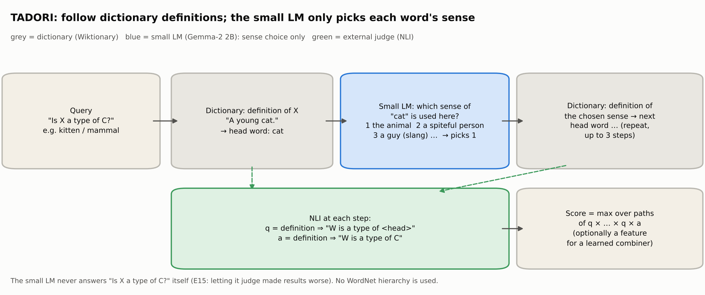
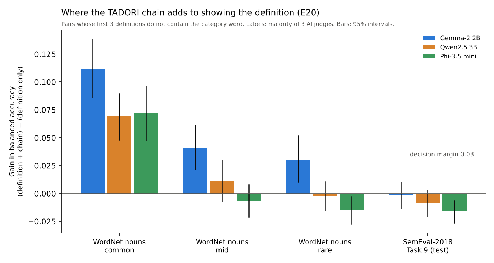

# AKANE Architecture experiments: checking a small LLM's answers from the outside

[](https://doi.org/10.5281/zenodo.24045799)

English | [日本語](README_ja.md)

**What this is:** experiments that keep a small language model (Gemma-2 2B) as the "mouth" and check its answers with parts placed outside it: rules, belief propagation (BP), retrieved evidence, dictionary definitions and a small NLI model. Each plan was fixed before its results, and ties and losses are reported as well.

**New here? In three lines.** Small AI models often answer "Is X a kind of Y?" wrongly and with confidence. We tried many ways to check such answers from outside the model; the one that kept working, **TADORI**, follows dictionary definitions step by step and lets the small model do only one easy job on the way (pick which meaning of a word is meant). It helps most where the dictionary does not state the answer directly, and it does not help everywhere; every result below says where it worked and where it did not. Terms are explained in [Terms used here](#terms-used-here).

**For researchers:** the method that remained, TADORI, is summarised in one section (definition, procedure, what was and was not shown, what was dropped): [TADORI (summary for researchers)](#tadori-summary-for-researchers).

**Main findings so far** (mostly one small model, Gemma-2 2B, with two more small models in E20; English; mostly one domain; see [Limitations](#limitations)):

- **A small model is a poor judge but a good helper.** Gemma-2 2B is often confidently wrong on "X is a type of Y". Checking its answer against dictionary definitions with an NLI model cuts the error measure (AURC, lower is better) from 0.154 to 0.070 (E6).
- **Give it only the narrow job it is good at (TADORI).** Chaining definitions (granddaughter → person → mammal) breaks when a word is read in the wrong sense. When Gemma only picks which sense of each word is meant, wrong-sense chains fall from 72% to 10%, and on 300 new items the chain check with a learner beats Gemma's own confidence (0.046 vs 0.118) (E7, E8, rechecked without hand-written lists). We call this check, following dictionary definitions and letting the small model pick only the sense of each word on the way, **TADORI** (Japanese for "tracing"; Tracing Along Definitions, Opting for the Right Interpretation). Following definitions and having a model pick word senses are both older ideas; what is new is how they are combined ([Related work](#related-work-and-what-is-different)).
- **Combining every signal in one learner helps; deeper chains and box embeddings alone do not (E11).** Gemma's answers, the dictionary chain, outside sentences and a box embedding in one gradient-boosting learner beat the learner on Gemma's answers alone on "is a type of" (0.017 → 0.004), part-whole (0.062 → 0.039) and disease (0.025 → 0.016); geography ties, and part-whole and disease tie under Gemini's labels.
- **Gemma's narrow job holds up at scale (E12).** On 34,402 WordNet definitions whose head word was sense-tagged by people, Gemma picks the meant sense 80.9% of the time (this is sense-choice accuracy, not the accuracy of TADORI's answers), against 60.5% for WordNet's first sense and 67.9% for embedding similarity, and the checks in E12-1 say this is not only memory.
- **Filling the chain's dead ends with outside sentences did not help (E14).** Generic sentences (GenericsKB) fill most of the gaps but add more wrong answers than they fix (0.063 → 0.140); Wikipedia is clean but fills too few (a tie). Most remaining misses fail at the chain's last step, the judgement "is this a kind of C". Letting Gemma make that judgement, even with every definition on the path shown, is worse than the current NLI (E15: 0.060 → 0.109).
- **Against people's labels, rare words and other small models (E17 to E20).** Against human ratings (HyperLex) and a human-made list (BLESS), TADORI did not beat a small model whose threshold was tuned well (E17 worse, E18 a tie). On rare words, simply showing the dictionary definition does most of the work (E19). On common words whose first three definitions do not name the category, adding the chain to the definition helps for all three small models tested (Gemma-2 2B, Qwen2.5 3B, Phi-3.5 mini: +0.07 to +0.11 balanced accuracy under every set of labels; +0.03 to +0.12 when the thresholds are tuned on other words, 73 of 75 checks pass). It does not carry over to all words, rare words, or SemEval-2018 Task 9 turned into yes/no pairs (E20). A learned combination is no better than a simple "or" (E20-1). [Details](#e17-to-e20-testing-tadori-on-human-labels-rare-words-and-other-small-models-2026-11-14)
- **Showing sentences that state the answer helps on part-whole questions (E10)**, whether they come from GenericsKB (0.068 → 0.039) or Gemma writes them itself (0.044, a tie).
- **The network (BP) did not become the main part.** BP that also doubts the model's rules beat counting violations in taxonomy and disease tests (E2-6, E2-8), but it did not beat a strong learner where labeled data existed (E3, E4, E9), and with no labels at all a plain average of five signals was as good or better (E13). The p-bit method and BP never differed in accuracy (E4, E13). Using the network's wobble to choose which answers TADORI checks looked better under WordNet labels but not under common-sense labels (E16).

Ties and losses are reported in every section. Two corrections (2026-11-11) changed earlier numbers; they are listed in [Corrections](#corrections-2026-11-11). A check of every experiment for settings chosen on the scored items is in [this check](#check-were-settings-chosen-on-the-same-data-they-were-scored-on-2026-11-14).


**Try it in 5 minutes (CPU only, no GPU).** This reproduces the E8 results from the model answers and NLI scores already saved in `data/`; running Gemma itself needs the Colab notebooks in `colab/`.

```bash
git clone https://github.com/mst-design2020/akane-e2-experiments.git && cd akane-e2-experiments/analysis/e8
pip install numpy scipy scikit-learn
python e8_analyze.py ../../data/E8_chains_nli.json out.json   # about 5 minutes; prints the AURC table, e.g. 0.037 for the learned chain check (this saved run used the original hand-written lists; without them it is 0.056, see analysis/nolist/)
```

`python check_formulas_e8.py ../../data/E8_chains_nli.json` (about 5 seconds) checks the code against the formulas below. Tested in a fresh Python 3.13 environment.

All experiments in one table: [Results at a glance](#results-at-a-glance). Each experiment's plan and results are in `plans/` (Japanese). Articles explaining each step (Japanese): [Articles](#articles-japanese).

Author: Masaya Kato (M.S.T. Design, Saiki, Oita, Japan) https://mst-design.jp/ · ORCID https://orcid.org/0009-0001-6803-654X · DOI https://doi.org/10.5281/zenodo.24045799

## Terms used here

| Term | Meaning in this repository |
|---|---|
| Small model, 2B, 9B | Gemma-2 with 2 or 9 billion parameters (E20 also Qwen2.5 3B and Phi-3.5 mini), used without fine-tuning |
| Yes−No logit | How much more the model leans to "Yes" than to "No" as its next word; larger means more sure of "Yes" |
| NLI model | A separate small model that judges whether one sentence follows from another (here DeBERTa-v3-large) |
| TADORI | The dictionary-chain check: follow definitions (kitten → cat → mammal), the small model only picks word senses, NLI judges each step |
| AURC | Average error rate when answers are given in order of confidence; lower is better (used up to E16) |
| BA, balanced accuracy | Average of "yes on true pairs" and "no on false pairs"; higher is better (E18 to E20) |
| Flag, rule | A pass/fail rule written in the plan before the run, e.g. "a difference of at least 0.03 with the lower end of the 95% interval above 0" |
| Tie | The difference did not meet the rule; it is not a win |
| Common-sense labels | Answers re-judged by AI models (Claude, Gemini, from E19 ChatGPT), not by people |
| BP, network | Belief propagation: passing evidence between linked claims in a network of rules (E2 to E16) |
| p-bit method | The same network sampled the way probabilistic bits would, run in software; never better than BP in accuracy |

## TADORI (summary for researchers)

TADORI is the check that survived E2 to E15. The other parts we tried (a network with BP, the p-bit method, deeper chains, outside sentences added to the chain) tied or lost and were dropped. What remained got a name. This section is meant to be read on its own; the detailed numbers stay in each experiment's section.

**Name.** TADORI is an acronym of **T**racing **A**long **D**efinitions, **O**pting for the **R**ight **I**nterpretation: follow the dictionary definitions and choose the right sense of each word on the way. It also reads as the Japanese word たどり (*tadori*, "tracing").



**In one paragraph.** TADORI checks a small model's answer to "Is X a type of C?" with a chain of dictionary definitions. The small model has exactly one job inside the chain: decide which sense of a word is meant in the definition it appears in. An external NLI model scores each step and whether the chain has arrived at C. The small model never judges "Is X a type of C?" itself.

**Inputs and outputs.**

| | Content |
|---|---|
| Input | The claim "X is a type of C." (X is a noun, C is one of 46 categories). The small model's own answer (its Yes−No logit $\ell$) is what gets checked; it is kept separately |
| Uses | A dictionary (English noun definitions from Wiktionary), a small model (Gemma-2 2B-it, no fine-tuning), an NLI model (DeBERTa-v3-large-mnli-fever-anli-ling-wanli) |
| Does not use | The WordNet hierarchy, hand-written word lists (none since 2026-11-11), or showing C to the small model |
| Output | A score $s_6 \in [0,1]$ for how well the definition chain supports "X is a type of C". It can be used alone or as one feature for a learned combiner |

**Procedure** (method D in [E6–E8: how the computation works](#e6e8-how-the-computation-works)).

1. Take the definition $d$ of each sense of X from the dictionary (in Wiktionary order, at most 8). From here on, $w$ is the word whose definition is being read: it starts as $w=X$ and becomes the chosen head word at each step. $W$ is $w$ with its first letter capitalised, as used in the hypothesis sentence.
2. Take the head noun $g$ of the definition (the root of spaCy's first noun chunk).
3. **Show the small model $d$ and the numbered definitions of $g$'s senses, and ask which sense of $g$ is meant in $d$.** C is not shown. The prompt is `Dictionary definition of "w": d` / `In this definition, which meaning of the word "g" is used?` / `1. … 2. …` (the senses of $g$ in dictionary order, at most 8) / `Answer with the number only.`, wrapped in Gemma's chat template. We take the logits of the tokens "1", "2", … at the first answer position, apply a softmax, and pick the highest. Nothing is generated.
4. With the external NLI model, compute the step score $q = e(d \Rightarrow \text{"W is a type of } g\text{."})$ and the arrival score $a = e(d \Rightarrow \text{"W is a type of C."})$. If $w$ is C itself, $a=1$. Here $e(\cdot)$ is the NLI entailment probability, the premise is `"w" means: d` and the hypothesis is `W is a type of g.` (or `C.`). For example, with $w$ = kitten and $d$ = "A young cat.", the premise is `"kitten" means: A young cat.` and the hypothesis is `Kitten is a type of cat.`
5. Repeat steps 2 to 4 from the definition of the chosen sense, up to 3 steps.
6. The score $s_6$ is the maximum over paths of $q_{n_0} \cdots q_{n_{t-1}}\, a_{n_t}$.

**What was shown.** Every result was judged by rules fixed before the run. Common-sense labels are by Claude; the main results were also labelled by Gemini. E19 and E20 used three AI judges (Claude, ChatGPT, Gemini) and their majority vote.

AURC is the average error rate when the most confident answers are given first; **lower is better**.

| Claim | Data and measure | TADORI | Baselines | Verdict (what improved) | Section |
|---|---|---|---|---|---|
| The small model is good at picking senses | Wrong-sense chains among paths of 2+ steps that reach C (Claude, blind to method) | 4/41 (10%) | No sense choice 36/50 (72%), embedding similarity 8/35 | Fewer wrong-sense chains | [E8](#e8-choosing-word-senses-along-the-chain-and-a-fresh-test-set) |
| Sense choice holds up at scale | 34,402 head words in WordNet definitions, agreement with human sense tags (Princeton Gloss Corpus) | 80.9% | Similarity 67.9%, WordNet first sense 60.5% | Higher sense-choice accuracy (Gemma − similarity +13.0 points, 95% interval 10.3 to 16.3) | [E12](#e12-does-gemmas-sense-choice-hold-up-at-scale-2026-11-12) |
| It is not only memory | 5,000 items with the defined word hidden or the text paraphrased | Hidden 80.8%, paraphrased 69.3% | First sense 59.3% | Accuracy survives hiding and paraphrase (paraphrased − first sense +10.0, 3.4 to 17.0) | [E12](#e12-does-gemmas-sense-choice-hold-up-at-scale-2026-11-12) |
| It can check the small model's answers | 300 fresh items never used for any choice, AURC (lower is better) | 0.046 (chain + learner) | The small model's own confidence 0.118 | Better at finding the small model's errors (95% interval 0.038 to 0.112) | [E8](#e8-choosing-word-senses-along-the-chain-and-a-fresh-test-set), [recheck](#recheck-without-hand-written-word-lists-2026-11-11) |
| It helps as a feature with other signals | 700 items, AURC (lower is better), gradient boosting | 0.038 (all signals) | Learner on the small model's answers only 0.053 | Adding it to a learner finds errors better (5 of 5 runs) | [E11](#e11-fixing-e8s-weak-points-and-combining-every-signal-2026-11-12) |
| Where the definition does not name the category, the chain adds to the definition (common words, three small models) | Common-word pairs whose first three definitions do not contain the category; balanced accuracy (higher is better); majority of 3 AI judges | Definition + chain (SO): Gemma 0.880, Qwen 0.881, Phi 0.887 | Definition only (S): 0.769, 0.811, 0.815 | +0.111, +0.069, +0.072; all three models under every set of labels. Thresholds tuned on other words: +0.08 to +0.12, +0.03 to +0.09, +0.04 to +0.09 (25, 23 and 25 of 25 checks pass) | [E20](#e17-to-e20-testing-tadori-on-human-labels-rare-words-and-other-small-models-2026-11-14) |

**What was not shown.**

- That TADORI beats a single dictionary step (E6). On 700 items the scores are 0.063 vs 0.069, and on the 300 fresh items the interval crosses 0. Its strengths are fewer wrong-sense chains and its value as a feature for a learner. The chain score alone has not been shown to beat one step.
- 80.9% is the **accuracy of sense choice** on WordNet definitions. It is not the accuracy of TADORI's answers. E8 uses Wiktionary, which splits senses differently.
- Up to E19 only one small model (Gemma-2 2B) was tested. E20 added Qwen2.5 3B and Phi-3.5 mini: the chain's gain on common words held for all three, but over all words it met the rule for only one of three. Only English, mostly the "is a type of" question; other dictionaries and languages are untested.
- That TADORI improves on a small model when judged against human ratings (HyperLex: worse in rank correlation, E17), a human-made list (BLESS: a tie, E18) or the public SemEval-2018 Task 9 benchmark (0 of 3 models, E20).
- That the chain adds to showing the definition on rare words (E19: a tie; E20: cannot be claimed). On rare words the definition alone is usually enough (E20-1).
- Common-sense labels come from AI models (Claude and Gemini; from E19 also ChatGPT), not from people.

**What we tried and dropped** (each tied or lost).

| Direction | Result | Decision | Section |
|---|---|---|---|
| Combine with a network (BP), add penalties for incompatible categories | 0.091 vs the strongest path 0.047 (worse); the penalty weight was 0 in 23 of 25 runs | No network | [E8](#e8-choosing-word-senses-along-the-chain-and-a-fresh-test-set) |
| The p-bit method | Never differed from BP in accuracy | No role for accuracy (speed and power not measured) | [E4](#e4-a-large-memory-network-with-many-loops-bp-and-the-p-bit-method), [E13](#e13-without-any-labels-does-a-network-combine-conflicting-signals-better-2026-11-12) |
| Deeper chains, 3 to 6 steps | 0.063 vs 0.063 (tie) | Depth is not pursued. Chains stop at dictionary dead ends, not at the step limit | [E11-2](#e11-fixing-e8s-weak-points-and-combining-every-signal-2026-11-12), [E14](#e14-filling-the-chains-dead-ends-with-outside-sentences-2026-11-12-to-11-13) |
| Fill dead ends with outside sentences (GenericsKB, Gemma's own, Wikipedia) | 0.063 → 0.140 (GenericsKB, worse); Wikipedia ties | Adding sources is not pursued | [E14](#e14-filling-the-chains-dead-ends-with-outside-sentences-2026-11-12-to-11-13) |
| Let the small model judge the last step "is it a type of C" (with every definition on the path shown) | 0.060 → 0.109 (worse); no better than showing an unrelated path (0.102) | Keep the external NLI judge | [E15](#e15-letting-gemma-judge-the-chains-last-step-2026-11-13) |
| Let the small model choose the parent word | 0.062 vs 0.060 (tie) | Keep the current head noun | [E15](#e15-letting-gemma-judge-the-chains-last-step-2026-11-13) |
| A TADORI veto on the small model's "yes" (BLESS) | 0.910 vs 0.902 (tie, below the 0.03 bar) | Not pursued | [E18](#e17-to-e20-testing-tadori-on-human-labels-rare-words-and-other-small-models-2026-11-14) |
| Look at the chain only when the model hesitates | Equal or slightly worse than always looking; the chain is still consulted for 85% to 95% of pairs | Always look | [E20](#e17-to-e20-testing-tadori-on-human-labels-rare-words-and-other-small-models-2026-11-14) |
| Learn how to combine definition and chain (logistic regression) | −0.008 to +0.007 against the simple "or" (tie, 0 of 3 models) | Keep the "or" | [E20-1](#e17-to-e20-testing-tadori-on-human-labels-rare-words-and-other-small-models-2026-11-14) |

E15 shows that a 2B model makes a poor final judge. It does not undo TADORI's division of labour. A larger model might behave differently: LORex reports gains from showing the path with 8B-class models.

**Relation to prior work.** Each part has been done before:

- following head words of dictionary definitions (Chodorow et al. 1985, Véronis and Ide 1991, Rigau et al. 1998, OntoLearn Reloaded 2013);
- having a model pick a sense from a list of definitions (Meconi et al. 2025);
- checking a model's answers with an external judge (ConCoRD 2022, BTProp 2025).

TADORI combines them and uses the small model only to choose senses along the way, not to judge. We did not find this combination in the work we surveyed, but we may have missed some. The difference from BTProp: BTProp links the model's own answers in a network, while TADORI follows an outside dictionary and uses no network.

**Where to find the exact implementation.** The dictionary is the full Wiktionary dump (enwiktionary-latest-pages-articles, fetched 2026-11-10). Its text is CC BY-SA, so it is not stored here; the notebook downloads it again. The code is in these places:

- the head noun: `genus` in `analysis/e8/e8_core.py`;
- the prompt: `choice_prompt` in the same file;
- the NLI sentences: `premise` and `hyp` in the same file;
- the sense-choice cell: `analysis/nolist/build_notebook_E8n.py` (notebook `colab/E8n_nolist_recheck.ipynb`);
- the chain score: `analysis/nolist/e8n_analyze.py`.

All formulas and their code locations are in [E6–E8: how the computation works](#e6e8-how-the-computation-works).

**Notes for reading these results.**

- The common-sense labels come from AI models (Claude and Gemini; ChatGPT as well from E19), not from people. The 300 fresh items were also labelled by Claude.
- The 80.9% (E12) is sense choice on WordNet. It is not directly comparable with the accuracy of TADORI's answers, which uses Wiktionary.

**Run it.** To run it from saved outputs on a CPU, use `cd analysis/nolist; E8_DIR=../e8 python e8n_analyze.py ../../data/E8n_chains_nli.json out.json`. Method D is TADORI, and it takes about 5 minutes. To run the large sense-choice test, use `cd analysis; python e12/e12_analyze.py ../data/E12/e12_items_all.json.gz ../data/E12/e12_local.json.gz ../data/E12/E12_results.json.gz out.json`, which takes a few seconds. The small model's sense choice itself is in `colab/E8_sense_choice.ipynb` and in `choice_prompt` in `analysis/e8/e8_core.py`. The figure above is drawn by `analysis/tadori/fig_tadori.py`; it is a schematic and shows no numbers.

**Citation.** To cite it, please use this repository's DOI (https://doi.org/10.5281/zenodo.24045799, `CITATION.cff`).

## AKANE Architecture in short

The idea is to use a language model as the "mouth" and to place the checking outside the model. The model answers first. Then an outside system checks whether the answers are consistent with a large memory and with rules. In the long run, we want to hand this checking computation to physical parts such as p-bits (probabilistic bits that flip between 0 and 1).
The experiments here test the smallest version of that outside checker. **They study components of AKANE; they do not test the whole architecture** (see [What is and is not shown](#what-is-and-is-not-shown)). More about the overall research: https://mst-design.jp/research/ (Japanese)

## What is and is not shown

**Scope.** Only one part of AKANE: checking a small model's answers with parts placed outside it (rules, networks, evidence, dictionaries, NLI). Mostly one small model (Gemma-2 2B; E20 also Qwen2.5 3B and Phi-3.5 mini), English, mostly "X is a type of Y" (also part-whole, disease and geography). The p-bit method is simulated on a PC. Real p-bit hardware, speed or power, building up or updating a large memory, and the performance of the whole architecture have not been tested at all.

**Shown** (a difference under rules fixed before the run, and still there after the recheck without hand-written lists)
- Checking with dictionary definitions and NLI beats Gemma's confidence alone (E6: AURC 0.154 → 0.070; without lists, on 300 new items: chain + learner 0.046 vs confidence 0.118, 95% interval of the difference 0.038–0.112).
- Giving Gemma only the job of picking word senses cuts wrong-sense chains (72% → 10%, E8 recheck). On 34,402 human-tagged definitions it picks 80.9%, above similarity 67.9% and first sense 60.5% (E12: Gemma − similarity +13.0 points, 95% interval 10.3–16.3), and not only from memory (E12-1).
- Putting every signal into one gradient-boosting learner beats the learner on Gemma's answers alone (E11-2: 0.053 → 0.038, 5 of 5; E11-3: "is a type of", part-whole and disease; part-whole and disease tie under Gemini's labels).
- On part-whole questions, showing a sentence that states the answer before the question helps (E10-2: 0.068 → 0.039, 5 of 5).
- BP that also doubts the rules beats counting violations (E2-6, E2-8, at least 8 of 10).
- On rare words, showing a small model the dictionary definition (with or without the chain) beats the small model alone and Gemma-2 9B alone (E19: +0.07 to +0.13 over 2B under WordNet, three AI judges and their majority).
- Where the definition does not name the category, the chain adds to the definition on common words for three small models (E20: +0.07 to +0.11 under every set of labels).

**Not shown**
- That the network (BP) or the p-bit method beats a strong learner. Where labeled data existed, it never did.
- That p-bits are faster or use less power. No hardware was measured.
- That the results carry over to other models (larger ones, other vendors), other languages or other domains.
- Commonsense labels come from AIs (Claude and Gemini; from E19 also ChatGPT), not people, and items where they disagree have not been checked by people.
- That AKANE as a whole beats other ways of checking.

**Lost or tied** (all in [Results at a glance](#results-at-a-glance))
- Against BTProp: with the original links BTProp is better or tied, and with links from real models our rule-doubting BP is never better (E2-10 to E2-12).
- A large loopy network collapses, and a cautious one only ties features + learner (E4). The network loses to a gradient-boosting learner (E9-3) and, with no labels, ties a plain average (E13).
- Deeper chains, box embeddings alone, and filling dead ends with outside sentences all tie or are worse (E11-2, E14). Letting Gemma judge the chain's last step is worse, and letting it choose the parent word changes nothing (E15).
- Sending the claims where the sampled network wobbles from conflicting rules to TADORI beats a tree learner only under WordNet labels; under common-sense labels it wins only at a 1% budget, and it loses on disease and geography (E16).
- E10's "it works on other questions" did not repeat on new items chosen by rule (E10-1).
- Against human ratings (HyperLex) TADORI is worse than 2B alone, and on BLESS its veto ties (E17, E18). Over all words, on rare words and on SemEval-2018, adding the chain to the definition cannot be claimed (E20); a learned combination ties the simple "or" (E20-1).
- The 2026-11-11 audit (a stronger learner, no hand-written lists) removed some numbers and some "clearly better" claims ([Corrections](#corrections-2026-11-11)).

## Repository map

```
plans/      plan and results of each experiment, with the rules fixed before the run (Japanese)
colab/      notebooks that query Gemma (Google Colab, GPU)
data/       saved Gemma answers and NLI scores (enough to redo the analysis without a GPU)
analysis/   analysis code (CPU), including check_formulas*.py, which checks the code against the formulas
results/    output JSON and figures
figures/    figures used in this README
```

Details in [Layout](#layout); commands in [Rerunning the analysis](#rerunning-the-analysis).

**What can be reproduced.** "From saved data" means the analysis can be redone on a CPU from the files in `data/` and `results/`. "From Gemma" means a Colab notebook reruns everything from querying Gemma.

| Exp. | From saved data (CPU) | From Gemma (Colab GPU) |
|---|---|---|
| E2-2, E2-3 | partly: Gemma's answers are in `data/`; analysis and figures are inside the notebook | yes, T4 |
| E2-4 to E2-9 | yes, `analysis/` | yes, notebooks for E2-4, E2-5, E2-7, E2-8 |
| E2-10, E2-11 | yes, fetches BTProp's published logs | not needed (uses the published logs) |
| E2-12 | yes, from the judgements in `results/E212/` | yes, about 30 min on a T4 |
| E3 | no: HoVer text (CC BY-SA) is not included, so run the notebook | yes, about 4 h on an L4 |
| E4, E5 | yes (E4-0 takes about 20 min) | yes, E4-1 and E4-2 notebooks |
| E6 to E8, recheck without lists | yes | yes, L4 (the notebook refetches definitions) |
| E9 | yes | yes, E9-1 notebook |
| E10 | yes | yes |
| E11 | yes (E11-2's box takes about 30 min on a CPU and drifts slightly between runs) | yes |
| E12 | yes, seconds; matches `results/E12/` exactly | yes |
| E13 | yes, about 15 min; matches `results/E13/` exactly | not needed (reuses earlier answers) |
| E14 | yes; E14-1 to E14-3 match exactly, E14 differs only in the learner's box | yes |
| E15 | yes, seconds; matches `results/E15/` exactly | yes, L4, about 30 minutes |
| E16 | yes, CPU; E16-1 about 20 minutes, E16-2 about 15 minutes; the common-sense step matches `results/E16/E161d_out.json` exactly | E16-0 only: yes, L4 |
| E17, E18 | summaries only (`results/E17/`, `results/E18/`): HyperLex and BLESS pairs are not redistributed; the analysis scripts run on the notebook output | yes, L4 (build the notebook with `analysis/e17/`, `analysis/e18/` builders) |
| E19, E20, E20-1 | yes, seconds; the judge step and E20-1 match `results/E19/judge/`, `results/E20/` exactly | yes, L4 (E20 about 2 to 3 hours; builders in `analysis/e19/`, `analysis/e20/`) |

Running Gemma needs your own Hugging Face token.

## Corrections (2026-11-11)

Both corrections were found by our own audit. The numbers in the findings above already use the corrected runs.

- **Correction (2026-11-11): the learned baselines were all linear.** Every "features + learning" baseline in E2 to E8 was logistic regression. Redoing them with a tree-based learner (gradient boosting, `analysis/audit_gb/`) changes three statements: E2-7 (taxonomy: BP's win becomes a tie; geography: BP now loses to the learned combination), E4-2 (the cautious network loses under WordNet labels) and E7 (adding chain scores is no longer clearly best). E8's result holds. Details are marked "Audit (2026-11-11)" below.
- **Correction (2026-11-11): hand-written word lists.** E7, E8 and the real dictionary check used in E9-1 to E9-3 picked each definition's head noun with hand-written word lists (`PERSON_HEADS`, `OF_HEADS`, `META` and two fixes: for example "one who …" → person, "a kind of X" → X; audit: `plans/audit_hand_lists.md`). We reran them without any such list: head-noun candidates come from grammar only (the head of the first noun chunk and the object of its "of"), and the NLI score of the step chooses among them (`analysis/nolist/`). The rules for "holds" were fixed before the runs. **Held:** Gemma's sense choice cuts wrong-sense chains (72% → 10%), the chain + learner beats Gemma's confidence on the 300 new items (0.046 vs 0.118), chaining breaks fewer right answers (40% → 31%), and every E9 conclusion about the network. **Not held:** the chain scores (0.047 → 0.063 without training, 0.037 → 0.056 learned), the clear gain over E6's features with gradient boosting (only 3 of 5 splits by 20%), the dictionary's hit rate on true claims (88% → 83%), and E9-3's "checking every claim with the dictionary is best" (now best in 1 of 12 conditions; gradient boosting is better). Details: [Recheck without hand-written word lists](#recheck-without-hand-written-word-lists-2026-11-11).

## Check: were settings chosen on the same data they were scored on? (2026-11-14)

After an outside review (ChatGPT and Gemini read this README), we checked every experiment for one common mistake: choosing a threshold, weight or setting on some items and then reporting results on the **same** items. That makes a method look better than it is. Result: two places did this, both in E19 and E20, and both were rechecked on held-out words; the results held. Everywhere else the setting was chosen on separate items, or nothing was tuned.

| Exp. | Where settings were chosen | Where results were measured | Same items? |
|---|---|---|---|
| E2-2 to E2-9, E2-10 to E2-12 | 20% of words, cities, diseases or responses | the other 80% (5 splits) | no |
| E3 | the network has no tuned settings; the learner uses 5 folds | the held-out fold | no |
| E4, E5 | 20% of nouns (rule weights, bias correction, the grid in (7)) | the other 80% (5 splits) | no |
| E6 to E8, E8n | 4 folds by noun (network strengths, learners) | the fifth fold; the 300 new items were never used for any choice | no |
| E9 to E9-3 | the training part of each split | the unchecked claims of the evaluation part | no |
| E10 to E10-3, E11-3 | 20% of entities | the other 80% (5 splits) | no |
| E11-1, E12, E12-1 | nothing tuned (accuracy of fixed methods) | all items | – |
| E11-2, E14 | learners: 4 folds by noun | the fifth fold, and the 300 new items | no |
| E12-2 | the confidence threshold on half of the head words | the other half | no |
| E13 | nothing tuned (no labels). The reference "pick the best signal with 20 labels" is scored on all items including those 20 (a small advantage to the reference, not to the network) | all items | 20 items |
| E15 | nothing tuned; methods fixed before | E10-3's 600 items (E8's 1,000 were only looked at) | no |
| E16 | network weights and learners: 4 folds | the held-out folds, joined | no |
| E17 | learners: the official train+dev split | the official test split | no |
| E18 | thresholds on HyperLex | BLESS | no |
| E19 | thresholds on the common bucket | all buckets; **common bucket = same words** | **yes → rechecked on held-out words: holds** |
| E20 | thresholds on W's common bucket, SemEval's tuning half | all buckets, SemEval's other half; **W common = same words** | **yes → rechecked on held-out words: holds (Qwen's gain shrinks)** |
| E20-1 | the logistic regression: same places as E20 | the same comparisons as E20 | as E20 (only ties were found) |

What this check does not cover: E8's 700 items, E4-2's answers and E10's items were reused across several later experiments (listed in [Limitations](#limitations)), so later designs were made knowing earlier results on the same items. The fresh 300 items (E8) and E10-3's 600 items (E15) are the guards against this.

## Articles (Japanese)

Every number in the articles below comes from files in this repository. Articles (Japanese):

- Article 1: E2-2 and E2-3, rules written by a person. https://note.com/mst_design2020/n/n28ced8c9549d
- Article 2: E2-4 to E2-7, rules written by the model itself. https://note.com/mst_design2020/n/n5d7de09a97f2
- Article 3: E2-8 and E2-9, a third domain and more wrong rules. https://note.com/mst_design2020/n/n0cddc2e4f209
- Article 4: E2-10 and E2-11, the same test as BTProp. https://note.com/mst_design2020/n/ne9eea6736480 (Zenn: https://zenn.dev/mst_design2020/articles/8b904689df2ddc)
- Article 5: E2-12, links made by real models. https://note.com/mst_design2020/n/n1af3e4380f0c (Zenn: https://zenn.dev/mst_design2020/articles/bc3e1c916a4baa)
- Article 6: E3, evidence and abstention. https://note.com/mst_design2020/n/nf427df9ee49d (Zenn: https://zenn.dev/mst_design2020/articles/c1537032d8943c)
- Article 7: E4, a large network learned from the model's answers. https://note.com/mst_design2020/n/nd323ba54cf92
- Article 8: E4 (second half) and E5, re-checking the answer key and the cost of the model's own rules. https://note.com/mst_design2020/n/n222a0ecf386d (Zenn, E4 and E5: https://zenn.dev/mst_design2020/articles/545424bd00f46f)
- Article 9: E6 to E8, dictionary definitions and word senses. https://note.com/mst_design2020/n/nde0fb5abc0aa (Zenn: https://zenn.dev/mst_design2020/articles/5d3feab2c2fff8)
- Article 10: E9 and E10, the network's role and outside checks on other questions. https://note.com/mst_design2020/n/ndb76756d6b3e (Zenn, E9: https://zenn.dev/mst_design2020/articles/804eba1639b569; E10: https://zenn.dev/mst_design2020/articles/50e211cbd882af)
- Article 11: E11, combining every signal in one learner. https://note.com/mst_design2020/n/n8ca2afb0ac35 (Zenn, E11 to E14: https://zenn.dev/mst_design2020/articles/8ac3114ae8cf58)
- Article 12: E12 to E14, word-sense choice on 34,000 items, combining without labels, and filling dead ends. https://note.com/mst_design2020/n/nd15d73345722 (Zenn: same as Article 11)
- Article 13: E15 and TADORI, the last step judged by the small model, and naming the method. https://note.com/mst_design2020/n/n4a4123b34fd6 (Zenn: https://zenn.dev/mst_design2020/articles/fc03d9c1a5763b)
- Article 14: E17 to E20-1, where TADORI helps (human labels, rare words, other small models, and the review checks). https://note.com/mst_design2020/n/n1f1871868858 (Zenn, E16 to E20-1: https://zenn.dev/mst_design2020/articles/45f9359416b8e5)

## E2: rules written by the model, checked with belief propagation

**In short:** A small LLM writes its own consistency rules, some of them wrong. A network then checks the LLM's answers against those rules while also doubting each rule, using belief propagation. This is close to BTProp (Hou et al., NAACL 2025). The difference is that the rules come from the LLM itself and the network estimates which rules to trust, without labels. In E2-10 to E2-12 we ran both on BTProp's own released trees. With the original links BTProp is better or tied. When links are flipped at random (E2-11) the rule-doubting network holds up better, but when the links are made by real models (three NLI models and Gemma, E2-12) BTProp barely degrades and the rule-doubting network is never better. We do not claim our method beats BTProp. E2 is closed here (summary in `plans/E2_summary.md`, Japanese). E3 asked whether a network over retrieved evidence helps the model abstain; it tied with the model's own confidence and lost to a simple learned combination of NLI scores (see E3 below). E4 joined thousands of the model's answers about WordNet categories into one large network with many loops: it did not beat a simple learned combination of features, and BP and the p-bit method never differed in accuracy (see E4 below).

A small language model (Gemma-2 2B) answers many true/false statements. The statements are linked by rules, and we try to find which of the model's answers are wrong by looking at the whole network of answers.

### What the E2 experiments do

- Example statements: "Paris is a city in France." "France is a country in Europe." "Paris is located in Europe."
- Example rules: "If A is a kind of B and B is a kind of C, then A is a kind of C." "Nothing is both a plant and an animal."
- Signals compared for flagging wrong answers: the model's own confidence; counting rule violations; MaxSAT; loopy belief propagation (BP); a software simulation of p-bits (Gibbs sampling, called "揺れ" in the code). E2-7 adds paraphrase inconsistency, neighbor consistency (a simplified form of Xu et al. 2026), and a logistic-regression ensemble of these signals.
- Metric: AUROC for detecting the model's wrong answers. 20% of the words or cities are used for tuning and 80% for evaluation. There are 5 splits × 2 p-bit seeds, so 10 runs.
- Decision rule, fixed before each experiment: A "wins" over B if the mean AUROC difference is at least 0.02 and A is higher in at least 8 of 10 runs. A difference below 0.02 is a "tie".
- E2-10 and E2-11 differ: they use BTProp's released belief trees and ChatGPT confidences instead of Gemma, detect false statements in FactCheckGPT and WikiBio, split by response (20% tuning), tune by AUROC on the tuning part, compute exactly on the trees (no p-bits), and use 5 runs with the rule "at least 0.02 and higher in at least 4 of 5". Details in `plans/E2-10_btprop.md`.

The plan for each experiment was written and fixed before seeing its results. The plans and results are in `plans/` (Japanese). Ties and losses are reported too.

## How the computation works

This section writes down what the code computes. `analysis/check_formulas.py` checks the code against these formulas (see the end of this section). The formulas for E6–E8 are in [E6–E8: how the computation works](#e6e8-how-the-computation-works).

**Inputs from the model.** For each statement $i$, the model is asked "Is the following statement true? Answer Yes or No only." and we keep $s_i$ = (logit of "Yes") − (logit of "No") at the first answer token. For each pair of labels $k$ (for example "plant" and "animal"), the model is asked an exclusion question in both orders, and $z_k$ is the mean of the two Yes−No logits. From E2-5 on, the wording is "Is it true that no plant is an animal? Answer Yes or No only." (wording P2). For wordings where "No" means exclusion (E2-4, and P0/P1 in E2-5), the sign is flipped, so that always $z_k > 0$ means the model says the two labels never hold together.

**Calibration (on the tuning 20% only).** $\ell_i = (s_i - \beta)\cdot 2/\sigma$, where $\sigma$ is the standard deviation of $s$ on the tuning statements and the threshold $\beta$ is the one (among 97 quantiles) that gives the best accuracy on them. The model's answer is $m_i = [\ell_i > 0]$ and its confidence is $c_i = |\mathrm{sigmoid}(\ell_i) - 1/2|$. For the rules, $\zeta_k = 2 z_k/\sigma_z$, with $\sigma_z$ the standard deviation of $z$ over all label pairs.

**The network.** Each statement has a variable $x_i \in \{0,1\}$ (1 = true). In the rule-doubting network (E2-6 to E2-9), each label pair also has a variable $u_k \in \{0,1\}$, where $u_k = 1$ means "this exclusion rule does not hold". The network is the probability distribution

$$
P(x,u) \propto \exp\Big( \lambda \sum_i \ell_i x_i - \lambda r \sum_k \zeta_k u_k - W \sum_{(a,b,c)\in C} x_a x_b (1-x_c) - W \sum_k \sum_{(a,b)\in I_k} x_a x_b (1-u_k) \Big)
$$

- $C$: chaining rules written by a person, "if $a$ and $b$ then $c$" (for example "$w$ is a kind of $B$" and "$B$ is a kind of $Z$" give "$w$ is a kind of $Z$"). These are always correct.
- $I_k$: all pairs of statements that put the same word (or the same class) under the two labels of pair $k$. If both are true, the exclusion rule $k$ is broken unless $u_k = 1$.
- The second term makes $u_k = 1$ unlikely when the model was confident that the labels exclude each other ($\zeta_k$ large), and likely when it said they can overlap. So the model's rule answers are a starting belief, and the answers to the statements can overturn a rule.

The network that fully trusts the rules (E2-2 to E2-5, and the "trusting BP" in E2-9) has no $u$: its exclusion term is $-W \sum_{(a,b)\in E} x_a x_b$, where $E$ is the union of the $I_k$ taken as true. In E2-2, E2-3 and the human-rule runs of E2-4 these are the exclusions written by a person (flipped at random in the corrupted runs); otherwise they are the pairs with $z_k > 0$. (The E2-4 run "Bw" instead keeps every pair and multiplies its $W$ by the model's probability of exclusion.)

**Signals for "this answer is wrong" (higher = more suspicious).**
- Model's confidence: $-c_i$.
- Counting: $v_i - c_i/10$, where $v_i$ is the number of rules (chaining rules and exclusions with $z_k>0$, all taken as true) that the model's answers $m$ break and that involve statement $i$. The small $c_i/10$ term only breaks ties.
- BP: loopy sum-product belief propagation on $P$ (damping 0.5, at most 200 iterations, tolerance $10^{-6}$) gives $q_i \approx P(x_i = 1)$. The signal is $1 - q_i$ if $m_i = 1$, and $q_i$ if $m_i = 0$.
- p-bit simulation ("揺れ"): the same $P$ sampled by Gibbs sampling (graph coloring, 10 chains, 100 burn-in sweeps, then 400 sweeps averaged) gives $q_i$; the signal is built in the same way as for BP. Each update sets $x_i = 1$ with probability sigmoid(change in the exponent above), which is how a p-bit behaves. The rules here link three variables at a time, so real p-bit hardware, which usually links pairs, would need extra wiring.
- MaxSAT: the most probable assignment of $P$ (weights rounded to integers: $100\lambda|\ell_i|$ for each statement, $100\lambda r|\zeta_k|$ for each rule variable, $100W$ for each rule), solved with RC2. The signal is $[\text{MaxSAT changes } m_i] - c_i/10$.

**Tuning.** For BP, p-bits and MaxSAT separately, $(\lambda, W, r)$ is chosen from $\{0.5,1,2\}\times\{1,2,4\}\times\{0.5,1,2\}$ ($r$ only when rules are doubted) by the accuracy of the thresholded result on the tuning statements. Counting has no parameters. The tuning statements are all statements about 20% of the words, cities or diseases, and AUROC is measured on the rest.

**E2-9.** The rule answers are replaced by $\pm|z_k|$ with the sign set by the ground truth, and then a random fraction $f$ of the label pairs (seed $10000 + \text{split}$) have their sign flipped.

**Checking the code against these formulas.** `cd analysis; python check_formulas.py` (about 1 minute) builds 40 small random networks, computes the exact probabilities by enumerating every assignment of the formula above, and compares them with the code used in the experiments. Result: BP matches exactly on tree-shaped networks (difference 0.0000) and differs by at most 0.019 on networks with loops, as expected for loopy BP; the p-bit simulation differs by at most 0.003 (sampling noise); MaxSAT always finds the most probable assignment.

## Results at a glance

Split into five stages following the course of the work. Each stage starts with its rule for a "difference"; every rule was fixed in the plan before the run. 95% intervals come from resampling by item noun (or head word). AURC differences are "this method − the comparison", so negative is better.

**Why the rules differ between experiments.** None of them is a formal statistical test; each is a practical rule fixed in the plan before the run, and it changed with the measure and the item set.
- E2 to E9-2 use a fixed gap of 0.02. The measures there ranged from about 0.03 to 0.85, where 0.02 could separate methods.
- From E9-3 on, true claims are rare (4.9%) and AURC values shrink to about 0.001–0.02, where a fixed 0.02 gap can never be met. The rule became "at least 20% of the other value" (the E9-3 section records that this was changed before the runs), and later experiments kept it.
- From E11 on, many comparisons use no learner and so have no splits (chain scores, sense-choice accuracy). With no runs to count, a 95% interval from resampling takes the place of the count.
- "Win" and "difference" mean the same thing.

**What the 95% intervals cover.** The spread of the difference when the items (item nouns, or head words) are drawn again with replacement 1,000 times. Both methods are compared on the same draw each time (a paired bootstrap). Variation from data splits and random seeds is not in these intervals; that is what the "4 of 5 runs" rules check.

### Stage 1: rules written by the model, checked with belief propagation (E2-2 to E2-9)

Rule: a "win" needs a mean AUROC gain of at least 0.02 over 10 runs and a higher score in at least 8 of 10.

| Exp. | What | Main result | Plan and results |
|---|---|---|---|
| E2-2 | Geography test (GeoNames, 3,586 statements), human rules | BP 0.83 vs counting 0.81: win, just at the threshold | `plans/E2-2_geo.md` |
| E2-3 | Taxonomy test (WordNet, 2,074 statements), human rules | BP 0.88 vs counting 0.85: win | `plans/E2-3_wordnet.md` |
| E2-4 | Rules written by the model; deliberately corrupted human rules | Model rules were 31% correct, giving a tie. Human rules with 10% flipped still win; at 20% it is a tie | `plans/E2-4_selfrule.md` |
| E2-5 | Choose the question wording on separate labels, then use it once | Rules 87% correct. BP 0.82 vs counting 0.81: tie (BP beats the model's confidence) | `plans/E2-5_wording.md` |
| E2-6 | Let the network also doubt each rule | BP 0.84 vs counting 0.81: win (8 of 10 runs) | `plans/E2-6_doubt_rules.md` |
| E2-7 | Repeat in geography; compare with other methods | Geography: BP 0.82 vs counting 0.80, tie. Taxonomy: BP beats the other methods when the combination uses logistic regression (0.844 vs 0.803); with gradient boosting the combination reaches 0.825 (gap 0.019, 8/10), a tie (checked 2026-11-11 with a gradient-boosting learner, `analysis/audit_gb/`). Geography: tie with the logistic-regression ensemble (0.817 vs 0.804); the gradient-boosting ensemble beats BP (0.851 vs 0.817, 8/10) | `plans/E2-7_geo_and_baselines.md` |
| E2-8 | Third domain (disease classes, Human Disease Ontology, 3,304 questions); the model also chooses which label pairs to check | Model rules 84% correct. Rule-doubting BP 0.76 vs counting 0.74: win (10/10). Pairs chosen by the model were 80% wrong; BP on them was slightly below BP on all pairs (tie by our criterion, but lower in all 10 runs) | `plans/E2-8_disease.md` |
| E2-9 | Same networks, only the fraction of wrong rules changes (0 to 50%; disease and taxonomy) | The BP-minus-counting gap stays about the same ("no change" by our criterion). BP that fully trusts the rules is better when rules are right and falls behind at 30% wrong. Extra check: without the human-written chaining rules, the gap grows with the wrong fraction in taxonomy (+0.03 to +0.09) | `plans/E2-9_wrong_rate.md` |

### Stage 2: the same test as BTProp (E2-10 to E2-12)

Rule: mean AUROC gain of at least 0.02 and better in at least 4 of 5.

| Exp. | What | Main result | Plan and results |
|---|---|---|---|
| E2-10 | Same test as BTProp (Hou et al., NAACL 2025): BTProp's released ChatGPT belief trees and confidences, scored on FactCheckGPT (631 claims) and WikiBio (921 sentences); only the final probability computation is swapped | BTProp's gain over the model's confidence is reproduced (+0.03 / +0.08). WikiBio: BTProp 0.80 vs our rule-doubting BP 0.77, BTProp wins (5/5). FactCheckGPT: 0.79 vs 0.80, tie | `plans/E2-10_btprop.md` |
| E2-11 | Same trees, a random fraction (0 to 50%) of the NLI links reversed | BTProp falls below the model's confidence at 20–30% wrong links (0.60–0.65 at 50%); rule-doubting BP stays near the confidence. Our BP wins from 20% (FactCheckGPT) and at 50% (WikiBio) | `plans/E2-10_btprop.md` |
| E2-12 | Same trees, links labeled by four real models (NLI small/base/large, Gemma-2 2B) | BTProp barely degrades (still above the confidence with Gemma). FactCheckGPT: all ties; WikiBio: BTProp wins for every link model (by 0.02–0.05). With natural link errors the rule-doubting BP is never better | `plans/E2-12_real_links.md` |

### Stage 3: evidence, a large network, and the cost of rule errors (E3 to E5)

Rule: AURC difference of at least 0.02 in at least 4 of 5.

| Exp. | What | Main result | Plan and results |
|---|---|---|---|
| E3 | Evidence (HoVer, 3,952 claims): can a network over retrieved evidence tell the model when to abstain? | Network ties the model's confidence and loses to NLI features + LR (AURC 0.225 vs 0.207 vs 0.177) | `plans/E3_evidence_abstain.md` |
| E4 | Thousands of the model's WordNet answers in one large network with many loops; BP vs the p-bit method | Large network collapses; a cautious network ties features + LR. BP and the p-bit method never differ in accuracy | `plans/E4-2_learned_net.md` |
| E5 | How much do errors in the model's own rules cost? | A cost under WordNet labels (0.02 to 0.04), almost none under common-sense labels; doubting the rules = trusting them | `plans/E5_rule_errors.md` |

### Stage 4: checking with dictionary definitions (E6 to E9)

Rule: E6 to E9-2, AURC difference of at least 0.02 in at least 4 of 5 (rates: 10 points). E9-3: a difference of at least 20% of the other value in at least 4 of 5.

| Exp. | What | Main result | Plan and results |
|---|---|---|---|
| E6 | Dictionary definitions + NLI against the model's confident errors (700 items) | 75% of confident errors fixed; AURC 0.154 → 0.070; but 40% of right two-step answers broken | `plans/E6_dictionary.md` |
| E7 | Chain definitions up to three steps | Fewer right answers broken (40% → 29%), but 30 of 50 chains go through a wrong sense; BP ties the path product. Without hand-written lists: 40% → 31%, holds ([recheck](#recheck-without-hand-written-word-lists-2026-11-11)) | `plans/E7_chain_definitions.md` |
| E8 | The model picks each word's sense along the chain; negative evidence; 300 new items | Wrong-sense chains 64% → 4%; AURC 0.047 without training, 0.037 learned; network loses; new items 0.039 vs 0.118 for confidence. Without hand-written lists: 72% → 10%, 0.063, 0.056, new items 0.046 vs 0.118, 95% interval of the difference 0.038–0.112 ([recheck](#recheck-without-hand-written-word-lists-2026-11-11)) | `plans/E8_sense_choice.md` |
| E9 | Only a few claims can be checked by the dictionary; does the network spread the checks better than learning? (simulated checker, then the real one) | Beat logistic regression on the nouns that received a check (E9-1: 2% 0.072 vs 0.032), but tied gradient boosting (E9-2). Holds without hand-written lists ([recheck](#recheck-without-hand-written-word-lists-2026-11-11)) | `plans/E9-1_real_dictionary.md`, `plans/E9-2_strong_learner.md` |
| E9-3 | Same question on all 1,681 nouns × 46 categories (77,326 claims), rules only from the model's answers | Network loses to gradient boosting in all 13 conditions (10%: 0.0029 vs 0.0018); boosting finished by the network 0.0014, a tie by the rule. Without hand-written lists the network results hold, but checking every claim with the dictionary is no longer best ([recheck](#recheck-without-hand-written-word-lists-2026-11-11)) | `plans/E9-3_all_categories.md` |

### Stage 5: other questions, combining signals, the chain's dead ends (E10 to E15)

Rule: a difference of at least 20% of the other value in at least 4 of 5 (E10 series, E11-3). E11-1, E11-2, E13, E14, E15: at least 20% and a 95% interval that excludes 0. E12: at least 5 points and a 95% interval that excludes 0.

| Exp. | What | Main result | Plan and results |
|---|---|---|---|
| E10 | Does the dictionary check carry over to part-whole, disease and geography questions? | Chain better than confidence on part-whole and geography, worse on disease; but hand-chosen wholes and hand-written lists were used ([E10](#e10-do-outside-checks-carry-over-to-other-questions-part-whole-disease-geography)) | `plans/E10_other_questions.md` |
| E10-1 | Fixes set in advance, no hand-written lists, new items chosen by rule | Fixes make things worse; E10's gains do not repeat (one step vs confidence, part-whole 0.076 vs 0.068: tie) | `plans/E10-1_fixes_without_lists.md` |
| E10-2 | Show definitions or GenericsKB sentences in the prompt | Part-whole: sentences 0.068 → 0.039 (5/5); definitions 0.088 (worse); only common words gain | `plans/E10-2_show_resources.md` |
| E10-3 | Gemma's own sentences; the same resources on "is a type of"; keep only sense-matched sentences | Own sentences 0.044 vs GenericsKB 0.039: tie. "Is a type of": every resource ties with confidence. Sense filter: tie | `plans/E10-3_self_text_and_isa.md` |
| E11-1 | Gemma picks a noun's usual sense (2,000 WordNet nouns); E8's first step narrowed to that sense | Usual sense: Gemma 59% vs similarity 47% (+11.9 points, 95% interval 9.2–14.4). Narrowing the first step: 0.056 vs 0.063, a tie; worse on the 300 new items | `plans/E11-1_usual_sense.md` |
| E11-2 | Chains up to 6 steps; a box embedding learned from the chains; everything in one learner | Deeper: tie (difference 0.000, 95% interval −0.003 to 0.002). Box alone or filling: worse. Combined learner 0.053 → 0.038 (5/5), new items 0.042 → 0.031 | `plans/E11-2_deep_chain_and_box.md` |
| E11-3 | The combined learner on "is a type of", part-whole, disease and geography | Beats Gemma-only boosting on K (0.017 → 0.004), P (0.062 → 0.039) and D (0.025 → 0.016); G tie. Gemini's labels: P, D, G ties. Box adds nothing | `plans/E11-3_combine_on_other_questions.md` |
| E12 | Gemma picks the sense of a definition's head word, on 34,402 human-tagged WordNet glosses | Gemma 80.9% vs similarity 67.9%, first sense 60.5%, Lesk 35.9% (differences; Gemma − similarity +13.0 points, 95% interval 10.3–16.3) | `plans/E12_gloss_head_sense.md` |
| E12-1 | Is that only memory? Hide the word, paraphrase, ask for the rest of the gloss | Hidden 80.8%, paraphrased 69.3% (still above first sense 59.3%); flat across recall levels: not only memory | `plans/E12-1_memorized_or_not.md` |
| E12-2 | Coarse senses; switching on Gemma's confidence | Coarse 88.9%; 41% of misses in the answer's group. Confidence switch: tie; in the chain (300 new items) 0.056 vs 0.056: tie | `plans/E12-2_coarse_senses_and_abstain.md` |
| E13 | No labels: combine five disagreeing signals (mean, vote, Dawid–Skene, network) | Mean best (K 0.077, P 0.084, better than any single signal); network 0.091, a tie with the mean (network − mean +0.015, 95% interval −0.017 to +0.048): "the network's role is over". Dawid–Skene worse on P | `plans/E13_combine_without_labels.md` |
| E14 | Fill the chain's dead ends with GenericsKB and Gemma's own sentences (NLI judge) | 41 of 52 wrong "no"s filled, but 127 wrong "yes"s added: 0.140 vs 0.063, worse (difference +0.077, 95% interval +0.051 to +0.106) | `plans/E14_fill_gaps.md` |
| E14-1 | Same, Gemma as the judge | 0.124 vs 0.063: worse (difference +0.061, 95% interval +0.037 to +0.085) | `plans/E14-1_gemma_judge.md` |
| E14-2 | Wikipedia's first sentence, at most one per path | 0.063 vs 0.063 (difference 0.000, 95% interval −0.008 to +0.008; 300: 0.050 vs 0.056): tie; fills 12 of 52 | `plans/E14-2_wikipedia_first_sentence.md` |
| E14-3 | Wikipedia's whole lead (10 sentences) | 0.067 vs 0.063 (difference +0.004, 95% interval −0.008 to +0.015; 300: 0.049 vs 0.056): tie; fills 14 of 52 | `plans/E14-3_wikipedia_lead.md` |
| E15 | Gemma judges the chain's last step with the whole path of definitions shown / Gemma picks the parent word (checked on 600 "is a type of" items) | Last step: 0.109 vs 0.060, worse (difference −0.049, 95% interval −0.071 to −0.029); ties the unrelated-path control (0.102). Parent word: 0.062 vs 0.060, no change | `plans/E15_last_step.md` |

### Stage 6: looking for a use of the p-bit's wobble (E16)

| Exp. | What | Main result | Plan and results |
|---|---|---|---|
| E16-0 | Is Gemma weaker on reversed "is a type of" questions (a precondition for a reversal-curse network)? | No: forward 0.849 vs reverse 0.882 on the hard set; direction stopped | `plans/E16-0_reverse_questions.md` |
| E16-1 | Sample a rule network (Gibbs, as a p-bit would), read whether a claim wobbles from conflict or from ignorance, and send conflict cases to TADORI | Scored by WordNet, conflict order fixes more errors than the tree learner (5% budget: 960 vs 792). Re-scored by common sense on the claims where the two differ, it wins only at a 1% budget and loses at 2.5% and 5%. Mean-field gives the same readout, so nothing here needs a p-bit | `plans/E16-1_wobble_routing.md` |
| E16-2 | The same on disease and geography | Conflict order loses to every other selection, 0/5 at every budget | `plans/E16-2_disease_geography.md` |

### Stage 7: people's labels, rare words, other small models (E17 to E20-1)

Rule: a difference of at least 0.03 in balanced accuracy (E17: 0.05 in Spearman's $\rho$) and the lower end of its 95% interval above 0, resampled by word ("worse": the upper end below 0); E20 needs this for at least 2 of 3 small models. Claims are kept only when the answer table and the AI judges' labels agree. Details: [E17 to E20](#e17-to-e20-testing-tadori-on-human-labels-rare-words-and-other-small-models-2026-11-14).

| Exp. | What | Main result | Plan and results |
|---|---|---|---|
| E17 | HyperLex: 2,163 noun pairs rated by people (0 to 6); does TADORI bring 2B closer? | Spearman: 2B 0.832, TADORI (2B where no entry) 0.795: worse (−0.037, −0.054 to −0.021). 9B 0.852. With a learner: tie (+0.014) | `plans/E17_hyperlex.md` |
| E18 | BLESS: does a TADORI veto stop "yes" to parts, reversed pairs, siblings? (thresholds from HyperLex) | 2B 0.902, ask the reverse 0.903, veto 0.910 (tie, +0.009), 9B 0.958. A tuned 2B already says "yes" to only 0.5% to 3% of them | `plans/E18_bless.md` |
| E19 | Rare words (wordfreq Zipf < 1.5), 600 words × 46 categories | Rare: 2B 0.795 → 2B or TADORI 0.921 (works, +0.07 to +0.13 under every label set), above 9B; but the same as showing the definition (S 0.899; TO − S a tie) | `plans/E19_rare_words.md` |
| E20 | Pairs whose definitions do not name the category; three small models; SemEval-2018 | Definition + chain vs definition: common words 3/3 models work (+0.07 to +0.11; with thresholds tuned on other words 73 of 75 checks still pass); all words 1/3 (cannot be claimed); rare 1/3; SemEval (as yes/no pairs) 0/3 | `plans/E20_gloss_gap.md` |
| E20-1 | Learned combination; why rare words gain little | Logistic regression ties the "or" (0/3). The chain reaches the answer as often on rare words (85% to 88%) but the definition alone is already right more often (Qwen, Phi 59% → 85% to 87%); about 11% have no path | `plans/E20-1_combine_and_count.md` |

## E3: Can evidence let the model say "I don't know"?

After E2 we asked a different question: if the model is given evidence (retrieved documents), can a network over that evidence tell it when to abstain, better than simpler methods? Plan (fixed before the results, with changes logged): `plans/E3_evidence_abstain.md` (Japanese); prior work: `plans/E3_prior_work.md` (Japanese).

- Data: HoVer dev claims with gold evidence (ProgramFC's release), 2 to 4 Wikipedia articles per claim. 3,952 claims (48 used for pilots are excluded), supports/refutes.
- Models: Gemma-2 2B gives the verdict and its confidence P(True). Gemma-2 9B (4-bit) splits each claim into sub-claims with hidden entities ("#1 = the director of film X") and fills in candidate names from the evidence. A DeBERTa-v3-large NLI model judges each paragraph against the claim and each sub-claim.
- Methods, all scored by how well they rank claims for abstention: (1) Gemma's confidence, (2) counting supporting vs. contradicting sentences (Pandian 2026 style), (3) 11 NLI features + logistic regression (SURE-RAG style, 5-fold), (4) Dempster-Shafer combination (EvidentialRAG style), (5) hard AND logic (ProgramFC/GraphCheck style) and (5') the minimum sub-claim probability, (6) a network over candidates, sub-claims and the claim (exact inference, equivalent to BP on this small graph).

| Method | Accuracy, all answered | 90% answered | 70% | 50% | AURC (lower is better) |
|---|---|---|---|---|---|
| (1) Gemma's confidence | 67.9% | 69.6 | 73.2 | 76.9 | 0.207 |
| (2) Counting | 54.5 | 55.7 | 59.5 | 66.4 | 0.353 |
| (3) NLI features + LR | 71.0 | 73.2 | 77.9 | 82.5 | **0.177** |
| (4) Dempster-Shafer | 67.1 | 68.0 | 70.1 | 73.5 | 0.253 |
| (5) Hard logic | 71.0 | 71.1 | 71.3 | 71.2 | 0.287 |
| (5') Min sub-claim | 70.6 | 71.4 | 74.1 | 76.2 | 0.246 |
| (6) Network | 71.1 | 72.4 | 75.3 | 78.0 | 0.225 |

- With the rule fixed in advance (AURC difference of at least 0.02 in 4 of 5 folds), the network beats counting, Dempster-Shafer and the min sub-claim formula (5/5 each), ties with Gemma's confidence (difference 0.016, network better in 1 of 5 folds), and loses to the NLI features + LR (0/5). By number of articles (AURC for (1)/(6)/(3)): 2: 0.150/0.148/0.144, 3: 0.230/0.245/0.182, 4: 0.243/0.268/0.205.
- Removing one gold paragraph from "supports" claims (1,976 claims): Gemma's "supports" answers fall from 75% to 41%, but its mean confidence |p-0.5| does not move (0.445 to 0.443). The evidence-based scores do become less confident (network 0.405 to 0.349, min sub-claim 0.346 to 0.207).
- So: using evidence helps notice missing evidence, but connecting the evidence in a network did not beat a simple learned combination of NLI scores. We do not claim the network helps. Note that the network as run had no evidence-evidence contradiction links (the plan mentioned them), so it was a small loop-free graph. E3 is closed here.

## E4: A large memory network with many loops, BP and the p-bit method

E4 asks whether many of the model's answers, joined into one large network full of loops, catch the model's mistakes better than simpler methods. It also asks whether the p-bit method (sampling, run in software) differs from BP there. Plans (fixed before the results; checks added afterwards are labeled as such): `plans/E4-0_synthetic.md`, `plans/E4-1_wordnet_net.md`, `plans/E4-2_learned_net.md`; prior work: `plans/E4_prior_work.md`, `plans/E4-2_prior_work.md` (all Japanese). Same verdict rule as before: an AURC difference of at least 0.02 in at least 4 of 5 splits counts as a difference, otherwise a tie.

**E4-0, synthetic networks** (2,000 claims, 2 to 6 links per claim, 1% to 30% wrong rules, rules trusted at the right strength or twice too strong, 5 seeds each). BP and the p-bit method (one chain, 10,000 sweeps) tied in 30 of 32 conditions and BP was better in 2; the p-bit method was never better. Where links are many and wrong rules are over-trusted, BP's probabilities drift from the exact answer on small networks (mean error 0.10 with 6 links, against 0.01 for the p-bit method), but accuracy still tied. With strong, over-trusted rules a single p-bit chain got stuck. Here the network is the true generating model, so BP beat the model's confidence in 29 of 32 conditions.

**E4-1, a real network from WordNet and Gemma.** 1,500 nouns × 46 WordNet categories. Gemma-2 2B answered "X is a type of Y" for each noun (up to 4 true and 3 unrelated categories), for category pairs ("Y is a type of Z"), and for disjointness ("Nothing can be both a Y and a Z"). Only the logical form of the rules is fixed (inheritance, disjointness, and two rules between category claims); the category knowledge itself is the model's answers. 10,864 claims, 51,643 rules, about 80,000 independent loops.

| Method (noun claims, test 80%) | AURC (lower is better) | Accuracy, all answered | 50% answered |
|---|---|---|---|
| (1) Gemma's confidence | 0.142 | 81.9% | 88.3% |
| (2) Counting broken rules | 0.053 | 82.0 | 97.7 |
| (3) Features + logistic regression | **0.009** | 93.6 | 99.8 |
| (4) Small networks, one noun at a time (BP) | 0.059 | 81.6 | 96.1 |
| (5) One large network (BP) | 0.062 | 82.3 | 95.5 |
| (6) Large network, p-bit method (4 chains × 10,000 sweeps) | 0.080 | 82.3 | 93.9 |

The large network beat confidence (5/5) but tied with the small networks and lost to features + learning. BP and the p-bit method tied (in one split the p-bit chains got stuck; in the other four they matched within 0.001). Category claims shared by many nouns got worse inside the network (disjointness AURC 0.009 to 0.063): small doubts from many nouns pile up on them. A weakness: the false candidates were unrelated categories, which rules separate easily.

**E4-2, a network with learned rule weights.** Following Jiang, Lowd and Dou (ICDM 2012), where a Markov logic network with learned weights beat per-fact learning on NELL, we learned the strength of each rule type and a bias correction by logistic regression. All 1,681 nouns × 46 categories were asked (80,377 questions). Harder false candidates: (G) the false category Gemma believed most, (H) a sibling or uncle category (as in TaxoGlimpse, VLDB 2024), (E) an unrelated one. 11,864 claims, 55,136 rules.

| Method (noun claims, test 80%) | AURC | Accuracy, all answered | 50% answered |
|---|---|---|---|
| (1) Gemma's confidence | 0.248 | 69% | 77% |
| (2) Confidence + bias correction | 0.251 | 70 | 78 |
| (3) Features + logistic regression | 0.086 | 77 | 93 |
| (4) Learned small networks (BP) | 0.107 | 79 | 90 |
| (5) Learned large network (BP) | 0.382 | 46 | 61 |
| (5') Cautious large network: category claims held at Gemma's (corrected) values | **0.079** | 79 | 94 |
| (6) Learned large network, p-bit method with parallel tempering (4 temperatures) | 0.382 | 46 | 61 |
| (7) One rule strength chosen on a grid | 0.151 | 70 | 86 |

- The learned large network collapsed: it called almost everything true (false candidates caught: G 0%, H 3 to 11%, E 3 to 13%). It lost to (2), (3) and (4) in 5 of 5 splits. A check added after the results: with the category claims set to Gemma's raw values instead, it still collapsed (AURC 0.18 to 0.21). The shared category claims are pulled over by doubts from many nouns, the same overcounting seen in E4-1.
- The cautious network was lower than (3) in all 5 splits, but by only 0.007, so it is a tie. Jiang et al.'s result did not carry over to this setting, where the rules' content also comes from the model.
- BP and the p-bit method tied again (mean probability difference 0.004). No tempering swap was accepted, so the four temperatures did not help on a network this size.
- On the false category Gemma believed most (G), accuracy was 31% for confidence, 53% for (3), and 54% for the cautious network.
- **Correction (2026-11-10): the WordNet labels are part of the problem.** We re-judged 700 sampled items (200 G, 200 H, 100 E, 200 true) by common sense without looking at the WordNet label (`analysis/e4/relabel/`, judged by Claude, one annotator). About a third of the G items are correct in an ordinary sense (22% clearly, 12% debatable; e.g. agua → drink, velvet → material, economist → worker), because WordNet uses narrow word senses. H and E were almost all truly false. About 11% of the "true" items were false in an ordinary sense. With the common-sense labels, G accuracy becomes about 60% (confidence), 76% (3) and 80% (cautious network). On these 700 items the AURC of the cautious network vs (3) goes from 0.099 vs 0.087 (WordNet) to 0.039 vs 0.056 (common sense); the network is smaller in all 5 splits, but the gap (0.013–0.027) is still a tie under our rule. The small networks move from 0.165 to 0.054. So the earlier wording that Gemma's most-believed errors stay mostly uncorrected overstated the problem.

  

  
- Of five predictions written down beforehand, three held. Wrong were "the learned large network beats (2)" and "(5) and (5') tie on noun claims".
- **Audit (2026-11-11): a stronger learner.** With gradient boosting instead of logistic regression on the same features, (3) reaches 0.038, far below the cautious network (0.079), so under WordNet labels the network loses. Much of this gain comes from regularities in how the candidates were built (true categories are linked in the hierarchy; G is by design the false category Gemma believed most) and from WordNet's narrow senses, which a tree model can pick up. On the 700 common-sense items the gap is small: cautious network 0.039 vs gradient boosting 0.049 (network lower in 5/5, a tie by the rule).

**Summary of E4.** In these tests, putting all answers into one large loopy network did not beat a simple learned combination of features, and letting shared knowledge change inside the network made results worse. Keeping shared knowledge fixed and inferring only the item-level answers was the best variant, tied with features + logistic regression; a tree-based learner beats it under WordNet labels and ties with it under common-sense labels (audit 2026-11-11). BP and the p-bit method never differed in accuracy; any advantage of p-bits would have to be speed or energy, which simulation cannot measure. 

**E4-3, no labels at all** (`plans/E4-3_no_labels.md`, `analysis/e4/e43.py`). Same answers and network as E4-2, with labels used only for scoring. Unsupervised methods (AURC, lower is better): confidence 0.248; Batch Calibration (Zhou et al., ICLR 2024) 0.243; counting violated rules 0.151; Dawid–Skene-style EM without the network 0.253; EM with the large network (BP, W=2) 0.157; cautious network 0.168; small networks 0.280. The network beats confidence and calibration in all 5 splits (by about 0.09), but ties with plain counting. With the network, re-estimating class priors from the marginals double-counts the network's push and collapses, so the prior is matched against a network-only model instead (no labels used). The estimated true rate of shared is-a claims drifted badly (0.255 vs 0.026). Conclusion of E4 as a whole: what helps is the rules themselves, not the network computation; the errors in the model's own rules and in the WordNet labels (see the E4-2 correction) move the results a lot.


Figures: `analysis/e4/figs_en.py` (English), `analysis/e4/figs_zenn.py` (Japanese).

## E5: How much do errors in the model's own rules cost?

E5 asks how much it costs, when answers are corrected with rules, that the rules themselves come from the model and are partly wrong. Plan (fixed before the results; the Gemini check was added afterwards): `plans/E5_rule_errors.md`; prior work: `plans/E5_prior_work.md` (both Japanese). Studies such as TaxoGlimpse (2024) and LLM-Hype (2025) measure how often a model's is-a knowledge is wrong, and BeliefBank, ConCoRD and LoCo-LMs correct answers with rules assumed to be right; we did not find work that measures the cost of the model's own wrong rules on the correction itself.

Setup: no new model queries. The E4-2 answers, candidates and network are reused (`analysis/e5/e5.py`, CPU, under a minute); only the rules (category-pair is-a claims, 2,044 in the network, and disjointness claims, 968) are swapped. Gemma's is-a rules: 144 "yes", of which 48 are right by WordNet (102 disagreements in total); disjointness: 928 "yes", 56 disagreements. Rule sets: none; WordNet; Gemma's; Gemma's with 20/50/80% of its errors fixed; only is-a errors fixed; only disjointness errors fixed; only the stronger half of Gemma's "yes" rules. Methods: counting violated rules, a network that trusts the rules (category claims held at the rule's yes/no, as the cautious network in E4-2), a network that doubts the rules (held at Gemma's own probability), features + logistic regression. Scored with WordNet (all test noun claims) and with common-sense labels (the 700 re-judged items of E4-2, test nouns only).

| Rules | Count | Trust net | Doubt net | Features + LR | Trust net, common sense | Features + LR, common sense |
|---|---|---|---|---|---|---|
| None | 0.248 | 0.251 | 0.251 | 0.194 | 0.154 | 0.107 |
| WordNet | 0.128 | 0.056 | 0.056 | 0.043 | 0.046 | 0.051 |
| Gemma's | 0.151 | 0.079 | 0.079 | 0.087 | 0.046 | 0.058 |
| Gemma's, is-a errors fixed | 0.130 | 0.060 | 0.060 | 0.044 | 0.043 | 0.051 |
| Gemma's, disjointness errors fixed | 0.155 | 0.076 | 0.078 | 0.089 | 0.048 | 0.066 |
| Gemma's, stronger half only | 0.161 | 0.134 | 0.130 | 0.085 | 0.090 | 0.068 |

(AURC of noun claims, lower is better, mean of 5 splits. Gemma's confidence alone: 0.248 WordNet, 0.152 common sense.)

- Scored with WordNet, Gemma's rules cost 0.022 to 0.023 (networks, counting) and 0.044 (features + LR) compared with WordNet's rules, in 5 of 5 splits. Almost all of it comes from the is-a rules: fixing only those brings results back to the WordNet level; fixing disjointness errors changes nothing. The cost falls roughly linearly as more errors are fixed.
- Audit (2026-11-11): with gradient boosting as the learner, its cost is 0.021 (0.041 vs 0.020), half the logistic-regression figure; the networks are unchanged.
- Scored with common sense, the cost almost disappears (0.000 to 0.007, no split with a difference). On the same 700 items scored with WordNet the cost is still visible (trust net 0.071 vs 0.108), so this is not just the smaller sample. Many of Gemma's "wrong" is-a rules are wrong only in WordNet's narrow senses (e.g. vegetable → food, car → machine, person → mammal).
- The rule-doubting network equals the trusting one: Gemma's rule answers are nearly always extreme (Yes−No logits around ±8), so there is almost nothing to doubt. Keeping only the stronger half of the rules is worse than keeping all (0.134 vs 0.079, 5/5): losing rules costs more than their errors.
- The E4-2 limitation about the cautious network's bias correction did not affect noun claims: holding category claims at the rule's yes/no gives the same 0.079.
- Second annotator (added after the results): Gemini judged the same 802 items (the 700 plus the 102 disagreeing is-a rules, shuffled and unlabeled; `analysis/e5/labels/`). Agreement with Claude's labels: 87% on three classes, 91% counting "debatable" as correct. Of the 96 rules Gemma calls is-a and WordNet does not, Gemini called 32 clearly correct, 49 debatable and 15 wrong. Rescored with Gemini's labels, the cost of Gemma's rules is between −0.004 and +0.004 for all methods (no difference), with "debatable" counted either way. Both annotators are AI models, not people, and Gemini comes from the same company as Gemma.
- Of four predictions written down beforehand, two held (the cost is mostly in is-a rules; it shrinks under common sense). Wrong: the doubting network would lose less, and the stronger half of the rules would cost less.

**E5-2, a second domain: disease classes** (`plans/E5-2_disease.md`, `analysis/e5/e52.py`). Geography was not usable (Gemma's geography rules were 99% correct in E2-7), so we reused the E2-8 disease data: 3,304 disease claims, 527 chaining rules (always kept), and 231 label pairs. Gemma's "these two never hold together" rules agree with the Human Disease Ontology (DOID) on 83.5% of pairs (10 over-claimed, 28 missed). Same rule swaps and methods as E5, the same network code, and a common-sense sample of 702 items (all 324 claims where Gemma and DOID disagree, 300 agreeing claims, the 38 disagreeing pairs and 40 agreeing pairs), judged by Claude before seeing the results and then by Gemini.

| Rules | Count | Trust net | Doubt net | Features + LR | Trust net, common sense | Doubt net, common sense |
|---|---|---|---|---|---|---|
| None | 0.046 | 0.047 | 0.047 | 0.027 | 0.253 | 0.253 |
| DOID | 0.036 | 0.031 | 0.031 | 0.024 | 0.202 | 0.202 |
| Gemma's | 0.038 | 0.035 | 0.037 | 0.025 | 0.216 | 0.229 |
| Gemma's, missed pairs fixed | 0.035 | 0.030 | 0.032 | 0.024 | 0.199 | 0.210 |
| Gemma's, over-claimed pairs fixed | 0.039 | 0.036 | 0.038 | 0.026 | 0.219 | 0.233 |
| Gemma's, stronger half only | 0.041 | 0.038 | 0.040 | 0.026 | 0.227 | 0.241 |

(AURC, mean of 5 splits; common sense = Claude's labels on the sample. Gemma's confidence alone: 0.050 DOID.)

- Scored with DOID, the cost of Gemma's rules is 0.001 to 0.006 (no difference). The rules themselves help little in this domain (trust net 0.047 without rules vs 0.031 with DOID's, not a difference), and Gemma's confidence alone is already good.
- Scored with common sense, counting, the trusting network and features + LR show no difference either. The rule-doubting network is the exception: it loses 0.027 (5/5; 0.024 with Gemini's labels, 5/5). The same happens on the sample scored with DOID (0.023), so it is not caused by the labels: Gemma's disease-rule answers are weak (median |logit| about 4), and holding the pairs at those weak probabilities makes the network worse.
- Most of the cost comes from missed pairs; fixing over-claimed pairs changes nothing. Of the 28 missed pairs, Claude judged 7 truly exclusive, 10 not exclusive and 11 debatable; DOID's "never together" (no DOID term under both labels) is narrow in places.
- Gemini never used "debatable" and called all 78 pair statements false, so its pair labels are not informative. On disease claims it agrees with Claude on 87% (counting "debatable" as correct).
- Of four predictions, one held (small cost under DOID). Wrong: over-claimed pairs would matter more; the doubting network would be slightly better; DOID's rules would look worse than Gemma's under common sense.

## E6: Can dictionary definitions fix the model's confident errors?

E4-2 left a set of answers that Gemma believes and that are wrong even by common sense ("G" candidates that common sense also rejects). E6 asks whether adding dictionary definitions of the noun fixes them, and how many right answers it breaks. Plan (fixed before the results): `plans/E6_dictionary.md`; prior work: `plans/E6_prior_work.md` (both Japanese). Definitions are known to help is-a judgments (TaxoLLaMA, ACL 2024; Moskvoretskii et al., Semantic Web 2026; LLM-Hype 2025), and models are known to resist outside text when they are confident (ClashEval, NeurIPS 2024; Xie et al., ICLR 2024). We did not find work that measures, on a model's own confident errors, how many are fixed and how many right answers are broken, or that compares putting the definition into the prompt with judging it outside the model.

Setup: the same 700 re-judged items as E5 (Claude's and Gemini's common-sense labels). 81 of them are confident errors: G candidates that Gemma answers "yes" and common sense rejects. Definitions of the noun only: S1 WordNet (the E4-2 nouns have exactly one WordNet noun sense, so this is close to showing WordNet's answer), S2 Wiktionary, all English noun senses (the main source; fetched for 591 of 599 nouns), S3 Wiktionary's first sense only. Methods: ① Gemma's confidence; ② definitions in the prompt, Gemma asked again; ③ an NLI model (DeBERTa-v3-large, as in E2-12 and E3) judges "\"X\" means: definition" ⇒ claim, best sense; ④ a network joining Gemma's answer with the senses (noisy-OR; a tree, so BP is exact; one strength chosen on the training folds); ⑤ features + logistic regression. Trained and scored with the common-sense labels, 5-fold by noun, 5 seeds (`colab/E6_dictionary_gemma.ipynb`, L4 GPU; most of the time is fetching Wiktionary politely; `analysis/e6/`).

| Method (S2 unless noted) | Confident errors fixed (81) | low / mid / high confidence | Right answers (T) said "no" | Common-sense-right G broken | AURC, Claude | AURC, Gemini |
|---|---|---|---|---|---|---|
| ① Confidence | 0% | 0 / 0 / 0 | 33% | 4% | 0.154 | 0.149 |
| ② In the prompt, S1 WordNet | 75% | 89 / 85 / 52 | 28% | 26% | 0.124 | 0.159 |
| ② In the prompt | 70% | 93 / 74 / 44 | 24% | 26% | 0.124 | 0.145 |
| ③ NLI outside, S1 WordNet | 83% | 93 / 93 / 63 | 26% | 40% | 0.060 | 0.080 |
| ③ NLI outside | 75% | 89 / 81 / 56 | 24% | 40% | 0.070 | 0.084 |
| ④ Network | 20% | 56 / 4 / 0 | 31% | 8% | 0.098 | 0.094 |
| ⑤ Features + LR | 68% | 87 / 74 / 43 | 24% | 24% | 0.079 | 0.080 |

- Definitions fix about 70 to 85% of the confident errors. Prompt vs outside NLI (S2): 70% vs 75%, a tie by the rule fixed beforehand (10 points). Both fix fewer of the most confident errors (prompt 93% → 44%, NLI 89% → 56%), so the drop is not only the model ignoring the text: those pairs are harder (e.g. "matchbox is a toy", "simulator is a game").
- Definitions also break 24 to 40% of the G answers that common sense accepts. Most of these need two steps ("granddaughter is a mammal"): a definition gives the direct parent ("person") only.
- Network vs features + LR (S2): the network is worse in 5 of 5 splits by 0.010 to 0.029, 0.02 or more in 2, a tie by the rule. The chosen strength is small (0.25 to 0.5), so the network fixes few errors.
- Added after the results (reference only): the NLI score alone gives the lowest AURC (0.070 with S2, 0.060 with S1), lower than features + LR in 5 of 5 splits (by 0.005 to 0.015); adding Gemma's confidence makes it worse. In E3, where the evidence was retrieved paragraphs, the outside NLI judge lost; here the evidence answers the claim directly.
- Audit (2026-11-11): with gradient boosting, features + learning reaches 0.067 (S2), about the same as the NLI score alone (0.070). The network (0.098) still loses.
- Of five predictions, two held (definitions fix; network ties or loses to LR) and one partly (the prompt fixes fewer confident errors). Wrong: WordNet's definition would fix the most; NLI would be unaffected by confidence; NLI would break rare-sense true answers (it breaks two-step G answers instead).

## E7: Chaining definitions (granddaughter → person → mammal)

E6's definitions broke true claims that need two steps, because a definition names only the direct parent. E7 follows the head noun of each definition up to three steps and asks whether that repairs them, and whether a network (BP) combines the chains better than simple rules. Plan (fixed before the results): `plans/E7_chain_definitions.md`; prior work: `plans/E7_prior_work.md` (both Japanese). Chaining definitions to build taxonomies is old (MindNet 1998; OntoLearn Reloaded, Computational Linguistics 2013, which notes semantic drift), BP over taxonomies helps (Bansal et al., ACL 2014), and step scores have been multiplied along proof chains (Entailer, EMNLP 2022); transitivity often fails in automatically built taxonomies (Liang et al., AAAI 2017). We did not find work that uses such chains to correct a small model's confident errors and compares ways of combining them.

Setup: same 700 items, labels and NLI model as E6. The noun's senses are E6's Wiktionary senses; later words come from the English Wiktionary dump (2026-11-10; 2,339 words). Head noun by spaCy plus a few rules (e.g. "one who …" → person, "a kind of X" → X). Each step is scored by NLI ("\"w\" means: definition" ⇒ "W is a type of head"), and arrival by NLI or by reaching the category word. Methods: ③ one step (E6); ⑥ strongest path, product of step scores (Entailer-style); ⑥b any path whose steps all pass 0.5; ⑦ a network over the words ("this word is a C"), implication factors along steps, loopy BP, three parameters chosen on the training folds; ⑧ logistic regression on E6's features plus ⑥, ⑥b, path depth and ⑦ (`colab/E7_chain_definitions.ipynb`; `analysis/e6/e7_core.py`, `e7_analyze.py`).

| Method | Confident errors fixed (81) | Common-sense-right G broken (68) | Right answers (T) said "no" (177) | AURC, Claude | AURC, Gemini |
|---|---|---|---|---|---|
| ③ One step (E6) | 75% | 40% | 24% | 0.070 | 0.084 |
| ⑥ Strongest path | 64% | 29% | 6% | 0.087 | 0.079 |
| ⑥b Any path | 63% | 29% | 6% | 0.198 | 0.175 |
| ⑦ Network (BP) | 83% | 47% | 28% | 0.083 | 0.097 |
| ⑧ Features + chains, LR | 68% | 27% | 23% | 0.048 | 0.054 |
| E6 features + LR (reference) | 68% | 24% | 24% | 0.079 | 0.080 |

- Chaining breaks fewer true claims (40% → 29%, a difference by the rule fixed beforehand) and rescues many true "X is a living thing" claims (T said "no": 24% → 6%), but fixes fewer confident errors (75% → 64%).
- Network vs strongest path: 0.083 vs 0.087, a tie. The network chose weak links (β 0.25, b −1, ε 0.8 in most splits) and behaves close to one step.
- Of 50 random chains of two or more steps that reach the category, 30 pass through a wrong sense (most often a rare sense of "person" that leads to "body part" or "organ"; also device → "scheme", child → a fortune-telling card). The network sees only path strength, not sense, so it cannot tell these apart (sample: `results/E7/E7_drift50_sample.json`, judged by Claude).
- Reference comparison fixed beforehand: adding the chain scores as features (⑧) gives the lowest AURC so far, 0.048 vs 0.079 for E6's features + LR (5/5 splits, by 0.027 to 0.037; Gemini labels 0.054 vs 0.080). Whether to trust a chain was better decided by learning than by the network, as in Liang et al. (2017).
- **Audit (2026-11-11):** with gradient boosting for both, ⑧ is 0.051 vs 0.067 for E6's features: lower in 5/5 splits, but by 0.010 to 0.018, so a tie by the 0.02 rule. The claim that adding chains is clearly best does not survive a stronger learner here (it does in E8).
- **Recheck without hand-written word lists (2026-11-11):** the head-noun rules above ("one who …" → person, "a kind of X" → X) were hand-written word lists. Without them, chaining (method A) breaks 31% of right answers instead of 29%, still fewer than one step (40%); the rule fixed beforehand holds ([recheck](#recheck-without-hand-written-word-lists-2026-11-11)).
- Both predictions held (fewer broken, some fixes lost; network ties the product).

## E8: Choosing word senses along the chain, and a fresh test set

E7's chains often went through a wrong sense (30 of 50). E8 picks one sense for each word along a chain and compares four ways of doing it, adds "cannot both hold" evidence to the network, and checks everything on 300 new items that were not used to make any choice. Plan (fixed before the results): `plans/E8_sense_choice.md`; prior work: `plans/E8_prior_work.md` (both Japanese). Picking the sense of a definition's head word is an old, hard step (about 80% per step in dictionary work of the 1990s; Rigau et al. 1998); the first non-rare sense is a strong baseline (Kovács et al., NLE 2022; SemEval-2016 Task 14); LLMs can pick senses from a list of definitions (Meconi et al. 2025). We did not find a measurement of sense drift along multi-step definition chains used to check a small model's answers.

Setup: the 700 items from E6/E7 plus 300 new items from E4-2 claims whose nouns do not appear in the 700 (same mix of G/H/E/T; labeled by Claude from the noun and category only, `analysis/e8/e8_new_labels.py`). The Wiktionary dump (2026-11-10) is read again keeping sense labels such as "slang" or "obsolete". Ways to choose the sense of each later word: A none (all of the first 4 senses, as E7); B the first sense without a rare/slang/obsolete-type label; C the sense closest to the previous definition (sentence embeddings); D Gemma-2 2B picks the sense, shown the previous definition and the candidate senses (the category is not shown). Negative evidence: NLI towards 8 broad groups (animal, plant, food, man-made object, …) that cannot hold together with the claimed category, as a penalty in the network. Methods as in E7 (`colab/E8_sense_choice.ipynb`; `analysis/e8/`).

| Method (700 items) | Confident errors fixed (81) | Common-sense-right G broken (68) | Right answers (T) said "no" (177) | AURC, Claude | AURC, Gemini |
|---|---|---|---|---|---|
| ① Gemma's confidence | 0% | 4% | 33% | 0.154 | 0.149 |
| ③ One step (E6) | 75% | 40% | 24% | 0.069 | 0.084 |
| ⑥ Strongest path, A (E7) | 64% | 29% | 6% | 0.087 | 0.078 |
| ⑥ Strongest path, B / C | 75% / 74% | 35% / 35% | 19% / 15% | 0.053 / 0.055 | 0.062 / 0.063 |
| ⑥ Strongest path, D (Gemma picks senses) | 75% | 34% | 8% | 0.047 | 0.056 |
| ⑦ Network + negative evidence, D | 83% | 49% | 29% | 0.091 | 0.075 |
| ⑧ Features + chains, LR, A | 67% | 28% | 23% | 0.050 | 0.057 |
| ⑧ Features + chains, LR, D | 72% | 27% | 14% | 0.037 | 0.045 |
| E6 features + LR (reference) | 68% | 24% | 24% | 0.079 | 0.080 |

- Wrong senses in chains of two or more steps that reach the category (judged by Claude, blind to the method): A 32/50 (64%), B 2/18, C 5/39, D 2/48 (4%). Gemma is poor at "is X a type of C?" but good at "which sense is meant here?". A direct check after the results (40 random sense choices; Claude fixed the right sense from the candidates before looking at any method's choice): Gemma 35/37 right, embeddings 24/37, first good sense 24/37, always the first sense 24/37 (`results/E8/sense_check.json`).
- With Gemma's sense choices, the plain strongest-path product (no training) keeps E6's fixes (75%), cuts "no" on right answers from 24% to 8%, and gives AURC 0.047.
- Main comparison 1 (⑧A vs ⑧D): 0.050 vs 0.037, D better in all 5 splits but by 0.011 to 0.013, below the 0.02 fixed beforehand, so a tie by the rule.
- Main comparison 2 (⑥ vs network with negative evidence): the network is worse (0.091 vs 0.047, 5/5). The penalty weight chosen on the training folds was 0 in 23 of 25 splits; the negative evidence did not help.
- New 300 items (all choices fixed on the 700): AURC ⑧D 0.039, ⑥D 0.043, ③ 0.055, E6 features + LR 0.055, ① 0.118. Against Gemma's confidence the gain is clear (0.079, 95% interval 0.043 to 0.121, resampling nouns); against one-step NLI it is 0.017 (−0.007 to 0.040), not shown with 300 items. The new items seem easier than the 700.
- Audit (2026-11-11): with gradient boosting for the learned methods, ⑧D vs E6's features on the 700 is 0.031 vs 0.071 (5/5, by 0.033 to 0.047), so E8's gain holds against a stronger learner. On the 300 new items ⑧D reaches 0.023, and its gap to one-step NLI (0.055) is 0.034 (95% interval 0.014 to 0.058). This was seen after the results and is reference only.
- **Recheck without hand-written word lists (2026-11-11):** without the head-noun lists, wrong-sense chains are A 36/50 (72%), C 8/35, D 4/41 (10%, judged by Claude blind to the method); ⑥D 0.063 (one step ③ 0.069); ⑧D 0.056; with gradient boosting ⑧D 0.053 vs 0.070 for E6's features (lower in 5/5 but by 20% only in 3/5); new 300 items ⑧D 0.046 vs 0.118 (95% interval of the gap 0.038 to 0.112). Sense choice and the gain over confidence hold; the exact chain scores and the clear gain over E6's features with a strong learner do not. (Run through the same analysis copy, the published data give 0.037 for ⑧D with gradient boosting; the 0.031 above also used method B and network features.) Method B (a hand-written list of sense labels) and the negative evidence (hand-written groups `GW`, `CG`, `COMPAT`, fixed before the results; a negative result) were dropped in the recheck ([recheck](#recheck-without-hand-written-word-lists-2026-11-11)).

## E6–E8: how the computation works

These formulas describe what the code computes. `analysis/e8/check_formulas_e8.py` checks the E8 code against them (end of this section).

**Symbols.**

| Symbol | Meaning |
|---|---|
| $X$, $C$ | The noun and the category of the claim ("X is a type of C.") |
| $\ell$ | Gemma's Yes−No logit. $\sigma$ is the sigmoid, $\mathrm{logit}(x)=\log\frac{x}{1-x}$ |
| $e(\text{premise} \Rightarrow \text{hypothesis})$ | NLI entailment probability |
| $d_k$, $K$ | Definition of the $k$-th sense of $X$, and the number of senses (at most 8) |
| $e_k$, $c_k$ | Entailment and contradiction probabilities from $d_k$ to "X is a type of C." |
| $n=(w,j)$ | Chain node: sense $j$ of word $w$, with definition $d_n$ and genus $g(n)$ |
| $q_n$ | Step strength: entailment from $d_n$ to "W is a type of $g(n)$." |
| $a_n$ | Arrival: entailment from $d_n$ to "W is a type of C." (1 if $w$ is C itself) |
| $\mathrm{ch}(n)$, $j^*$ | Next nodes of $n$, and the sense index chosen by B, C or D |
| $S(n,t)$, $s_1$, $s_6$ | Strongest-path value with $t$ steps left, one-step score, strongest-path score |
| $z_n$, $z_R$ | Network variables: "$w$ in this sense is a type of C", "X is a type of C" (0 or 1) |
| $u_n$, $w_{pc}$ | Node evidence, and the weight of the link from parent $p$ to child $c$ |
| $\beta$, $b$, $\varepsilon$, $\gamma$ | Network strengths (arrival scale, bias, link strength, negative-evidence strength), chosen on the training folds |
| $\nu_n$, $G$ | Negative evidence: largest entailment to a group $G$ disjoint from C |
| $\hat p$, $r_j$, $N$ | A method's probability of "correct", error rate among the $j$ most confident answers, number of items |

**Claims and the outside judge.** Each claim is "X is a type of C." (X is a noun, C one of the 46 categories). Gemma's answer is the Yes−No logit $\ell$ with the same prompt as E4. The outside judge is an NLI model (DeBERTa-v3-large-mnli-fever-anli-ling-wanli); $e(\text{premise} \Rightarrow \text{hypothesis})$ is its entailment probability. Premises are always `"w" means: <definition>` and hypotheses `W is a type of <word>.`

**One step (E6 ③).** With the Wiktionary noun senses of X written $d_1,\dots,d_K$ (at most 8),

$$ s_1 = \max_{k} \; e\big(\text{"X" means: } d_k \;\Rightarrow\; \text{X is a type of C.}\big) $$

and $s_1 = \sigma(\ell)$ when no definition was found. E6 ② (in the prompt) is $\sigma(\ell')$, where $\ell'$ is the Yes−No logit when the numbered definitions are placed before the question. E6 ④ (network) is $\sigma\big(\ell + w\cdot \mathrm{logit}(1-\prod_k (1-e_k))\big)$ with $w \in \{0, 0.25, \dots, 4\}$ chosen on the training folds ($e_k$ are the per-sense values above).

**Chain nodes.** A node $n = (w, j)$ is "sense $j$ of word $w$", with definition $d_n$ and genus $g(n)$ (head of the first noun chunk from spaCy, plus a few rules).

- Step strength: $\;q_n = e(\text{"w" means: } d_n \Rightarrow \text{W is a type of } g(n).)$
- Arrival: $\;a_n = 1$ if $w$ is C itself, otherwise $a_n = e(\text{"w" means: } d_n \Rightarrow \text{W is a type of C.})$
- Next nodes $\mathrm{ch}(n)$: A takes all of the first 4 senses of $g(n)$. B, C and D pick one sense $j^*$ of $g(n)$ ($j^* = 1$ if $g(n)$ has one sense).
  - B: the first sense without a label such as obsolete, archaic, rare or slang (sense 1 if all are labelled)
  - C: $j^* = \arg\max_j \cos\big(v(d_n),\, v(d_{g(n),j})\big)$ ($v$ = all-mpnet-base-v2 sentence embedding)
  - D: Gemma is asked `Dictionary definition of "w": d_n … which meaning of the word "g" is used? 1. … 2. … Answer with the number only.`; the logits of the tokens "1", "2", … at the first answer position are softmaxed and the top number is taken. The category C is not shown.

**Strongest path (⑥).** The best product of step strengths times arrival over paths of up to 3 steps:

$$ S(n, t) = \begin{cases} a_n & a_n = 1 \text{ or } t = 0 \\ \max\big(a_n,\; q_n \cdot \max_{c \in \mathrm{ch}(n)} S(c, t-1)\big) & \text{otherwise} \end{cases} \qquad s_6 = \max_k S\big((X,k), 3\big) $$

i.e. the maximum of $q_{n_0}\cdots q_{n_{t-1}}\, a_{n_t}$ over paths $(X,k)=n_0 \to n_1 \to \dots \to n_t$ with $t \le 3$. ⑥b (OR over paths) says yes if any path has every step $q > 0.5$ and arrival $a > 0.5$.

**Network (⑦; with negative evidence in E8).** Each chain node gets $z_n \in \{0,1\}$ ("$w$ in this sense is a type of C"), and a root $z_R$ ("X is a type of C").

$$ P(z) \;\propto\; \exp\Big( b\, z_R + \sum_n u_n z_n \Big) \prod_{(p \to c)} (1 - \varepsilon\, w_{pc})^{[z_p = 0,\; z_c = 1]}, \qquad u_n = \beta\,\mathrm{logit}(a_n) + b - \gamma\, \nu_n $$

- Links $(p \to c)$ are root → each sense of X ($w = 1$) and the chain steps ($w = q_p$). A link only lowers the probability when the child is a type of C but the parent is not.
- Nodes with $a_n = 1$ get $u_n = 30$ (nearly clamped).
- Negative evidence: $\nu_n = \max_{G} e(\text{"w" means: } d_n \Rightarrow \text{W is a type of } G.)$, where $G$ runs over the broad groups disjoint from C (animal, plant, food, man-made object, material, body part, disease, activity; disjointness from a hand-made common-sense table). $\gamma = 0$ gives the E7 form.
- The output is $P(z_R = 1)$ from damped loopy BP (synchronous, damping 0.5, 40 iterations). $(\beta, b, \varepsilon) \in \{0.25,0.5,1\} \times \{-1,0,1,2\} \times \{0.8,0.95,0.99\}$ is chosen by log loss on the training folds, then $\gamma \in \{0,1,2,4,8\}$.
- In E7 the nodes are words, not senses: the node evidence uses the best arrival over the word's senses, and steps between the same two words are merged as $\prod_k (1 - \varepsilon\,q_k)$ (noisy-OR).

**Learned combiners (⑤, ⑧).** ⑤ is logistic regression on the E6 features ($\ell$, $\max_k e_k$, $\max_k c_k$, $\mathrm{mean}_k e_k$, $\mathrm{mean}_k c_k$, $1-\prod_k(1-e_k)$, $K$, whether definitions exist; $c_k$ is the contradiction probability). ⑧ adds $s_6$, ⑥b, the number of steps on the strongest path, the network value, $\max_k \nu_{(X,k)}$, the number of senses of the first genus on the strongest path, and whether any chain exists.

**Metric.** Every method gives $\hat p = P(\text{correct})$; answer $=[\hat p > 0.5]$, confidence $= \max(\hat p, 1-\hat p)$. Sorting by confidence and writing $r_j$ for the error rate among the top $j$,

$$ \mathrm{AURC} = \frac{1}{N} \sum_{j=1}^{N} r_j $$

(lower is better). Items are split by noun into 5 folds (seeds 600–604); 4 folds choose and train, the fifth is scored.

**Formulas and code.**

| Formula | Code |
|---|---|
| NLI premise and hypothesis texts | `premise`, `hyp` in `analysis/e8/e8_core.py`. NLI values are computed in Colab and stored in `data/E8_chains_nli.json` as `steps` ($q_n$) and `arrive` (source of $a_n$ and $\nu_n$) |
| $s_1$ | `x_feats` (first column) and `s3` in `run`, `analysis/e8/e8_analyze.py`. For E6: `nli_feats` and `3_nli_S2` in `analysis/e6/e6_analyze.py` |
| E6 ②, ④ | `run` in `e6_analyze.py` (`2_in_prompt_*`, `4_net_*`; candidates for $w$ in `W_GRID`) |
| $g(n)$ | `genus` in `e8_core.py` |
| $\mathrm{ch}(n)$ (A, B) | `chain_nodes`, `first_good` in `e8_core.py` (label list `BAD_LABELS`) |
| $j^*$ (C, D) | cell "3." in `analysis/e8/build_notebook_E8.py` (`CHOICE_C`, `CHOICE_D`); the D prompt is `choice_prompt` in `e8_core.py` |
| $a_n$, $\nu_n$, $G$ | `Item.__init__` in `e8_analyze.py` (`self.arr`, `self.neg`); groups in `GW`, `CG`, `COMPAT`, `disjoint_groups` |
| $S(n,t)$, $s_6$, ⑥b | `Item.maxprod` in `e8_analyze.py` |
| Network $P(z)$ and $P(z_R=1)$ | `Item.bp` in `e8_analyze.py` (E7: `Item.bp` in `analysis/e6/e7_analyze.py`) |
| Candidates and selection of $\beta, b, \varepsilon, \gamma$ | `GRID`, `GAMMAS` and `run` in `e8_analyze.py` |
| Features of ⑤, ⑧ | `X5` in `run`, and `feats`, in `e8_analyze.py` |
| AURC | `aurc` in `analysis/e6/e6_analyze.py` |

**What comes from prior work and what is our own design.**

| Part | Borrowed idea (source) | Our own choices |
|---|---|---|
| Judging "is a type of" from definitions with NLI | Definitions help hypernym judgement (TaxoLLaMA 2024 and others); NLI used to check model answers (ConCoRD 2022) | Premise/hypothesis templates; taking the maximum over senses |
| Following the genus of definitions | Chodorow et al. 1985, MindNet 1998, OntoLearn Reloaded 2013 | Genus extraction with spaCy plus a few rules; up to 3 steps |
| Product of step strengths (⑥) | Multiplying step scores of a proof (Entailer 2022) | Nodes as (word, sense); maximum over paths; handling of arrival $a_n$ |
| Sense choice B | First sense without rare/obsolete-type labels (Kovács et al. 2023) | The label list `BAD_LABELS` |
| Sense choice C | Choosing senses by similarity (McIntosh & Curran 2009, OntoLearn 2013) | Cosine of all-mpnet-base-v2 sentence embeddings |
| Sense choice D | LLM picks a sense from candidate definitions (Meconi et al. 2025, ConSeC 2021) | The prompt; not showing the category C; choosing by number-token logits |
| Network and BP (⑦) | Taxonomy induction with BP (Bansal et al. 2014); loopy BP (Murphy et al. 1999) | Factor form (penalise only "child is a type of C, parent is not"); the root; the negative-evidence term $\gamma\nu_n$ |
| Negative evidence | Disjointness rules in the network (Jiang et al. 2012) | The 8 groups and the compatibility table (hand-made common sense) |
| Chain values as learned features (⑧) | Path values as features (PRA, Lao & Cohen 2010; Liang et al. 2017) | Choice of features |
| AURC | Risk–coverage (El-Yaniv & Wiener 2010); AURC (Geifman et al. 2019) | — |
| Decision rules | — | ≥0.02 in ≥4 of 5 runs, 10 points for rates (fixed before the experiment) |

**Checking the E8 code against these formulas.** `cd analysis/e8; python check_formulas_e8.py ../../data/E8_chains_nli.json` (about 15 seconds on a CPU). Result: the strongest path matches a brute-force enumeration of all paths on all 4,000 cases (1,000 items × A–D; difference $10^{-16}$). For the network, items with at most 13 nodes are compared with exact probabilities from enumerating every assignment: exact on 60 tree-shaped items (difference $10^{-14}$), at most 0.015 off on 31 items with loops (loopy BP is an approximation, as expected).

## E9: Does the network help when only a few answers can be checked?

Up to E8 the network (BP) never beat simpler methods, and in every test all claims had the same kind of evidence. E9 asks a setting where a network might help: an outside checker (the dictionary) can check only a small share of the claims, and the network spreads those checks along the rules ("a beagle is a dog" checked → "a beagle is an animal" and "a beagle is not a sport" follow). Close work: collective classification and active inference (Sen et al. 2008; Bilgic and Getoor 2008/2010), Macskassy and Provost (JMLR 2007), Correct and Smooth (ICLR 2021). Prior work: `plans/E9_prior_work.md` (Japanese). Plans and results: `plans/E9_net_role.md`, `plans/E9-1_real_dictionary.md`, `plans/E9-2_strong_learner.md`, `plans/E9-3_all_categories.md`.

Setup: Gemma's answers from E4-2. 1%, 2%, 5%, 10% (and 20%) of the claims are checked and held at the checker's answer; checks are chosen at random, where Gemma is least sure, or one per noun ordered by the network's uncertainty ("net"). Methods: (A) Gemma's confidence, (C) features + logistic regression with features of the checks in the same noun, (C++) the same features with gradient boosting (from E9-2), (D) the network with the checks fixed (BP, rule weights learned as in E4-2), (F++) gradient boosting finished with the network (Correct and Smooth style). AURC, lower is better; nouns split 20% tuning / 80% evaluation, 5 splits.

| Step | Checker and claims | Main result |
|---|---|---|
| E9 | Simulated checker with the error rates of E6's dictionary check; E4-2 candidates (11,864 claims) | All 45 conditions tie overall. Looking afterwards only at the unchecked claims of nouns that received a check, the network had about half the error of logistic regression (2% net: 0.081 vs 0.040, 5/5). This view was chosen after seeing results, so E9-1 fixed it in advance |
| E9-1 | Real dictionary check (E8's chain with Gemma choosing senses, ⑥D; true → yes 88%, false → no 96%) | With the score fixed beforehand, the network beat logistic regression: 2% 0.072 vs 0.032 (5/5), 5% 0.050 vs 0.029 (3/5), 10% 0.074 vs 0.047 (5/5). Overall still a tie |
| E9-2 | Same, with stronger learners | Gradient boosting: 2% 0.030 vs network 0.032, 5% 0.020 vs 0.029, 10% 0.025 vs 0.047. A tie by the rule; **the network's win does not survive**. Gradient boosting reaches 0.038 even with no checks, largely by picking up how the E4-2 candidates were built (see the audit, `analysis/audit_gb/`) |
| E9-3 | All 1,681 nouns × 46 categories (77,326 claims, no candidate selection); network rules only from Gemma's answers (144 is-a, 941 disjointness), no WordNet hierarchy anywhere | Network loses to gradient boosting in all 13 conditions; gradient boosting finished with the network is slightly better than gradient boosting (5–20%) but below the threshold. **No win for the network** |

E9-3 in more detail (`analysis/e9/e93.py`). Only 4.9% of the claims are true, so AURC values are small (Gemma's confidence 0.017) and the earlier rule (difference ≥ 0.02) cannot work; the rule fixed before running was a difference of at least 20% of the opponent's value in 4 of 5 splits. Before any method was run, Claude labeled 600 sampled claims by common sense without seeing WordNet (300 random, 300 where Gemma or the dictionary said yes; 126 true, 42 debatable, 432 false). The dictionary's "yes" over all claims is right only 52% of the time (it is right 88% on true claims, but false claims are many). Before the code was written, the dictionary score was removed from the learners' features for unchecked claims, since that would amount to checking everything (logged in the plan).

| Checked, chosen by "net" | A confidence | C logistic | C++ boosting | D network | F++ boosting + network | All claims checked by the dictionary (reference) |
|---|---|---|---|---|---|---|
| 2% | 0.0147 | 0.0038 | 0.0026 | 0.0044 | 0.0023 | 0.0019 |
| 5% | 0.0160 | 0.0025 | 0.0019 | 0.0038 | 0.0017 | 0.0014 |
| 10% | 0.0157 | 0.0018 | 0.0018 | 0.0029 | 0.0014 | 0.0010 |

(AURC on the unchecked claims of nouns that received a check, mean of 5 splits.)

- Scored on the 600 common-sense labels the direction is the same (10%, net: boosting 0.028, network 0.038, boosting + network 0.024, all-dictionary 0.027).
- Without any checks, gradient boosting finds 59% of the true categories (precision 79%), Gemma's confidence 40%, the dictionary on all claims 68%.
- Predictions: "the network ties the strong learner" was wrong (it loses); "boosting + network is slightly better, below the threshold" held.

**Summary of E9.** The network's win in E9-1 came from a weak opponent and a test set with construction regularities. With a stronger learner and no candidate selection, spreading a few checks with the network did not beat learning; the rules help, but as features for a learner rather than inside a network. A network may still be useful as a small finishing step after a learner, without labels, or as a hedge against wrong rules (E2-9, E2-11). The dictionary check itself (E8) remained the strongest signal.

**Correction (2026-11-11).** The last sentence held only with the hand-written head-noun lists. Without them, checking every claim with the dictionary alone is worse than gradient boosting in 11 of 12 conditions (2%, net: 0.0033 vs 0.0026); the dictionary helps as a check added to a learner, not as the best signal on its own. The network conclusions above hold ([recheck](#recheck-without-hand-written-word-lists-2026-11-11)).

### E9: how the computation works

This section writes out what the code computes. It covers E9-3 (`analysis/e9/e93.py`), which settled the conclusion, and ends with how E9 to E9-2 (`analysis/e9/e9.py`) differ. `analysis/e9/check_formulas_e9.py` checks the network code against these formulas (end of this section).

**Symbols.**

| Symbol | Meaning |
|---|---|
| $e$, $j$, $(e,j)$ | a noun, a category, the claim "$e$ is a type of $j$" |
| $\ell_{ej}$, $y_{ej}$ | Gemma's Yes−No logit, the gold label (0 or 1) |
| $z_{ej}$ | network variable (0 or 1) |
| $\mathcal I$ | category pairs for which Gemma answered Yes to "$a$ is a type of $b$" (144 in E9-3) |
| $\mathcal D$ | category pairs for which Gemma answered Yes to "$a$ and $b$ are disjoint" (941) |
| $S$, $h_{ej}$ | the set of checked claims, the dictionary check's answer (0 or 1) |
| $s^{t}_{ej}$, $s^{d}_{ej}$ | with Gemma's answers as they are, the number of $\mathcal I$ / $\mathcal D$ rules broken by making $(e,j)$ true (−1 each) or false (+1 each) |
| $\lambda$, $W_t$, $W_d$, $b$ | rule weights, learned on the tuning nouns |
| $m$ | network strength multiplier, chosen from $\{0.5,1,2,4\}$ on the tuning nouns |
| $\hat p$, $r_k$, $N$ | a method's probability of "true", the error rate when answering the $k$ most confident claims, the number of claims |

**Rule weights.** On the tuning nouns (20%), logistic regression fits

$$ \Pr(y_{ej}=1) = \sigma\big(\lambda\,\ell_{ej} + W_t\, s^{t}_{ej} + W_d\, s^{d}_{ej} + b\big) $$

and $W_t, W_d$ are clipped at 0.

**Network (D).** One network over the 46 categories per noun (nouns are not connected).

$$ P(z_e) \;\propto\; \exp\Big(\sum_j u_{ej}\, z_{ej}\Big) \prod_{(a,b)\in\mathcal I} (1-c_t)^{[z_{ea}=1,\; z_{eb}=0]} \prod_{(a,b)\in\mathcal D} (1-c_d)^{[z_{ea}=1,\; z_{eb}=1]}, \qquad c_t = 1-e^{-mW_t},\; c_d = 1-e^{-mW_d} $$

$$ u_{ej} = \begin{cases} \lambda\,\ell_{ej} + b & (e,j) \notin S \\ +\log 9 & (e,j)\in S,\ h_{ej}=1 \\ -\log 9 & (e,j)\in S,\ h_{ej}=0 \end{cases} $$

- A checked claim has a field that trusts the dictionary 90%, and receives no messages (it is clamped). The output is $\hat p_{ej} = P(z_{ej}=1)$ from loopy belief propagation (parallel updates, damping 0.5, at most 100 iterations).
- The WordNet hierarchy is used neither in the network nor in the learners.

**Learners (C, C++).** Features per claim:

- Gemma's answers: $\ell_{ej}$, the max and mean of $\ell$ over the noun's other categories, $s^{t}_{ej}$, $s^{d}_{ej}$
- neighbours of checks: the number of checked-yes categories $a$ with $(a,j)\in\mathcal I$, the number of checked-yes categories disjoint with $j$ in $\mathcal D$, the number of checked-no categories $a$ with $(j,a)\in\mathcal I$, the noun's numbers of checked yes and no, whether the noun has any check, and $\ell_{ej}$ times each of the first three being positive

C is logistic regression on standardised features; C++ is gradient boosting (`HistGradientBoostingClassifier`, 300 iterations, learning rate 0.05). The dictionary score enters only as the answer $h$ of checked claims, never as a feature (that would amount to checking everything).

**Finishing (F++).** The same network as D, with field $u_{ej} = \mathrm{logit}\,\hat p^{\text{C++}}_{ej}$ on unchecked claims.

**Dictionary on everything (K, reference).** Logistic regression on the dictionary score $k_{ej}$ (0 when missing) and a missing flag.

**Choosing what to check.** Let $\hat p^{A}$ be Gemma's confidence calibrated by logistic regression on the tuning nouns, and $H_{ej}$ its binary entropy. "Gemma least sure" takes the largest $H$. "Net" goes through nouns in order of $\sum_j H_{ej}$ and takes one claim per noun (the one with the largest $H$), with further rounds if needed.

**Metric.** Answer $[\hat p>0.5]$, confidence $\max(\hat p, 1-\hat p)$; with $r_k$ the error rate of the $k$ most confident answers, $\mathrm{AURC} = \frac1N\sum_{k=1}^N r_k$. The main score is on the unchecked claims of nouns that received a check.

**How E9 to E9-2 differ.** The network is E4-2's cautious network (`build` and `WNet` in `analysis/e4/e42.py`). Category-to-category claims ("$a$ is a type of $b$", "$a$ and $b$ are disjoint") are variables too, clamped at Gemma's $\sigma(\ell)$; each rule multiplies by $e^{-mW}$ when its violating assignment occurs (four kinds: inheritance, disjointness, antisymmetry, type-of vs disjoint; weights learned by the same regression, the last two at $(W_t+W_d)/2$). Checked claims are clamped at $\pm\log 9$. The learner C uses E4-2's features plus the one-step push from the checks and whether the noun has a check; E9-2 adds the neighbour-of-check features above, weighted by Gemma's category-pair answers (C+, C++). E9's simulated checker errs at fixed rates per claim kind, matched to how E6's dictionary check erred.

**Formulas and code.**

| Formula | Code |
|---|---|
| $\mathcal I$, $\mathcal D$ | `IMP`, `DIS` in `analysis/e9/e93.py` (from Gemma's answers via `rl`) |
| $s^{t}$, $s^{d}$ | `signed` in `e93.py` |
| $\lambda, W_t, W_d, b$ | `lrw` in the main loop of `e93.py` |
| network $P(z_e)$ and $\hat p$ | `bp` in `e93.py` ($u$ is `U`; checks are `ansU`, `frozen`; $m$ is `WMUL`) |
| neighbour-of-check features | `nb_feats` in `e93.py`; Gemma features are `BASEF` |
| C, C++, F++, K | `lrC`, `gb`, `cG`, `lrK` in `e93.py` |
| choosing checks | `select` in `e93.py` |
| AURC and decision rule | `aurc` in `e93.py` (`selective` in `analysis/e4/e41.py`), `e93_analyze.py` |
| E9 to E9-2 | `e9.py` (network `e42.WNet.bp`, simulated checker `NOISES`, E9-2 features `nb_feats`) |

**Borrowed and our own.**

| Part | Borrowed idea (source) | Our own choices |
|---|---|---|
| Check a few, spread along links | collective classification and choosing what to label (Sen et al. 2008; Bilgic & Getoor 2008/2010; Macskassy & Provost 2007) | the dictionary as checker; the "net" selection |
| Network and loopy BP | as in E4 (Murphy et al. 1999 and others) | rules built only from Gemma's answers; factor form; check strength $\log 9$ |
| Smoothing a learner's output along links (F++) | Correct and Smooth (Huang et al. 2021) | using the same network for the finish |
| A strong baseline | tree models are strong on tabular features (Grinsztajn et al. 2022) | fixed settings (300 iterations, rate 0.05) |
| Artifacts of how the problem is built | Gururangan et al. 2018; Geirhos et al. 2020 | E9-3 uses all claims, no candidate selection |
| AURC | Geifman et al. 2019 | – |
| Decision rule | – | a difference of at least 20% of the opponent's value in 4 of 5 splits (E9-3, fixed before running) |

**Checking the code against the formulas.** `cd analysis/e9; python check_formulas_e9.py` (a few seconds) draws 200 small random networks per network type (3 to 7 variables, weights 0.2 to 3) and compares the code's output with exact enumeration. A clamped claim is counted as one copy per rule that carries only its field (the same as receiving no messages). Results: the E9-3 network (`bp` in `e93.py`) matches on the 120 tree-shaped networks (difference $10^{-13}$) and differs by at most 0.137 on the 80 with loops; the E9 to E9-2 network (`e42.WNet.bp` with clamped checks) matches on 140 trees (difference $10^{-14}$) and differs by at most 0.074 on 60 with loops. Loopy BP is an approximation, so differences on loops are expected (the weights in this check are stronger than in the experiments).

## Recheck without hand-written word lists (2026-11-11)

E7, E8 and the real dictionary check of E9-1 to E9-3 used hand-written word lists to pick each definition's head noun (`PERSON_HEADS` 10 phrases, `OF_HEADS` 27 words, `META` 22 words, and two single fixes, in `analysis/e6/e7_core.py` and `analysis/e8/e8_core.py`). These are English grammar words, not domain knowledge, and they were fixed before the results, but a result should not depend on a list someone wrote. In E8's dictionary, 1,849 of 15,980 definitions (12%) had their head noun set to person, human or nothing by these lists. Audit of all published code: `plans/audit_hand_lists.md` (Japanese). Other lists in the methods: `BAD_LABELS` (E8 method B, reference only) and the groups for E8's negative evidence (`GW`, `CG`, `COMPAT`, `GROUP_WORDS`; negative result). The questions themselves (categories, sentence templates), filters on how items were built, and wikitext parsing were not counted.

**What changed.** Head-noun candidates come from grammar only: spaCy's first noun chunk, its head and the object of an "of" attached to it, each as lemma and as written (`genus_candidates` in `analysis/nolist/e8n_core.py`). Among the candidates found in the dictionary, the one with the highest NLI score for the step ("\"w\" means: definition" ⇒ "W is a type of candidate") is used. Method B and the negative evidence were dropped. Everything else (dump, items, labels, NLI, Gemma, prompts, analysis) is the same as published. Plans with the rules fixed before the runs: `plans/E8n_nolist_recheck.md`, `plans/E9n_nolist_recheck.md` (Japanese).

| # | Published claim | Published | Without lists | Rule (fixed before) | Verdict |
|---|---|---|---|---|---|
| E8-1 | Gemma's sense choice cuts wrong-sense chains (A → D) | 64% → 4% | 72% → 10% | D ≤ 10% and below A | holds (just) |
| E8-2 | ⑥D without training, 700 items | 0.047 | 0.063 | within ±20% or better | **does not hold** |
| E8-3 | ⑧D learned (logistic regression) | 0.037 | 0.056 | within ±20% or better | **does not hold** |
| E8-4 | ⑧D vs E6's features, gradient boosting | 0.031 vs 0.071 (5/5) | 0.053 vs 0.070 (by 20% in 3/5) | 20% better in 4 of 5 | **does not hold** |
| E8-5 | New 300 items: ⑧D vs confidence | 0.039 vs 0.118 | 0.046 vs 0.118 (gap 0.038 to 0.112) | better, interval excludes 0 | holds |
| E7 | Right answers broken, ③ → ⑥A | 40% → 29% | 40% → 31% | ⑥A below ③ | holds |
| E9-1 | Network beats logistic regression on checked nouns | 2% 0.072 vs 0.032 | 2% 0.072 vs 0.032; 5% and 10% as published | same decision rule | holds |
| E9-1 | Dictionary hit rate (75,716 claims): true → yes, false → no | 88%, 96% | 83%, 96% | within 5 points | **does not hold** (5.1 points) |
| E9-2 | Against gradient boosting the network's win disappears | no win | no win | no win | holds |
| E9-3 | Network alone loses to gradient boosting | all conditions | 12 of 12 | 12 or more, no win | holds |
| E9-3 | Boosting + network finishing is a tie | no win by the rule | 1 condition (10%, net) wins; rule needs 2 of 3 | as published | holds |
| E9-3 | Checking every claim with the dictionary is best | best in almost all (2% net 0.0019) | best in 1 of 12 (2% net 0.0033 vs boosting 0.0026) | best in 12 or more | **does not hold** |

- **What remains:** giving the small model only the job of choosing senses works; the dictionary chain plus a learner is far better than the model's confidence, also on new items; the network is not the main actor.
- **What no longer holds:** the exact chain scores (0.047, 0.037), "clearly better than E6's features" with a strong learner, and "the dictionary check is the strongest signal on its own". Without lists the chain (⑥D 0.063) is also only a little better than one step (③ 0.069).
- Predictions written before the runs: sense choice holds (right), ⑥D is the most at risk (right), ⑧ is little affected (wrong); for E9, the hit rate drops a few points (right, though we did not expect it to cross the line) and "dictionary is best" holds (wrong).
- Limits: labels are those of the published experiments (Claude's common sense, Gemini, WordNet); wrong-sense judgements are by Claude alone. Half of E9-3's 600 common-sense items were sampled where Gemma or the published dictionary check said yes.
- The published code and data are kept unchanged so that the published numbers can be reproduced; the files of the recheck are listed under Layout.

## E10: Do outside checks carry over to other questions? (part-whole, disease, geography)

E10 to E10-3 ask whether the outside checks that worked on "X is a type of Y" carry over to other kinds of questions, and what kind of outside text actually helps. Plans (fixed before the results; changes logged): `plans/E10_other_questions.md`, `plans/E10-1_fixes_without_lists.md`, `plans/E10-2_show_resources.md`, `plans/E10-3_self_text_and_isa.md`; prior work: `plans/E10_prior_work.md`, `plans/E10-2_prior_work.md`, `plans/E10-3_candidates_prior_work.md` (all Japanese). Code: `analysis/e10/`; notebooks: `colab/E10*.ipynb`; Gemma's and NLI's outputs: `data/E10/`; analysis outputs: `results/E10/`.

Setup shared by all four steps:

- Model: Gemma-2 2B, Yes−No logit. NLI: DeBERTa-v3-large, as in E6 to E8. Dictionary: the English Wiktionary dump (2026-11-10), as in E7 and E8.
- Three question types, every pair asked (no candidate selection):
  - **P part-whole:** "A wheel is a part of a car." Truth from WordNet part meronyms.
  - **D disease classes:** Human Disease Ontology, 22 classes.
  - **G geography:** cities × 22 UN M49 regions.
- Main labels are common sense. Before any method's scores were seen, Claude judged 600 sampled claims per question type: half at random, half where Gemma or the dictionary said yes. "Debatable" items are left out.
  - From E10-1 on, Gemini judged the same items. Agreement on items neither marked debatable: P 86%, D 99%, G 97%.
  - WordNet, the disease ontology and M49 serve as the second scoring.
- AURC, lower is better. Items are split by entity, 20% tuning / 80% evaluation, 5 splits. A difference needs at least 20% of the opponent's value in at least 4 of 5 splits (as in E9-3).

| Step | Question | Main result (common-sense labels, AURC) |
|---|---|---|
| E10 | Does E8's dictionary chain (Gemma picks the senses) help on P, D and G? Compared with Gemma's confidence (①), one step (③), the chain (⑥D), gradient boosting on Gemma's answers (C++) and boosting with the dictionary features (⑧D++) | The chain beats ① on P (⑥D 0.033 vs 0.047, 5/5) and G (0.045 vs 0.060, 4/5); on D, ① is better (0.025 vs 0.033, 4/5). One step alone: P 0.026, D 0.034, G 0.044. ⑧D++ beats C++ in all three (P 0.028 vs 0.048, D 0.013 vs 0.017, G 0.018 vs 0.027). The chain never beats one step. **This run used hand-written lists** (which head nouns to follow, which part words to drop, body-part names for diseases) and **30 wholes chosen by hand** (car, house, body, …). See E10-1 |
| E10-1 | Fix three weaknesses found in E10 with rules fixed in advance, remove every hand-written list, and test on new items chosen by rule (30 new wholes, the remaining diseases, new cities) | Removing the lists changes nothing (ties in all three). The fixes make things worse (P and D, 5/5). **E10's gains do not repeat on the new items**: ③ vs ① ties on P (0.076 vs 0.068) and G, and ① is better on D. The dictionary features added to boosting tie with boosting alone in all three. Likely reason, counted after the results and not tested: for rule-chosen wholes, the part's definition reaches the whole in only 2% of true pairs. Same conclusions with Gemini's labels |
| E10-2 | Show Gemma text in the prompt. ⑩: definitions of both words. ⑪g: up to 5 general sentences from GenericsKB that mention both words. Controls (⑩s, ⑪s): the text of another, shuffled pair. ⑪n: the same sentences judged by NLI | Part-whole on the E10-1 items: ① 0.068, ⑩ 0.088 (① better 4/5), **⑪g 0.039 (better than ① 5/5; control 0.132)**, ⑪n 0.097. Boosting with these features beats C++: 0.042 vs 0.065 (5/5). The gain is only for common words: 0.073 → 0.035 for common words, 0.057 → 0.062 for rare words, where sentences are rarely found. Adding only "a sentence was found" to ① gives 0.060, so the content matters. Same direction on E10's items (0.047 → 0.035). Under Gemini's labels the gain is 12%, a tie; under WordNet labels it is a tie. Diseases and geography: sentences are almost never found |
| E10-3 | (1) Gemma writes up to five sentences itself (⑫) instead of retrieving GenericsKB. (2) The same resources on "X is a type of Y" (K: 501 nouns × 46 categories = 23,046 claims, scored with E9-3's 600 labels). (3) Gemma keeps only the sentences whose words are used in the same senses as in the claim (⑪f), and NLI on those (⑪nf) | (1) ⑫ 0.044 vs ⑪g 0.039: **a tie**; both beat ① 5/5. (2) K: ① 0.095, ⑩ 0.099, ⑪g 0.106, ⑫ 0.075 (better in only 2/5), NLI 0.083: **all ties with ①**. ⑫ beats ① 5/5 on rare words and under WordNet labels (reference). (3) ⑪f 0.045 vs ⑪g 0.039 and ⑪nf 0.089 vs ⑪n 0.097: ties. Only 24% of the found sentences were kept |

**What E10 shows.**

- On part-whole questions, putting sentences that state the answer in front of the question improves the small model's answers. Sentences the model writes itself work about as well as retrieved ones, as Abdallah et al. (2025) found for open-domain QA with Gemma-2 2B.
- Definitions, which describe each word but rarely state the relation, do not help.
- We cannot claim three things: that outside text is needed, that choosing the resource to fit the question type helps (on "is a type of" no resource beat Gemma's confidence by the rule), or that removing sentences with mismatched senses helps. All five overall claims checked in E10-3 came out false.
- E10's first positive result rested on hand-chosen wholes and hand-written lists, and did not repeat on items chosen by rule. We report it as a result that did not hold.
- E6 found that definitions in the prompt helped on "is a type of" (AURC 0.154 → 0.124). That sample of 700 items was rich in confident errors. On all claims of 501 nouns (E10-3, K), Wiktionary definitions in the prompt did not help.

**Hand-written lists.** E10's code had the lists named above (audit: `plans/audit_hand_lists_E10.md`, Japanese). From E10-1 on, before each notebook was handed over, the method code was scanned mechanically for string lists (`analysis/e10/e101/scan.py`). Each plan has a section listing what was set by hand: question templates, fixed numbers and prompt wording.

### E10: how the computation works

This section writes out what the code computes. It covers E10-2 and E10-3, which settled the claims; for the dictionary chains of E10 and E10-1 it gives only the differences from E8's formulas ([E6–E8: how the computation works](#e6e8-how-the-computation-works)).

**Symbols.**

| Symbol | Meaning |
|---|---|
| $q$ | the question sentence (P "A wheel is a part of a car.", D "X is a ⟨class⟩.", G "X is located in ⟨region⟩.", K "X is a type of C.") |
| $x$, $w$ | the item word and the class-side word (P: the whole; D: class name; G: region name; K: category name) |
| $\ell(\cdot)$ | Gemma's Yes−No logit for a given prompt; $\ell_{\text{①}}$ is the plain question |
| $F_m(x,w)$ | the sentences method $m$ puts before the question (at most 5) |
| $e(\text{premise}\Rightarrow\text{hypothesis})$ | the NLI entailment probability (same model as E6–E8) |
| $\alpha_m$, $\beta_m$ | coefficients that turn method $m$'s logit into a probability (learned on the tuning 20%) |
| $\hat p$, $r_k$, $N$ | a method's probability of "true", the error rate of the $k$ most confident answers, the number of claims |

**Asking with sentences in front (①, ⑩, ⑩s, ⑪g, ⑪s, ⑫, ⑪f).** All share one form; only the sentences $F_m$ differ.

$$ \ell_m = \ell\big(\texttt{Facts: } F_m(x,w)\ \texttt{Using these facts and your own knowledge, is the following statement true? Answer Yes or No only. Statement: } q\big), \qquad \hat p_m = \sigma(\alpha_m\,\ell_m + \beta_m) $$

- ①: no sentences, `Is the following statement true? Answer Yes or No only. Statement: q` (as in E4 to E10-1).
- ⑩: the first three Wiktionary senses of $x$ and of $w$, in page order (220 characters each), under `Dictionary definitions:` and asked with `Using these definitions and your own knowledge, …`.
- ⑪g: up to five GenericsKB sentences (about 3.4 million) that contain both $x$ and $w$, highest GenericsKB score first. Word forms (plurals etc.) come from lemminflect; there is no hand-written list of forms. `(no facts found)` when none.
- ⑩s, ⑪s (controls): the sentences of a different item or claim from the same setting, shuffled with seed 1.
- ⑫: Gemma is asked `Write up to five short, general, factual sentences that mention both "x" and "w". Write one sentence per line and nothing else.` (up to 100 tokens); up to five lines of at least 3 words are shown in the ⑪g form.
- ⑪f: for each ⑪g sentence $f$, Gemma is asked `Statement: q / Sentence: f / In the sentence, are "x" and "w" used with the same meanings as in the statement? Answer Yes or No only.`; only Yes sentences are kept.

**NLI on the sentences (⑪n, ⑪nf).**

$$ \hat p_{\text{⑪n}} = \begin{cases} \max_{f \in F_{\text{⑪g}}} e(f \Rightarrow q) & F_{\text{⑪g}} \neq \emptyset \\ \hat p_{\text{①}} & \text{otherwise} \end{cases} $$

⑪nf uses $F_{\text{⑪f}}$ instead of $F_{\text{⑪g}}$.

**Learners (C++, X++).** C++ is gradient boosting (300 iterations, learning rate 0.05) on Gemma-only features: $\ell_{\text{①}}$; the max, mean and standard deviation of $\ell_{\text{①}}$ over the item's other classes; how many of them are higher; the number of Yes answers; the item word's frequency (wordfreq); the class (one-hot). X++ adds $\ell_{\text{⑩}}$, $\ell_{\text{⑪g}}$, $\hat p_{\text{⑪n}}$, whether sentences were found, how many, and the one-step dictionary value.

**Dictionary chains in E10 and E10-1.** Nodes, step confidence $q_n$, arrival $a_n$ and the strongest path $S(n,t)$ follow E8; only the hypothesis sentences change with the setting.

- Steps: type-of steps use `W is a type of g.`; part/location steps use P `W is a part of g.`, G `W is located in g.`, D `W affects the g.`
- Arrival: P `W is a part of ⟨whole⟩.` (1 when $w$ is the whole itself), G `W is located in ⟨region⟩.`, D the larger of `W is a ⟨class⟩.` and, for body-system classes, `W is a part of the ⟨system⟩.`
- ③ is one step; ⑥D is the strongest path of up to three steps (senses chosen by Gemma). Items missing from the dictionary keep $\hat p_{\text{①}}$. ⑧D++ is gradient boosting on C++'s features plus ③, ⑥D and related values.
- E10-1's fixed version ⑨ (P) is $\max(③, \text{fix 1}, \text{fix 2}) \times$ direction confidence, the mean of two answers to `Which statement is true? Answer A or B only. A: … B: …` with the order swapped. For D, a disease name missing from the dictionary is split into its last word and the rest (fix 4). In E10-1, head-noun candidates come from grammar alone and are chosen by the NLI value (no hand-written lists).

**Metric.** Answer $[\hat p>0.5]$, confidence $\max(\hat p, 1-\hat p)$; $\mathrm{AURC} = \frac1N\sum_{k=1}^N r_k$. Items are split into 5 folds (seed 0); one fold tunes and trains, the rest evaluates; 5 times.

**Formulas and code.**

| Formula | Code |
|---|---|
| ⑩ and ⑪g prompts, ⑩ definitions | `def_prompt`, `fact_prompt`, `defs_text` in `analysis/e10/e102/e102_core.py` |
| $F_{\text{⑪g}}$ (finding sentences) | `forms`, `term_hits` in `e102_core.py` (top 5 by score among sentence ids shared by both words; the search cell of `build_notebook_E10-2.py`) |
| ⑫ and ⑪f prompts | `self_prompt`, `parse_lines`, `sense_prompt` in `analysis/e10/e103/e103_core.py` |
| $\hat p_m$, ⑪n, C++, X++ | `methods` in `analysis/e10/e102/e102_analyze.py` (E10-3's `e103/e103_analyze.py` reuses it) |
| controls ⑩s, ⑪s | `analysis/e10/e102/build_notebook_E10-2.py` (the cell that builds `defS`, `genS`) |
| E10 chains (③, ⑥D, ⑧D++) | `step_hyp`, `arrive_hyps` in `analysis/e10/e10_core.py`; `chain_scores`, `run` in `e10_analyze.py` |
| E10-1's ⑨ | `methods` in `analysis/e10/e101/e101_analyze.py`; prompts `dir_prompt`, `split_name` in `e101_core.py` |
| AURC and decision rule | `aurc` in `analysis/e10/e10_analyze.py`, `judge` in `e101/e101_analyze.py` |

**Borrowed and our own.**

| Part | Borrowed idea (source) | Our own choices |
|---|---|---|
| Putting text before the question | retrieval-augmented generation (Lewis et al. 2020) | the prompt; at most 5 sentences |
| A resource of general sentences | GenericsKB (Bhakthavatsalam et al. 2020); part-whole pairs in hasPart KB (2021) | choosing sentences with both words, by score |
| Letting the model write its own context (⑫) | GenRead (Yu et al. 2023); Liu et al. 2022; Abdallah et al. 2025 | the request; up to 5 sentences |
| NLI on the sentences (⑪n) | as in E6 (NLI to check answers, ConCoRD 2022) | max over sentences; ① when none |
| Splitting by rare words | Mallen et al. 2023 | the cut (wordfreq 3.5) fixed in advance |
| Dictionary chains (E10, E10-1) | as in E8 | per-setting hypothesis sentences; fixes 1 to 4 |
| Two-way direction question (fix 3) | direction errors (Proietti & Lenci 2025); asking to choose (Zhang et al. 2025) | averaging two swapped orders |
| Controls (⑩s, ⑪s) | – | swapping in another item's or claim's text |
| AURC | Geifman et al. 2019 | – |
| Decision rule | – | a difference of at least 20% of the opponent's value in 4 of 5 splits (as E9-3, fixed in advance) |

E10's methods have no network, so the check is that rerunning all four analyses from the published files reproduces the saved outputs ([Rerunning the analysis](#rerunning-the-analysis)).

## E11: Fixing E8's weak points, and combining every signal (2026-11-12)

E11-1 to E11-3 go back to E8's dictionary chain (without hand-written lists, E8n method D) and ask three things: can Gemma pick the usual sense of the item noun itself, does following the chain deeper or learning a box embedding from it fill the true answers it misses, and does giving every signal we have to one tree learner help, also on other question types. Plans (fixed before the results; changes logged at the end of each): `plans/E11-1_usual_sense.md`, `plans/E11-2_deep_chain_and_box.md`, `plans/E11-3_combine_on_other_questions.md`; prior work: `plans/E11_prior_work.md`, `plans/E11_box_dictionary_prior_work.md`, `plans/E11-2_prior_work.md`, `plans/E11-3_prior_work.md`; the count of E8n's errors that started E11: `plans/E11_count_E8_errors.md`; a plan put on hold (choosing two words' senses together): `plans/E11_choose_senses_together_on_hold.md` (all Japanese). Code: `analysis/e11/`; notebooks: `colab/E11-*.ipynb`; outputs: `data/E11/`; analysis outputs: `results/E11/`.

Setup shared by the three steps:

- Model Gemma-2 2B, NLI DeBERTa-v3-large and the Wiktionary dump, as in E8n. No hand-written word lists; the method code was scanned for string lists before each notebook was handed over (`analysis/e10/e101/scan.py`; only key and method names were found).
- E11-1 and E11-2 use E8's 700 items (common-sense labels by Claude, Gemini as the second scoring) and the 300 new items (Claude only), with E8n's rules: a difference needs at least 20% of the opponent's AURC and a 95% bootstrap interval (resampling nouns, 1,000 times) that excludes 0; for learners, 20% in at least 4 of 5 runs. The 300 new items are used once, with the method chosen on the 700.
- E11-3 uses the E10 setup (items split by entity, 20% train / 80% evaluate, 5 splits, 20% in at least 4 of 5).

| Step | Question | Main result |
|---|---|---|
| E11-1 ① | Without context, can Gemma pick a noun's most common sense? 2,000 WordNet nouns with 2–8 senses; the answer is the sense most often tagged in SemCor; candidates shown in a shuffled order and its reverse | Gemma 59.2%, embedding similarity 47.1%, random 33.2% (Gemma better, interval excludes 0). But WordNet's first sense *is* the SemCor-frequency order, so with that order available Gemma is not needed |
| E11-1 ② | E8n starts the chain from every sense of the item noun. Start from Wiktionary's first sense only (R1), Gemma's chosen sense (R2), or weight each sense's path by Gemma's probability (R3) | 700 items: R3 0.056 vs all senses (R0) 0.063, 12%, **a tie**; wrong "yes" 54 → 24, but "no" to true claims 52 → 72. 300 new items: R3 0.074, worse than R0 0.056. Gradient boosting with R3: 1 of 5 runs by 20%, a tie. **Narrowing the first step does not help** |
| E11-2 | (1) Follow the chain up to 6 steps instead of 3. (2) A box embedding (Li et al. 2019) trained only on E8n's own steps and arrivals, no WordNet, no labels; fill the chain's "no" with the box (R0+BX). (3) Give everything to one gradient-boosting learner: E6's features, R0, the deep chain, the box and E11-1's R3 | (1) 4 steps 0.063 vs 3 steps 0.063: **a tie**. Of 32 new "yes" answers at 4–6 steps, 28 go through the same path (person → individual → human → hominid → anthropoid = animal), and 4 use a wrong sense. (Why deeper chains do not help was found in E14: most missed chains stop at a dead end, not at the step limit.) (2) Box alone 0.117; filling 0.091: **worse** under Claude's labels, ties under Gemini's. (3) **The combined learner wins**: 700 items 0.053 → 0.038 (5/5 runs by 20%); 300 new items 0.042 → 0.031, interval [0.0006, 0.022], just above 0 |
| E11-3 | Does the combined learner repeat on other questions? K "is a type of" (E10-3's 23,046 claims, E9-3's 600 labels) and P part-whole (E10-1 items) were fixed as main; D disease and G geography as side questions. Gemma-only gradient boosting (C++, as in E10) vs everything (ALL): C++ features + dictionary chain + E10-1 fixes + the outside texts of E10-2/E10-3 + a box trained as in E11-2. "Repeated" was fixed as: ALL beats C++ on both K and P | **Repeated.** Common-sense labels (Claude): K 0.017 → 0.004 (5/5), P 0.062 → 0.039 (5/5), D 0.025 → 0.016 (4/5), G 0.034 → 0.032 (tie). Against the best earlier method: K beats C++ + chain (0.006, 4/5); P ties X++ (GenericsKB sentences, 0.037); D beats ⑧N++ (0.023, 4/5). Under Gemini's labels P, D and G are ties. Under the original labels (WordNet, ontology, M49) ALL wins on all four |

**What E11 shows.**

- Gemma can tell the usual sense of a noun better than embedding similarity, but narrowing E8's first step to that sense breaks more true answers than it saves.
- Deeper chains add almost one path only; the box embedding, learned from the chain's own steps, is poor on its own.
- Giving every signal to one tree learner was the only E11 result that passed its rule, and it repeated on "is a type of" and part-whole (and on disease). The pieces are not new; what is shown is how much the combination adds, for one small model.
- Checked after the results, not part of the claims (drop one group at a time): in E11-2 the box helped the learner most (dropping it 0.037 → 0.046), although it is poor alone. In E11-3 the box added nothing (ALL without the box: P 0.038, D 0.016, G 0.032); P's gain comes from the outside texts (without them 0.052); in K both the chain (without it 0.009) and the outside texts (0.006) help.
- What we cannot claim: that the combination helps on geography, that it helps under Gemini's labels on part-whole or disease, or that the box is needed.

**Hand-set parts.** Prompts, the numbers of senses (at most 8), the depth (6), the box settings (32 dimensions, 200 epochs, learning rate 0.01, 5 negatives, 5 seeds) and the learner settings were fixed in the plans before the runs. The E9n checker scores used for K's chain features (`data/E9n_checker_scores.json`) do not store chain shapes, so K has no box.

### E11: how the computation works

This section writes out what the code computes, using the symbols of [E6–E8: how the computation works](#e6e8-how-the-computation-works) ($X$, $C$, $\ell$, $n=(w,j)$, $q_n$, $a_n$, $S(n,t)$) and of [E10: how the computation works](#e10-how-the-computation-works).

**Symbols added in E11.**

| Symbol | Meaning |
|---|---|
| $d_1,\dots,d_K$ | the senses of a noun (WordNet glosses in E11-1 ①; Wiktionary senses of $X$ in ② and E11-2), at most 8 |
| $\pi_k$ | Gemma's probability that sense $k$ is the most common one (softmax over the number tokens, averaged over two orders) |
| $f_k$ | the strongest-path value of E8n method D started only from sense $k$ of $X$: $f_k = S((X,k), T)$ |
| $T$ | the number of chain steps (3 in E8n; 4 to 6 in E11-2) |
| $B_v$ | the box of node $v$: corners $\mathbf{z}_v$ and $\mathbf{Z}_v = \mathbf{z}_v + \mathrm{softplus}(\boldsymbol{\delta}_v)$ in $\mathbb{R}^{32}$ |
| $\mathcal{V}$, $\mathcal{E}$ | box nodes (chain nodes and class words), and training pairs with target weights |
| $\mathbf{x}$ | the feature vector given to the gradient-boosting learner |

**Usual sense (E11-1 ①).** Gemma sees `Here are the meanings of the English word "w": 1. … 2. … Which meaning is the most common one in everyday English? Answer with the number only.` With $\lambda_m$ the logit of number token $m$ at the first answer position and $o$ the shown order,

$$ \pi_k = \tfrac12 \sum_{o \in \{o_1,\, \mathrm{rev}(o_1)\}} \mathrm{softmax}_m(\lambda_m)\big|_{m = o^{-1}(k)}, \qquad \hat k = \arg\max_k \pi_k $$

where $o_1$ is a random order (seed 0). The answer is right when $\hat k$ is the sense with the most SemCor tags. The nouns are chosen by rule: lower-case alphabetic, at least 3 letters, 2–8 senses, the top SemCor count at least 3 and strictly larger than the second (2,606 nouns; 2,000 drawn with seed 0). S1 picks $\arg\max_k \cos(v(w), v(d_k))$ with all-mpnet-base-v2.

**First step of the chain (E11-1 ②).** With $f_k$ above,

$$ R0 = \max_k f_k, \quad R1 = f_1, \quad R2 = f_{\hat k}, \quad R3 = \sum_k \pi_k\, f_k $$

R0 equals E8n's ⑥D (checked in `check_R0_equals_E8n_6D`).

**Deeper chains (E11-2).** The same recursion as E8, with more steps: $D_T = \max_k S((X,k), T)$ for $T = 4, 5, 6$. At each new step, a node whose genus candidates had not been read gets them from the dump; the genus is the candidate with the largest NLI step value (as in E8n); Gemma chooses the genus's sense; arrival $a_n$ is computed for the item's category. $T$ is chosen on the 700 items ($T=4$). $D_3 = R0$ exactly (checked).

**Box embedding (E11-2, E11-3).** Following Li et al. (2019, softbox), with $\mathrm{vol}(\mathbf{l},\mathbf{h}) = \prod_i \mathrm{softplus}(h_i - l_i)$,

$$ P(u \sqsubseteq v) = \frac{\mathrm{vol}\big(\max(\mathbf{z}_u,\mathbf{z}_v),\ \min(\mathbf{Z}_u,\mathbf{Z}_v)\big)}{\mathrm{vol}(\mathbf{z}_u,\mathbf{Z}_u)} $$

Training pairs come only from the chains: each step $n \to (g(n), j^*)$ with target $q_n$, and each arrival $n \to C$ with target $a_n$ (E11-3: every node × every class or whole, with the arrival NLI value). The loss is

$$ \mathcal{L} = -\frac{1}{|\mathcal{E}|} \sum_{(u,v,t) \in \mathcal{E}} \Big[ t \log P(u \sqsubseteq v) + (1-t) \log\big(1 - P(u \sqsubseteq v)\big) \Big] \;-\; \frac{1}{|\mathcal{E}|\,5} \sum_{(u,\cdot,\cdot)} \sum_{r=1}^{5} \log\big(1 - P(u \sqsubseteq v_r)\big) $$

with $v_r$ random nodes (5 negatives), Adam, learning rate 0.01, 200 epochs. Items are split into 5 folds by noun; for each fold, the arrivals that would give away the answer are removed before training: in E11-2 every sense of a test noun to its own category, in E11-3 every arrival from a node whose word is a test entity. The box never sees the pair it is scored on. The score is $BX = \max_k P((X,k) \sqsubseteq C)$, averaged over 5 seeds. Filling: $R0{+}BX = R0$ if $R0 > 0.5$, otherwise $BX$.

**Combined learner.** Gradient boosting (scikit-learn `HistGradientBoostingClassifier`).

- E11-2 (E8n's setting: 200 iterations, learning rate 0.05, at least 20 samples per leaf; 5 runs × 5 folds by noun, seeds 600–604): the opponent uses $\mathbf{x}_0 = (\ell,\ \text{E6's NLI features},\ \text{has definitions},\ R0,\ \text{steps of } R0)$, where E6's NLI features are $\max_k e_k$, $\max_k c_k$, $\mathrm{mean}_k e_k$, $\mathrm{mean}_k c_k$, $1-\prod_k(1-e_k)$ and $K$; ALL uses $\mathbf{x} = (\mathbf{x}_0,\ D_4,\ \text{steps of } D_4,\ BX,\ R3)$. For the 300 new items both are trained once on all 700.
- E11-3 (E10's setting: 300 iterations, learning rate 0.05). Feature groups: **FG** (C++) $\ell_{\text{①}}$; its max, mean and standard deviation over the entity's other classes; how many are higher; the number of Yes answers; word frequency; the class one-hot (P, D, G also Gemma's logit for the question with the two words swapped, from E10-1). **chain**: E10-1's no-list chain values (one step, strongest path, path length, any arrival, has a chain); for K, the E9n checker scores. **fix**: E10-1's fixes (P: fixes 1, 2 and the direction value; D: fix 4; G: none). **res**: $\ell_{\text{⑩}}$, $\ell_{\text{⑪g}}$, $\hat p_{\text{⑪n}}$, whether sentences were found and how many (P and K also $\ell_{\text{⑫}}$). **box**: $BX$ (P, D, G). ALL is all groups; C++ is FG only.

**Metric.** AURC as in E6–E8. The common-sense labels with "debatable" removed.

**Formulas and code.**

| Formula | Code |
|---|---|
| E11-1 prompt, two orders and $\pi_k$ | `prompt_usual`, `jobs_usual`, `merge` in `analysis/e11/e111_core.py`; noun choice `semcor_items` |
| $f_k$, R0–R3 | `per_root`, `scores` in `analysis/e11/e111_analyze.py` (calls `Item.maxprod` of `analysis/nolist/e8n_analyze.py`) |
| Deeper chains $D_T$ | `follow`, `extend`, `chains` in `analysis/e11/e112_core.py`; `deep_scores` in `e112_analyze.py` |
| Box $P(u \sqsubseteq v)$, loss | `Box.logp`, `train`, `score` in `analysis/e11/e112_box.py` |
| Box pairs and folds | `box_scores` in `e112_analyze.py` (E11-2); `main` in `e113_box.py` (E11-3) |
| Filling, combined learner (E11-2) | `fill`, `gb_cv`, `run` in `e112_analyze.py`; after-the-fact drop-one in `e112_ablate.py` |
| Feature groups, ALL vs C++ (E11-3) | `ent_feats`, `evaluate`, `pdg`, `part_K` in `analysis/e11/e113_analyze.py` |
| Decision rules | `judge` in `e111_analyze.py` (bootstrap); `judge` in `analysis/e10/e101/e101_analyze.py` (4 of 5) |

**Borrowed and our own.**

| Part | Borrowed idea (source) | Our own choices |
|---|---|---|
| Asking an LLM to pick a sense from numbered definitions | Meconi et al. 2025; ConSeC 2021 | asking for the most common sense without context; two orders averaged |
| SemCor frequency as the usual sense | Miller et al. 1993; the most-frequent-sense baseline in WSD | the rule for choosing nouns |
| Weighting paths by sense probability (R3) | – | $\sum_k \pi_k f_k$ |
| Following definitions deeper | Chodorow et al. 1985; Rigau et al. 1998 | up to 6 steps, genus chosen by NLI, sense by Gemma |
| Box embeddings | Vilnis et al. 2018; Li et al. 2019 (softbox); Boratko et al. 2021 | training only on the chain's own pairs, with NLI values as targets; removing each fold's own arrivals |
| Combining many signals in one learner | stacking (Wolpert 1992); learned uncertainty combiners (Chauhan et al. 2026) | the feature groups; the rule "K and P both" fixed before the run |
| AURC | Geifman et al. 2019 | – |

E11 has no network, so the check is that rerunning the analyses from the published files reproduces the saved outputs ([Rerunning the analysis](#rerunning-the-analysis)).
## E12: Does Gemma's sense choice hold up at scale? (2026-11-12)

E8's core step is letting Gemma choose which sense of a definition's head word is meant (dog → "animal" in which sense?). Until E12 this had been measured on only 37 cases (Gemma 35/37, first sense 24/37). E12 measures it on tens of thousands of cases with sense labels made by people, then checks whether Gemma only remembers the dictionary (E12-1), and how far off its misses are and whether its confidence helps (E12-2). Plans (fixed before the results; changes logged at the end of each): `plans/E12_gloss_head_sense.md`, `plans/E12-1_memorized_or_not.md`, `plans/E12-2_coarse_senses_and_abstain.md`; prior work: `plans/E12_prior_work.md` (all Japanese). Code: `analysis/e12/`; notebooks: `colab/E12_gloss_head_sense.ipynb`, `colab/E12-1_memorized_or_not.ipynb`; outputs: `data/E12/`; analysis outputs: `results/E12/`.

Setup:

- Data: the Princeton WordNet 3.0 Gloss Corpus (glosses with manually tagged senses; the original Princeton download has been offline since 2018, we used the copy at github.com/sgjimenezv/wordnet_3_0_glosstag). From the 82,115 noun glosses, the head word is the head of the first noun chunk (spaCy), the same rule as E8n.
- Items: the head word has exactly one manual sense tag, is a one-word noun, and has 2–8 WordNet senses: **34,402 items** (4,035 different head words). Side set: the object of "of" ("a kind of X"), 7,855 items. The tagged sense is WordNet's first sense in 60.5% of the head-word items.
- Methods: S0 random; S1 WordNet's first sense (WordNet orders senses by frequency; Wiktionary, used in E8, has no such strong order); S2 Lesk (word overlap between the gloss and each candidate sense, weighted by IDF over all noun glosses, no stop-word list); S3 similarity (all-mpnet-base-v2, E8's method C); **G Gemma-2 2B** with E8 method D's prompt, the candidates shown in a random order and in its reverse (showing WordNet's order would put the first sense first). Reference T, WordNet's tree (pick the candidate that is an ancestor of the defined word), uses information close to the answer and is only a yardstick.
- Rule: "a difference" is at least 5 points with a 95% bootstrap interval that excludes 0, resampling head words (1,000 times; same as E11-1).

| Step | Question | Main result |
|---|---|---|
| E12 | Accuracy of the head word's sense on 34,402 WordNet glosses | **Gemma 80.9%**, similarity 67.9%, first sense 60.5%, Lesk 35.9%, random 31.4% (reference: WordNet's tree 82.5%). Gemma − first sense +20.5 points [13.7, 28.2], Gemma − similarity +13.0 [10.3, 16.3]: **differences**. Averaged per head word: 76.9% vs 51.4% (first sense). Where the answer is not the first sense (13,602 items) Gemma is right 75.0% (similarity 65.9%). "Of" objects: 73.9% vs 61.9% |
| E12-1 | Does Gemma only remember WordNet's glosses? 5,000 items: B hide the defined word; C hide it and paraphrase the gloss and the candidates with another model (Qwen2.5-1.5B-Instruct); D show the first half of the gloss and ask Gemma to continue it | A (as in E12) 81.3%, B 80.8%, C 69.3%, first sense 59.3%. C − first sense +10.0 [3.4, 17.0]; on items whose second half Gemma cannot recall (overlap < 0.2, 1,327 items) A − first sense +23.8 [15.1, 33.7]. Both rules hold: **not only memory**. Accuracy is flat across recall levels (81.8 / 81.5 / 84.2%) |
| E12-2 | (1) How far off are the misses? Count with coarse senses (CSI, Lacerra et al. 2020; WordNet lexnames). (3a) Use Gemma only when its confidence is high, else the first sense. (3b) In E8n's chain, follow the first 4 senses where Gemma is unsure | (1) Coarse accuracy: Gemma 88.9% (CSI), 88.1% (lexname); 41% (CSI) of Gemma's misses fall in the same coarse group as the answer, so most misses are not near-misses. (3a) Tie (+0.2 points). (3b) Only 6.9% of the chain's steps have confidence below 0.9; 300 new items 0.056 vs 0.056: **tie** |

**What E12 shows.**

- Gemma-2 2B picks the meant sense of a definition's head word in about 4 of 5 cases on 34,402 human-tagged items, clearly above WordNet's first sense and embedding similarity. E8's 35/37 (95%) was too high; at scale it is about 80%.
- Hiding the word changes nothing, and accuracy does not depend on how much of the gloss Gemma can recall. Paraphrasing costs 12 points, but the paraphrases were rough (the head word survived in only 24%), so that drop mixes memory with damage from the paraphrase.
- Gemma's confidence does not help as a switch, and the chain's errors in E8n do not come from unsure sense choices.
- What we cannot claim: that the same accuracy holds on Wiktionary (E8's dictionary; WordNet and Wiktionary split senses differently), or that no part of the accuracy comes from memory.

**Hand-set parts.** Senses per word 2–8, 5,000 items for the WordNet-order check and E12-1 (seed 0), the 5-point rule, recall cut-offs 0.2 and 0.5, glosses of at least 6 words for D, generation lengths 60 and 40, NLI 0.5 for "same meaning", the τ candidates {0.5, 0.6, 0.7, 0.8, 0.9, 0.95}. No word lists (the item builder, local methods and Colab core were checked by eye).

### E12: how the computation works

**Symbols added in E12.**

| Symbol | Meaning |
|---|---|
| $\eta$, $h$ | a WordNet noun gloss and its head word |
| $d_1,\dots,d_K$ | the WordNet noun senses of $h$ in WordNet's order ($2 \le K \le 8$); $d_1$ is the first sense |
| $k^\dagger$ | the manually tagged sense (the answer) |
| $s_k$ | a method's score for sense $k$; $T = \{k : s_k = \max_m s_m\}$ the tied top senses |
| $\pi_k$ | Gemma's probability for sense $k$, averaged over two orders (as in E11-1) |
| $c(\cdot)$ | a coarse group (CSI cluster or WordNet lexname) |

**Gemma's choice (G).** The prompt is E8 method D's: `Dictionary definition of "w": η … In this definition, which meaning of the word "h" is used? 1. … 2. … Answer with the number only.` With $\lambda_m$ the logit of number token $m$ at the first answer position and $o$ the shown order,

$$ \pi_k = \tfrac12 \sum_{o \in \{o_1,\, \mathrm{rev}(o_1)\}} \mathrm{softmax}_m(\lambda_m)\big|_{m = o^{-1}(k)}, \qquad s_k^{\mathrm G} = \pi_k $$

with $o_1$ a random order (seed 0). E12-1 B uses the same prompt with `Dictionary definition of a word:` (no name); C shows Qwen's paraphrases of $\eta$ and of each $d_k$.

**Other methods.** S1: $s_1 = 1$, others 0. S3: $s_k = \cos\big(v(\eta), v(d_k)\big)$ with all-mpnet-base-v2. S2 (Lesk), with $\mathrm{tok}(\cdot)$ the set of lower-case words matching `[a-z][a-z-]*`, $N = 82{,}115$ noun glosses and $\mathrm{df}(u)$ the number of glosses containing $u$:

$$ s_k^{\mathrm{Lesk}} = \sum_{u \,\in\, \mathrm{tok}(\eta) \cap \mathrm{tok}(d_k)} \mathrm{idf}(u), \qquad \mathrm{idf}(u) = \log \frac{N}{\mathrm{df}(u)} \;\; (\log N \text{ if unseen}) $$

**Accuracy with ties, and the interval.** One item scores $\mathrm{hit} = [k^\dagger \in T] / |T|$ (a tie counts as a random pick among the tied senses). For a difference between methods $a$ and $b$, head words $h$ are resampled with replacement (1,000 times) and each draw gives $\sum_{i \in \text{draw}} (\mathrm{hit}^a_i - \mathrm{hit}^b_i) \big/ |\text{draw}|$; the interval is the 2.5–97.5 percentiles.

**Recall (E12-1 D).** Gemma sees `Complete the WordNet definition of the noun "w". … w: <first half>` and writes up to 40 tokens. With $r$ the words of the true second half and $\hat r$ the words written, recall $= \mathrm{LCS}(r, \hat r)/|r|$ (words in the same order; glosses of at least 6 words).

**Coarse accuracy (E12-2 1).** $\mathrm{hit}_c = \frac{1}{|T|}\sum_{k \in T} [c(d_k) = c(d_{k^\dagger})]$; random is $\frac1K \sum_k [c(d_k) = c(d_{k^\dagger})]$. Items with a sense missing from the CSI table are left out (10,509).

**Confidence switch (E12-2 3a, 3b).** 3a: answer $\arg\max_k \pi_k$ if $\max_k \pi_k \ge \tau$, else sense 1; $\tau$ is chosen on one half of the head words (seed 0) and compared on the other. 3b (method D′): in E8n's chain, a step out of node $n$ follows Gemma's sense $j^*$ if $\max_j \pi_{n,j} \ge \tau$, otherwise all of the first 4 senses of $g(n)$ (method A); $\tau$ is chosen on the 700 items and used once on the 300 new items, with E8n's rule (20% and bootstrap by noun).

**Formulas and code.**

| Formula | Code |
|---|---|
| Items (head word, candidates, answer) | `analysis/e12/e12_items.py` (reads the Gloss Corpus `noun.xml`) |
| G prompt, two orders, $\pi_k$ | `choice_prompt`, `jobs`, `merge` in `analysis/e12/e12_core.py` |
| Lesk, WordNet tree | `idf_table`, `lesk`, `tree` in `analysis/e12/e12_local.py` |
| Hit with ties, bootstrap by head word | `hit`, `boot_diff` in `analysis/e12/e12_analyze.py` |
| E12-1 prompts, recall, overlap | `choice_prompt_hidden`, `para_prompt`, `recall_prompt`, `lcs_recall`, `overlap` in `analysis/e12/e121_core.py`; analysis `e121_analyze.py` |
| Coarse accuracy, 3a | `labels_of`, `main` in `analysis/e12/e122_coarse.py` |
| D′ | `chains_mixed`, `main` in `analysis/e12/e122_chain.py` |

**Borrowed and our own.**

| Part | Borrowed idea (source) | Our own choices |
|---|---|---|
| Disambiguating the words of WordNet glosses | Senseval-3 gloss WSD task (Litkowski 2004; best 68.6%, all words); Gloss Corpus (Princeton) | only the head word; items with one manual tag and 2–8 senses |
| Genus-word disambiguation in dictionaries | Rigau et al. 1998 (61–64%) | — |
| LLM picks a sense from numbered definitions | Meconi et al. 2025 (Gemma-2 2B 72.4 on standard WSD); ConSeC 2021 | two shuffled orders averaged |
| Lesk | Lesk 1986 | IDF over all noun glosses, no stop-word list |
| Contamination checks | Golchin & Surdeanu (Data Contamination Quiz; Time Travel); Deng et al. 2024 (TS-Guessing) | hiding the word, paraphrasing with another model, recall of the second half |
| Coarse senses | Navigli 2006; Lacerra et al. 2020 (CSI); Ciaramita & Johnson 2003 (supersenses) | counting how many misses stay in the answer's group |
| Abstaining on low confidence | Geifman & El-Yaniv 2017 | the switch to the first sense; D′ in the chain |

E12 has no network, so the check is that rerunning the analyses from the published files reproduces the saved outputs ([Rerunning the analysis](#rerunning-the-analysis)).

## E13: Without any labels, does a network combine conflicting signals better? (2026-11-12)

The network (BP) lost in E3, E4 and E9 where some labels existed, or where one reused rule set piled up errors. One case had not been tried: **no labels at all**, with several signals that disagree. E10-2 and E10-3 already give five signals for every claim, so E13 compares ways of combining them without any new Colab run. Plan (fixed before the results): `plans/E13_combine_without_labels.md`; prior work: `plans/E13_prior_work.md` (Japanese). Code: `analysis/e13/e13.py`; output: `results/E13/E13_results.json`.

Setup:

- Claims and signals are E10-3's. K "is a type of": 501 nouns × 46 categories = 23,046 claims. P part-whole: 9,750 claims. Five signals per claim, all from Gemma-2 2B or NLI: ① Gemma with nothing shown, ⑩ with dictionary definitions shown, ⑪g with GenericsKB sentences shown, ⑫ with its own written sentence shown, ⑪n NLI on the sentences (only when sentences were found).
- No labels are used to combine. Labels only score: Claude's common-sense labels (K 558 items, P 532 items; "debatable" removed), with WordNet's labels as the second scoring.
- K's category rules ("C ⇒ D"): the category pairs Gemma said "C is a type of D" with a positive logit in E4-2 (2,300 questions; WordNet not used).
- Methods (no labels): M1 mean of probabilities; M2 majority vote; M3 Dawid–Skene; M4 the network (M3's weights as evidence + the category rules, BP); M4b the network with M1's mean as evidence. References: the p-bit method (Gibbs sampling of M4's energy); R1 choosing the best single signal on 20 WordNet-labeled claims (5 draws).
- Rule: AURC, a difference of at least 20% of the opponent's value with a 95% bootstrap interval (by noun, 1,000 times) that excludes 0. Main 1: M4 beats both M1 and M2 on K → "the network has a role when there are no labels". If not, write "the network's role is over".

AURC with Claude's labels (lower is better):

| Method | K "is a type of" (558) | P part-whole (532) |
|---|---|---|
| ① nothing shown | 0.124 | 0.199 |
| ⑩ definitions / ⑪g sentences / ⑫ own sentence / ⑪n NLI | 0.097 / 0.107 / 0.148 / 0.130 | 0.089 / 0.130 / 0.271 / 0.145 |
| **M1 mean** | **0.077** | **0.084** |
| M2 majority vote | 0.078 | 0.088 |
| M3 Dawid–Skene | 0.097 | 0.198 |
| M4 network (DS + category rules, $w=2$) | 0.091 | – |
| M4b network (from the mean) | 0.089 | – |
| reference: network $w=1$ / $w=3$ | 0.078 / 0.105 | – |
| reference: p-bit method (Gibbs) | 0.111 | – |
| R1 best single signal on 20 labels (5 draws) | 0.113 | 0.141 |

**What E13 shows.**

- Main 1 fails: the network ties the mean (0.091 vs 0.077) and the majority vote (0.078), slightly worse. By the rule fixed in advance, **the network's role is over** in this research form.
- Dawid–Skene is worse than the vote on P (0.198 vs 0.088, a difference). It trusts ⑩ (rarely says yes) too much; all five signals come from the same small model, so their errors are alike (the point made by Berti-Equille 2026).
- Without labels, the plain mean of five signals beats every single signal (K 0.124 → 0.077, P 0.199 → 0.084). It does not reach E10-3's learner that uses 20% labels on P (0.039).
- The p-bit method and BP tie, as in E4. WordNet's labels give the same order (mean 0.016 best, network 0.033, DS 0.057).

**Hand-set parts.** The rule penalty $w = 2$ (references 1 and 3), 50 EM iterations, the rule threshold (Gemma's logit 0), 20 labels × 5 draws, 1,000 resamples, 20%. No word lists.

### E13: how the computation works

**Symbols added in E13.**

| Symbol | Meaning |
|---|---|
| $\ell_{i,s}$ | signal $s \in \{①, ⑩, ⑪g, ⑫, ⑪n\}$ for claim $i$, as a logit (⑪n: $\mathrm{logit}$ of the largest entailment); missing when a source has nothing |
| $v_{i,s}$ | vote $[\ell_{i,s} > 0]$ |
| $S_i$ | the signals available for claim $i$ |
| $\pi$, $a_s$, $b_s$ | Dawid–Skene: share of true claims, $P(v_s = 1 \mid \text{true})$, $P(v_s = 1 \mid \text{false})$ |
| $\mathcal R$ | category rules $(C, D)$: Gemma's logit for "C is a type of D." is positive (E4-2) |
| $y_{X,C}$ | network variable "X is a type of C" (0 or 1) |

**Mean and vote.**

$$ M1_i = \frac{1}{|S_i|}\sum_{s \in S_i} \sigma(\ell_{i,s}), \qquad M2_i = \frac{1}{|S_i|}\sum_{s \in S_i} v_{i,s} + 10^{-3}\,(M1_i - 0.5) $$

(the small second term only breaks ties).

**Dawid–Skene (M3).** Start from $q_i = M2_i$ (clipped to [0.01, 0.99]) and repeat 50 times:

$$ \pi = \overline{q}, \quad a_s = \frac{\sum_i q_i v_{i,s}}{\sum_i q_i}, \quad b_s = \frac{\sum_i (1-q_i) v_{i,s}}{\sum_i (1-q_i)}, $$

$$ z_i = \mathrm{logit}\,\pi + \sum_{s \in S_i} \Big[ v_{i,s} \log\frac{a_s}{b_s} + (1-v_{i,s}) \log\frac{1-a_s}{1-b_s} \Big], \qquad q_i = \sigma(z_i) $$

(sums over the claims where $s$ is available; $a_s, b_s$ clipped to [0.01, 0.99]). M3 $= q_i$.

**Network (M4, K only).** For each noun $X$, one variable per category,

$$ P(y) \;\propto\; \exp\Big( \sum_C h_{X,C}\, y_{X,C} \;-\; w \sum_{(C,D) \in \mathcal R} [\,y_{X,C} = 1,\; y_{X,D} = 0\,] \Big) $$

with $h = z$ from M3 (M4b: $h = \mathrm{logit}(M1)$) and $w = 2$. The output is the belief from damped BP (damping 0.5, 50 iterations). The p-bit method samples the same $P(y)$ by Gibbs sweeps (2,200 sweeps, the first 200 dropped).

**R1.** Draw 20 claims with WordNet labels (both classes present), pick the signal with the lowest AURC on them, score it; 5 draws (seed 13).

**Formulas and code.**

| Formula | Code |
|---|---|
| Signals and rules | `load_K`, `load_P` in `analysis/e13/e13.py` |
| M1, M2 | `m_mean`, `m_major` |
| M3 | `dawid_skene` |
| M4, M4b, p-bit method | `net` (`how="bp"` or `"gibbs"`) |
| R1, decision rules | `run`, `judge` |

**Borrowed and our own.**

| Part | Borrowed idea (source) | Our own choices |
|---|---|---|
| Estimating source accuracies without labels | Dawid & Skene 1979; Snorkel (Ratner et al. 2017); Platanios et al. 2017 | five signals from one small model |
| Truth discovery with a few labels | Berti-Equille 2026 (BP-TD: picking the best source on 20 labels beats the rest) | R1 as the reference |
| Rules between categories in the network | Pujara et al. 2013 (knowledge graph identification); E4-2 | the rule set from Gemma's own answers; penalty $w$ |
| AURC | Geifman et al. 2019 | – |

The network code is the same kind of binary BP as E4; E13 checks only that the p-bit method gives the same answers (it does, as in E4).

## E14: Filling the chain's dead ends with outside sentences (2026-11-12 to 11-13)

Counting E8n's errors (`plans/E14_count_gaps.md`): of the 82 true claims the chain answers "no" to (52 in the 700 items, 30 in the 300), 55 score almost 0. Forty of them are people or animals → "living thing" or "mammal". They stop because the chain hits a **dead end** (48; for example granddaughter → child → descendant → progeny, then a loop in the dictionary), or because the noun's definition has no head noun ("One who studies zoology", 4). This is why E11-2's longer chains (6 steps) did not help. E14 adds an outside "A is a kind of B" sentence at each chain node to see if the chain then reaches the category. Plans: `plans/E14_fill_gaps.md`, `plans/E14-1_gemma_judge.md`, `plans/E14-2_wikipedia_first_sentence.md`, `plans/E14-3_wikipedia_lead.md`; prior work: `plans/E14_prior_work.md` (all Japanese). Code: `analysis/e14/`; notebooks: `colab/E14_fill_gaps.ipynb`, `colab/E14-1_gemma_judge.ipynb`, `colab/E14-2v2_wikipedia_first_sentence.ipynb`, `colab/E14-3_wikipedia_lead.ipynb`; outputs: `data/E14/`; analysis outputs: `results/E14/`.

Setup shared by the four steps:

- The base is E11-2's 6-step chain (E8n method D extended); without added sentences it equals E8n (3 steps) and E11-2 (6 steps) exactly (checked in every run, difference 0.0).
- At every chain node (not only at dead ends, so that the place to add is not chosen by looking at the answer), a sentence whose subject's head is the word $w$ is added; the other noun-chunk heads in the sentence are parent candidates; the parent is the best-scoring candidate; Gemma chooses the parent's sense (E8n method D's prompt, with the sentence in place of the definition); from there the chain follows Wiktionary again. Up to 6 steps in all.
- Items, labels and rules are E8n's: the 700 items (Claude's common-sense labels; Gemini as the second scoring) and the 300 new items (Claude), AURC of the strongest path, a difference of at least 20% with a 95% interval by noun that excludes 0. The flag needs both the 700 and the 300.
- These 1,000 items had been seen in E8n and E11. A win would only be a candidate; every step tied or lost, so there is no win chosen after the fact.

| Step | Source of the added sentences, and the judge | Main result (AURC, 700 / 300) |
|---|---|---|
| E14 | GenericsKB (all 3.4M sentences; the "Best" set is avoided because it contains sentences made from WordNet and ConceptNet), up to 3 per word; plus one sentence Gemma writes (`Write one short sentence saying what kind of thing a "w" is.`). Judge: NLI "sentence ⇒ W is a type of P." | ⑭gs 0.140 / 0.085 vs ⑥N 0.063 / 0.056: **worse** on the 700. 41 of the 52 wrong "no"s turn into "yes", but 127 wrong "yes"s are added. Adding ⑭gs to E11-2's combined learner: better in 0 of 5 runs (a tie). Gemma's own sentence alone (⑭s): 0.064 / 0.036, a tie on the 700 (after the fact, not a claim) |
| E14-1 | same sentences; judge: Gemma `Sentence: … Does this sentence say that a "w" is a kind of "P"? Answer Yes or No only.` | ⑭′gs 0.124 / 0.081: still **worse**; wrong "yes" 181 → 184. Gemma rejects obvious noise but passes "X is a Y" sentences that are off-topic |
| E14-2 | Wikipedia: the first sentence of the noun's article (official API, one request per second; disambiguation pages left out); judge: Gemma; at most one added sentence per path | W1 0.063 / 0.050 vs N3 0.063 / 0.056: **tie**. Clean (5 new wrong "yes"s), but fills only 12 of 52 |
| E14-3 | Wikipedia: the first 10 sentences of the lead; a pronoun subject counts only when the article's title is the word itself; judge: Gemma | W1 0.067 / 0.049: **tie**; fills 14 of 52, 4 new wrong "yes"s |

**What E14 shows.**

- The dead ends can be filled: with GenericsKB and Gemma's sentences, 80% of the wrong "no"s became "yes". But general sentences are noisy (a sentence about a pesticide named "Safety" made safety → plant; NLI gave "Granddaughters trump even a four-homer win" 0.99 for "a granddaughter is a type of win"), and sentences shaped "X is a Y" pass even Gemma's judge. Chains that add sentence after sentence drift (breadwinner → support → price → mechanism → …). Overall, worse.
- Clean sources (Wikipedia) do not hurt, but fill too little: articles are missing for many common nouns (disambiguation pages: web, station, player), and more text (the whole lead) fills only 2 more.
- Looking at the 38 still unfilled after E14-3 (after the fact): many chains already reach person, human, mammal or organism, and fail only at the **last step**, the NLI arrival (for example "mammal ⇒ living thing" gets a low value); others pick a wrong parent from the sentence (mathematician → work), or the answer itself is debatable (athlete → worker). The amount of outside text is not the bottleneck. [E15](#e15-letting-gemma-judge-the-chains-last-step-2026-11-13) tests this.
- What we cannot claim: that outside text is needed. In E10-3, E14 and E14-1, Gemma's own sentences did at least as well as the retrieved ones.

**Hand-set parts.** 3 GenericsKB sentences per word (20 read), 6 parent candidates per sentence, 30 words for Gemma's sentence, 6 steps, 10 lead sentences, at most 1 added sentence per path (E14-2/3), Wikipedia: 20 titles per request, one request per second. No word lists: the source filter uses GenericsKB's source field, disambiguation pages are dropped by the API's page properties; scanned with `analysis/e10/e101/scan.py` before each notebook was handed over (only key, method and dependency-label names were found). E14-2's first notebook (the summary API, 8 requests in parallel) was refused by Wikipedia for over half the words; it was replaced by the slower v2 before any comparison and is not used.

### E14: how the computation works

This uses the symbols of [E6–E8: how the computation works](#e6e8-how-the-computation-works) ($n = (w,j)$, $q_n$, $a_n$, $S(n,t)$, $j^*$).

**Symbols added in E14.**

| Symbol | Meaning |
|---|---|
| $\varphi_{w,i}$ | the $i$-th added sentence about word $w$ (a graft node $(\mathrm g, w, i)$; dictionary nodes are $(\mathrm s, w, j)$) |
| $P(\varphi)$ | parent candidates: heads of the other noun chunks in $\varphi$ (nouns, at most 6) |
| $J(\varphi, w, p)$ | the judge's value for "σ says a w is a kind of p": NLI entailment of $\varphi \Rightarrow$ `W is a type of p.` (E14), or Gemma's $\sigma(\ell_{\text{Yes}} - \ell_{\text{No}})$ for the prompt above (E14-1 to E14-3) |
| $p^*(\varphi)$ | the chosen parent, $\arg\max_{p \in P(\varphi)} J(\varphi, w, p)$ |
| $G$ | the largest number of graft nodes allowed on one path (E14: no limit; W1: 1) |

**Which sentences.** $\varphi$ is used for $w$ only if the head of its subject noun chunk (dependency `nsubj` or `nsubjpass`) is $w$ (lemma or text); in E14-3 also a pronoun subject when the Wikipedia title is $w$ itself. GenericsKB: the 20 highest-scored sentences for $w$ are read, and the 3 with the largest $J(\varphi, w, p^*)$ kept. Gemma's sentence: one. Wikipedia: the first sentence (E14-2) or the first 10 lead sentences (E14-3), keeping the one $(\varphi, p^*)$ with the largest $J$.

**Edges.**

- $(\mathrm s, w, j) \to (\mathrm s, g, j^*)$: the dictionary step as in E8n, strength $q_{(w,j)}$, 1 step.
- $(\mathrm s, w, j) \to (\mathrm g, w, i)$: the sentence about the same word, strength 1, 0 steps. For a middle word, only when Gemma reads $w$ in $\varphi$ in sense $j$ (`Sentence: φ … which meaning of the word "w" is used?`); the noun itself starts from its sentences directly.
- $(\mathrm g, w, i) \to (\mathrm s, p^*, j^*)$: strength $J(\varphi_{w,i}, w, p^*)$, 1 step; Gemma chooses the sense $j^*$ of $p^*$ in $\varphi$.

**Arrival.** Dictionary nodes: $a_n$ as in E8n. Graft nodes: $a_{(\mathrm g,w,i)} = J(\varphi_{w,i}, w, C)$.

**Strongest path with step costs and a graft limit.** With $\omega(n \to m)$ the edge strength and $c(n \to m) \in \{0, 1\}$ the step cost above and $\kappa$ the grafts still allowed,

$$ S(n, t, \kappa) = \max\Big( a_n,\; \max_{m \in \mathrm{ch}(n),\; c(n\to m) \le t,\; [m \text{ graft}] \le \kappa} \omega(n \to m)\; S\big(m,\, t - c(n \to m),\, \kappa - [m \text{ graft}]\big) \Big) $$

($S = a_n$ when $a_n = 1$). The score is $\max_{\text{roots } r} S\big(r, 6, G - [r \text{ graft}]\big)$ (a root can be a sentence about $X$ itself); N3 and N6 use no graft nodes and $t = 3, 6$.

**Learner (E14).** E11-2's combined learner (gradient boosting, 5 runs × 5 folds by noun) with and without three more features: the ⑭gs score, its number of steps and the score of showing the sentences directly (⑪x).

**Formulas and code.**

| Formula | Code |
|---|---|
| Subject test and parent candidates $P(\varphi)$ | `subject_parents` in `analysis/e14/e14_core.py` |
| Gemma's sentence, sense in a sentence | `self_prompt`, `clean_self`, `sense_in_sentence_prompt` in `e14_core.py` |
| Growing the chains (sentences, $p^*$, $j^*$, arrivals) | `grow`, `new_word` in `e14_core.py`; the Colab cells in `analysis/e14/build_notebook_E14*.py` (the Gemma judge `says_prompt`, Wikipedia reading `wiki_sents`) |
| Edges and $S(n,t)$ | `follow` in `e14_core.py`; `Graph` in `analysis/e14/e14_analyze.py` |
| Graft limit $G$ | `GraphB` in `analysis/e14/e142_compare.py` |
| Learner, decision rules | `run` in `e14_analyze.py` (E11-2's `gb_cv`, `box_scores`); `e141_compare.py`, `e142_compare.py` |
| Stripping texts for publication | `analysis/e14/strip_texts.py` |
| The error count before E14, the look at what is left after E14-3 | `analysis/e14/count_gaps.py`, `analysis/e14/e143_diag.py` |

**Borrowed and our own.**

| Part | Borrowed idea (source) | Our own choices |
|---|---|---|
| Combining dictionaries to fill gaps in taxonomies built from definitions | Véronis & Ide 1991 (errors 55–70% → 6% with five dictionaries); empty heads ("one who…"): Chodorow et al. 1985, Guthrie et al. 1990 | adding at every chain node; a judge picks the parent |
| Generic sentences | GenericsKB (Bhakthavatsalam et al. 2020) | using all of it, not "Best" |
| Hypernyms from Wikipedia's first sentence | Kazama & Torisawa 2007; WiBi (Flati et al. 2014) | no word list; Gemma picks the parent; the whole lead in E14-3 |
| Sentence patterns for "is a kind of" | Hearst 1992; Snow et al. 2005 | the subject test only, no patterns |
| Having the model write its own context | GenRead (Yu et al. 2023); Liu et al. 2022 | one sentence per word |
| Strongest path | as E8 | step costs, the graft limit |
| AURC | Geifman et al. 2019 | – |

E14 has no network, so the check is that rerunning the analyses from the published files reproduces the saved outputs ([Rerunning the analysis](#rerunning-the-analysis)).

## E15: Letting Gemma judge the chain's last step (2026-11-13)

After E14-3, and in a count over E8n's 1,000 items (`plans/E15_count_prior_work.md`), 29 of the 82 wrong "no"s on true claims reach a correct intermediate word strongly (kitten → cat, wife → human) and fail only at the **last step**. That step is one NLI call, "the intermediate word's definition ⇒ W is a type of C.", and it scores low when the definition does not name the class (human ⇒ mammal 0.015, cat ⇒ mammal 0.012). E15 replaces this last step, and the choice of parent word, with Gemma.
- Plan and results: `plans/E15_last_step.md`; count and prior work: `plans/E15_count_prior_work.md`
- Code `analysis/e15/`, notebook `colab/E15_last_step.ipynb` (L4 GPU, about 30 minutes), outputs `data/E15/` (Wiktionary definitions removed, CC BY-SA), analysis outputs `results/E15/`

**What changes (two things).**

1. Last step: show Gemma every definition along the path and ask (`Dictionary definitions: - "kitten": … - "cat": … Based on these definitions, is a "kitten" a kind of "mammal"? Answer Yes or No only.`). The class name is never added to the definitions.
2. Parent word: when a definition has two or more parent candidates, Gemma picks by number which word says what kind of thing w is. The step strength stays the NLI value.

Controls: Gemma shown only the path's last definition (last), Gemma shown an unrelated path of the same length from another item (ctrl), and Gemma with no definitions (none). The ctrl condition checks whether Gemma answers from its own knowledge instead of reading the path.

**Items and rule (fixed before running).** The check (flags) uses E10-3's 600 "is a type of" items (from E4-2's 501 words × 46 classes, labelled by Claude's common sense; 210 yes). E8's 1,000 items were used many times in E14, so they are only looked at. The rule is as before (a difference of at least 20% of the other value, and a 95% interval, resampled by entity word, that excludes 0). Main claim 1, "fixing the last step works", needs the full-path Gemma to beat the current NLI **and** to beat the unrelated path.

| Method | 600 "is a type of" items (flags) | E8's 1,000 items (look only) |
|---|---|---|
| Current (NLI for parent and last step) | **0.060** | **0.061** |
| Last step: Gemma with the whole path | 0.109 | 0.088 |
| Last step: Gemma with the last definition only | 0.128 | 0.096 |
| Last step: Gemma with an unrelated path | 0.102 | 0.131 |
| Gemma with no definitions (Gemma's confidence) | 0.168 | 0.117 |
| Parent word chosen by Gemma (NLI last step) | 0.062 | 0.060 |
| Both by Gemma | 0.110 | 0.089 |

(AURC, lower is better)

**What E15 shows.**

- Letting Gemma judge the last step is **worse** (600 items: 0.109 vs 0.060, difference −0.049, 95% interval −0.071 to −0.029). It adds wrong "yes"s (on E8's 1,000: 30 fixed, 39 new wrong "yes"s, 9 correct "yes"s lost).
- The whole path beats the last definition alone (600 items: difference +0.019, 95% interval +0.009 to +0.030, below the 20% bar) and beats no definitions by far. But on the 600 items it ties the unrelated path (0.109 vs 0.102), so we cannot say Gemma reads the path (on E8's 1,000 it does beat the unrelated path).
- Choosing the parent word with Gemma changes nothing (within 0.002). NLI and Gemma pick the same parent in 12,653 of 14,851 cases, and the answers barely change when they differ.
- None of the four flags is raised. For the last step, the dedicated NLI judge beats the 2B Gemma, in line with the lesson from E8 (give the small model only a narrow role). The dictionary-chain line of experiments stops here.
- Not shown: whether a larger model reads the path (LORex finds it helps at 8B).

**Choices made by hand.** Three prompts (arrival, parent word, and sense choice as in E8n), 3 steps (as E8n), up to 8 senses (as E8n), random seed 15 for picking the unrelated path. No word lists.

### E15: how the computation works

Notation as in [E6 to E8: how the computation works](#e6e8-how-the-computation-works) ($n = (w,j)$, $q_n$, $a_n$, $S(n,t)$, $j^*$).

- Parent word: before, $g(n) = \arg\max_{p} \mathrm{NLI}(\text{definition} \Rightarrow \text{W is a type of } p)$; in E15's g, the candidate $p$ that Gemma picks by number. The step strength $q_n$ is the NLI value either way.
- Paths: from every sense of the entity word $x$, up to 3 steps; for each node $n$ the strongest path $\pi(n)$ and its strength $Q(n) = \prod_{m \in \pi(n)} q_m$ (the stronger path wins when two reach the same node).
- Arrival: before, $a_n = \mathrm{NLI}(\text{definition}_n \Rightarrow \text{W is a type of } C)$. In E15, $a^{\text{path}}_n = \sigma(\ell_{\text{Yes}} - \ell_{\text{No}})$ with every definition on $\pi(n)$ shown, $a^{\text{last}}_n$ with only $n$'s definition, and $a^{\text{ctrl}}_n$ with another item's path of the same length. If the node's word is the class itself, $a_n = 1$.
- Score: $\max_n Q(n)\, a_n$. "none" is $\sigma(\ell_{\text{Yes}} - \ell_{\text{No}})$ for the question with no definitions.

| Formula | Code |
|---|---|
| Parent node and step $g(n)$, $q_n$; paths $\pi$, $Q$ | `analysis/e15/e15_core.py`: `step_from`, `reach` |
| Prompts (arrival, parent word) | `e15_core.py`: `arrive_prompt`, `genus_prompt`, `path_lines` |
| Score | `e15_core.py`: `score`; `analysis/e15/e15_analyze.py`: `scores` |
| Running Gemma and NLI (Colab cells) | `analysis/e15/build_notebook_E15.py` |
| Rule | `e15_analyze.py` (uses E14's `judge`) |
| The count before E15 | `analysis/e15/count15.py` |

| Part | Borrowed idea (source) | Our own choice |
|---|---|---|
| Show the path (the lineage) when judging | LORex (Mishra et al. 2025, arXiv 2505.13282) | a 2B Gemma, paths of dictionary definitions, the unrelated-path control |
| NLI is weak on hypernym substitution | Glockner et al. 2018 | – |
| Picking the parent word from a definition | Chodorow et al. 1985; OntoLearn Reloaded (Velardi et al. 2013) | Gemma picks from the candidates by number |

E15 has no network either, so the check is that rerunning the analysis from the published files reproduces the saved output (`results/E15/E15_analysis.json`) exactly.

## E16: Can the p-bit's wobble choose what TADORI checks? (2026-11-13)

A short record of a direction that did not work, kept so it is not tried again unknowingly. Prior work: `plans/E16_prior_work.md` (closest: Knowledge-driven Active Learning, Ciravegna et al. 2023, which queries the samples that break domain rules most and helps only when there are many rules).

- **Idea.** A p-bit network samples answers; besides the average, one can read whether a claim wobbles because its evidence is weak ("ignorance") or because rules pull it both ways ("conflict": the sum of absolute pulls minus the absolute net pull). Send the conflict cases to TADORI, the outside dictionary check.
- **E16-1 (E4-2's 77,326 "is a type of" claims, 5 seeds, rules fixed before each step).** Conflict cases are wrong about twice as often as ignorance cases (54% vs 23%). With a check budget of 1/2.5/5% of the claims, conflict order fixed 398/730/960 WordNet-scored errors, versus 353/643/792 for a tree learner and about 0 for counting rule violations. **But** when the 1,756 claims that only one of the two orders changed were labelled blind by common sense (Claude, one labeller), conflict order won only at 1% (+45, 95% interval +25 to +65) and lost at 2.5% (−68, −106 to −32) and 5% (−60, −110 to −10): the WordNet win came mostly from WordNet's narrow labels. The readout is identical with mean-field marginals, so it is not p-bit specific.
- **E16-2 (E10-1's disease and geography items).** Conflict order lost to every other selection at every budget. TADORI covers only 28% and 34% of these claims, and the rule networks are thin.
- **Still shown:** where TADORI changes the network's answer, common sense agrees with TADORI most of the time (at 1%: net +221 of 245 changes). **Not shown:** any task where the p-bit's wobble beats an ordinary learner.
- Code `analysis/e16/` (inputs: `analysis/e4/e42_data.json` built as in E4, `data/E4-2_answers_gemma-2-2b-it.json`, `data/E9n_checker_scores.json`, `analysis/e5/labels/sample_labeled.json`; E16-2 also needs `data/E10/E10-1/` and the Disease Ontology file of 2026-10-29), outputs `results/E16/`, common-sense labels `results/E16/common_sense/`, E16-0 notebook `colab/E16-0_reverse_questions.ipynb` and its output `data/E16/`. No word lists; geography's only rule is that UN subregions do not overlap.

## E17 to E20: Testing TADORI on human labels, rare words and other small models (2026-11-14)

**In plain words.** Up to E16, TADORI was tested with one small model (Gemma-2 2B) and judged mostly against labels written by AI. E17 to E20 ask four plain questions:

1. Does TADORI still help when the right answers come from **people** (HyperLex, BLESS)? (E17, E18)
2. Does it help on **rare words** that a small model barely knows? (E19)
3. When the dictionary definition **does not already contain the answer word**, does following the chain add anything beyond simply showing the definition? Does this hold for **other small models** (Qwen, Phi) and on a **public benchmark made by people** (SemEval-2018 Task 9)? (E20)
4. Can the two signals be combined better, and why does the chain not add more on rare words? (E20-1)

A small example of what TADORI adds. Question: "Is a *kitten* a kind of *mammal*?" The dictionary says *kitten*: "A young cat." The word "mammal" is not in that definition, so showing the definition alone does not hand over the answer. TADORI follows the definition to *cat* ("A small domesticated carnivorous mammal …"), and asks the NLI model whether that definition says a cat is a mammal. That second step is what the chain adds over showing the definition. (This illustrates the mechanism; it does not always succeed. E15 found that this last NLI judgement is where many chains fail: cat ⇒ mammal scored only 0.012.)

**Short answer.**

- Against human ratings and human-made lists, TADORI does **not** improve on a small model with a well-chosen threshold (E17: worse in rank correlation; E18: a tie).
- On rare words, showing a small model the dictionary definition helps a lot, and that is most of the gain (E19). The chain on top of the definition is a tie.
- Where the definition does not name the category, the chain helps **on common words for all three small models** under every set of labels (E20, about +0.07 to +0.11 balanced accuracy), but **not** across all words together, not on rare words, and not on SemEval.
- Learning how to combine the two signals adds nothing over the simple "or" rule (E20-1). On rare words the definition alone is already enough, and about 11% of true pairs stay out of reach because the chain finds no path (the same dead ends as in E14).

Plans and results (Japanese): `plans/E17_hyperlex.md`, `plans/E18_bless.md`, `plans/E19_rare_words.md`, `plans/E20_gloss_gap.md`, `plans/E20-1_combine_and_count.md`, with prior-work notes `plans/E17_prior_work.md` to `plans/E20_prior_work.md`. Every rule below was written in the plan before the run.

### The three answers that are compared (E17 to E20)

Each small model $m$ is asked about a noun $x$ and a category $y$. All answers are read from the model's next-token logits; nothing is generated.

- **G (guess, no definition).** Prompt `Is a "x" a kind of "y"? Answer Yes or No only.`, wrapped in the model's chat template. $G_m(x,y) = \ell_m(\text{Yes}) - \ell_m(\text{No})$, the difference of the two token logits.
- **S (show the definition).** The same question, after `Dictionary definitions:` and the first three Wiktionary noun definitions of $x$ (`- "x": d_1`, …), ending with `Based on these definitions, is a "x" a kind of "y"? Answer Yes or No only.` $S_m(x,y)$ is again the Yes−No logit difference.
- **T (TADORI).** The chain score of [E6 to E8: how the computation works](#e6e8-how-the-computation-works), built as in E15's current version: up to 3 steps, the parent word chosen by NLI, the sense of each middle word chosen by the small model $m$, and the arrival judged by NLI:

$$T_m(x,y) = \max_{\text{paths } n_0 \to \dots \to n_t} \; q_{n_0} \cdots q_{n_{t-1}} \, a_{n_t}(y), \qquad t \le 3,$$

where $q_n$ is the NLI entailment probability of the step and $a_n(y)$ the NLI probability that the node's definition entails "W is a type of $y$." ($a_n = 1$ if the node's word is $y$ itself). If $x$ has no Wiktionary noun entry, there is no chain.

**Reading the rules below.** Every comparison is a difference between two methods with a 95% bootstrap interval (percentile method, 2,000 resamples). "The interval is above 0" means its **lower end** is above 0; "below 0" means its **upper end** is below 0. The main measure from E18 on is **balanced accuracy (BA)**: the average of the share of true pairs answered "yes" and the share of false pairs answered "no". It gives both halves equal weight, so a method cannot score well just by saying "no" to the many false pairs (in E19 and E20 only about 5% of pairs are true).

### E17: human ratings (HyperLex)

**Question.** HyperLex (Vulić et al. 2017) gives 2,163 noun pairs with average human ratings from 0 to 6 for "to what degree is X a type of Y". Does adding TADORI to Gemma-2 2B bring its answers closer to the human ratings?

**What is compared.** $G_2$ (2B), $G_9$ (Gemma-2 9B, a larger model, as a reference), $T$, and the usual way TADORI is used without training, $H = T$ if $x$ has a dictionary entry and $\sigma(G_2)$ otherwise (as in E10-1; $\sigma$ is the logistic function, which puts $G_2$ on the same 0-to-1 scale as $T$). $H$ is used only in E17; it is not the S of E19 and E20. Measure: Spearman's $\rho$ with the human ratings; 95% intervals from 2,000 resamples of pairs. With training (secondary): gradient boosting on the official train+dev split (1,622 pairs), tested on the 541 test pairs, features $[G_2]$ (LG2), $[G_2, T, \text{has chain}, \text{path length}]$ (LG2T) and $[G_9]$ (LG9).

**Rule.** Flag A: $\rho(H) - \rho(G_2) \ge 0.05$ with an interval above 0 means "works"; below 0 with an interval below 0 means "worse"; otherwise a tie. Flag B: the same for LG2T vs LG2. Flag C: against 9B.

| Without training (2,163 pairs) | $\rho$ | With training (541 test pairs) | $\rho$ |
|---|---|---|---|
| 2B ($G_2$) | 0.832 | LG2 | 0.810 |
| 9B ($G_9$) | 0.852 | LG2T | 0.824 |
| TADORI ($T$) | 0.782 | LG9 | 0.835 |
| TADORI, 2B where no entry ($H$) | 0.795 | | |

- Flag A: **worse** ($H - G_2 = -0.037$, 95% interval $-0.054$ to $-0.021$). Flag C: does not reach 9B ($H - G_9 = -0.057$).
- Flag B: **tie** (+0.014, $-0.007$ to $+0.034$). LG2T vs LG9: a tie ($-0.011$).
- Looked at after the result: TADORI says "no" to many part-whole, reversed and sibling pairs that people rate in the middle (about 2), but it also lowers true "type of" pairs (people 4.8 to 5.2) and synonyms. A 0/1-like score is a poor fit for ranking graded ratings.

### E18: stopping wrong "yes" answers (BLESS)

**Question.** E17 suggested that 2B says "yes" to parts, reversed pairs and siblings. Does a TADORI **veto** stop those, and is it better than asking the model the reverse question itself?

**Data.** BLESS (Baroni and Lenci 2011) noun pairs (the fixed copy in Shwartz et al.'s UnsupervisedHypernymy at commit e3b2270, val+test), minus pairs that are in HyperLex. All hypernym pairs; the reversed pairs; and part, sibling (co-hyponym) and random pairs, each sampled to the same number as the hypernyms (seed 0). Thresholds are set on HyperLex's 1,622 train+dev pairs (rating ≥ 3 counts as "type of"), never on BLESS.

**Methods.**

- $G_2$: $G_2(x,y) > \theta$. $G_9$: the same with 9B.
- D (ask the reverse too): $G_2(x,y) > \theta \;\wedge\; G_2(x,y) - G_2(y,x) > \delta$.
- V (TADORI veto): $G_2(x,y) > \theta \;\wedge\; (\text{no entry for } x \;\vee\; T(x,y) \ge \tau)$.

**Measure.** $\mathrm{BA}_{\text{BLESS}} = \tfrac12\,\Pr(\text{yes}\mid\text{hypernym}) + \tfrac12 \cdot \tfrac14 \sum_{k \in \{\text{part, reversed, sibling, random}\}} \Pr(\text{no}\mid k)$. Intervals: 2,000 resamples of BLESS concepts (about 200).

| Method | BA (BLESS) |
|---|---|
| 2B ($G_2$) | 0.902 |
| Ask the reverse too (D) | 0.903 |
| 2B + TADORI veto (V) | 0.910 |
| 9B ($G_9$) | 0.958 |

- Flag A (V − $G_2$): **tie** (+0.009, $-0.002$ to $+0.019$; the bar was 0.03). Flag B (V − D): tie (+0.007). Flag C: does not reach 9B ($-0.048$).
- With a threshold tuned on human data, 2B says "yes" to only 0.5% to 3% of parts, reversed pairs, siblings and random pairs. The many wrong "yes" answers in E17 came from reading the raw logit at 0. **So E17's hint ("TADORI stops these mistakes") does not hold against a properly tuned 2B.**

### E19: rare words

**Question.** Mallen et al. (2023) found that outside text helps most for rare entities. On words that 2B barely knows, does TADORI help, and is it better than just showing the definition?

**Data (W).** WordNet nouns (lowercase a–z, at least 3 letters) that fall under one of the 46 categories used since E4-2, have an English noun entry in Wiktionary, and are not a category name. Rarity is the wordfreq Zipf value: **common** ≥ 3.0, **mid** 1.5 to 3.0, **rare** < 1.5 (0, not in wordfreq, counts as rare). 200 words per bucket (seed 0) × 46 categories = 27,600 pairs, 1,263 of them true by WordNet (true if any noun sense of $x$ reaches the category through WordNet hypernyms, including instance links).

**Methods.** $G_2$, $G_9$, $S$ (2B shown the definitions), $T$ (2B picks the senses), and the main rule

$$\mathrm{TO} = [\,G_2 > \theta\,] \;\vee\; [\,T \ge \tau\,],$$

"if 2B says no but the dictionary chain reaches the category, say yes". $\theta$ and $\tau$ are chosen together.

**Measure.** Balanced accuracy

$$\mathrm{BA} = \tfrac12\,\Pr(\text{yes}\mid\text{true}) + \tfrac12\,\Pr(\text{no}\mid\text{false}),$$

per bucket. Each threshold is tuned on the **common** bucket only, as the value that maximises BA over the 1st to 99th percentiles of the score; all buckets are tested. 95% intervals: 2,000 resamples of the word $x$ (all 46 pairs of a word move together).

**Rule (main: the rare bucket).** Flag A: $\mathrm{BA(TO)} - \mathrm{BA}(G_2) \ge 0.03$ with the interval above 0 → "works"; below 0 with the interval below 0 → "worse"; otherwise a tie. Flag B: the same for TO vs S. Flag C: TO vs $G_9$ (≥ 0.03 with the interval above 0 → "above 9B"). Common-sense check: WordNet labels alone are not enough; every pair where the compared methods disagree is relabelled blind (method hidden) by AI judges, and a claim is kept only if WordNet and the AI labels point the same way.

| Method | Common | Mid | Rare (WordNet) | Rare (common sense, Claude) |
|---|---|---|---|---|
| $G_2$ 2B | 0.771 | 0.818 | 0.795 | 0.795 |
| $G_9$ 9B | 0.782 | 0.817 | 0.845 | 0.851 |
| S 2B shown the definition | 0.790 | 0.839 | 0.902 | 0.899 |
| T TADORI alone | 0.858 | 0.888 | 0.920 | 0.920 |
| TO 2B or TADORI | 0.867 | 0.892 | 0.921 | 0.921 |

On the rare bucket, with each judge's labels and thresholds re-tuned on those labels:

| Flag (rare) | Claude | ChatGPT | Gemini | Majority of 3 |
|---|---|---|---|---|
| A: TO − $G_2$ | +0.114 works | +0.065 works | +0.132 works | +0.103 works (0.076 to 0.129) |
| B: TO − S | +0.011 tie | −0.001 tie | +0.038 works | +0.005 tie |
| C: TO − $G_9$ | +0.059 above 9B | +0.034 above 9B | +0.062 above 9B | +0.052 above 9B |

- **On rare words, adding the dictionary to 2B helps a lot and puts it above 9B**, under WordNet and all four AI labellings. But **most of this comes from showing the definition**: S alone is +0.10 over 2B, and the chain on top of S is a tie (Flag B).
- Checks made after the first result (all in the plan): a threshold-free AUC gives the same order; dropping "living thing" and "person" does not change it; on the common bucket TO also beats 2B under common-sense labels (+0.074, 0.053 to 0.095). In 14% to 16% of true pairs the category name is literally in the first three definitions; removing them leaves the result. Among true pairs whose definitions do **not** name the category, the chain says yes much more often than S on common and mid words (S 0.65 → TO 0.84 on common words). This led to E20.
- **Check added after review: common words measured on words not used for tuning.** The thresholds are tuned on the common bucket, so its numbers above are measured on the tuning words (the rare bucket, the main claim, is not). Splitting the common words in half (5 random splits), tuning on one half and measuring on the other, under WordNet and the four AI labellings (`analysis/e19/e19_holdout.py`, `results/E19/E19_holdout.json`): TO − $G_2$ +0.03 to +0.13 (24 of 25 pass), TO − $G_9$ +0.04 to +0.13 (above 9B in 25 of 25), TO − S +0.03 to +0.12 (25 of 25). The common-word results hold. On common words only the pairs where TO and $G_2$ disagree were judged, so the S and $G_9$ comparisons there rest partly on WordNet labels.
- Judges: Claude labelled 2,493 pairs (1,169 rare, 1,324 common), and ChatGPT and Gemini labelled the same pairs with the same instructions in batches of 250 (method hidden). Agreement on these judged pairs (only pairs where the compared methods disagree, so harder than average): Claude–ChatGPT 0.92, Claude–Gemini 0.90, ChatGPT–Gemini 0.89; with WordNet 0.955, 0.91 and 0.90. The mid bucket was not judged. Gemini said yes most often (405 vs Claude's 190). These are AI judges, not people.

### E20: definitions that do not name the category, three small models, and SemEval

**Question.** E19 suggests the chain helps exactly where the definition does not already name the category. E20 tests that directly, fixed in advance:

- on pairs whose first three definitions **do not contain $y$** as a word (also with -s/-es),
- does adding the chain to "show the definition" help (SO vs S),
- for **three different small models**, and
- on **SemEval-2018 Task 9** (Camacho-Collados et al. 2018), a public hypernym benchmark whose answers were made by people?

**Data.**

- **W (main).** Built exactly like E19 but with new words: seed 1, the 600 E19 words removed. 200 words per bucket, 27,600 pairs, 1,279 true by WordNet, 190 of which name the category in the definitions.
- **E (SemEval).** The English 1A test set (1,500 terms and their gold hypernyms). The original zip on Google Drive could no longer be downloaded, so the notebook reads the same test terms and gold hypernyms from the Hugging Face copy `feliphe-galiza/SemEval2018-Task9-preds-1A.english` (`input` and `grund_truth` columns) and rebuilds a file of the same form; no rule changed. $x$ must be one lowercase word (a–z, ≥ 3 letters) with a Wiktionary entry. True pairs: up to 3 gold hypernyms of $x$ (seed 0). False pairs: the same number of gold hypernyms of other terms that are not gold for $x$ (seed 0). Terms are split in half (seed 0): one half tunes the thresholds, the other is measured (2,168 pairs, 1,084 true, 424 words).
- **Main subset.** All false pairs, plus the true pairs whose definitions do not name $y$: $\{(x,y) : \text{gold}=0\} \cup \{(x,y) : \text{gold}=1,\ y \notin d_{1..3}(x)\}$. W: 27,410 pairs, 1,089 true. E: 2,015 pairs, 931 true.

**Models.** Gemma-2 2B-it, Qwen2.5-3B-Instruct, and Phi-3.5-mini-instruct. The plan named Llama-3.2-3B-Instruct, with Phi-3.5-mini as the fallback if Hugging Face access was not granted; access was not granted, so Phi was used. The code and output files still use the key `llama3b` for this third model. Reference: Gemma-2 9B-it, asked without definitions ($G_9$) only. Each model picks the middle-word senses of its own chain (Gemma's chains are E19's).

**Rules combining S and T** (for each model $m$):

$$\mathrm{SO} = [\,S > \theta\,] \vee [\,T \ge \tau\,] \quad\text{(main: show the definition, and also say yes if the chain arrives)}$$
$$\mathrm{TO} = [\,G > \theta\,] \vee [\,T \ge \tau\,] \quad\text{(E19's rule, reference)}$$
$$\mathrm{SA} = [\,S > \theta\,] \vee \big([\,|S - \theta| \le \mu\,] \wedge [\,T \ge \tau\,]\big) \quad\text{(use the chain only when S is near its threshold)}$$

Thresholds maximise BA on W's common bucket (all pairs) or on E's tuning half. $(\theta,\tau)$ of SO and TO are searched jointly over the 1st to 99th percentiles; $(\theta,\tau,\mu)$ of SA over the 5th to 95th percentiles in steps of 5.

**Rules (fixed before the run).**

- Flag 1 (main; W; main subset; all buckets): for each model, SO − S ≥ 0.03 with the interval above 0 → "works"; below 0 with the interval below 0 → "worse"; otherwise a tie. **If at least 2 of the 3 models "work", we say "the chain helps where one step of definitions does not reach".**
- Flag 2 (E; the measured half; main subset): the same rule; 2 of 3 → "it also helps on a public benchmark made by people".
- Flag 3 (W; main subset): SA − SO ≥ −0.01 with the interval's lower end above −0.03, and the chain looked at for at most half of the pairs → "the chain is needed only when the model hesitates".
- Common-sense check: every main-subset pair where SO and S disagree for any model was labelled blind by Claude, ChatGPT and Gemini (at most 800 per set; W 800, E 244, 1,044 in all). The flags are recomputed with each judge's labels and with the majority vote (thresholds re-tuned). A conclusion is written only when the answer table and the majority vote point the same way.

**Results** (main subset; SO − S in balanced accuracy, 2,000 resamples by word; number of models, out of 3, with "works"):

| | Answer table | Claude | ChatGPT | Gemini | Majority |
|---|---|---|---|---|---|
| Flag 1, W, all buckets | 1/3 | 1/3 | 1/3 | 2/3 | 1/3 |
| W, common words | 3/3 | 3/3 | 3/3 | 3/3 | 3/3 |
| W, rare words | 0/3 | 0/3 | 1/3 | 1/3 | 1/3 |
| Flag 2, SemEval | 0/3 | 0/3 | 0/3 | 0/3 | 0/3 |

Under the majority vote (the main common-sense label), with 95% intervals:

| SO − S | Gemma-2 2B | Qwen2.5 3B | Phi-3.5 mini |
|---|---|---|---|
| W, all buckets | **+0.062** (0.049 to 0.075) | +0.027 (0.016 to 0.039) | +0.019 (0.007 to 0.030) |
| W, common | **+0.111** (0.086 to 0.138) | **+0.069** (0.048 to 0.090) | **+0.072** (0.048 to 0.096) |
| W, mid | **+0.041** (0.022 to 0.062) | +0.011 (−0.007 to 0.030) | −0.007 (−0.021 to 0.008) |
| W, rare | **+0.030** (0.010 to 0.052) | −0.002 (−0.016 to 0.011) | −0.015 (−0.027 to −0.003), worse |
| SemEval | −0.002 (−0.014 to 0.011) | −0.009 (−0.020 to 0.003) | −0.016 (−0.026 to −0.006), worse |

Bold: meets the rule (≥ 0.03, interval above 0).



- **Flag 1: cannot be claimed.** Under the answer table, Claude, ChatGPT and the majority vote, only 1 of 3 models (Gemma) meets the rule over all words (Gemini's labels give 2 of 3). Qwen (+0.02 to +0.04) and Phi (+0.01 to +0.03) gain, but below the 0.03 bar.
- **Common words: the chain helps for all three models under every label set** (Gemma +0.10 to +0.11, Qwen +0.06 to +0.08, Phi +0.07 to +0.08).
- **Check added after review: common words measured on words not used for tuning.** The thresholds are tuned on the common bucket, so the common-word numbers above are measured on the same words (mid, rare and SemEval are not). We split the common words in half (5 random splits), tuned on one half and measured SO − S on the other half's main subset, under all five label sets (`analysis/e20/e20_holdout.py`, `results/E20/E20_holdout.json`). Gemma +0.08 to +0.12 (25 of 25 pass the rule), Phi +0.04 to +0.09 (25 of 25), Qwen +0.03 to +0.09 (23 of 25; two ties). The gain is a little smaller, Qwen's the most, but it remains.
- **Rare words: cannot be claimed**; Phi is slightly worse in places. E19's gain on rare words did not repeat once the pairs whose definitions name the category were removed and the words were redrawn.
- **Flag 2 (SemEval): cannot be claimed** (0/3 under every label set). Note that SemEval-2018 Task 9 is a ranking task (find the hypernyms of a term); here it is turned into yes/no pairs with negatives taken from other terms' gold hypernyms, so this says nothing about TADORI on the original ranking measures (MAP, MRR). Under common-sense labels Phi is slightly worse (−0.012 to −0.024).
- Against 9B (W, all buckets): SO with the definition is above 9B asked without one for all three small models (+0.07 to +0.09, under every label set). On SemEval, SO and 9B tie.
- **Flag 3: not enough.** Using the chain only when S is close to its threshold is slightly worse than or equal to SO, and the chain is consulted for 85% to 95% of pairs.
- Judges: agreement on the 1,044 judged pairs (only pairs where SO and S disagree) with the answer table Claude 0.898, ChatGPT 0.842, Gemini 0.852, majority 0.894; between judges 0.83 to 0.87. All other pairs keep the answer-table label. These are AI judges, not people.

### E20-1: a learned combination, and why the chain stops adding on rare words

No new model runs; E20's scores and the same labels are reused (CPU only).

**1. Learned combination.** Instead of the "or" rule, a logistic regression on two features,

$$p_{\mathrm{LR}}(x,y) = \mathbf{w}^\top \operatorname{standardise}\big([\,S,\ \log(T + 10^{-4})\,]\big) + b, \qquad \text{yes} \iff p_{\mathrm{LR}} > \theta,$$

with `class_weight="balanced"` and $C = 1$, trained where E20 tunes its thresholds (W's common bucket, E's tuning half), and $\theta$ chosen there to maximise BA. LRg adds $G$ as a third feature. Rule (fixed before): LR − SO "works" (the E20 rule) for at least 2 of 3 models, on W (flag A) and on E (flag B), majority vote as the main label.

- Flags A and B: **0/3 under every label set**. LR − SO lies between −0.008 and +0.007 (majority vote: W all, Gemma 0.892 vs 0.892, Qwen 0.898 vs 0.902, Phi 0.905 vs 0.906). LRg is +0.00 to +0.01 over SO, below the 0.03 bar. The simple "or" rule is as good as a learned combination.

**2. Counting (majority-vote true pairs in W's main subset).** The share of pairs where the chain reached the answer ($T \ge \tau$), found no path at all ($T < 0.01$), or arrived weakly; and the share where the definition alone was enough ($S > \theta$):

| Bucket (true pairs) | Chain reached | No path ($T<0.01$) | Definition alone (Gemma / Qwen / Phi) |
|---|---|---|---|
| Common (394) | 83% to 88% | 11% to 12% | 12% / 59% / 59% |
| Mid (351) | 84% to 86% | 13% | 28% / 76% / 76% |
| Rare (367) | 85% to 88% | 11% | 52% / 85% / 87% |

- The chain reaches the answer equally often in every bucket, so **the chain does not break on rare words**. What changes is that **rare words' definitions are specific enough on their own** (Qwen and Phi: 59% on common words → 85% to 87% on rare words), so the chain has little left to add.
- Both miss 7% to 14% of true pairs. The remaining gap is mostly the ~11% with no path, the dead ends that E14 tried to fill with outside sentences and made worse with noise.

### E17 to E20: how the computation works

| Formula | Code |
|---|---|
| $G$, $S$ prompts and Yes−No logits | `arrive_prompt` in `analysis/e15/e15_core.py`; `yes_no` in `analysis/e20/build_notebook_E20.py` (Colab cell) |
| $T$: chain with the model's sense choice, NLI parent and arrival | `grow`, `choose_senses`, `t_scores` in `analysis/e20/build_notebook_E20.py` (E19: `analysis/e19/build_notebook_E19.py`); E17 `tscore` in `analysis/e17/e17_analyze.py` |
| "Definition names the category" (lit) | `literal` in `analysis/e20/build_notebook_E20.py` (word boundary, optional -s/-es, first three definitions) |
| Spearman $\rho$, flags A–C, learners (E17) | `rho`, `boot_diff`, `flag_ab`, `flag_c`, `learn` in `analysis/e17/e17_analyze.py` |
| $\mathrm{BA}_{\text{BLESS}}$, D, V, thresholds from HyperLex (E18) | `bl_ba`, `fit`, `hl_tune`, `boot`, `flag_ab` in `analysis/e18/e18_analyze.py` |
| BA, TO, thresholds, flags A–C (E19) | `ba`, `cands`, `fit`, `boot`, `flag_ab`, `flag_c`, `run` in `analysis/e19/e19_analyze.py` |
| SO, TO, SA, main subset, flags 1–3 (E20) | `fit1`, `fit_or`, `fit_sa`, `masks`, `decide`, `boot`, `flag`, `run` in `analysis/e20/e20_analyze.py` |
| Judges: map answers back, majority vote, rerun the flags | `analysis/e19/judge_combine.py`, `analysis/e20/judge_combine.py` |
| LR, LRg, the count (E20-1) | `lr_yes` and the count block in `analysis/e20/e201_analyze.py` |
| Figure | `analysis/e20/fig_e20.py` |

| Part | Borrowed idea (source) | Our own choice |
|---|---|---|
| Graded human ratings of "type of" | HyperLex (Vulić et al. 2017) | Spearman against a 0/1-like chain score; 9B as the reference |
| Hypernyms vs parts, siblings, reversed and random pairs | BLESS (Baroni and Lenci 2011), copy from Shwartz et al. 2017 | a veto by the chain; thresholds tuned on HyperLex, never on BLESS |
| Outside text helps rare entities most | Mallen et al. 2023 | rarity by wordfreq Zipf buckets; dictionary definitions instead of retrieval |
| Definitions help hypernymy detection | Yin and Roth 2018 ("Term Definitions Help Hypernymy Detection", one definition step with training); TaxoLLaMA (Moskvoretskii et al. 2024, fine-tuned with WordNet definitions) | no training; definition vs definition + chain, on pairs where the definition does not name the category, for three small models |
| Public hypernym benchmark | SemEval-2018 Task 9 (Camacho-Collados et al. 2018) | used as yes/no pairs with sampled negatives, not as a ranking task |
| NLI as a zero-shot judge | Yin et al. 2019 | the chain's step and arrival (as since E6) |
| Combining scores with a learner | stacking (Wolpert 1992) | two features only, trained where E20 tunes thresholds |
| Labels from several LLM judges | LLM-as-a-judge practice | three judges (Claude, ChatGPT, Gemini), method hidden, majority vote, a claim only when table and vote agree |

**Choices made by hand** (all written in the plans before the runs): bucket edges 1.5 and 3.0; 200 words per bucket; seeds (E19: 0, E20 W: 1, E20 E: 0); three definitions shown; at most three gold hypernyms per SemEval term; margins 0.03 (and 0.01 for flag 3, 0.05 for E17's $\rho$); human rating 3 as the middle; SA's 19-point grid. No hand-written word lists. The 46 categories are the questions themselves (as since E4-2).

**Judge instructions** (the same for all three judges; `data/E19/judge/prompt_header.txt`, `data/E20/judge/prompt_header.txt`): "For each numbered line "X | Y", decide whether X is a kind of Y … in ordinary common sense. Any established dictionary sense of X counts (e.g. a rare meaning). People count as "living thing" and "person", but NOT as "animal" or "mammal". "man-made object" means any artifact. Reply ONLY with the line numbers whose answer is YES …". Pairs were shuffled (seed 0) and sent in batches, each in a new chat. One ChatGPT batch in E19 collapsed (almost everything YES) and was redone in a new chat. Raw answers are in `data/E19/judge/` and `data/E20/judge/`.

**Run conditions (for reproducing E17 to E20).** Google Colab, one L4 GPU, `transformers` with each model's own chat template (`apply_chat_template`, generation prompt added), left padding, no quantization; Gemma-2 2B in float16, the other models in bfloat16. Models were downloaded from Hugging Face on 2026-11-14 without a pinned revision. "Yes" and "No" are the last token of the tokenizer's encoding of each word (printed by the notebook); the value read is the logit difference at the last position, so nothing is generated. Logit scales differ between models, which is why every threshold is set per model. NLI: the same DeBERTa model as since E6, inputs cut at 192 tokens.

**What is published and what can be rerun.**

- E19 and E20: per-pair scores of every model (`data/E19/c19.json`, `data/E20/c20.json`), the judged pairs and every judge's raw answers. Rerunning `judge_combine.py` and `e201_analyze.py` from these files reproduces `results/E19/judge/`, `results/E20/judge/` and `results/E20/E20-1_out.json` exactly. In `c20.json`, SemEval words are replaced by ids (`e00000`, … in sorted order, so the resampling is unchanged), and Zipf values are removed from both files (wordfreq data); the bucket of each word is kept.
- E17 and E18: only summaries (`results/E17/E17_summary.json`, `results/E18/E18_summary.json`), because HyperLex and BLESS pairs are not redistributed here. The analysis scripts are included and run on the notebook's output.
- Notebooks: the builder scripts are included (`analysis/e17/build_notebook_E17.py`, `analysis/e18/build_notebook_E18.py`, `analysis/e19/build_notebook_E19.py`, `analysis/e19/build_notebook_E19_defs.py`, `analysis/e20/build_notebook_E20.py`). The built notebooks are not, because they embed earlier outputs that contain Wiktionary definition text (CC BY-SA). The builders read inputs from the author's working folders; adjust the paths before building.

## Layout

- `colab/`: Google Colab notebooks (T4 GPU). They ask Gemma the questions and save the answers. The E2-2 and E2-3 notebooks also run the analysis and draw the figures.
  - Open in Colab: [E2-2](https://colab.research.google.com/github/mst-design2020/akane-e2-experiments/blob/main/colab/E2-2_geo_gemma.ipynb) / [E2-3](https://colab.research.google.com/github/mst-design2020/akane-e2-experiments/blob/main/colab/E2-3_wordnet_gemma.ipynb) / [E2-4](https://colab.research.google.com/github/mst-design2020/akane-e2-experiments/blob/main/colab/E2-4_selfrule_gemma.ipynb) / [E2-5](https://colab.research.google.com/github/mst-design2020/akane-e2-experiments/blob/main/colab/E2-5_wording_gemma.ipynb) / [E2-7](https://colab.research.google.com/github/mst-design2020/akane-e2-experiments/blob/main/colab/E2-7_geo_baselines_gemma.ipynb) / [E2-8](https://colab.research.google.com/github/mst-design2020/akane-e2-experiments/blob/main/colab/E2-8_disease_gemma.ipynb)
  - The notebooks save to your own Google Drive and need your own Hugging Face token (`HF_TOKEN` in Colab secrets) with access to Gemma.
- `data/`: saved Gemma answers. With these, the analysis can be rerun without a GPU.
  - `geo_mouth_gemma-2-2b-it.json`, `wn_mouth_gemma-2-2b-it.json`: answers to the true/false statements (Yes−No logits)
  - `E2-4_rules_gemma-2-2b-it.json`, `E2-5_rules_gemma-2-2b-it.json`: answers to the rule questions
  - `E2-7_answers_gemma-2-2b-it.json`: geography rule questions and paraphrased questions
  - `E2-8_answers_gemma-2-2b-it.json`: disease questions, rule questions, and the model's pair choices (generated numbers)
- `analysis/`: analysis for E2-4 to E2-9 (CPU only), and `check_formulas.py`
- `analysis/btprop/`: E2-10 to E2-12. BTProp's code has no license file, so it is not copied here; `setup_btprop.sh` clones it at a fixed commit and fetches the labels
- `analysis/e3/`: E3 code (pilot and main Colab cells, notebook builders, `e3_analyze.py`)
- `colab/E3_hover_main.ipynb`: E3 main run (L4 GPU, about 4 hours; resumable). `colab/E3_split_results.ipynb` splits the output for download
- `analysis/e4/`: E4 code. `e40.py` (synthetic networks), `e41_data.py`/`e42_data.py` (build the WordNet questions), `e41.py`/`e42.py` (networks, BP, p-bit method, comparisons), `probe_*.py` (checks added after the results), notebook builders
- `colab/E4-1_isa_gemma.ipynb`, `colab/E4-2_isa_all_gemma.ipynb`: ask Gemma the E4-1 and E4-2 questions (L4 GPU, E4-2 about 30 minutes; resumable)
- `data/E4-1_answers_gemma-2-2b-it.json`, `data/E4-2_answers_gemma-2-2b-it.json`: Gemma's answers for E4 (statements and Yes−No logits)
- `analysis/e5/`: E5 code (`e5.py`, `e52.py` for E5-2) and labels (`labels/` for E5, `labels_E5-2/` for E5-2: Claude's and Gemini's common-sense labels, the prompts given to Gemini)
- `analysis/e6/`: E6 code (`e6_colab.py` Colab core, `build_notebook_E6.py`, `e6_analyze.py`) and `e6_items.json` (the 700 items with WordNet definitions and labels)
- `colab/E6_dictionary_gemma.ipynb`: E6 (fetches Wiktionary, asks Gemma, runs NLI; L4 GPU). `data/E6_answers_gemma-2-2b-it.json`: its output without the Wiktionary texts (CC BY-SA; the notebook refetches them)
- `colab/E7_chain_definitions.ipynb`: E7 (reads the Wiktionary dump, follows head nouns, runs NLI; L4 GPU, about 40 minutes). `data/E7_chains_nli.json`: its output (head nouns and NLI scores; definition texts removed). Code in `analysis/e6/` (`e7_core.py`, `build_notebook_E7.py`, `e7_analyze.py`)
- `colab/E8_sense_choice.ipynb`: E8 (reads the dump with sense labels, picks senses with embeddings and with Gemma, runs NLI; L4 GPU, about 1.5 hours). `data/E8_chains_nli.json`: its output (sense labels, head nouns, sense choices, chains and NLI scores; definition texts removed). Code and the 300 new items in `analysis/e8/`
- `analysis/e9/`: E9 code. `e9.py` (E9 with a simulated checker; `real` for E9-1/E9-2 with the dictionary check), `e93.py` (E9-3), `e9*_analyze.py` (summaries and the decision rules), `e91_checker.py`/`e91_from_small.py` (turn the Colab output into checker scores), `check_formulas_e9.py` (checks the network code against the formulas), notebook builders, and `labels/E9-3_sample_labeled_claude.json` (600 claims labeled by Claude by common sense, not by a person)
- `colab/E9-1_dictionary_check.ipynb`: runs E8's dictionary check (Gemma chooses senses) on every E4-2 claim (L4 GPU). `colab/E9-1b_small_output.ipynb` shrinks its output. `data/E9-1_checker_scores.json`: the resulting dictionary yes/no for each claim
- `analysis/nolist/`: the recheck without hand-written word lists (`e8n_core.py` without the lists, `e8n_analyze.py`/`e8n_analyze_gb.py` for E7/E8, notebook builders). `colab/E8n_nolist_recheck.ipynb` (E7/E8, L4 GPU, about 1 hour) and `colab/E9n_nolist_recheck.ipynb` (E9 checker, L4 GPU). `data/E8n_chains_nli.json` (definition texts removed) and `data/E9n_checker_scores.json`. Results in `results/nolist/`
- `analysis/e10/`: E10 code (`e10_data.py` builds the questions, `e10_core.py` is the Colab core, `e10_analyze.py`, notebook builder). `e101/`, `e102/`, `e103/`: E10-1, E10-2 and E10-3 (data builder, Colab cores, notebook builders, `*_analyze.py`, `scan.py` for the hand-written-list scan, `gemini/` with the prompts given to Gemini and its labels; `e103/k_items.json` and `cs_K_claude.json` for the "is a type of" part). Notebooks: `colab/E10_dictionary_other_questions.ipynb`, `colab/E10-1_fixes_without_lists.ipynb`, `colab/E10-2_show_definitions_and_generics.ipynb`, `colab/E10-3_self_text_isa_sense_filter.ipynb` (L4 GPU, 1 to 2 hours each; resumable). `data/E10/`: the items with answers and the notebooks' outputs (Gemma's logits, sense choices, NLI scores and the GenericsKB sentences shown, CC BY 4.0; dictionary definition texts removed, CC BY-SA). `results/E10/`: common-sense labels and analysis outputs
- `analysis/e11/`: E11 code (`e111_core.py`, `e112_core.py` Colab cores; `e112_box.py` and `e113_box.py` box embeddings; `e111_analyze.py`, `e112_analyze.py`, `e112_ablate.py`, `e113_analyze.py`; notebook builders). Notebooks: `colab/E11-1_usual_sense.ipynb`, `colab/E11-2_deep_chain_box.ipynb` (L4 GPU, 20 to 35 minutes and 10 to 20 minutes), `colab/E11-3_box_gpu.ipynb` (trains the E11-3 boxes on a GPU). `data/E11/`: the notebooks' outputs (Gemma's sense probabilities with WordNet glosses; the deeper chains with Wiktionary definition texts removed, CC BY-SA; the E11-3 box values). `results/E11/`: analysis outputs (the drift sample keeps only the words on each path)
- `analysis/e12/`: E12 code (`e12_items.py` builds the items from the Gloss Corpus, `e12_local.py` the methods without a GPU, `e12_core.py`/`e121_core.py` Colab cores, `e12_analyze.py`, `e121_analyze.py`, `e122_coarse.py`, `e122_chain.py`, notebook builders). Notebooks: `colab/E12_gloss_head_sense.ipynb` (L4 GPU, under an hour), `colab/E12-1_memorized_or_not.ipynb` (L4 GPU). `data/E12/`: the items (WordNet glosses and tags), the local methods' scores and the notebooks' outputs (Gemma's sense probabilities, similarities, Qwen's paraphrases, recall). `results/E12/`: analysis outputs
- `analysis/e13/e13.py`: E13 (CPU, about 15 minutes; reads `data/E10/`, `results/E10/E10-1/`, `analysis/e10/e103/` and `data/E4-2_answers_gemma-2-2b-it.json`). `results/E13/`: its output
- `analysis/e14/`: E14 code (`e14_core.py` Colab core, `e14_analyze.py` for E14, `e141_compare.py` for E14-1, `e142_compare.py` for E14-2 and E14-3, `strip_texts.py`, `count_gaps.py`, `e143_diag.py`, notebook builders; rebuilding the earlier notebooks gives the later `e14_core.py`, whose added options are off for E14 to E14-2). Notebooks: `colab/E14_fill_gaps.ipynb`, `colab/E14-1_gemma_judge.ipynb`, `colab/E14-2v2_wikipedia_first_sentence.ipynb`, `colab/E14-3_wikipedia_lead.ipynb` (L4 GPU, 10 minutes to 1 hour each; resumable). `data/E14/`: the grown chains with Wiktionary definitions and Wikipedia sentences removed (CC BY-SA); GenericsKB sentences (CC BY 4.0) and Gemma's sentences are kept. `results/E14/`: analysis outputs (the drift samples keep only the words on each path, plus GenericsKB and Gemma sentences)
- `analysis/e16/`: E16 code (`e160_*` and `build_notebook_E16-0.py` reverse questions; `e161.py` the sampled network and its readout, `e161b.py`/`e161c.py`/`e161c2.py` which claims to send to TADORI, `e161d.py` the common-sense recheck; `e162.py` disease and geography). Notebook: `colab/E16-0_reverse_questions.ipynb`. `data/E16/`: E16-0 items and Gemma's answers. `results/E16/`: outputs and the blind common-sense labels
- `analysis/e15/`: E15 code (`e15_core.py` paths and prompts, `e15_analyze.py` comparisons, `count15.py` the count before E15, `build_notebook_E15.py` builds the notebook). Notebook: `colab/E15_last_step.ipynb` (L4 GPU, about 30 minutes). `data/E15/`: notebook outputs (parent words, step values, arrival values, Gemma's Yes−No logits; Wiktionary definitions removed, CC BY-SA). `results/E15/`: analysis output
- `analysis/e17/`, `analysis/e18/`: E17 and E18 analysis (`e17_analyze.py`, `e18_analyze.py`; `e17/e15_core.py` is a copy of E15's) and notebook builders. `results/E17/`, `results/E18/`: summaries only (HyperLex and BLESS are not redistributed)
- `analysis/e19/`: E19 (`e19_analyze.py` comparisons and rules, `judge_combine.py` the three AI judges, `e19_holdout.py` the held-out check of the common bucket, notebook builders `build_notebook_E19.py` and `build_notebook_E19_defs.py` for the definition check). `data/E19/`: per-pair scores (`c19.json`, Zipf values removed) and `judge/` (the judged pairs, ChatGPT's and Gemini's raw answers, Claude's labels, the instruction text). `results/E19/`: summary and `judge/` outputs
- `analysis/e20/`: E20 (`e20_analyze.py`, `judge_combine.py`, `e201_analyze.py` for E20-1, `e20_holdout.py` for the held-out check, `fig_e20.py`, `build_notebook_E20.py`). `data/E20/`: per-pair scores of the three small models and 9B (`c20.json`; SemEval words replaced by ids, Zipf values removed) and `judge/`. `results/E20/`: `judge/` outputs and `E20-1_out.json`. `figures/E20/`: the figure in the E20 section
- `results/`: result JSON files and figures (`results/E3/E3_main_analysis.json` for E3, `results/E4/` for E4, `results/E5/` for E5, `results/E6/` for E6, `results/E7/` for E7, `results/E8/` for E8, `results/E9/` for E9)
- `plans/`: plans and results for each experiment (Japanese)

## Rerunning the analysis

You need Python 3.10 or newer and `numpy scipy scikit-learn python-sat nltk wordfreq geonamescache matplotlib`. The taxonomy test also needs the NLTK WordNet data: `python -m nltk.downloader wordnet`.
For figures, set the environment variable `JP_FONT` to a Japanese font file, such as Noto Sans JP.

Run from `analysis/`. Results are written to `results/`.

```
cd analysis
# E2-4: human rules (A), 10/20/30% flipped rules, and the original E2-3 rules
python run_c.py A,F0.1,F0.2,F0.3,E23
# E2-4: Gemma's rules (B) and confidence-weighted rules (Bw)
python run_b.py ../data/E2-4_rules_gemma-2-2b-it.json gemma B,Bw
# E2-5: rules from each question wording
python run_e25.py ../data/E2-5_rules_gemma-2-2b-it.json P2,P1,P12
# E2-6: network that also doubts the rules (wording P2, chosen in E2-5)
python e26.py ../data/E2-5_rules_gemma-2-2b-it.json P2 P2doubt
# E2-7: taxonomy (reuses the E2-6 result and adds the other methods)
python e27.py ../data/E2-7_answers_gemma-2-2b-it.json wn reuse:../results/E26_P2doubt.json wn
# E2-7: geography (runs the rule-doubting network first; about 8 minutes per split)
BASE=base_geo.py python e27.py ../data/E2-7_answers_gemma-2-2b-it.json geo run geo
# summary and figure
python summ.py ../results/C_A.json
python fig27.py
# E2-8: disease (runs the 5 splits in parallel, ~12 min per split). The ontology file is downloaded automatically
bash run28.sh ../data/E2-8_answers_gemma-2-2b-it.json gemma
# E2-9: vary the wrong-rule fraction (run each split, then merge; for the run without chaining rules use NOTRANS=1 LEVELS=0,0.3,0.5 and merge29.py _notrans)
for s in 0 1 2 3 4; do python e29.py dis $s; python e29.py wn $s; done
python merge29.py
# check that the code computes the formulas in "How the computation works"
python check_formulas.py
```

E2-10 and E2-11 (BTProp comparison, CPU only, a few minutes; also needs `pyyaml absl-py`, and `datasets` to download the WikiBio labels from Hugging Face):

```
cd analysis/btprop
bash setup_btprop.sh          # clones BTProp at 6e80da8, gets FactCheckGPT and WikiBio labels
cd work/BTProp
python ../../bt_repro.py factcheckgpt                       # BTProp as released
python ../../e210.py factcheckgpt ../../E210_factcheckgpt.json
python ../../e210.py wikibio ../../E210_wikibio.json
python ../../e211.py wikibio ../../E211_wikibio.json        # reversed links
```

WikiBio note: BTProp evaluates rewritten sentences (pronouns replaced by names) that are not released. `align_wikibio.py` matches the released labels to BTProp's sentences by order and string similarity (924 of 929 sentences). In BTProp's released code, a claim without a belief tree gets probability 1 (true); for FactCheckGPT (48 such claims) we also report BTProp with the model's confidence used for those claims, and compare against that.

E3: run `colab/E3_hover_main.ipynb` (needs access to Gemma-2 2B and 9B on Hugging Face). It writes `E3_main.json`; then `python analysis/e3/e3_analyze.py E3_main.json out.json` (CPU, a few seconds). The per-claim outputs contain HoVer text and are not stored here.

E4: in `analysis/e4/`, `python e40.py` (CPU, about 20 minutes). For E4-1/E4-2, build the questions with `NLTK_DATA=<wordnet> python e41_data.py` and `python e42_data.py` (they reproduce the files the notebooks used), then `python e41.py e41_data.json ../../data/E4-1_answers_gemma-2-2b-it.json out41.json` and `python e42.py e42_data.json ../../data/E4-2_answers_gemma-2-2b-it.json out42.json` (CPU, about 70 minutes each, mostly the p-bit method; `E41_SWEEPS`/`E42_SWEEPS` set the number of sweeps).


E5: build `e42_data.json` as above (in `analysis/e4/`), then in `analysis/e5/`: `python e5.py ../e4/e42_data.json ../../data/E4-2_answers_gemma-2-2b-it.json labels/sample_labeled.json out.json` (CPU, under a minute). Use `labels/sample_gemini.json` or `labels/sample_gemini_strict.json` to score with Gemini's labels. E5-2: `python e52.py ../../data/E2-8_answers_gemma-2-2b-it.json labels_E5-2/E5-2_labels_claude.json out.json` (CPU, under a minute; it rebuilds the E2-8 questions with `analysis/data_dis.py`, which downloads the disease ontology).

E6: in `analysis/e6/`: `python e6_analyze.py ../../data/E6_answers_gemma-2-2b-it.json out.json` (CPU, seconds; uses `../e5/labels/` for Gemini's labels). E7: `python e7_analyze.py ../../data/E7_chains_nli.json ../../data/E6_answers_gemma-2-2b-it.json out.json` (CPU, about 10 minutes for the BP grid). E8: in `analysis/e8/`, `python e8_analyze.py ../../data/E8_chains_nli.json out.json` (CPU, about 5 minutes).
E9: build `e42_data.json` as above (in `analysis/e4/`), then in `analysis/e9/`: `python e91_from_small.py ../../data/E9-1_checker_scores.json` (makes `E91_checker.json`). E9: `python e9.py`; E9-1: `python e9.py real`; E9-2: `E9_STRONG=1 E9_CHECKERS=e8D python e9.py real`; E9-3: `python e93.py` (CPU, about 10 minutes for 5 splits). Then `python e9_analyze.py`, `e91_analyze.py`, `e92_analyze.py`, `e93_analyze.py` apply the decision rules. `E9_SPLITS`/`E93_SPLITS` choose the splits.
Recheck without hand-written lists: in `analysis/nolist/`, `E8_DIR=../e8 python e8n_analyze.py ../../data/E8n_chains_nli.json out.json` (and `e8n_analyze_gb.py` for gradient boosting). For E9, in `analysis/e9/`: `python e91_from_small.py ../../data/E9n_checker_scores.json`, then `python e9.py real`, `E9_STRONG=1 E9_CHECKERS=e8D python e9.py real` and `E93_CHECKER=../../data/E9n_checker_scores.json python e93.py`, and the same `*_analyze.py` (they overwrite `results/E9/`; the recheck's outputs are in `results/nolist/E9n/`).

E10: in `analysis/e10/`, `python e10_analyze.py ../../data/E10/E10/e10_items.json ../../data/E10/E10 out.json ../../results/E10/E10/cs.json`. E10-1: `python e101/e101_analyze.py run ../../data/E10/E10-1/e101_items.json ../../data/E10/E10-1 out.json ../../results/E10/E10-1/cs_labels_claude.json` (`cs_labels_gemini.json` or `cs_labels_agree.json` for the other labels). E10-2: `python e102/e102_analyze.py ../../data/E10/E10-1/e101_items.json ../../data/E10/E10-1 ../../data/E10/E10/e10_items.json ../../data/E10/E10/E10_gemma.json.gz ../../data/E10/E10-2 out.json ../../results/E10/E10-1/cs_labels_claude.json ../../results/E10/E10/cs.json`. E10-3: `python e103/e103_analyze.py ../../data/E10/E10-1/e101_items.json ../../data/E10/E10-1 ../../data/E10/E10-2 ../../data/E10/E10-3 ../../data/E4-2_answers_gemma-2-2b-it.json out.json ../../results/E10/E10-1/cs_labels_claude.json`. All CPU only (E10 needs `wordfreq`).

E11: in `analysis/`, E11-1: `python e11/e111_analyze.py ../data/E8n_chains_nli.json ../data/E11/E11-1_results.json out.json` (under a minute). E11-2: unzip `data/E11/E11-2_results.json.gz`, then `python e11/e112_analyze.py ../data/E8n_chains_nli.json ../data/E11/E11-1_results.json E11-2_results.json out.json drift.json` (needs `torch`; the box takes about 30 minutes on a CPU) and `python e11/e112_ablate.py` with the same three inputs and `out.json`. E11-3: `python e11/e113_analyze.py out.json` (about a minute; reads `data/E10/`, `results/E10/E10-1/`, `data/E4-2_answers_gemma-2-2b-it.json`, `data/E9n_checker_scores.json` and `data/E11/box_*.json`). The E11-3 boxes are retrained with `python e11/e113_box.py ../data/E10/E10-1 ../data/E10/E10-1/e101_items.json P box_P.json` (CPU, several hours for P; the notebook runs them on a GPU). Rerunning E11-1 and E11-3 from the files in this repository reproduces `results/E11/` exactly. E11-2 does not reproduce bit for bit, because the box training on a CPU differs slightly between runs (thread count); a rerun from these files (`results/E11/E11-2_analysis_rerun.json`) gave every decision unchanged (deep chain tie, box worse, combined learner 5/5 on the 700 items and better on the 300 new items: 0.042 → 0.027, interval [0.0045, 0.027], against 0.031 in the saved run). The after-the-fact drop-one check (`e112_ablate.py`) was not rerun.

E12: in `analysis/`, `python e12/e12_analyze.py ../data/E12/e12_items_all.json.gz ../data/E12/e12_local.json.gz ../data/E12/E12_results.json.gz out.json` (seconds). E12-1: `python e12/e121_analyze.py ../data/E12/e12_items_all.json.gz ../data/E12/E12_results.json.gz ../data/E12/E12-1_results.json.gz out.json`. E12-2: `python e12/e122_coarse.py ../data/E12/e12_items_all.json.gz ../data/E12/e12_local.json.gz ../data/E12/E12_results.json.gz sensekey2csi_complete.tsv out.json` (needs the NLTK WordNet data and the CSI table from https://github.com/SapienzaNLP/csi_code, commit ca30c2f, `data/sensekey2csi_complete.tsv`; CC BY-NC-SA, not stored here) and `cd e12; python e122_chain.py ../../data/E8n_chains_nli.json out.json`. To rebuild the items: `python e12/e12_items.py noun.xml items.json` (Gloss Corpus `merged/noun.xml`, spaCy `en_core_web_sm`, about 7 minutes) and `python e12/e12_local.py items.json local.json`.

E13: `cd analysis/e13; python e13.py out.json` (about 15 minutes; needs `wordfreq`).

E14: in `analysis/e14/`, with `E8_DIR=../e8`: E14 `python e14_analyze.py ../../data/E8n_chains_nli.json ../../data/E11/E11-1_results.json ../../data/E11/E11-2_results.json.gz ../../data/E14/E14_results.json.gz out.json drift.json` (needs `torch`; the E11-2 box inside the learner takes most of the time). E14-1: `python e141_compare.py ../../data/E8n_chains_nli.json ../../data/E14/E14_results.json.gz ../../data/E14/E14-1_results.json.gz out.json`. E14-2 and E14-3: `python e142_compare.py ../../data/E8n_chains_nli.json ../../data/E14/E14-2v2_results.json.gz out.json drift.json` (and `E14-3_results.json.gz`). The error count before E14: `python count_gaps.py ../../data/E8n_chains_nli.json`.

E15: in `analysis/e15/`, `E8_DIR=../e8 python e15_analyze.py ../../data/E15/E15_results.json.gz out.json` (seconds; reads `analysis/e14/` and `k_items.json`, `cs_K_claude.json` in `analysis/e10/e103/`). It reproduces `results/E15/E15_analysis.json` exactly.

E17 to E20-1 (CPU, seconds to a minute each; `numpy scipy scikit-learn matplotlib`):

```
cd analysis/e19 && python judge_combine.py && python e19_holdout.py   # E19: WordNet and the three AI judges, held-out check -> results/E19/
cd ../e20 && python judge_combine.py && python e201_analyze.py  # E20 and E20-1 -> results/E20/
python e20_holdout.py                                           # held-out check of the common bucket -> results/E20/E20_holdout.json
python fig_e20.py                                               # figure -> figures/E20/ (JP_FONT for the Japanese one)
# E17, E18 need the notebook output and the HyperLex zip:
# python ../e17/e17_analyze.py E17_results.json.gz hyperlex-data.zip out.json
# python ../e18/e18_analyze.py c18.json hyperlex-data.zip out.json
```

Rerunning from the files in this repository reproduces `results/E19/judge/summary_judges.json`, `results/E20/judge/summary_judges.json` and `results/E20/E20-1_out.json` exactly.

Rerunning E12, E12-1, E12-2, E13, E14-1, E14-2 and E14-3 from the files in this repository reproduces `results/E12/`, `results/E13/` and `results/E14/` exactly (E14-2 and E14-3 from the stripped data). E14 reproduces everything except the learner: the E11-2 box inside it is trained on a CPU and differs slightly between runs (as in E11-2). The rerun (`results/E14/E14_analysis_rerun.json`) gives the same decisions (the learner with ⑭gs better in 0 of 5 runs; on the 300 new items 0.031 → 0.023 against 0.032 → 0.024 in the saved run, not counted as a win because the 700 items failed).

## Related work and what is different

The closest work we know is BTProp (Hou et al., NAACL 2025, https://arxiv.org/abs/2406.06950). It builds links between statements with a separate model (NLI) and uses belief propagation to detect an LLM's hallucinations. Here, the model also writes the exclusion rules itself, and the network also estimates whether each rule is true (E2-6). In E2-10 we ran BTProp on its own released trees: with the links as given, BTProp is better on WikiBio and tied on FactCheckGPT, so we do not claim our method is better. When a share of the links is deliberately flipped (E2-11), BTProp, which treats the links as certain, degrades sharply, while the rule-doubting BP does not. With links labeled by real models (E2-12), however, BTProp barely degrades: natural labeling errors seem far less harmful than random flips. The model's own confidence (P(True)), which the BTProp paper treats as a strong baseline, is included here as a baseline. Other related work: Crum et al. 2024 (asking LLMs for disjointness axioms), Xu et al. 2026 (neighbor-consistency belief), Jiang, Lowd and Dou 2012 (cleaning an extracted knowledge base with Markov logic), Maieutic prompting (Jung et al. 2022), BeliefBank (Kassner et al. 2021). The E2-9 pattern (doubting the rules costs a little when the rules are right and helps when many are wrong) matches the analysis in Snorkel (Ratner et al., VLDB 2017, https://arxiv.org/abs/1711.10160): learning how accurate each source is helps most when source accuracies vary. Here we see the same tendency when a model checks its own answers.

For E10: showing retrieved text to answer a question is retrieval-augmented generation; having the model write its own context first is GenRead (Yu et al., ICLR 2023) and generated knowledge prompting (Liu et al., ACL 2022). Abdallah et al. (2025, https://arxiv.org/abs/2502.20245) found that Gemma-2 2B reading its own generated context beats BM25 retrieval in open-domain QA; on part-whole questions, E10-3 finds its own sentences tie with retrieved general sentences. GenericsKB (Bhakthavatsalam et al. 2020) collects general sentences, and hasPart KB (Bhakthavatsalam et al. 2021) part-whole pairs drawn from them. Mallen et al. (ACL 2023) found that retrieval helps most for rare entities; here it helped only common words, because sentences for rare words were rarely found. Proietti and Lenci (2025) show that LLMs confuse the direction of part-whole relations.

For E11: asking an LLM to pick a word's sense from numbered definitions was measured on standard tests by Meconi et al. (EMNLP 2025, https://arxiv.org/abs/2509.13905; Gemma-2 2B 72.4, most frequent sense 65.2); E11-1 asks for the usual sense without a sentence. Disambiguating the genus word of dictionary definitions to build a taxonomy goes back to Rigau et al. (1998, without an LLM). Box embeddings of hierarchies: Vilnis et al. (2018), Li et al. (2019), Boratko et al. (2021); Ganea et al. (2018) found that embeddings trained only on direct edges recover distant pairs poorly, which matches the weak box alone in E11-2. Learning to combine several confidence signals with a few labels beats the best single signal in 30 of 32 settings in Chauhan et al. (2026, https://arxiv.org/abs/2608.24492); UniFact (Su et al., https://arxiv.org/abs/2512.02772) combines internal signals with outside checks, and its gain shrinks for another model. E11-3 finds the same kind of gain for one small model on three of four question types.

For E12: the Senseval-3 task on WordNet glosses (Litkowski 2004) disambiguated every word of the glosses (best 68.6%, a different WordNet version and all parts of speech, so not directly comparable); Rigau et al. (1998) disambiguated the genus words of a dictionary at 61–64%. E12 measures only the head word, with a small model and no training. Contamination checks follow Golchin and Surdeanu (Data Contamination Quiz, Time Travel) and Deng et al. (NAACL 2024). For E13: estimating source accuracies without labels is Dawid and Skene (1979) and Snorkel; Berti-Equille (2026) found that picking the best source with 20 labels beats truth-discovery methods, and that sources built on the same model share errors, which is what E13 sees. For E14: combining several dictionaries to fill the gaps of a definition taxonomy goes back to Véronis and Ide (1991), and Wikipedia's first sentence as a hypernym source to Kazama and Torisawa (2007) and WiBi (Flati et al., ACL 2014); E14 tests them as additions to a small model's dictionary chain, under a fixed rule, and finds no gain. For E15: showing the path from the root (the lineage) helps taxonomy judgements in LORex (Mishra et al. 2025, https://arxiv.org/abs/2505.13282 ) with 8B-class LLMs, and NLI models are weak on hypernym substitution (Glockner et al., ACL 2018); E15 finds that a 2B Gemma shown a path of dictionary definitions still falls short of the dedicated NLI judge.

For E17 to E20: graded human ratings of "is a type of" come from HyperLex (Vulić et al., Computational Linguistics 2017), and hypernyms against parts, siblings and random pairs from BLESS (Baroni and Lenci 2011); Shwartz et al. (EACL 2017) showed that unsupervised measures confuse these relations. Mallen et al. (ACL 2023) found that outside text helps rare entities most; E19 sees the same with dictionary definitions on rare words. Yin and Roth (2018, "Term Definitions Help Hypernymy Detection") and TaxoLLaMA (Moskvoretskii et al. 2024) show that definitions help hypernymy, with training; E20 asks, without training and for three small models, whether following definitions adds to showing one definition, on pairs where the definition does not name the category. SemEval-2018 Task 9 (Camacho-Collados et al. 2018) is the public hypernym-discovery benchmark used in E20, here as yes/no pairs.

On TADORI: following the head words of dictionary definitions to build a taxonomy is old (Chodorow et al. 1985; Véronis and Ide 1991; Rigau et al. 1998; OntoLearn Reloaded, Velardi et al. 2013), and the accuracy of LLMs at picking word senses has been measured (Meconi et al. 2025). Combining the two to check a small model's answers from the outside, with the model doing only the sense choice, is something we did not find in the work we searched (we may have missed some).

## Limitations

- All learned baselines in E2 to E8 were logistic regression as first published; the re-run with gradient boosting (2026-11-11, `analysis/audit_gb/`) used one fixed setting, not tuned.
- Only one small model (Gemma-2 2B), only English, and three domains: geography, taxonomy and disease classes.
- Up to E2-7 a person chose which label pairs to ask rule questions about. In E2-8 the model chose them, but its choices followed list position and 80% were wrong. The only rule type the model writes is "these two never hold together".
- Disease ground truth comes from the Human Disease Ontology; a class missing from the ontology is not always truly absent (e.g. COVID-19 is not under respiratory system disease there).
- In E2-9 the wrong rules are random flips, which differ from the model's natural errors (mostly missed exclusions). The run without chaining rules was added after seeing the main E2-9 results.
- E2-4 to E2-7 reuse the same data across several experiments, and the 5 splits come from the same data.
- The paraphrase and neighbor-consistency signals in E2-7 are simplified versions of the published methods, adapted to a single yes/no answer.
- E2-10/E2-11 use BTProp's ChatGPT trees; our method was tuned on 20% of the data while BTProp used its published settings (fitted on the first 120 WikiBio passages). The wrong links in E2-11 are random reversals, not natural NLI errors (natural errors are E2-12; the 100-pair re-labeling there was done by Claude, an AI, and is not ground truth), and decomposition links were not changed. The wider grid and the directed decomposition factor in E2-10 were added after seeing the result (they do not change it).
- E3: one dataset (HoVer, gold evidence), small models only. The network ran without evidence-evidence contradiction links, so it was loop-free; whether loops change the picture is not tested here. Method (3) is trained (5-fold) while the network has no tuned parameters. In the drop-one-paragraph check, decompositions and candidates from the full evidence were reused, which slightly favors the NLI-based methods. The pilot checks of decomposition quality were done by Claude, an AI.
- E4: one domain (WordNet categories) and one small model. The truth comes from WordNet, which has its own quirks (we removed four categories for this reason). In E4-1 the false candidates were easy; E4-2 used harder ones. The rule weights in E4-2 are learned by an approximation (neighbors fixed at Gemma's answers), and the cautious network applies the bias correction learned on noun claims to category claims as well, which made its category-pair claims poor (E5 found this did not change the noun-claim results). Parallel tempering used only four temperatures and no swap was accepted. Checks marked as added after the results are for reference only.
- E8: the 300 new items are labeled by Claude only (no Gemini labels) and seem easier than the 700. The drift count is one annotator (Claude), blind to the method. The label list for B missed "euphemism"; adding it changes no choice. The broad groups for negative evidence were set by hand.
- E7: same 700 items as E6. Head nouns come from simple rules; the Wiktionary dump parse lost some senses (e.g. most senses of "cat"). The drift count is one annotator (Claude) on 50 chains.
- E6: 700 items (81 confident errors), one domain, one small model; labels from two AI models. Definitions of the noun only, not of the category. Wiktionary changes over time; the senses used were fetched on 2026-11-10.
- E5: same data, domain and model as E4-2. Rule errors are defined by WordNet, so fixing errors moves the rules toward WordNet. The common-sense labels cover 700 items and come from two AI models (Claude, Gemini), not from people. E5-2 reuses the E2-8 data; medical judgments by AI models are not expert judgments, and Gemini's pair labels were uniform, so the pair judgments rest on Claude alone.
- E10: one small model, one prompt per method, English. The common-sense labels are by Claude (with Gemini from E10-1 on; for "is a type of" in E10-3, Claude only), not by people. Half of each 600-item sample was taken where Gemma or the dictionary said yes. Under Gemini's labels the GenericsKB gain falls below the threshold. GenericsKB sentences were found for only 22% of the part-whole claims (40% of true ones), and almost none for diseases and cities.
- E11: one small model, English. The labels are the same AI labels as E8 and E10 (Claude, with Gemini as the second), not people's. The E11-2 win on the 300 new items is just above the rule (interval lower end 0.0006). The combined learners need labeled items to train on (20% in E11-3, 4 folds of 700 in E11-2). In E11-3 the K errors are already small (0.017), and the part-whole gain comes mostly from E10-2's sentences. The drift count of the deeper chains is one annotator (Claude). Checks that drop one group at a time were done after the results.
- E12: WordNet glosses and WordNet senses, not Wiktionary (E8's dictionary). The human sense tags contain errors and close calls. The paraphrases in E12-1 were rough, so the size of any memory effect is not measured.
- E13: five signals from one small model (and one NLI model); the network had rules only for "is a type of". The common-sense labels are Claude's.
- E14: the 1,000 items had been used before (E8n, E11); four variants were tried on them, all tied or lost. Wikipedia lacks articles for many common nouns. The reading of 50 grown paths is one annotator (Claude). What is left after E14-3 was looked at after the results.
- E17 to E20: labels for E19 and E20 come from WordNet or SemEval's gold lists and from three AI judges (Claude, ChatGPT through the free web chat, Gemini), not from people; Gemini says yes more often than the others. Phi-3.5 mini replaced Llama-3.2 3B because access was not granted (the files call it `llama3b`). SemEval was read from a Hugging Face copy because the original download no longer worked. E17 and E18 use one small model; the HyperLex threshold transfer in E18 assumes HyperLex and BLESS mean the same by "type of". E19's checks after the first result (AUC, removing two categories, literal mentions) were not fixed in advance; E20 was planned to test them. E20 has one seed per data set. Only single-word, lowercase English nouns with a Wiktionary entry were used (no multi-word terms, other parts of speech or other languages), and each model was asked with one prompt wording; how much the results depend on the wording is not tested. The chain needs definitions that name a broader word; about 11% of true pairs find no path.
- The p-bits are simulated in software. These experiments say nothing about speed or energy.

## How this was made

The research direction, the decisions, and the Colab runs are by the author. The experiment design, the code, the analysis, and the write-up were done together with Claude, an AI assistant made by Anthropic.

## License

Code: MIT License (see `LICENSE`). The data in `data/` are outputs of Gemma and follow the Gemma Terms of Use. GeoNames, WordNet, the Human Disease Ontology, Factcheck-GPT (Apache 2.0) and the WikiBio hallucination labels follow their own licenses. BTProp's code and logs are not included. HoVer is CC BY-SA 4.0; its text is not redistributed here.

## Data and model

- GeoNames (through the `geonamescache` package) https://www.geonames.org/
- WordNet (through NLTK) https://wordnet.princeton.edu/ ; word frequencies for E4 from `wordfreq` https://github.com/rspeer/wordfreq
- Human Disease Ontology (release 2026-10-29, CC0) https://disease-ontology.org/ . The file is not stored in this repository; the notebook and analysis download it from the GitHub tag v2026-10-29.
- BTProp code and released logs (commit 6e80da8) https://github.com/UCSB-NLP-Chang/BTProp
- FactCheckGPT labels (Factbench.jsonl, Wang et al. 2024) https://github.com/yuxiaw/Factcheck-GPT
- WikiBio GPT-3 hallucination labels (Manakul et al. 2023) https://huggingface.co/datasets/potsawee/wiki_bio_gpt3_hallucination
- HoVer (Jiang et al., Findings of EMNLP 2020, CC BY-SA 4.0) https://hover-nlp.github.io/ , dev claims with gold evidence as released by ProgramFC (Pan et al., ACL 2023) https://github.com/teacherpeterpan/ProgramFC
- Gemma-2 9B instruction-tuned https://huggingface.co/google/gemma-2-9b-it and NLI model https://huggingface.co/MoritzLaurer/DeBERTa-v3-large-mnli-fever-anli-ling-wanli (E3)
- English Wiktionary (dumps of 2026-11-10/11, CC BY-SA 4.0) https://dumps.wikimedia.org/enwiktionary/ (E6 to E10). Definition texts are not stored here; the notebooks fetch them
- GenericsKB (Bhakthavatsalam et al. 2020, CC BY 4.0) through https://huggingface.co/datasets/community-datasets/generics_kb (E10-2, E10-3, E14). The sentences used are in `data/E10/` and `data/E14/`
- Princeton WordNet 3.0 Gloss Corpus (WordNet license), copy at https://github.com/sgjimenezv/wordnet_3_0_glosstag (E12). Its glosses and tags are in `data/E12/`
- Qwen2.5-1.5B-Instruct https://huggingface.co/Qwen/Qwen2.5-1.5B-Instruct and cross-encoder/nli-deberta-v3-base (E12-1); CSI coarse senses (Lacerra et al. 2020, CC BY-NC-SA, not stored) https://github.com/SapienzaNLP/csi_code (E12-2)
- English Wikipedia (CC BY-SA 4.0) through the MediaWiki API, fetched 2026-11-13 (E14-2, E14-3). Sentences are not stored here
- UN M49 regions through https://github.com/lukes/ISO-3166-Countries-with-Regional-Codes (E10)
- HyperLex (Vulić et al. 2017) https://github.com/ivulic/hyperlex (E17, E18; not stored here)
- BLESS (Baroni and Lenci 2011) through Shwartz et al.'s UnsupervisedHypernymy, commit e3b2270, https://github.com/vered1986/UnsupervisedHypernymy (E18; not stored here)
- SemEval-2018 Task 9, English 1A test set (Camacho-Collados et al. 2018), read from the Hugging Face copy https://huggingface.co/datasets/feliphe-galiza/SemEval2018-Task9-preds-1A.english (E20; words replaced by ids in `data/E20/`)
- `wordfreq` Zipf values for word rarity (E19, E20; values not stored here)
- Qwen2.5-3B-Instruct https://huggingface.co/Qwen/Qwen2.5-3B-Instruct and Phi-3.5-mini-instruct https://huggingface.co/microsoft/Phi-3.5-mini-instruct (E20)
- Common-sense judges (E19, E20): Claude (Anthropic), ChatGPT (OpenAI, web chat) and Gemini (Google, web chat), all on 2026-11-14
- Gemma-2 2B instruction-tuned https://huggingface.co/google/gemma-2-2b-it . The Gemma outputs in `data/` are used under the Gemma Terms of Use.
