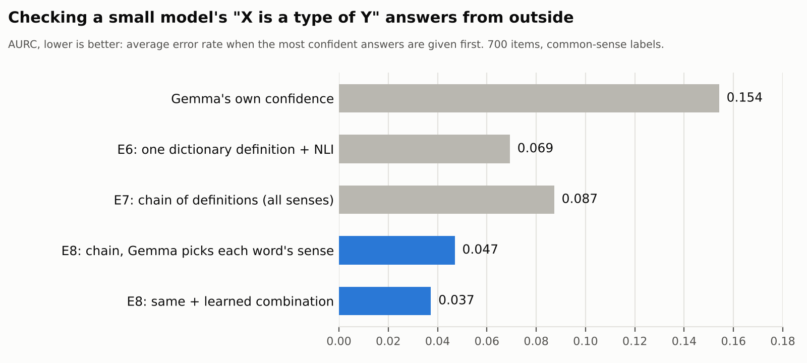
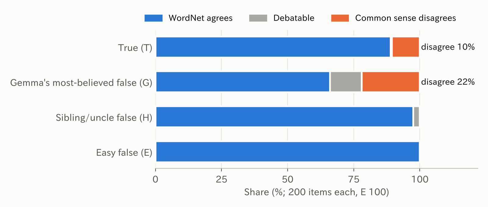
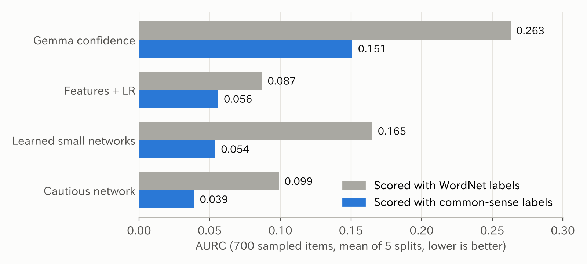
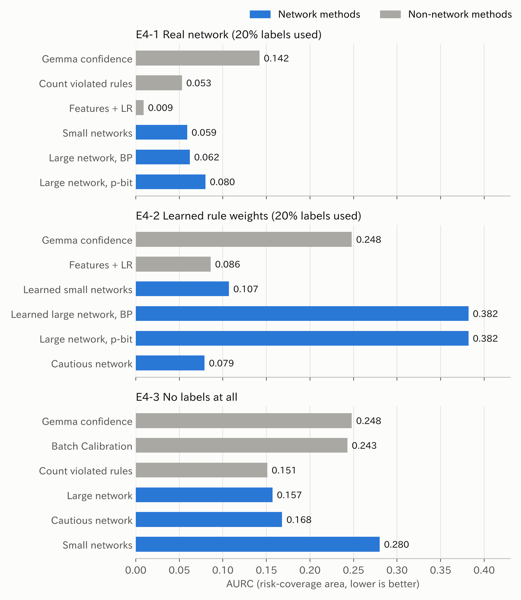

# AKANE Architecture experiments: checking a small LLM's answers from the outside

[](https://doi.org/10.5281/zenodo.24045800)

English | [日本語](README_ja.md)

**What this is:** experiments that keep a small language model (Gemma-2 2B) as the "mouth" and check its answers with parts placed outside it: rules, belief propagation (BP), retrieved evidence, dictionary definitions and a small NLI model. Each plan was fixed before its results, and ties and losses are reported as well.

**Main findings so far** (one small model, English, mostly one domain; see Limitations):

- **A small model is a poor judge but a good helper.** Gemma-2 2B is often confidently wrong on "X is a type of Y" questions. Checking its answer against dictionary definitions with an NLI model cuts the error measure (AURC) from 0.154 to 0.069 (E6).
- **Give it the narrow job it is good at.** Chaining definitions (granddaughter → person → mammal) fails when a word is read in the wrong sense (64% of chains, E7). When Gemma only picks which sense of each word is meant, it is right in 35 of 37 checked cases and wrong-sense chains fall to 4%. The chain check then reaches AURC 0.047 without training, 0.037 with a learned combination (E8).
- **On 300 new items** not used for any choice, the checker is clearly better than the model's own confidence (0.039 vs 0.118). Its gain over a one-step dictionary check (0.055) is not shown with 300 items.
- **Where the network (BP) helps, and where it does not.** BP that also doubts the model's own rules beats simply counting violations in taxonomy and disease tests (E2-6, E2-8). It did not beat simpler learned combinations with evidence (E3), large many-loop networks (E4) or dictionary chains (E7, E8). The p-bit method and BP never differed in accuracy (E4).



All experiments in one table: [Results at a glance](#results-at-a-glance). Each experiment's plan and results are in `plans/` (Japanese).

Every number in the articles below comes from files in this repository. Articles (Japanese):

- Article 1: E2-2 and E2-3, rules written by a person. https://note.com/mst_design2020/n/n28ced8c9549d
- Article 2: E2-4 to E2-7, rules written by the model itself. https://note.com/mst_design2020/n/n5d7de09a97f2
- Article 3: E2-8 and E2-9, a third domain and more wrong rules. https://note.com/mst_design2020/n/n0cddc2e4f209
- Article 4: E2-10 and E2-11, the same test as BTProp. https://note.com/mst_design2020/n/ne9eea6736480 (Zenn: https://zenn.dev/mst_design2020/articles/8b904689df2ddc)
- Article 5: E2-12, links made by real models. https://note.com/mst_design2020/n/n1af3e4380f0c (Zenn: https://zenn.dev/mst_design2020/articles/bc3e1c916a4baa)
- Article 6: E3, evidence and abstention. https://note.com/mst_design2020/n/nf427df9ee49d (Zenn: https://zenn.dev/mst_design2020/articles/c1537032d8943c)
- Article 7: E4, a large network learned from the model's answers. https://note.com/mst_design2020/n/nd323ba54cf92
- Article 8: E4 (second half) and E5, re-checking the answer key and the cost of the model's own rules. https://note.com/mst_design2020/n/n222a0ecf386d

Author: Masaya Kato (M.S.T. Design, Saiki, Oita, Japan) https://mst-design.jp/ · ORCID https://orcid.org/0009-0001-6803-654X · DOI https://doi.org/10.5281/zenodo.24045800

## AKANE Architecture in short

The idea is to use a language model as the "mouth" and to place the checking outside the model. The model answers first. Then an outside system checks whether the answers are consistent with a large memory and with rules. In the long run, we want to hand this checking computation to physical parts such as p-bits (probabilistic bits that flip between 0 and 1).
The experiments here test the smallest version of that outside checker. More about the overall research: https://mst-design.jp/research/ (Japanese)

## E2: rules written by the model, checked with belief propagation

**In short:** A small LLM writes its own consistency rules, some of them wrong. A network then checks the LLM's answers against those rules while also doubting each rule, using belief propagation. This is close to BTProp (Hou et al., NAACL 2025). The difference is that the rules come from the LLM itself and the network estimates which rules to trust, without labels. In E2-10 to E2-12 we ran both on BTProp's own released trees. With the original links BTProp is better or tied. When links are flipped at random (E2-11) the rule-doubting network holds up better, but when the links are made by real models (three NLI models and Gemma, E2-12) BTProp barely degrades and the rule-doubting network is never better. We do not claim our method beats BTProp. E2 is closed here (summary in `plans/E2_summary.md`, Japanese). E3 asked whether a network over retrieved evidence helps the model abstain; it tied with the model's own confidence and lost to a simple learned combination of NLI scores (see E3 below). E4 joined thousands of the model's answers about WordNet categories into one large network with many loops: it did not beat a simple learned combination of features, and BP and the p-bit method never differed in accuracy (see E4 below).

A small language model (Gemma-2 2B) answers many true/false statements. The statements are linked by rules, and we try to find which of the model's answers are wrong by looking at the whole network of answers.

### What the E2 experiments do

- Example statements: "Paris is a city in France." "France is a country in Europe." "Paris is located in Europe."
- Example rules: "If A is a kind of B and B is a kind of C, then A is a kind of C." "Nothing is both a plant and an animal."
- Signals compared for flagging wrong answers: the model's own confidence; counting rule violations; MaxSAT; loopy belief propagation (BP); a software simulation of p-bits (Gibbs sampling, called "揺れ" in the code). E2-7 adds paraphrase inconsistency, neighbor consistency (a simplified form of Xu et al. 2026), and a logistic-regression ensemble of these signals.
- Metric: AUROC for detecting the model's wrong answers. 20% of the words or cities are used for tuning and 80% for evaluation. There are 5 splits × 2 p-bit seeds, so 10 runs.
- Decision rule, fixed before each experiment: A "wins" over B if the mean AUROC difference is at least 0.02 and A is higher in at least 8 of 10 runs. A difference below 0.02 is a "tie".
- E2-10 and E2-11 differ: they use BTProp's released belief trees and ChatGPT confidences instead of Gemma, detect false statements in FactCheckGPT and WikiBio, split by response (20% tuning), tune by AUROC on the tuning part, compute exactly on the trees (no p-bits), and use 5 runs with the rule "at least 0.02 and higher in at least 4 of 5". Details in `plans/E2-10_btprop.md`.

The plan for each experiment was written and fixed before seeing its results. The plans and results are in `plans/` (Japanese). Ties and losses are reported too.

## How the computation works

This section writes down what the code computes. `analysis/check_formulas.py` checks the code against these formulas (see the end of this section).

**Inputs from the model.** For each statement $i$, the model is asked "Is the following statement true? Answer Yes or No only." and we keep $s_i$ = (logit of "Yes") − (logit of "No") at the first answer token. For each pair of labels $k$ (for example "plant" and "animal"), the model is asked an exclusion question in both orders, and $z_k$ is the mean of the two Yes−No logits. From E2-5 on, the wording is "Is it true that no plant is an animal? Answer Yes or No only." (wording P2). For wordings where "No" means exclusion (E2-4, and P0/P1 in E2-5), the sign is flipped, so that always $z_k > 0$ means the model says the two labels never hold together.

**Calibration (on the tuning 20% only).** $\ell_i = (s_i - \beta)\cdot 2/\sigma$, where $\sigma$ is the standard deviation of $s$ on the tuning statements and the threshold $\beta$ is the one (among 97 quantiles) that gives the best accuracy on them. The model's answer is $m_i = [\ell_i > 0]$ and its confidence is $c_i = |\mathrm{sigmoid}(\ell_i) - 1/2|$. For the rules, $\zeta_k = 2 z_k/\sigma_z$, with $\sigma_z$ the standard deviation of $z$ over all label pairs.

**The network.** Each statement has a variable $x_i \in \{0,1\}$ (1 = true). In the rule-doubting network (E2-6 to E2-9), each label pair also has a variable $u_k \in \{0,1\}$, where $u_k = 1$ means "this exclusion rule does not hold". The network is the probability distribution

$$
P(x,u) \propto \exp\Big( \lambda \sum_i \ell_i x_i \;-\; \lambda r \sum_k \zeta_k u_k \;-\; W \sum_{(a,b,c)\in C} x_a x_b (1-x_c) \;-\; W \sum_k \sum_{(a,b)\in I_k} x_a x_b (1-u_k) \Big)
$$

- $C$: chaining rules written by a person, "if $a$ and $b$ then $c$" (for example "$w$ is a kind of $B$" and "$B$ is a kind of $Z$" give "$w$ is a kind of $Z$"). These are always correct.
- $I_k$: all pairs of statements that put the same word (or the same class) under the two labels of pair $k$. If both are true, the exclusion rule $k$ is broken unless $u_k = 1$.
- The second term makes $u_k = 1$ unlikely when the model was confident that the labels exclude each other ($\zeta_k$ large), and likely when it said they can overlap. So the model's rule answers are a starting belief, and the answers to the statements can overturn a rule.

The network that fully trusts the rules (E2-2 to E2-5, and the "trusting BP" in E2-9) has no $u$: its exclusion term is $-W \sum_{(a,b)\in E} x_a x_b$, where $E$ is the union of the $I_k$ taken as true. In E2-2, E2-3 and the human-rule runs of E2-4 these are the exclusions written by a person (flipped at random in the corrupted runs); otherwise they are the pairs with $z_k > 0$. (The E2-4 run "Bw" instead keeps every pair and multiplies its $W$ by the model's probability of exclusion.)

**Signals for "this answer is wrong" (higher = more suspicious).**
- Model's confidence: $-c_i$.
- Counting: $v_i - c_i/10$, where $v_i$ is the number of rules (chaining rules and exclusions with $z_k>0$, all taken as true) that the model's answers $m$ break and that involve statement $i$. The small $c_i/10$ term only breaks ties.
- BP: loopy sum-product belief propagation on $P$ (damping 0.5, at most 200 iterations, tolerance $10^{-6}$) gives $q_i \approx P(x_i = 1)$. The signal is $1 - q_i$ if $m_i = 1$, and $q_i$ if $m_i = 0$.
- p-bit simulation ("揺れ"): the same $P$ sampled by Gibbs sampling (graph coloring, 10 chains, 100 burn-in sweeps, then 400 sweeps averaged) gives $q_i$; the signal is built in the same way as for BP. Each update sets $x_i = 1$ with probability sigmoid(change in the exponent above), which is how a p-bit behaves. The rules here link three variables at a time, so real p-bit hardware, which usually links pairs, would need extra wiring.
- MaxSAT: the most probable assignment of $P$ (weights rounded to integers: $100\lambda|\ell_i|$ for each statement, $100\lambda r|\zeta_k|$ for each rule variable, $100W$ for each rule), solved with RC2. The signal is $[\text{MaxSAT changes } m_i] - c_i/10$.

**Tuning.** For BP, p-bits and MaxSAT separately, $(\lambda, W, r)$ is chosen from $\{0.5,1,2\}\times\{1,2,4\}\times\{0.5,1,2\}$ ($r$ only when rules are doubted) by the accuracy of the thresholded result on the tuning statements. Counting has no parameters. The tuning statements are all statements about 20% of the words, cities or diseases, and AUROC is measured on the rest.

**E2-9.** The rule answers are replaced by $\pm|z_k|$ with the sign set by the ground truth, and then a random fraction $f$ of the label pairs (seed $10000 + \text{split}$) have their sign flipped.

**Checking the code against these formulas.** `cd analysis; python check_formulas.py` (about 1 minute) builds 40 small random networks, computes the exact probabilities by enumerating every assignment of the formula above, and compares them with the code used in the experiments. Result: BP matches exactly on tree-shaped networks (difference 0.0000) and differs by at most 0.019 on networks with loops, as expected for loopy BP; the p-bit simulation differs by at most 0.003 (sampling noise); MaxSAT always finds the most probable assignment.

## Results at a glance

| Exp. | What | Main result | Plan and results |
|---|---|---|---|
| E2-2 | Geography test (GeoNames, 3,586 statements), human rules | BP 0.83 vs counting 0.81: win, just at the threshold | `plans/E2-2_geo.md` |
| E2-3 | Taxonomy test (WordNet, 2,074 statements), human rules | BP 0.88 vs counting 0.85: win | `plans/E2-3_wordnet.md` |
| E2-4 | Rules written by the model; deliberately corrupted human rules | Model rules were 31% correct, giving a tie. Human rules with 10% flipped still win; at 20% it is a tie | `plans/E2-4_selfrule.md` |
| E2-5 | Choose the question wording on separate labels, then use it once | Rules 87% correct. BP 0.82 vs counting 0.81: tie (BP beats the model's confidence) | `plans/E2-5_wording.md` |
| E2-6 | Let the network also doubt each rule | BP 0.84 vs counting 0.81: win (8 of 10 runs) | `plans/E2-6_doubt_rules.md` |
| E2-7 | Repeat in geography; compare with other methods | Geography: BP 0.82 vs counting 0.80, tie. Taxonomy: BP beats all other methods. Geography: tie with the ensemble | `plans/E2-7_geo_and_baselines.md` |
| E2-8 | Third domain (disease classes, Human Disease Ontology, 3,304 questions); the model also chooses which label pairs to check | Model rules 84% correct. Rule-doubting BP 0.76 vs counting 0.74: win (10/10). Pairs chosen by the model were 80% wrong; BP on them was slightly below BP on all pairs (tie by our criterion, but lower in all 10 runs) | `plans/E2-8_disease.md` |
| E2-9 | Same networks, only the fraction of wrong rules changes (0 to 50%; disease and taxonomy) | The BP-minus-counting gap stays about the same ("no change" by our criterion). BP that fully trusts the rules is better when rules are right and falls behind at 30% wrong. Extra check: without the human-written chaining rules, the gap grows with the wrong fraction in taxonomy (+0.03 to +0.09) | `plans/E2-9_wrong_rate.md` |
| E2-10 | Same test as BTProp (Hou et al., NAACL 2025): BTProp's released ChatGPT belief trees and confidences, scored on FactCheckGPT (631 claims) and WikiBio (921 sentences); only the final probability computation is swapped | BTProp's gain over the model's confidence is reproduced (+0.03 / +0.08). WikiBio: BTProp 0.80 vs our rule-doubting BP 0.77, BTProp wins (5/5). FactCheckGPT: 0.79 vs 0.80, tie | `plans/E2-10_btprop.md` |
| E2-11 | Same trees, a random fraction (0 to 50%) of the NLI links reversed | BTProp falls below the model's confidence at 20–30% wrong links (0.60–0.65 at 50%); rule-doubting BP stays near the confidence. Our BP wins from 20% (FactCheckGPT) and at 50% (WikiBio) | `plans/E2-10_btprop.md` |
| E2-12 | Same trees, links labeled by four real models (NLI small/base/large, Gemma-2 2B) | BTProp barely degrades (still above the confidence with Gemma). FactCheckGPT: all ties; WikiBio: BTProp wins for every link model (by 0.02–0.05). With natural link errors the rule-doubting BP is never better | `plans/E2-12_real_links.md` |
| E3 | Evidence (HoVer, 3,952 claims): can a network over retrieved evidence tell the model when to abstain? | Network ties the model's confidence and loses to NLI features + LR (AURC 0.225 vs 0.207 vs 0.177) | `plans/E3_evidence_abstain.md` |
| E4 | Thousands of the model's WordNet answers in one large network with many loops; BP vs the p-bit method | Large network collapses; a cautious network ties features + LR. BP and the p-bit method never differ in accuracy | `plans/E4-2_learned_net.md` |
| E5 | How much do errors in the model's own rules cost? | A cost under WordNet labels (0.02 to 0.04), almost none under common-sense labels; doubting the rules = trusting them | `plans/E5_rule_errors.md` |
| E6 | Dictionary definitions + NLI against the model's confident errors (700 items) | 75% of confident errors fixed; AURC 0.154 → 0.069; but 40% of right two-step answers broken | `plans/E6_dictionary.md` |
| E7 | Chain definitions up to three steps | Fewer right answers broken (40% → 29%), but 30 of 50 chains go through a wrong sense; BP ties the path product | `plans/E7_chain_definitions.md` |
| E8 | The model picks each word's sense along the chain; negative evidence; 300 new items | Wrong-sense chains 64% → 4%; AURC 0.047 without training, 0.037 learned; network loses; new items 0.039 vs 0.118 for confidence | `plans/E8_sense_choice.md` |

## E3: Can evidence let the model say "I don't know"?

After E2 we asked a different question: if the model is given evidence (retrieved documents), can a network over that evidence tell it when to abstain, better than simpler methods? Plan (fixed before the results, with changes logged): `plans/E3_evidence_abstain.md` (Japanese); prior work: `plans/E3_prior_work.md` (Japanese).

- Data: HoVer dev claims with gold evidence (ProgramFC's release), 2 to 4 Wikipedia articles per claim. 3,952 claims (48 used for pilots are excluded), supports/refutes.
- Models: Gemma-2 2B gives the verdict and its confidence P(True). Gemma-2 9B (4-bit) splits each claim into sub-claims with hidden entities ("#1 = the director of film X") and fills in candidate names from the evidence. A DeBERTa-v3-large NLI model judges each paragraph against the claim and each sub-claim.
- Methods, all scored by how well they rank claims for abstention: (1) Gemma's confidence, (2) counting supporting vs. contradicting sentences (Pandian 2026 style), (3) 11 NLI features + logistic regression (SURE-RAG style, 5-fold), (4) Dempster-Shafer combination (EvidentialRAG style), (5) hard AND logic (ProgramFC/GraphCheck style) and (5') the minimum sub-claim probability, (6) a network over candidates, sub-claims and the claim (exact inference, equivalent to BP on this small graph).

| Method | Accuracy, all answered | 90% answered | 70% | 50% | AURC (lower is better) |
|---|---|---|---|---|---|
| (1) Gemma's confidence | 67.9% | 69.6 | 73.2 | 76.9 | 0.207 |
| (2) Counting | 54.5 | 55.7 | 59.5 | 66.4 | 0.353 |
| (3) NLI features + LR | 71.0 | 73.2 | 77.9 | 82.5 | **0.177** |
| (4) Dempster-Shafer | 67.1 | 68.0 | 70.1 | 73.5 | 0.253 |
| (5) Hard logic | 71.0 | 71.1 | 71.3 | 71.2 | 0.287 |
| (5') Min sub-claim | 70.6 | 71.4 | 74.1 | 76.2 | 0.246 |
| (6) Network | 71.1 | 72.4 | 75.3 | 78.0 | 0.225 |

- With the rule fixed in advance (AURC difference of at least 0.02 in 4 of 5 folds), the network beats counting, Dempster-Shafer and the min sub-claim formula (5/5 each), ties with Gemma's confidence (difference 0.016, network better in 1 of 5 folds), and loses to the NLI features + LR (0/5). By number of articles (AURC for (1)/(6)/(3)): 2: 0.150/0.148/0.144, 3: 0.230/0.245/0.182, 4: 0.243/0.268/0.205.
- Removing one gold paragraph from "supports" claims (1,976 claims): Gemma's "supports" answers fall from 75% to 41%, but its mean confidence |p-0.5| does not move (0.445 to 0.443). The evidence-based scores do become less confident (network 0.405 to 0.349, min sub-claim 0.346 to 0.207).
- So: using evidence helps notice missing evidence, but connecting the evidence in a network did not beat a simple learned combination of NLI scores. We do not claim the network helps. Note that the network as run had no evidence-evidence contradiction links (the plan mentioned them), so it was a small loop-free graph. E3 is closed here.

## E4: A large memory network with many loops, BP and the p-bit method

E4 asks whether many of the model's answers, joined into one large network full of loops, catch the model's mistakes better than simpler methods. It also asks whether the p-bit method (sampling, run in software) differs from BP there. Plans (fixed before the results; checks added afterwards are labeled as such): `plans/E4-0_synthetic.md`, `plans/E4-1_wordnet_net.md`, `plans/E4-2_learned_net.md`; prior work: `plans/E4_prior_work.md`, `plans/E4-2_prior_work.md` (all Japanese). Same verdict rule as before: an AURC difference of at least 0.02 in at least 4 of 5 splits counts as a difference, otherwise a tie.

**E4-0, synthetic networks** (2,000 claims, 2 to 6 links per claim, 1% to 30% wrong rules, rules trusted at the right strength or twice too strong, 5 seeds each). BP and the p-bit method (one chain, 10,000 sweeps) tied in 30 of 32 conditions and BP was better in 2; the p-bit method was never better. Where links are many and wrong rules are over-trusted, BP's probabilities drift from the exact answer on small networks (mean error 0.10 with 6 links, against 0.01 for the p-bit method), but accuracy still tied. With strong, over-trusted rules a single p-bit chain got stuck. Here the network is the true generating model, so BP beat the model's confidence in 29 of 32 conditions.

**E4-1, a real network from WordNet and Gemma.** 1,500 nouns × 46 WordNet categories. Gemma-2 2B answered "X is a type of Y" for each noun (up to 4 true and 3 unrelated categories), for category pairs ("Y is a type of Z"), and for disjointness ("Nothing can be both a Y and a Z"). Only the logical form of the rules is fixed (inheritance, disjointness, and two rules between category claims); the category knowledge itself is the model's answers. 10,864 claims, 51,643 rules, about 80,000 independent loops.

| Method (noun claims, test 80%) | AURC (lower is better) | Accuracy, all answered | 50% answered |
|---|---|---|---|
| (1) Gemma's confidence | 0.142 | 81.9% | 88.3% |
| (2) Counting broken rules | 0.053 | 82.0 | 97.7 |
| (3) Features + logistic regression | **0.009** | 93.6 | 99.8 |
| (4) Small networks, one noun at a time (BP) | 0.059 | 81.6 | 96.1 |
| (5) One large network (BP) | 0.062 | 82.3 | 95.5 |
| (6) Large network, p-bit method (4 chains × 10,000 sweeps) | 0.080 | 82.3 | 93.9 |

The large network beat confidence (5/5) but tied with the small networks and lost to features + learning. BP and the p-bit method tied (in one split the p-bit chains got stuck; in the other four they matched within 0.001). Category claims shared by many nouns got worse inside the network (disjointness AURC 0.009 to 0.063): small doubts from many nouns pile up on them. A weakness: the false candidates were unrelated categories, which rules separate easily.

**E4-2, a network with learned rule weights.** Following Jiang, Lowd and Dou (ICDM 2012), where a Markov logic network with learned weights beat per-fact learning on NELL, we learned the strength of each rule type and a bias correction by logistic regression. All 1,681 nouns × 46 categories were asked (80,377 questions). Harder false candidates: (G) the false category Gemma believed most, (H) a sibling or uncle category (as in TaxoGlimpse, VLDB 2024), (E) an unrelated one. 11,864 claims, 55,136 rules.

| Method (noun claims, test 80%) | AURC | Accuracy, all answered | 50% answered |
|---|---|---|---|
| (1) Gemma's confidence | 0.248 | 69% | 77% |
| (2) Confidence + bias correction | 0.251 | 70 | 78 |
| (3) Features + logistic regression | 0.086 | 77 | 93 |
| (4) Learned small networks (BP) | 0.107 | 79 | 90 |
| (5) Learned large network (BP) | 0.382 | 46 | 61 |
| (5') Cautious large network: category claims held at Gemma's (corrected) values | **0.079** | 79 | 94 |
| (6) Learned large network, p-bit method with parallel tempering (4 temperatures) | 0.382 | 46 | 61 |
| (7) One rule strength chosen on a grid | 0.151 | 70 | 86 |

- The learned large network collapsed: it called almost everything true (false candidates caught: G 0%, H 3 to 11%, E 3 to 13%). It lost to (2), (3) and (4) in 5 of 5 splits. A check added after the results: with the category claims set to Gemma's raw values instead, it still collapsed (AURC 0.18 to 0.21). The shared category claims are pulled over by doubts from many nouns, the same overcounting seen in E4-1.
- The cautious network was lower than (3) in all 5 splits, but by only 0.007, so it is a tie. Jiang et al.'s result did not carry over to this setting, where the rules' content also comes from the model.
- BP and the p-bit method tied again (mean probability difference 0.004). No tempering swap was accepted, so the four temperatures did not help on a network this size.
- On the false category Gemma believed most (G), accuracy was 31% for confidence, 53% for (3), and 54% for the cautious network.
- **Correction (2026-11-10): the WordNet labels are part of the problem.** We re-judged 700 sampled items (200 G, 200 H, 100 E, 200 true) by common sense without looking at the WordNet label (`analysis/e4/relabel/`, judged by Claude, one annotator). About a third of the G items are correct in an ordinary sense (22% clearly, 12% debatable; e.g. agua → drink, velvet → material, economist → worker), because WordNet uses narrow word senses. H and E were almost all truly false. About 11% of the "true" items were false in an ordinary sense. With the common-sense labels, G accuracy becomes about 60% (confidence), 76% (3) and 80% (cautious network). On these 700 items the AURC of the cautious network vs (3) goes from 0.099 vs 0.087 (WordNet) to 0.039 vs 0.056 (common sense); the network is smaller in all 5 splits, but the gap (0.013–0.027) is still a tie under our rule. The small networks move from 0.165 to 0.054. So the earlier wording that Gemma's most-believed errors stay mostly uncorrected overstated the problem.

  

  
- Of five predictions written down beforehand, three held. Wrong were "the learned large network beats (2)" and "(5) and (5') tie on noun claims".

**Summary of E4.** In these tests, putting all answers into one large loopy network did not beat a simple learned combination of features, and letting shared knowledge change inside the network made results worse. Keeping shared knowledge fixed and inferring only the item-level answers was the best variant, tied with features + learning. BP and the p-bit method never differed in accuracy; any advantage of p-bits would have to be speed or energy, which simulation cannot measure. 

**E4-3, no labels at all** (`plans/E4-3_no_labels.md`, `analysis/e4/e43.py`). Same answers and network as E4-2, with labels used only for scoring. Unsupervised methods (AURC, lower is better): confidence 0.248; Batch Calibration (Zhou et al., ICLR 2024) 0.243; counting violated rules 0.151; Dawid–Skene-style EM without the network 0.253; EM with the large network (BP, W=2) 0.157; cautious network 0.168; small networks 0.280. The network beats confidence and calibration in all 5 splits (by about 0.09), but ties with plain counting. With the network, re-estimating class priors from the marginals double-counts the network's push and collapses, so the prior is matched against a network-only model instead (no labels used). The estimated true rate of shared is-a claims drifted badly (0.255 vs 0.026). Conclusion of E4 as a whole: what helps is the rules themselves, not the network computation; the errors in the model's own rules and in the WordNet labels (see the E4-2 correction) move the results a lot.



Figures: `analysis/e4/figs_en.py` (English), `analysis/e4/figs_zenn.py` (Japanese).

## E5: How much do errors in the model's own rules cost?

E5 asks how much it costs, when answers are corrected with rules, that the rules themselves come from the model and are partly wrong. Plan (fixed before the results; the Gemini check was added afterwards): `plans/E5_rule_errors.md`; prior work: `plans/E5_prior_work.md` (both Japanese). Studies such as TaxoGlimpse (2024) and LLM-Hype (2025) measure how often a model's is-a knowledge is wrong, and BeliefBank, ConCoRD and LoCo-LMs correct answers with rules assumed to be right; we did not find work that measures the cost of the model's own wrong rules on the correction itself.

Setup: no new model queries. The E4-2 answers, candidates and network are reused (`analysis/e5/e5.py`, CPU, under a minute); only the rules (category-pair is-a claims, 2,044 in the network, and disjointness claims, 968) are swapped. Gemma's is-a rules: 144 "yes", of which 48 are right by WordNet (102 disagreements in total); disjointness: 928 "yes", 56 disagreements. Rule sets: none; WordNet; Gemma's; Gemma's with 20/50/80% of its errors fixed; only is-a errors fixed; only disjointness errors fixed; only the stronger half of Gemma's "yes" rules. Methods: counting violated rules, a network that trusts the rules (category claims held at the rule's yes/no, as the cautious network in E4-2), a network that doubts the rules (held at Gemma's own probability), features + logistic regression. Scored with WordNet (all test noun claims) and with common-sense labels (the 700 re-judged items of E4-2, test nouns only).

| Rules | Count | Trust net | Doubt net | Features + LR | Trust net, common sense | Features + LR, common sense |
|---|---|---|---|---|---|---|
| None | 0.248 | 0.251 | 0.251 | 0.194 | 0.154 | 0.107 |
| WordNet | 0.128 | 0.056 | 0.056 | 0.043 | 0.046 | 0.051 |
| Gemma's | 0.151 | 0.079 | 0.079 | 0.087 | 0.046 | 0.058 |
| Gemma's, is-a errors fixed | 0.130 | 0.060 | 0.060 | 0.044 | 0.043 | 0.051 |
| Gemma's, disjointness errors fixed | 0.155 | 0.076 | 0.078 | 0.089 | 0.048 | 0.066 |
| Gemma's, stronger half only | 0.161 | 0.134 | 0.130 | 0.085 | 0.090 | 0.068 |

(AURC of noun claims, lower is better, mean of 5 splits. Gemma's confidence alone: 0.248 WordNet, 0.152 common sense.)

- Scored with WordNet, Gemma's rules cost 0.022 to 0.023 (networks, counting) and 0.044 (features + LR) compared with WordNet's rules, in 5 of 5 splits. Almost all of it comes from the is-a rules: fixing only those brings results back to the WordNet level; fixing disjointness errors changes nothing. The cost falls roughly linearly as more errors are fixed.
- Scored with common sense, the cost almost disappears (0.000 to 0.007, no split with a difference). On the same 700 items scored with WordNet the cost is still visible (trust net 0.071 vs 0.108), so this is not just the smaller sample. Many of Gemma's "wrong" is-a rules are wrong only in WordNet's narrow senses (e.g. vegetable → food, car → machine, person → mammal).
- The rule-doubting network equals the trusting one: Gemma's rule answers are nearly always extreme (Yes−No logits around ±8), so there is almost nothing to doubt. Keeping only the stronger half of the rules is worse than keeping all (0.134 vs 0.079, 5/5): losing rules costs more than their errors.
- The E4-2 limitation about the cautious network's bias correction did not affect noun claims: holding category claims at the rule's yes/no gives the same 0.079.
- Second annotator (added after the results): Gemini judged the same 802 items (the 700 plus the 102 disagreeing is-a rules, shuffled and unlabeled; `analysis/e5/labels/`). Agreement with Claude's labels: 87% on three classes, 91% counting "debatable" as correct. Of the 96 rules Gemma calls is-a and WordNet does not, Gemini called 32 clearly correct, 49 debatable and 15 wrong. Rescored with Gemini's labels, the cost of Gemma's rules is between −0.004 and +0.004 for all methods (no difference), with "debatable" counted either way. Both annotators are AI models, not people, and Gemini comes from the same company as Gemma.
- Of four predictions written down beforehand, two held (the cost is mostly in is-a rules; it shrinks under common sense). Wrong: the doubting network would lose less, and the stronger half of the rules would cost less.

**E5-2, a second domain: disease classes** (`plans/E5-2_disease.md`, `analysis/e5/e52.py`). Geography was not usable (Gemma's geography rules were 99% correct in E2-7), so we reused the E2-8 disease data: 3,304 disease claims, 527 chaining rules (always kept), and 231 label pairs. Gemma's "these two never hold together" rules agree with the Human Disease Ontology (DOID) on 83.5% of pairs (10 over-claimed, 28 missed). Same rule swaps and methods as E5, the same network code, and a common-sense sample of 702 items (all 324 claims where Gemma and DOID disagree, 300 agreeing claims, the 38 disagreeing pairs and 40 agreeing pairs), judged by Claude before seeing the results and then by Gemini.

| Rules | Count | Trust net | Doubt net | Features + LR | Trust net, common sense | Doubt net, common sense |
|---|---|---|---|---|---|---|
| None | 0.046 | 0.047 | 0.047 | 0.027 | 0.253 | 0.253 |
| DOID | 0.036 | 0.031 | 0.031 | 0.024 | 0.202 | 0.202 |
| Gemma's | 0.038 | 0.035 | 0.037 | 0.025 | 0.216 | 0.229 |
| Gemma's, missed pairs fixed | 0.035 | 0.030 | 0.032 | 0.024 | 0.199 | 0.210 |
| Gemma's, over-claimed pairs fixed | 0.039 | 0.036 | 0.038 | 0.026 | 0.219 | 0.233 |
| Gemma's, stronger half only | 0.041 | 0.038 | 0.040 | 0.026 | 0.227 | 0.241 |

(AURC, mean of 5 splits; common sense = Claude's labels on the sample. Gemma's confidence alone: 0.050 DOID.)

- Scored with DOID, the cost of Gemma's rules is 0.001 to 0.006 (no difference). The rules themselves help little in this domain (trust net 0.047 without rules vs 0.031 with DOID's, not a difference), and Gemma's confidence alone is already good.
- Scored with common sense, counting, the trusting network and features + LR show no difference either. The rule-doubting network is the exception: it loses 0.027 (5/5; 0.024 with Gemini's labels, 5/5). The same happens on the sample scored with DOID (0.023), so it is not caused by the labels: Gemma's disease-rule answers are weak (median |logit| about 4), and holding the pairs at those weak probabilities makes the network worse.
- Most of the cost comes from missed pairs; fixing over-claimed pairs changes nothing. Of the 28 missed pairs, Claude judged 7 truly exclusive, 10 not exclusive and 11 debatable; DOID's "never together" (no DOID term under both labels) is narrow in places.
- Gemini never used "debatable" and called all 78 pair statements false, so its pair labels are not informative. On disease claims it agrees with Claude on 87% (counting "debatable" as correct).
- Of four predictions, one held (small cost under DOID). Wrong: over-claimed pairs would matter more; the doubting network would be slightly better; DOID's rules would look worse than Gemma's under common sense.

## E6: Can dictionary definitions fix the model's confident errors?

E4-2 left a set of answers that Gemma believes and that are wrong even by common sense ("G" candidates that common sense also rejects). E6 asks whether adding dictionary definitions of the noun fixes them, and how many right answers it breaks. Plan (fixed before the results): `plans/E6_dictionary.md`; prior work: `plans/E6_prior_work.md` (both Japanese). Definitions are known to help is-a judgments (TaxoLLaMA, ACL 2024; Moskvoretskii et al., Semantic Web 2026; LLM-Hype 2025), and models are known to resist outside text when they are confident (ClashEval, NeurIPS 2024; Xie et al., ICLR 2024). We did not find work that measures, on a model's own confident errors, how many are fixed and how many right answers are broken, or that compares putting the definition into the prompt with judging it outside the model.

Setup: the same 700 re-judged items as E5 (Claude's and Gemini's common-sense labels). 81 of them are confident errors: G candidates that Gemma answers "yes" and common sense rejects. Definitions of the noun only: S1 WordNet (the E4-2 nouns have exactly one WordNet noun sense, so this is close to showing WordNet's answer), S2 Wiktionary, all English noun senses (the main source; fetched for 591 of 599 nouns), S3 Wiktionary's first sense only. Methods: ① Gemma's confidence; ② definitions in the prompt, Gemma asked again; ③ an NLI model (DeBERTa-v3-large, as in E2-12 and E3) judges "\"X\" means: definition" ⇒ claim, best sense; ④ a network joining Gemma's answer with the senses (noisy-OR; a tree, so BP is exact; one strength chosen on the training folds); ⑤ features + logistic regression. Trained and scored with the common-sense labels, 5-fold by noun, 5 seeds (`colab/E6_dictionary_gemma.ipynb`, L4 GPU; most of the time is fetching Wiktionary politely; `analysis/e6/`).

| Method (S2 unless noted) | Confident errors fixed (81) | low / mid / high confidence | Right answers (T) said "no" | Common-sense-right G broken | AURC, Claude | AURC, Gemini |
|---|---|---|---|---|---|---|
| ① Confidence | 0% | 0 / 0 / 0 | 33% | 4% | 0.154 | 0.149 |
| ② In the prompt, S1 WordNet | 75% | 89 / 85 / 52 | 28% | 26% | 0.124 | 0.159 |
| ② In the prompt | 70% | 93 / 74 / 44 | 24% | 26% | 0.124 | 0.145 |
| ③ NLI outside, S1 WordNet | 83% | 93 / 93 / 63 | 26% | 40% | 0.060 | 0.080 |
| ③ NLI outside | 75% | 89 / 81 / 56 | 24% | 40% | 0.070 | 0.084 |
| ④ Network | 20% | 56 / 4 / 0 | 31% | 8% | 0.098 | 0.094 |
| ⑤ Features + LR | 68% | 87 / 74 / 43 | 24% | 24% | 0.079 | 0.080 |

- Definitions fix about 70 to 85% of the confident errors. Prompt vs outside NLI (S2): 70% vs 75%, a tie by the rule fixed beforehand (10 points). Both fix fewer of the most confident errors (prompt 93% → 44%, NLI 89% → 56%), so the drop is not only the model ignoring the text: those pairs are harder (e.g. "matchbox is a toy", "simulator is a game").
- Definitions also break 24 to 40% of the G answers that common sense accepts. Most of these need two steps ("granddaughter is a mammal"): a definition gives the direct parent ("person") only.
- Network vs features + LR (S2): the network is worse in 5 of 5 splits by 0.010 to 0.029, 0.02 or more in 2, a tie by the rule. The chosen strength is small (0.25 to 0.5), so the network fixes few errors.
- Added after the results (reference only): the NLI score alone gives the lowest AURC (0.070 with S2, 0.060 with S1), lower than features + LR in 5 of 5 splits (by 0.005 to 0.015); adding Gemma's confidence makes it worse. In E3, where the evidence was retrieved paragraphs, the outside NLI judge lost; here the evidence answers the claim directly.
- Of five predictions, two held (definitions fix; network ties or loses to LR) and one partly (the prompt fixes fewer confident errors). Wrong: WordNet's definition would fix the most; NLI would be unaffected by confidence; NLI would break rare-sense true answers (it breaks two-step G answers instead).

## E7: Chaining definitions (granddaughter → person → mammal)

E6's definitions broke true claims that need two steps, because a definition names only the direct parent. E7 follows the head noun of each definition up to three steps and asks whether that repairs them, and whether a network (BP) combines the chains better than simple rules. Plan (fixed before the results): `plans/E7_chain_definitions.md`; prior work: `plans/E7_prior_work.md` (both Japanese). Chaining definitions to build taxonomies is old (MindNet 1998; OntoLearn Reloaded, Computational Linguistics 2013, which notes semantic drift), BP over taxonomies helps (Bansal et al., ACL 2014), and step scores have been multiplied along proof chains (Entailer, EMNLP 2022); transitivity often fails in automatically built taxonomies (Liang et al., AAAI 2017). We did not find work that uses such chains to correct a small model's confident errors and compares ways of combining them.

Setup: same 700 items, labels and NLI model as E6. The noun's senses are E6's Wiktionary senses; later words come from the English Wiktionary dump (2026-11-10; 2,339 words). Head noun by spaCy plus a few rules (e.g. "one who …" → person, "a kind of X" → X). Each step is scored by NLI ("\"w\" means: definition" ⇒ "W is a type of head"), and arrival by NLI or by reaching the category word. Methods: ③ one step (E6); ⑥ strongest path, product of step scores (Entailer-style); ⑥b any path whose steps all pass 0.5; ⑦ a network over the words ("this word is a C"), implication factors along steps, loopy BP, three parameters chosen on the training folds; ⑧ logistic regression on E6's features plus ⑥, ⑥b, path depth and ⑦ (`colab/E7_chain_definitions.ipynb`; `analysis/e6/e7_core.py`, `e7_analyze.py`).

| Method | Confident errors fixed (81) | Common-sense-right G broken (68) | Right answers (T) said "no" (177) | AURC, Claude | AURC, Gemini |
|---|---|---|---|---|---|
| ③ One step (E6) | 75% | 40% | 24% | 0.070 | 0.084 |
| ⑥ Strongest path | 64% | 29% | 6% | 0.087 | 0.079 |
| ⑥b Any path | 63% | 29% | 6% | 0.198 | 0.175 |
| ⑦ Network (BP) | 83% | 47% | 28% | 0.083 | 0.097 |
| ⑧ Features + chains, LR | 68% | 27% | 23% | 0.048 | 0.054 |
| E6 features + LR (reference) | 68% | 24% | 24% | 0.079 | 0.080 |

- Chaining breaks fewer true claims (40% → 29%, a difference by the rule fixed beforehand) and rescues many true "X is a living thing" claims (T said "no": 24% → 6%), but fixes fewer confident errors (75% → 64%).
- Network vs strongest path: 0.083 vs 0.087, a tie. The network chose weak links (β 0.25, b −1, ε 0.8 in most splits) and behaves close to one step.
- Of 50 random chains of two or more steps that reach the category, 30 pass through a wrong sense (most often a rare sense of "person" that leads to "body part" or "organ"; also device → "scheme", child → a fortune-telling card). The network sees only path strength, not sense, so it cannot tell these apart (sample: `results/E7/E7_drift50_sample.json`, judged by Claude).
- Reference comparison fixed beforehand: adding the chain scores as features (⑧) gives the lowest AURC so far, 0.048 vs 0.079 for E6's features + LR (5/5 splits, by 0.027 to 0.037; Gemini labels 0.054 vs 0.080). Whether to trust a chain was better decided by learning than by the network, as in Liang et al. (2017).
- Both predictions held (fewer broken, some fixes lost; network ties the product).

## E8: Choosing word senses along the chain, and a fresh test set

E7's chains often went through a wrong sense (30 of 50). E8 picks one sense for each word along a chain and compares four ways of doing it, adds "cannot both hold" evidence to the network, and checks everything on 300 new items that were not used to make any choice. Plan (fixed before the results): `plans/E8_sense_choice.md`; prior work: `plans/E8_prior_work.md` (both Japanese). Picking the sense of a definition's head word is an old, hard step (about 80% per step in dictionary work of the 1990s; Rigau et al. 1998); the first non-rare sense is a strong baseline (Kovács et al., NLE 2022; SemEval-2016 Task 14); LLMs can pick senses from a list of definitions (Meconi et al. 2025). We did not find a measurement of sense drift along multi-step definition chains used to check a small model's answers.

Setup: the 700 items from E6/E7 plus 300 new items from E4-2 claims whose nouns do not appear in the 700 (same mix of G/H/E/T; labeled by Claude from the noun and category only, `analysis/e8/e8_new_labels.py`). The Wiktionary dump (2026-11-10) is read again keeping sense labels such as "slang" or "obsolete". Ways to choose the sense of each later word: A none (all of the first 4 senses, as E7); B the first sense without a rare/slang/obsolete-type label; C the sense closest to the previous definition (sentence embeddings); D Gemma-2 2B picks the sense, shown the previous definition and the candidate senses (the category is not shown). Negative evidence: NLI towards 8 broad groups (animal, plant, food, man-made object, …) that cannot hold together with the claimed category, as a penalty in the network. Methods as in E7 (`colab/E8_sense_choice.ipynb`; `analysis/e8/`).

| Method (700 items) | Confident errors fixed (81) | Common-sense-right G broken (68) | Right answers (T) said "no" (177) | AURC, Claude | AURC, Gemini |
|---|---|---|---|---|---|
| ① Gemma's confidence | 0% | 4% | 33% | 0.154 | 0.149 |
| ③ One step (E6) | 75% | 40% | 24% | 0.069 | 0.084 |
| ⑥ Strongest path, A (E7) | 64% | 29% | 6% | 0.087 | 0.078 |
| ⑥ Strongest path, B / C | 75% / 74% | 35% / 35% | 19% / 15% | 0.053 / 0.055 | 0.062 / 0.063 |
| ⑥ Strongest path, D (Gemma picks senses) | 75% | 34% | 8% | 0.047 | 0.056 |
| ⑦ Network + negative evidence, D | 83% | 49% | 29% | 0.091 | 0.075 |
| ⑧ Features + chains, LR, A | 67% | 28% | 23% | 0.050 | 0.057 |
| ⑧ Features + chains, LR, D | 72% | 27% | 14% | 0.037 | 0.045 |
| E6 features + LR (reference) | 68% | 24% | 24% | 0.079 | 0.080 |

- Wrong senses in chains of two or more steps that reach the category (judged by Claude, blind to the method): A 32/50 (64%), B 2/18, C 5/39, D 2/48 (4%). Gemma is poor at "is X a type of C?" but good at "which sense is meant here?". A direct check after the results (40 random sense choices; Claude fixed the right sense from the candidates before looking at any method's choice): Gemma 35/37 right, embeddings 24/37, first good sense 24/37, always the first sense 24/37 (`results/E8/sense_check.json`).
- With Gemma's sense choices, the plain strongest-path product (no training) keeps E6's fixes (75%), cuts "no" on right answers from 24% to 8%, and gives AURC 0.047.
- Main comparison 1 (⑧A vs ⑧D): 0.050 vs 0.037, D better in all 5 splits but by 0.011 to 0.013, below the 0.02 fixed beforehand, so a tie by the rule.
- Main comparison 2 (⑥ vs network with negative evidence): the network is worse (0.091 vs 0.047, 5/5). The penalty weight chosen on the training folds was 0 in 23 of 25 splits; the negative evidence did not help.
- New 300 items (all choices fixed on the 700): AURC ⑧D 0.039, ⑥D 0.043, ③ 0.055, E6 features + LR 0.055, ① 0.118. Against Gemma's confidence the gain is clear (0.079, 95% interval 0.043 to 0.121, resampling nouns); against one-step NLI it is 0.017 (−0.007 to 0.040), not shown with 300 items. The new items seem easier than the 700.

## Layout

- `colab/`: Google Colab notebooks (T4 GPU). They ask Gemma the questions and save the answers. The E2-2 and E2-3 notebooks also run the analysis and draw the figures.
  - Open in Colab: [E2-2](https://colab.research.google.com/github/mst-design2020/akane-e2-experiments/blob/main/colab/E2-2_geo_gemma.ipynb) / [E2-3](https://colab.research.google.com/github/mst-design2020/akane-e2-experiments/blob/main/colab/E2-3_wordnet_gemma.ipynb) / [E2-4](https://colab.research.google.com/github/mst-design2020/akane-e2-experiments/blob/main/colab/E2-4_selfrule_gemma.ipynb) / [E2-5](https://colab.research.google.com/github/mst-design2020/akane-e2-experiments/blob/main/colab/E2-5_wording_gemma.ipynb) / [E2-7](https://colab.research.google.com/github/mst-design2020/akane-e2-experiments/blob/main/colab/E2-7_geo_baselines_gemma.ipynb) / [E2-8](https://colab.research.google.com/github/mst-design2020/akane-e2-experiments/blob/main/colab/E2-8_disease_gemma.ipynb)
  - The notebooks save to your own Google Drive and need your own Hugging Face token (`HF_TOKEN` in Colab secrets) with access to Gemma.
- `data/`: saved Gemma answers. With these, the analysis can be rerun without a GPU.
  - `geo_mouth_gemma-2-2b-it.json`, `wn_mouth_gemma-2-2b-it.json`: answers to the true/false statements (Yes−No logits)
  - `E2-4_rules_gemma-2-2b-it.json`, `E2-5_rules_gemma-2-2b-it.json`: answers to the rule questions
  - `E2-7_answers_gemma-2-2b-it.json`: geography rule questions and paraphrased questions
  - `E2-8_answers_gemma-2-2b-it.json`: disease questions, rule questions, and the model's pair choices (generated numbers)
- `analysis/`: analysis for E2-4 to E2-9 (CPU only), and `check_formulas.py`
- `analysis/btprop/`: E2-10 to E2-12. BTProp's code has no license file, so it is not copied here; `setup_btprop.sh` clones it at a fixed commit and fetches the labels
- `analysis/e3/`: E3 code (pilot and main Colab cells, notebook builders, `e3_analyze.py`)
- `colab/E3_hover_main.ipynb`: E3 main run (L4 GPU, about 4 hours; resumable). `colab/E3_split_results.ipynb` splits the output for download
- `analysis/e4/`: E4 code. `e40.py` (synthetic networks), `e41_data.py`/`e42_data.py` (build the WordNet questions), `e41.py`/`e42.py` (networks, BP, p-bit method, comparisons), `probe_*.py` (checks added after the results), notebook builders
- `colab/E4-1_isa_gemma.ipynb`, `colab/E4-2_isa_all_gemma.ipynb`: ask Gemma the E4-1 and E4-2 questions (L4 GPU, E4-2 about 30 minutes; resumable)
- `data/E4-1_answers_gemma-2-2b-it.json`, `data/E4-2_answers_gemma-2-2b-it.json`: Gemma's answers for E4 (statements and Yes−No logits)
- `analysis/e5/`: E5 code (`e5.py`, `e52.py` for E5-2) and labels (`labels/` for E5, `labels_E5-2/` for E5-2: Claude's and Gemini's common-sense labels, the prompts given to Gemini)
- `analysis/e6/`: E6 code (`e6_colab.py` Colab core, `build_notebook_E6.py`, `e6_analyze.py`) and `e6_items.json` (the 700 items with WordNet definitions and labels)
- `colab/E6_dictionary_gemma.ipynb`: E6 (fetches Wiktionary, asks Gemma, runs NLI; L4 GPU). `data/E6_answers_gemma-2-2b-it.json`: its output without the Wiktionary texts (CC BY-SA; the notebook refetches them)
- `colab/E7_chain_definitions.ipynb`: E7 (reads the Wiktionary dump, follows head nouns, runs NLI; L4 GPU, about 40 minutes). `data/E7_chains_nli.json`: its output (head nouns and NLI scores; definition texts removed). Code in `analysis/e6/` (`e7_core.py`, `build_notebook_E7.py`, `e7_analyze.py`)
- `colab/E8_sense_choice.ipynb`: E8 (reads the dump with sense labels, picks senses with embeddings and with Gemma, runs NLI; L4 GPU, about 1.5 hours). `data/E8_chains_nli.json`: its output (sense labels, head nouns, sense choices, chains and NLI scores; definition texts removed). Code and the 300 new items in `analysis/e8/`
- `results/`: result JSON files and figures (`results/E3/E3_main_analysis.json` for E3, `results/E4/` for E4, `results/E5/` for E5, `results/E6/` for E6, `results/E7/` for E7, `results/E8/` for E8)
- `plans/`: plans and results for each experiment (Japanese)

## Rerunning the analysis

You need Python 3.10 or newer and `numpy scipy scikit-learn python-sat nltk wordfreq geonamescache matplotlib`. The taxonomy test also needs the NLTK WordNet data: `python -m nltk.downloader wordnet`.
For figures, set the environment variable `JP_FONT` to a Japanese font file, such as Noto Sans JP.

Run from `analysis/`. Results are written to `results/`.

```
cd analysis
# E2-4: human rules (A), 10/20/30% flipped rules, and the original E2-3 rules
python run_c.py A,F0.1,F0.2,F0.3,E23
# E2-4: Gemma's rules (B) and confidence-weighted rules (Bw)
python run_b.py ../data/E2-4_rules_gemma-2-2b-it.json gemma B,Bw
# E2-5: rules from each question wording
python run_e25.py ../data/E2-5_rules_gemma-2-2b-it.json P2,P1,P12
# E2-6: network that also doubts the rules (wording P2, chosen in E2-5)
python e26.py ../data/E2-5_rules_gemma-2-2b-it.json P2 P2doubt
# E2-7: taxonomy (reuses the E2-6 result and adds the other methods)
python e27.py ../data/E2-7_answers_gemma-2-2b-it.json wn reuse:../results/E26_P2doubt.json wn
# E2-7: geography (runs the rule-doubting network first; about 8 minutes per split)
BASE=base_geo.py python e27.py ../data/E2-7_answers_gemma-2-2b-it.json geo run geo
# summary and figure
python summ.py ../results/C_A.json
python fig27.py
# E2-8: disease (runs the 5 splits in parallel, ~12 min per split). The ontology file is downloaded automatically
bash run28.sh ../data/E2-8_answers_gemma-2-2b-it.json gemma
# E2-9: vary the wrong-rule fraction (run each split, then merge; for the run without chaining rules use NOTRANS=1 LEVELS=0,0.3,0.5 and merge29.py _notrans)
for s in 0 1 2 3 4; do python e29.py dis $s; python e29.py wn $s; done
python merge29.py
# check that the code computes the formulas in "How the computation works"
python check_formulas.py
```

E2-10 and E2-11 (BTProp comparison, CPU only, a few minutes; also needs `pyyaml absl-py`, and `datasets` to download the WikiBio labels from Hugging Face):

```
cd analysis/btprop
bash setup_btprop.sh          # clones BTProp at 6e80da8, gets FactCheckGPT and WikiBio labels
cd work/BTProp
python ../../bt_repro.py factcheckgpt                       # BTProp as released
python ../../e210.py factcheckgpt ../../E210_factcheckgpt.json
python ../../e210.py wikibio ../../E210_wikibio.json
python ../../e211.py wikibio ../../E211_wikibio.json        # reversed links
```

WikiBio note: BTProp evaluates rewritten sentences (pronouns replaced by names) that are not released. `align_wikibio.py` matches the released labels to BTProp's sentences by order and string similarity (924 of 929 sentences). In BTProp's released code, a claim without a belief tree gets probability 1 (true); for FactCheckGPT (48 such claims) we also report BTProp with the model's confidence used for those claims, and compare against that.

E3: run `colab/E3_hover_main.ipynb` (needs access to Gemma-2 2B and 9B on Hugging Face). It writes `E3_main.json`; then `python analysis/e3/e3_analyze.py E3_main.json out.json` (CPU, a few seconds). The per-claim outputs contain HoVer text and are not stored here.

E4: in `analysis/e4/`, `python e40.py` (CPU, about 20 minutes). For E4-1/E4-2, build the questions with `NLTK_DATA=<wordnet> python e41_data.py` and `python e42_data.py` (they reproduce the files the notebooks used), then `python e41.py e41_data.json ../../data/E4-1_answers_gemma-2-2b-it.json out41.json` and `python e42.py e42_data.json ../../data/E4-2_answers_gemma-2-2b-it.json out42.json` (CPU, about 70 minutes each, mostly the p-bit method; `E41_SWEEPS`/`E42_SWEEPS` set the number of sweeps).


E5: build `e42_data.json` as above (in `analysis/e4/`), then in `analysis/e5/`: `python e5.py ../e4/e42_data.json ../../data/E4-2_answers_gemma-2-2b-it.json labels/sample_labeled.json out.json` (CPU, under a minute). Use `labels/sample_gemini.json` or `labels/sample_gemini_strict.json` to score with Gemini's labels. E5-2: `python e52.py ../../data/E2-8_answers_gemma-2-2b-it.json labels_E5-2/E5-2_labels_claude.json out.json` (CPU, under a minute; it rebuilds the E2-8 questions with `analysis/data_dis.py`, which downloads the disease ontology).

E6: in `analysis/e6/`: `python e6_analyze.py ../../data/E6_answers_gemma-2-2b-it.json out.json` (CPU, seconds; uses `../e5/labels/` for Gemini's labels). E7: `python e7_analyze.py ../../data/E7_chains_nli.json ../../data/E6_answers_gemma-2-2b-it.json out.json` (CPU, about 10 minutes for the BP grid). E8: in `analysis/e8/`, `python e8_analyze.py ../../data/E8_chains_nli.json out.json` (CPU, about 5 minutes).
## Related work and what is different

The closest work we know is BTProp (Hou et al., NAACL 2025, https://arxiv.org/abs/2406.06950). It builds links between statements with a separate model (NLI) and uses belief propagation to detect an LLM's hallucinations. Here, the model also writes the exclusion rules itself, and the network also estimates whether each rule is true (E2-6). In E2-10 we ran BTProp on its own released trees: with the links as given, BTProp is better on WikiBio and tied on FactCheckGPT, so we do not claim our method is better. When a share of the links is deliberately flipped (E2-11), BTProp, which treats the links as certain, degrades sharply, while the rule-doubting BP does not. With links labeled by real models (E2-12), however, BTProp barely degrades: natural labeling errors seem far less harmful than random flips. The model's own confidence (P(True)), which the BTProp paper treats as a strong baseline, is included here as a baseline. Other related work: Crum et al. 2024 (asking LLMs for disjointness axioms), Xu et al. 2026 (neighbor-consistency belief), Jiang, Lowd and Dou 2012 (cleaning an extracted knowledge base with Markov logic), Maieutic prompting (Jung et al. 2022), BeliefBank (Kassner et al. 2021). The E2-9 pattern (doubting the rules costs a little when the rules are right and helps when many are wrong) matches the analysis in Snorkel (Ratner et al., VLDB 2017, https://arxiv.org/abs/1711.10160): learning how accurate each source is helps most when source accuracies vary. Here we see the same tendency when a model checks its own answers.

## Limitations

- Only one small model (Gemma-2 2B), only English, and three domains: geography, taxonomy and disease classes.
- Up to E2-7 a person chose which label pairs to ask rule questions about. In E2-8 the model chose them, but its choices followed list position and 80% were wrong. The only rule type the model writes is "these two never hold together".
- Disease ground truth comes from the Human Disease Ontology; a class missing from the ontology is not always truly absent (e.g. COVID-19 is not under respiratory system disease there).
- In E2-9 the wrong rules are random flips, which differ from the model's natural errors (mostly missed exclusions). The run without chaining rules was added after seeing the main E2-9 results.
- E2-4 to E2-7 reuse the same data across several experiments, and the 5 splits come from the same data.
- The paraphrase and neighbor-consistency signals in E2-7 are simplified versions of the published methods, adapted to a single yes/no answer.
- E2-10/E2-11 use BTProp's ChatGPT trees; our method was tuned on 20% of the data while BTProp used its published settings (fitted on the first 120 WikiBio passages). The wrong links in E2-11 are random reversals, not natural NLI errors (natural errors are E2-12; the 100-pair re-labeling there was done by Claude, an AI, and is not ground truth), and decomposition links were not changed. The wider grid and the directed decomposition factor in E2-10 were added after seeing the result (they do not change it).
- E3: one dataset (HoVer, gold evidence), small models only. The network ran without evidence-evidence contradiction links, so it was loop-free; whether loops change the picture is not tested here. Method (3) is trained (5-fold) while the network has no tuned parameters. In the drop-one-paragraph check, decompositions and candidates from the full evidence were reused, which slightly favors the NLI-based methods. The pilot checks of decomposition quality were done by Claude, an AI.
- E4: one domain (WordNet categories) and one small model. The truth comes from WordNet, which has its own quirks (we removed four categories for this reason). In E4-1 the false candidates were easy; E4-2 used harder ones. The rule weights in E4-2 are learned by an approximation (neighbors fixed at Gemma's answers), and the cautious network applies the bias correction learned on noun claims to category claims as well, which made its category-pair claims poor (E5 found this did not change the noun-claim results). Parallel tempering used only four temperatures and no swap was accepted. Checks marked as added after the results are for reference only.
- E8: the 300 new items are labeled by Claude only (no Gemini labels) and seem easier than the 700. The drift count is one annotator (Claude), blind to the method. The label list for B missed "euphemism"; adding it changes no choice. The broad groups for negative evidence were set by hand.
- E7: same 700 items as E6. Head nouns come from simple rules; the Wiktionary dump parse lost some senses (e.g. most senses of "cat"). The drift count is one annotator (Claude) on 50 chains.
- E6: 700 items (81 confident errors), one domain, one small model; labels from two AI models. Definitions of the noun only, not of the category. Wiktionary changes over time; the senses used were fetched on 2026-11-10.
- E5: same data, domain and model as E4-2. Rule errors are defined by WordNet, so fixing errors moves the rules toward WordNet. The common-sense labels cover 700 items and come from two AI models (Claude, Gemini), not from people. E5-2 reuses the E2-8 data; medical judgments by AI models are not expert judgments, and Gemini's pair labels were uniform, so the pair judgments rest on Claude alone.
- The p-bits are simulated in software. These experiments say nothing about speed or energy.

## How this was made

The research direction, the decisions, and the Colab runs are by the author. The experiment design, the code, the analysis, and the write-up were done together with Claude, an AI assistant made by Anthropic.

## License

Code: MIT License (see `LICENSE`). The data in `data/` are outputs of Gemma and follow the Gemma Terms of Use. GeoNames, WordNet, the Human Disease Ontology, Factcheck-GPT (Apache 2.0) and the WikiBio hallucination labels follow their own licenses. BTProp's code and logs are not included. HoVer is CC BY-SA 4.0; its text is not redistributed here.

## Data and model

- GeoNames (through the `geonamescache` package) https://www.geonames.org/
- WordNet (through NLTK) https://wordnet.princeton.edu/ ; word frequencies for E4 from `wordfreq` https://github.com/rspeer/wordfreq
- Human Disease Ontology (release 2026-10-29, CC0) https://disease-ontology.org/ . The file is not stored in this repository; the notebook and analysis download it from the GitHub tag v2026-10-29.
- BTProp code and released logs (commit 6e80da8) https://github.com/UCSB-NLP-Chang/BTProp
- FactCheckGPT labels (Factbench.jsonl, Wang et al. 2024) https://github.com/yuxiaw/Factcheck-GPT
- WikiBio GPT-3 hallucination labels (Manakul et al. 2023) https://huggingface.co/datasets/potsawee/wiki_bio_gpt3_hallucination
- HoVer (Jiang et al., Findings of EMNLP 2020, CC BY-SA 4.0) https://hover-nlp.github.io/ , dev claims with gold evidence as released by ProgramFC (Pan et al., ACL 2023) https://github.com/teacherpeterpan/ProgramFC
- Gemma-2 9B instruction-tuned https://huggingface.co/google/gemma-2-9b-it and NLI model https://huggingface.co/MoritzLaurer/DeBERTa-v3-large-mnli-fever-anli-ling-wanli (E3)
- Gemma-2 2B instruction-tuned https://huggingface.co/google/gemma-2-2b-it . The Gemma outputs in `data/` are used under the Gemma Terms of Use.
