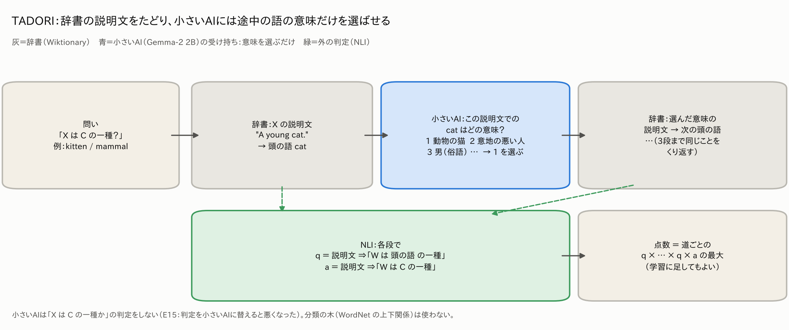
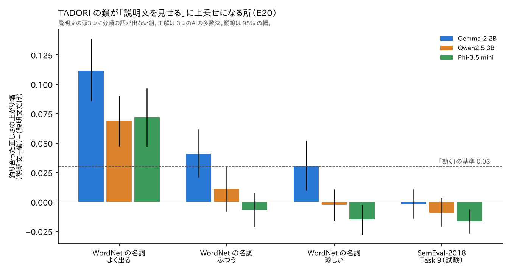

# AKANE Architecture 実験：小さいAIの答えを、外から確かめる

[](https://doi.org/10.5281/zenodo.24045799)

[English](README.md) | 日本語

**これは何か：** 小さな言葉のAI（Gemma-2 2B）を「口」として使い、その答えを、AIの外に置いた部品（ルール、確率伝搬（BP）、資料、辞書の説明文、小さなNLIのAI）で確かめる実験です。どの実験も、結果を見る前に計画を固定し、同着や負けもそのまま載せています。

**研究者の方へ：** 残った方法 TADORI の定義・手順・確かめた事・言えない事・外した物は、[TADORI（研究者向けの要約）](#tadori研究者向けの要約)の1節にまとめています。

**ここまでで分かったこと**（ほぼ小さいAI 1つ（Gemma-2 2B、E20 でほかに2つ）・英語・ほぼ1分野。[言えないこと（弱点）](#言えないこと弱点)も見てください）：

- **小さいAIは、判定役としては弱いが、手伝いとしては使える。** Gemma-2 2Bは「XはYの一種か」で自信を持って間違えることが多い。その答えを辞書の説明文とNLIで確かめると、誤りの指標（AURC、小さいほど良い）は0.154から0.070に下がった（E6）。
- **得意な狭い役目だけをさせる（TADORI）。** 説明文をつなぐ（孫娘→人→哺乳類）と、語を違う意味で読む取り違えで崩れる。Gemmaには「この語はどの意味か」を選ぶことだけをさせると、取り違えは72%から10%に減り、新しい300個でも、鎖＋学習の確かめがGemmaの自信より良かった（0.046対0.118）（E7・E8、手書きの一覧なしで確かめ直した数字）。辞書の説明文をたどり、途中の語の意味だけ小さいAIに選ばせるこの確かめ方を、**TADORI（たどり）**（Tracing Along Definitions, Opting for the Right Interpretation）と呼びます。辞書の説明文をたどる考えも、AIに意味を選ばせることも前からあり、新しいのはその組み合わせ方です（[近い研究と、違うところ](#近い研究と違うところ)）。
- **手がかりを全部1つの学習にまとめると良くなる。深い鎖や箱の形のベクトルだけでは良くならない（E11）。** Gemmaの答え・辞書の鎖・外の文・箱の形のベクトルを1つの木の学習に渡すと、Gemmaの答えだけの学習より、「一種か」（0.017→0.004）、部分と全体（0.062→0.039）、病気（0.025→0.016）で良くなった。地理は同着で、部分と全体・病気はGeminiの採点では同着。
- **Gemmaの狭い役目は、たくさんの問題でも保てた（E12）。** 人が意味を付けたWordNetの説明文34,402問で、Gemmaは頭の語の意味を80.9%当てた（意味選びの正しさで、TADORI全体の答えの正しさではない）。WordNetの最初の意味は60.5%、文の近さは67.9%。E12-1の確かめでは、覚えていただけではなかった。
- **鎖の行き止まりを外の文で埋めても、良くならなかった（E14）。** 一般的な文（GenericsKB）は抜けの多くを埋めるが、直す分より多くの間違いを足した（0.063→0.140）。Wikipediaはきれいだが埋まる数が少なく、同着。残った外れの多くは、鎖の最後の段の「Cの一種か」の判定で落ちている。その判定を Gemma に替えても（道の説明文を全部見せても）、今の NLI より悪かった（E15：0.060→0.109）。
- **人の正解・珍しい語・ほかの小さいAIで確かめた（E17〜E20）。** 人の点（HyperLex）や人が作った一覧（BLESS）に対しては、しきい値をきちんと決めた小さいAIより良くならなかった（E17 悪くなる、E18 同着）。珍しい語では、辞書の説明文を見せるだけで伸びのほとんどが取れる（E19）。最初の3つの説明文に分類の語が書いていない組で、よく出る語なら、試した3つの小さいAI全部（Gemma-2 2B・Qwen2.5 3B・Phi-3.5 mini）で、どの正解でも説明文に鎖を足すと良くなった（釣り合った正しさで +0.07〜+0.11。しきい値を別の語で決めても +0.03〜+0.12 で、75回中73回は決まりを満たす）。ただし語全体・珍しい語・はい・いいえの組に作り替えた SemEval-2018 Task 9 には広がらなかった（E20）。合わせ方を学習にしても「または」と同じ（E20-1）。[くわしく](#e17e20人の正解珍しい語ほかの小さいaiで-tadori-を確かめる2026-11-14)
- **部分と全体の問いでは、答えを書いた文を見せると効く（E10）。** GenericsKBの文（0.068→0.039）でも、Gemmaが自分で書いた文（0.044、同着）でも。
- **網（BP）は主役にならなかった。** ルールも疑うBPは、分類と病気のテストで違反を数えるだけの方法に勝った（E2-6・E2-8）が、正解付きのデータがある所では強い学習に勝てなかった（E3・E4・E9）。正解がまったくない時も、5つの手がかりを素直に平均する方が同じか良かった（E13）。p-bit方式とBPの正しさは一度も分かれなかった（E4・E13）。網の揺れでTADORIに確かめさせる所を選ぶ方法も、WordNetの採点では良く見えたが、常識の採点では良くならなかった（E16）。

同着や負けも、各節にそのまま載せています。2026-11-11の2つの訂正で前の数字が変わりました。[訂正](#訂正2026-11-11)にまとめています。


**5分で試す（CPUだけ、GPU不要）。** `data/` に保存済みのモデルの答えとNLIの値から、E8の結果を作り直します。Gemma自体を動かすには `colab/` のノートブックが要ります。

```bash
git clone https://github.com/mst-design2020/akane-e2-experiments.git && cd akane-e2-experiments/analysis/e8
pip install numpy scipy scikit-learn
python e8_analyze.py ../../data/E8_chains_nli.json out.json   # 約5分。AURCの表が出ます（例：学習した鎖の確かめ 0.037。この保存済みの流しは手書きの一覧ありの物で、一覧なしでは0.056。analysis/nolist/ を参照）
```

`python check_formulas_e8.py ../../data/E8_chains_nli.json`（約5秒）で、コードが下の式どおりかを確かめられます。まっさらなPython 3.13の環境で確かめ済みです。

すべての実験を1つの表で：[結果の一覧](#結果の一覧)。各実験の計画と結果は `plans/` にあります。各段階を説明した記事：[記事](#記事日本語)。

著者：加藤雅也（M.S.T.デザイン代表・大分県佐伯市） https://mst-design.jp/ ・ ORCID https://orcid.org/0009-0001-6803-654X ・ DOI https://doi.org/10.5281/zenodo.24045799

## TADORI（研究者向けの要約）

E2〜E15 で、最後まで残った確かめ方です。ほかの部品（網・BP・p-bit・深い鎖・外の文の継ぎ足し）を試し、同着か負けになったものを外して、残った形を名前にしました。この節だけで全体が分かるように書き、詳しい数字は各実験の節に置いています。

**名前。** TADORI（たどり）は **T**racing **A**long **D**efinitions, **O**pting for the **R**ight **I**nterpretation の頭文字です。「辞書の説明文（定義）をたどり、途中の語の正しい意味を選ぶ」という意味で、日本語の「たどる」とも読めるように名付けました。



**一言で。** 小さいAIの「X は C の一種か」という答えを、辞書の説明文の鎖で確かめます。小さいAIには、鎖の途中で「この説明文の中の語は、どの意味で使われているか」を選ぶ役だけをさせます。各段の確からしさと「C に着いたか」は、外の NLI が決めます。小さいAI自身は「X は C の一種か」を判定しません。

**入力と出力。**

| | 中身 |
|---|---|
| 入力 | 問い「X is a type of C.」（X は物の語、C は46分類のどれか）。小さいAIの答え（Yes−No のロジット $\ell$）は、確かめの相手として別に持つ |
| 使う物 | 辞書（Wiktionary の英語の名詞の説明文）、小さいAI（Gemma-2 2B-it。学習はしない）、NLI（DeBERTa-v3-large-mnli-fever-anli-ling-wanli） |
| 使わない物 | WordNet の上下関係、手書きの語の一覧（2026-11-11 からなし）、C を小さいAIに見せること |
| 出力 | 確かさ $s_6 \in [0,1]$（「X は C の一種」が説明文の鎖で言える度合い）。単独で使うか、ほかの手がかりと一緒に学習に渡す |

**手順**（式は [E6〜E8の計算のしかた](#e6e8の計算のしかた)の方法D）。

1. X の各意味（Wiktionary に載っている順、最大8つ）の説明文 $d$ を辞書から取る。以下、いま説明文を読んでいる語を $w$ と書く（最初は $w=X$、たどるたびに選んだ頭の語に変わる）。$W$ は仮説の文の中の $w$ で、先頭だけ大文字にした物。
2. 説明文の頭の名詞 $g$（spaCy の最初の名詞のかたまりの主辞）を取る。
3. **小さいAIに、$d$ と $g$ の意味の候補（番号付きの説明文）を見せ、$d$ の中の $g$ がどの意味かを番号で選ばせる。** C は見せない。聞き方は `Dictionary definition of "w": d` ／ `In this definition, which meaning of the word "g" is used?` ／ `1. … 2. …`（$g$ の意味を辞書の順に最大8つ）／ `Answer with the number only.` を、Gemma の会話の型（chat template）に入れたもの。答えの最初の位置での「1」「2」…の値（ロジット）を softmax し、一番高い番号の意味を選ぶ（文を生成させない）。
4. 外の NLI で、段の確かさ $q = e(d \Rightarrow \text{"W is a type of } g\text{."})$ と、着き $a = e(d \Rightarrow \text{"W is a type of C."})$ を出す（$w$ が C そのものなら $a=1$）。$e(\cdot)$ は NLI の「言える（entailment）」の確率で、前提の文は `"w" means: d`、仮説の文は `W is a type of g.`（または `C.`）。たとえば $w$ = kitten、$d$ = "A young cat." なら、前提 `"kitten" means: A young cat.`、仮説 `Kitten is a type of cat.`。
5. 選んだ意味の説明文から 2〜4 をくり返す（3段まで）。
6. 点数は、道ごとの $q_{n_0} \cdots q_{n_{t-1}}\, a_{n_t}$ の最大 $s_6$。

**分かったこと**（どれも流す前に固定した決まりで判定。常識の採点は Claude、主な物は Gemini でも採点。E19・E20 は Claude・ChatGPT・Gemini の3つと多数決）。

AURC は「確かな順に答えた時の誤りの割合の平均」で、**小さいほど良い**。

| 主張 | データと物差し | TADORI | 比べ相手 | 判定（何が良くなったか） | 節 |
|---|---|---|---|---|---|
| 小さいAIは意味選びが得意 | 鎖の途中の意味の取り違え（分類に着いた2段以上の道、Claude が方法を伏せて判定） | 4/41（10%） | 意味を選ばない 36/50（72%）、文の近さ 8/35 | 取り違えが減った | [E8](#e8鎖の途中の語の意味を選ぶ新しい問題で確かめる) |
| 意味選びはたくさんの問題でも保てる | WordNet の説明文の頭の語 34,402問、人が付けた意味との一致（Princeton Gloss Corpus） | 80.9% | 文の近さ 67.9%、WordNet の最初の意味 60.5% | 意味選びの正しさが高い：差あり（Gemma − 近さ +13.0 ポイント、95%の幅 10.3〜16.3） | [E12](#e12gemma-の意味選びはたくさんの問題でも保てるか2026-11-12) |
| 覚えていただけではない | 5,000問で定義される語の名前を隠す／言い換える | 隠す 80.8%、言い換え 69.3% | 最初の意味 59.3% | 隠しても言い換えても正しさが残る：差あり（言い換え − 最初の意味 +10.0、3.4〜17.0） | [E12-1](#e12gemma-の意味選びはたくさんの問題でも保てるか2026-11-12) |
| 小さいAIの答えを確かめられる | 新しい300問（決め方には一度も使っていない）、AURC（小さいほど良い） | 0.046（鎖＋学習） | 小さいAIの自信 0.118 | 小さいAIの間違いを見つけやすい：差あり（95%の幅 0.038〜0.112） | [E8](#e8鎖の途中の語の意味を選ぶ新しい問題で確かめる)・[確かめ直し](#手書きの一覧なしでの確かめ直し2026-11-11) |
| 他の手がかりと一緒に学習に渡すと良い | 700問、AURC（小さいほど良い）、木の学習 | 0.038（全部入り） | 小さいAIの答えだけの学習 0.053 | 学習に足すと間違いを見つけやすい：差あり（5回中5回） | [E11](#e11e8の弱い所を直す手がかりを全部まとめる2026-11-12) |
| 説明文に分類の語が無い所で、説明文に鎖を足すと良い（よく出る語、3つの小さいAI） | 最初の3つの説明文に分類の語が無い、よく出る語の組。釣り合った正しさ（大きいほど良い）、3つのAIの多数決 | 説明文＋鎖（SO）：Gemma 0.880・Qwen 0.881・Phi 0.887 | 説明文だけ（S）：0.769・0.811・0.815 | +0.111・+0.069・+0.072。どの正解でも3つとも効く。しきい値を別の語で決めても +0.08〜+0.12・+0.03〜+0.09・+0.04〜+0.09（25回中 25・23・25回が決まりを満たす） | [E20](#e17e20人の正解珍しい語ほかの小さいaiで-tadori-を確かめる2026-11-14) |

**言えないこと。**

- 辞書の1段だけの確かめ（E6）より良いとは言えません。700問で 0.063 対 0.069、新しい300問でも幅が0をまたぎます。TADORI の強みは「意味の取り違えが減る」ことと「学習の材料として効く」ことで、鎖そのものの点数が1段より上とは示せていません。
- 80.9% は WordNet の説明文での**意味選びの正しさ**で、TADORI 全体の答えの正しさではありません。E8 で使う辞書は Wiktionary で、意味の分け方が違います。
- E19 までは小さいAIは Gemma-2 2B の1つです。E20 で Qwen2.5 3B・Phi-3.5 mini を足し、よく出る語での鎖の効き目は3つとも出ましたが、語全体で決まりを満たしたのは3つのうち1つだけでした。英語だけ、問いは主に「一種か」。ほかの辞書・ほかの言葉では試していません。
- 人の点（HyperLex：順位の合い方で悪くなる、E17）、人が作った一覧（BLESS：同着、E18）、公開の SemEval-2018 Task 9（3つのうち0、E20）で、TADORI が小さいAIより良いこと。
- 珍しい語で、説明文を見せるだけより鎖が良いこと（E19 同着、E20 言えない）。珍しい語は説明文だけで足りることが多い（E20-1）。
- 常識の採点はAI（Claude・Gemini、E19 から ChatGPT も）で、人ではありません。

**試して外した物**（どれも同着か負け）。

| 試した方向 | 結果 | 判断 | 節 |
|---|---|---|---|
| 網（BP）でまとめる、両立しない分類の打ち消しを足す | 0.091 対 一番強い道 0.047（悪い）、打ち消しの強さは25回中23回で0 | 網は使わない | [E8](#e8鎖の途中の語の意味を選ぶ新しい問題で確かめる) |
| p-bit 方式 | BP と正しさが一度も分かれない | 正しさでは出番なし（速さ・電力は測っていない） | [E4](#e4輪の多い大きな記憶の網とbpp-bit方式)・[E13](#e13正解がまったくない時食い違う手がかりを網でまとめると良いか2026-11-12) |
| 鎖を3段から6段に深くする | 0.063 対 0.063（同着） | 深さは追わない。止まる理由は段の上限でなく辞書の行き止まり | [E11-2](#e11e8の弱い所を直す手がかりを全部まとめる2026-11-12)・[E14](#e14鎖の行き止まりを外の文で埋める2026-11-1211-13) |
| 行き止まりを外の文（GenericsKB・Gemma 自作・Wikipedia）で埋める | 0.063→0.140（GenericsKB、悪い）、Wikipedia は同着 | 資料を足す方向は追わない | [E14](#e14鎖の行き止まりを外の文で埋める2026-11-1211-13) |
| 最後の段「C の一種か」を小さいAIに判定させる（道の説明文を全部見せる） | 0.060→0.109（悪い）。関係のない道を見せた時（0.102）とも差がない | 判定は外の NLI のまま | [E15](#e15鎖の最後の段の判定をgemma-に替える2026-11-13) |
| 親の語を小さいAIに選ばせる | 0.062 対 0.060（同着） | 今の取り方のまま | [E15](#e15鎖の最後の段の判定をgemma-に替える2026-11-13) |
| 小さいAIの「はい」に TADORI の拒否権（BLESS） | 0.910 対 0.902（同着、基準 0.03 に届かない） | 追わない | [E18](#e17e20人の正解珍しい語ほかの小さいaiで-tadori-を確かめる2026-11-14) |
| AIが迷った時だけ鎖を見る | いつも見るのと同じか少し下。鎖を見る組も 85〜95% | いつも見る | [E20](#e17e20人の正解珍しい語ほかの小さいaiで-tadori-を確かめる2026-11-14) |
| 説明文と鎖の合わせ方を学習で決める（ロジスティック回帰） | 簡単な「または」と比べ −0.008〜+0.007（同着、3つのうち0） | 「または」のまま | [E20-1](#e17e20人の正解珍しい語ほかの小さいaiで-tadori-を確かめる2026-11-14) |

E15 で分かったのは「2B の小さいAIに最後の判定をさせると悪い」ことで、TADORI の役割の分け方そのものが崩れたわけではありません。もっと大きいAIなら違う可能性があります（LORex は8B級で道を見せると良くなると報告）。

**近い研究との違い。** 辞書の説明文の頭の語をたどる（Chodorow ほか 1985、Véronis・Ide 1991、Rigau ほか 1998、OntoLearn Reloaded 2013）、AI に説明文の候補から意味を選ばせる（Meconi ほか 2025）、AIの答えを外の判定で確かめる（ConCoRD 2022、BTProp 2025）は、どれも前からあります。TADORI はそれらを組み合わせ、小さいAIを「判定する役」でなく「途中の意味を選ぶ役」だけに使います。この組み合わせ方は、私たちが調べた範囲では見つかりませんでした（見落としの可能性はあります）。BTProp との違い：BTProp は AI 自身の答えどうしを網でつなぎます。TADORI は外の辞書をたどり、網を使いません。

**同じものを作るための置き場所。** 辞書は Wiktionary の全部入りファイル（enwiktionary-latest-pages-articles、2026-11-10 に取得。本文は CC BY-SA なのでここには入れず、ノートが取り直す）。頭の名詞は `analysis/e8/e8_core.py` の `genus`、聞き方は同じファイルの `choice_prompt`、NLI の文は `premise`・`hyp`。意味選びを流すセルは `analysis/nolist/build_notebook_E8n.py`（ノート `colab/E8n_nolist_recheck.ipynb`）、鎖の点数は `analysis/nolist/e8n_analyze.py`。式の全部とコードの対応は [E6〜E8の計算のしかた](#e6e8の計算のしかた) にあります。

**この結果を読む時の注意。** 常識の正解はAI（Claude・Gemini、E19 から ChatGPT も）が付けた物で、人の判定ではありません。新しい300問の正解も Claude です。80.9%（E12）は WordNet での意味選びで、Wiktionary を使う TADORI の答えの正しさとは直接比べられません。

**動かす。** 保存済みの答えから（CPU だけ）：`cd analysis/nolist; E8_DIR=../e8 python e8n_analyze.py ../../data/E8n_chains_nli.json out.json`（方法Dが TADORI。約5分）。意味選びの大量の測り：`cd analysis; python e12/e12_analyze.py ../data/E12/e12_items_all.json.gz ../data/E12/e12_local.json.gz ../data/E12/E12_results.json.gz out.json`（数秒）。小さいAIの意味選びそのものは `colab/E8_sense_choice.ipynb` と `analysis/e8/e8_core.py` の `choice_prompt` です。上の図は `analysis/tadori/fig_tadori.py` で作りました（数字は使っていない模式図です）。

**引用。** 引用するときは、このリポジトリの DOI（https://doi.org/10.5281/zenodo.24045799 、`CITATION.cff`）をお使いください。

## AKANE Architectureとは（短く）

言葉のAIを「口」として使い、答えを確かめる仕組みをAIの外に置く、という考え方です。AIがまず答え、そのあとで外の仕組みが、答えを大きな記憶やルールに照らして、つじつまが合っているかを確かめます。将来は、この確かめる計算を、p-bit（確率的に0と1を行き来する部品）のような物理の部品に任せることを考えています。
このリポジトリの実験は、その「確かめる仕組み」の、一番小さな形を試したものです。**AKANE 全体を確かめたものではなく、その部品の研究です**（確かめた範囲は下の[主張の整理](#主張の整理確かめられたまだ言えない負け)）。研究全体の説明は https://mst-design.jp/research/ にあります。

## 主張の整理（確かめられた・まだ言えない・負け）

**確かめた範囲。** AKANE 全体のうち、「小さいAIの答えを、AIの外の部品（ルール・網・資料・辞書・NLI）で確かめる」所だけです。小さいAIはほぼ Gemma-2 2B の1つ（E20 で Qwen2.5 3B・Phi-3.5 mini も）、言葉は英語、問いは主に「XはYの一種か」（ほかに部分と全体・病気・地理）。p-bit はパソコンの中で真似ただけです。p-bit の実機、速さや電力、大きな記憶を積み上げたり書き換えたりすること、AKANE 全体をつないだ時の性能は、まだ何も試していません。

**確かめられたこと**（流す前に決めた決まりで差があり、手書きの一覧なしの確かめ直しでも残った物）
- 辞書の説明文と NLI で確かめると、Gemma の自信だけより良い（E6：AURC 0.154→0.070。一覧なしで新しい300問：鎖＋学習 0.046 対 自信 0.118、差の95%の幅 0.038〜0.112）。
- Gemma に語の意味を選ぶ役だけをさせると、意味の取り違えが減る（72%→10%、E8 の確かめ直し）。人が意味を付けた説明文34,402問でも 80.9% で、近さ 67.9%・最初の意味 60.5% より上（E12：Gemma − 近さ ＋13.0ポイント、95%の幅 10.3〜16.3）。覚えていただけではない（E12-1）。
- 手がかりを全部1つの木の学習にまとめると、Gemma の答えだけの学習より良い（E11-2：0.053→0.038、5回中5回。E11-3：「一種か」・部分と全体・病気。Gemini の採点では部分と全体・病気は同着）。
- 部分と全体の問いでは、答えを書いた文を問いの前に見せると効く（E10-2：0.068→0.039、5回中5回）。
- ルールも疑う BP は、違反を数えるだけのやり方より良い（E2-6・E2-8、10回中8回以上）。
- 珍しい語では、小さいAIに辞書の説明文を見せると（鎖があってもなくても）、小さいAIだけ・Gemma-2 9B だけより良い（E19：2B より +0.07〜+0.13、WordNet・3つのAIの判定・多数決のどれでも）。
- 説明文に分類の語が書いていない組で、よく出る語なら、3つの小さいAIで鎖が説明文に上乗せする（E20：どの正解でも +0.07〜+0.11）。

**まだ言えないこと**
- 網（BP）や p-bit 方式が、強い学習より良いこと。正解付きのデータがある所では一度も勝っていません。
- p-bit が速い、電力が少ないこと。実機では測っていません。
- ほかのAI（大きいモデル、ほかの会社のモデル）、ほかの言葉、ほかの分野でも同じになること。
- 常識の採点はAI（Claude・Gemini、E19 から ChatGPT も）で、人ではありません。割れる物を人が確かめることも、まだしていません。
- AKANE 全体が、ほかの確かめ方より良いこと。

**負け・同着だったこと**（すべて[結果の一覧](#結果の一覧)にあります）
- 先行研究 BTProp との比べ：元のつながりでは BTProp が上か同着。実際のAIに付けさせたつながりでも、ルールも疑う BP が上回る所はなかった（E2-10〜E2-12）。
- 輪の多い大きな網は崩れ、慎重な網でも特徴＋学習と同着（E4）。網は木の学習に負け（E9-3）、正解がない時も平均と同着（E13）。
- 鎖を深くする、箱の形のベクトルだけ、外の文で行き止まりを埋める、はどれも同着か悪い（E11-2・E14）。鎖の最後の段の判定を Gemma に替えると悪く、親の語を Gemma で選んでも同じ（E15）。
- 網を揺らして矛盾で揺れる主張を TADORI に回すと、木の学習に勝つのは WordNet の採点の時だけ。常識の採点では予算1%でしか勝たず、病気・地理では負け（E16）。
- E10 の「ほかの問いでも効く」は、決まりで選んだ新しい問題では繰り返せなかった（E10-1）。
- 人の点（HyperLex）では TADORI が 2B だけより悪く、BLESS の拒否権は同着（E17・E18）。語全体・珍しい語・SemEval-2018 では、説明文に鎖を足す効き目は言えない（E20）。学習で合わせても「または」と同着（E20-1）。
- 2026-11-11 の点検で、学習の相手を強くし、手書きの一覧を外すと、いくつかの数字と「はっきり上」が残らなかった（[訂正](#訂正2026-11-11)）。

## リポジトリの地図

```
plans/      各実験の計画と結果（流す前に決めた決まりを含む）
colab/      Gemma に聞くノート（Google Colab、GPU）
data/       保存した Gemma の答えと NLI の値（これがあれば GPU なしで計算をやり直せる）
analysis/   計算のコード（CPU）。コードが式どおりかの確かめ check_formulas*.py も
results/    計算結果の JSON と図
figures/    README の図
```

詳しくは[ファイルの置き場所](#ファイルの置き場所)、やり直しのコマンドは[計算をやり直す](#計算をやり直す)。

**作り直せるか。** 「保存データから」は、`data/` と `results/` のファイルだけで CPU で計算をやり直せるか。「Gemma から」は、Colab のノートで Gemma に聞くところから流し直せるか。

| 実験 | 保存データから（CPU） | Gemma から（Colab の GPU） |
|---|---|---|
| E2-2・E2-3 | △ Gemma の答えは `data/` にある。計算と図はノートの中 | ○ T4 |
| E2-4〜E2-9 | ○ `analysis/` | ○ E2-4・E2-5・E2-7・E2-8 のノート |
| E2-10・E2-11 | ○ BTProp の公開の記録を取ってくる | 要らない（公開の記録を使う） |
| E2-12 | ○ `results/E212/` の判定から | ○ T4 で約30分 |
| E3 | × HoVer の文（CC BY-SA）を入れていないので、ノートを流す | ○ L4 で約4時間 |
| E4・E5 | ○（E4-0 は約20分） | ○ E4-1・E4-2 のノート |
| E6〜E8、一覧なしの確かめ直し | ○ | ○ L4（説明文はノートが取り直す） |
| E9 | ○ | ○ E9-1 のノート |
| E10 | ○ | ○ |
| E11 | ○（E11-2 の箱は CPU で約30分、回ごとに少しずれる） | ○ |
| E12 | ○ 数秒、`results/E12/` とぴったり一致 | ○ |
| E13 | ○ 約15分、`results/E13/` とぴったり一致 | 要らない（前の答えを使う） |
| E14 | ○ E14-1〜E14-3 はぴったり一致。E14 は学習の中の箱だけ少しずれる | ○ |
| E15 | ○ 数秒、`results/E15/` とぴったり一致 | ○ L4 で約30分 |
| E16 | ○ CPU、E16-1 約20分・E16-2 約15分。常識での採点は `results/E16/E161d_out.json` とぴったり一致 | E16-0 だけ ○ L4 |
| E17・E18 | まとめの値だけ（`results/E17/`・`results/E18/`）。HyperLex・BLESS の組は配らない。分析のプログラムはノートの出力に対して動く | ○ L4（`analysis/e17/`・`analysis/e18/` の作るプログラムでノートを作る） |
| E19・E20・E20-1 | ○ 数秒。判定のまとめと E20-1 は `results/E19/judge/`・`results/E20/` とぴったり一致 | ○ L4（E20 は約2〜3時間。作るプログラムは `analysis/e19/`・`analysis/e20/`） |

Gemma を使うには、自分の Hugging Face の鍵が要ります。

## 訂正（2026-11-11）

どちらも自分たちの点検で見つけたものです。上の「分かったこと」の数字は、直した後の流し直しの数字です。

- **訂正（2026-11-11）：比べた学習が全部、直線の学習でした。** E2〜E8の「特徴＋学習」はすべてロジスティック回帰でした。木の学習（勾配ブースティング、`analysis/audit_gb/`）で計算し直すと、3つの言い方が変わります。E2-7（分類はBPの勝ち→同着、地理は組み合わせと同着→BPの負け）、E4-2（WordNetで採点すると慎重な網の負け）、E7（鎖を足すのが一番とは言えない）。E8の結果は残りました。詳しくは下の「点検（2026-11-11）」の所に書きました。
- **訂正（2026-11-11）：手書きの語の一覧を使っていました。** E7・E8と、E9-1〜E9-3の本物の辞書の確かめは、説明文の頭の名詞を取る時に手で書いた語の一覧（`PERSON_HEADS`・`OF_HEADS`・`META` と個別の直し2つ。例：「one who …」→ person、「a kind of X」→ X）を使っていました（点検：`plans/audit_hand_lists.md`）。一覧を一切使わずに流し直しました。頭の名詞の候補は文法だけで出し（最初の名詞のかたまりの頭と、それに付いた of の目的語）、どれを使うかはその段のNLIの値で決めます（`analysis/nolist/`）。「保てた」の決まりは流す前に固定しました。**保てた：** Gemmaに意味を選ばせると取り違えが減る（72%→10%）、新しい300個で鎖＋学習がAIの自信より良い（0.046対0.118）、つなぐと正しい答えを壊すのが減る（40%→31%）、E9の網についての結論すべて。**保てなかった：** 鎖の数字（学習なし0.047→0.063、学習あり0.037→0.056）、木の学習でE6の特徴よりはっきり良い（20%以上は5回中3回だけ）、本当の主張への辞書の当たり（88%→83%）、E9-3の「全部を辞書で確かめるのが一番」（12条件中1つだけ。木の学習の方が良い）。詳しくは[手書きの一覧なしでの確かめ直し](#手書きの一覧なしでの確かめ直し2026-11-11)。

## 記事（日本語）

note記事の数字は、すべてこのリポジトリのファイルから出ています。

- 記事1「『数えるだけで足りた』を測り直したら――AIの間違いを、問題どうしのつながりから見つける」（E2-2・E2-3） https://note.com/mst_design2020/n/n28ced8c9549d
- 記事2「ルールまでAIに作らせたら――自分の答えを、自分で作ったルールで確かめられるか」（E2-4〜E2-7） https://note.com/mst_design2020/n/n5d7de09a97f2
- 記事3「外れたルールでも、疑えば使えるか――AIの間違い探しで、ルールの外れを増やしてみた」（E2-8・E2-9） https://note.com/mst_design2020/n/n0cddc2e4f209
- 記事4「先行研究と同じテストで比べてみた――AIの嘘探しで、負けた所と崩れなかった所」（E2-10・E2-11） https://note.com/mst_design2020/n/ne9eea6736480 （Zenn https://zenn.dev/mst_design2020/articles/8b904689df2ddc ）
- 記事5（E2-12、つながりを実際のAIに付けさせる） https://note.com/mst_design2020/n/n1af3e4380f0c （Zenn https://zenn.dev/mst_design2020/articles/bc3e1c916a4baa ）
- 記事6（E3、資料を根拠に「分からない」と言えるか） https://note.com/mst_design2020/n/nf427df9ee49d （Zenn https://zenn.dev/mst_design2020/articles/c1537032d8943c ）
- 記事7（E4、AIの答えから学んだ大きな網） https://note.com/mst_design2020/n/nd323ba54cf92
- 記事8（E4後半・E5、正解表の見直しと、AIが作ったルールの外れの損） https://note.com/mst_design2020/n/n222a0ecf386d （Zenn、E4とE5 https://zenn.dev/mst_design2020/articles/545424bd00f46f ）
- 記事9（E6〜E8、辞書の説明文と語の意味選び） https://note.com/mst_design2020/n/nde0fb5abc0aa （Zenn https://zenn.dev/mst_design2020/articles/5d3feab2c2fff8 ）
- 記事10（E9〜E10、網の出番と、ほかの問いでの外からの確かめ） https://note.com/mst_design2020/n/ndb76756d6b3e （Zenn、E9 https://zenn.dev/mst_design2020/articles/804eba1639b569 ・E10 https://zenn.dev/mst_design2020/articles/50e211cbd882af ）
- 記事11（E11、手がかりを全部1つの学習にまとめる） https://note.com/mst_design2020/n/n8ca2afb0ac35 （Zenn、E11〜E14 https://zenn.dev/mst_design2020/articles/8ac3114ae8cf58 ）
- 記事12（E12〜E14、意味選びを3万4千問で、正解なしのまとめ方、行き止まりの穴埋め） https://note.com/mst_design2020/n/nd15d73345722 （Zenn は記事11と同じ）
- 記事13（E15とTADORI、最後の段の判定を小さいAIに任せる、確かめ方の名前） https://note.com/mst_design2020/n/n4a4123b34fd6 （Zenn https://zenn.dev/mst_design2020/articles/fc03d9c1a5763b ）

## E2：AIが作ったルールで、確率伝搬を使って確かめる

**ひとことで：** 小さなAIに、答えを確かめるためのルールを自分で作らせます（外れも混ざります）。そのルールでAIの答えを確かめるとき、ルール自体が本当かどうかも一緒に疑いながら、確率伝搬で間違いを探します。BTProp（Hou ほか、NAACL 2025）に近い考え方です。違うのは、ルールをAI自身が作ることと、どのルールを信じるかを正解なしで網が決めることです。E2-10〜E2-12で、BTPropが公開した木そのものを使って両方を比べました。元のつながりではBTPropが上か同着でした。つながりをわざと逆にすると（E2-11）ルールも疑う網のほうが崩れにくかったものの、つながりを実際のAI（NLI 3種とGemma）に付けさせると（E2-12）BTPropはほとんど崩れず、ルールも疑う網が上回る所はありませんでした。私たちの方法がBTPropより良いとは言えません。E2はここで閉じます（まとめは `plans/E2_summary.md`）。E3では、資料を網でつなぐと「分からない」と控える判断が良くなるかを試しましたが、AIの自信と同着、NLIの数字を学習で合わせるだけの方法には負けました（下のE3）。E4では、WordNetの分類についてのAIの何千もの答えを、輪の多い1つの大きな網にしました。特徴を学習で組み合わせる単純なやり方には勝てず、BPとp-bit方式の正しさは一度も分かれませんでした（下のE4）。

小さな言葉のAI（Gemma-2 2B）に○×問題をたくさん答えさせ、問題どうしをルールでつないだ網から、どの答えが怪しいかを見つけます。

### E2で何をしているか（短く）

- 問題の例：「パリはフランスの都市である」「フランスはヨーロッパの国である」「パリはヨーロッパにある」（実際は英語）
- ルールの例：「AがBの一種で、BがCの一種なら、AはCの一種」「植物であって、しかも動物でもあるものはない」
- 比べる方法：AIの自信／ルールとの矛盾の数を数える／MaxSAT／確率伝搬（BP）／p-bitの動きをパソコンで真似た方法（揺れ）。E2-7ではさらに、言い換えのぶれ・近所の答えとの一致・それらの組み合わせ。
- 物差し：AIの間違いを見分けるAUROC。問題の2割で調整し、残り8割で測る。分け方5通り×p-bitの乱数2通り＝10回。
- 勝ち負けの決め方（各実験の前に固定）：10回の平均でAUROCの差が0.02以上、かつ10回中8回以上で上回ったら「勝ち」。差が0.02未満なら「同着」。
- E2-10・E2-11だけはやり方が違います：GemmaではなくBTPropが公開したChatGPTの木と自信を使い、FactCheckGPTとWikiBioで嘘の文を見つけます。回答ごとに2割で調整（AUROCで選ぶ）、木の上で厳密に計算（p-bitなし）、5回で「0.02以上かつ5回中4回以上」が勝ち。詳しくは `plans/E2-10_btprop.md`。

各実験の計画（結果を見る前に書いて固定したもの）と結果は `plans/` にあります。同着や負けの結果もすべて載せています。

## 計算のしかた

コードが実際に何を計算しているかを、式で書きます。コードがこの式どおりかは `analysis/check_formulas.py` で確かめられます（この節の最後）。E6〜E8の式は「[E6〜E8の計算のしかた](#e6e8の計算のしかた)」にあります。

**AIから受け取るもの。** 問題 $i$ ごとに「Is the following statement true? Answer Yes or No only.」と聞き、最初の語の「Yes」と「No」のロジットの差を $s_i$ とします。ラベルの組 $k$（例：植物と動物）ごとに「両立しないか」を2つの順番で聞き、Yes−Noのロジットの平均を $z_k$ とします。E2-5からの聞き方は「Is it true that no plant is an animal? Answer Yes or No only.」（聞き方P2）です。「No」が両立しないを意味する聞き方（E2-4、E2-5のP0・P1）では符号を逆にし、いつも $z_k > 0$ が「AIは両立しないと言った」になるようにしています。

**ずれと倍率の調整（調整用の2割だけで決める）。** $\ell_i = (s_i - \beta)\cdot 2/\sigma$。$\sigma$ は調整用の問題での $s$ の標準偏差、$\beta$ は97個の分位点のうち調整用で正解率が一番高くなるしきい値です。AIの答えは $m_i = [\ell_i > 0]$、AIの自信は $c_i = |\mathrm{sigmoid}(\ell_i) - 1/2|$。ルールのほうは $\zeta_k = 2 z_k/\sigma_z$（$\sigma_z$ は全部の組での $z$ の標準偏差）です。

**網。** 問題ごとに $x_i \in \{0,1\}$（1＝正しい）を置きます。ルールも疑う網（E2-6〜E2-9）では、ラベルの組ごとに $u_k \in \{0,1\}$ も置きます。$u_k = 1$ は「この両立しないルールは成り立たない」という意味です。網は次の確率分布です。

$$
P(x,u) \propto \exp\Big( \lambda \sum_i \ell_i x_i - \lambda r \sum_k \zeta_k u_k - W \sum_{(a,b,c)\in C} x_a x_b (1-x_c) - W \sum_k \sum_{(a,b)\in I_k} x_a x_b (1-u_k) \Big)
$$

- $C$：人が書いたつながりのルール「$a$ と $b$ が正しければ $c$ も正しい」（例：「$w$ は $B$ の一種」と「$B$ は $Z$ の一種」なら「$w$ は $Z$ の一種」）。いつも正しいルールです。
- $I_k$：同じことば（または同じ種類）を、組 $k$ の2つのラベルの両方に入れている問題の組。両方が正しいと、$u_k = 1$ でない限り、ルール $k$ を破ります。
- 2つ目の項により、AIが自信を持って「両立しない」と言った組（$\zeta_k$ が大きい）では $u_k = 1$ になりにくく、「両立する」と言った組ではなりやすくなります。つまり、AIのルールの答えは出発点の見込みで、問題への答えのほうからルールがくつがえることもあります。

ルールを全部信じる網（E2-2〜E2-5と、E2-9の「疑わないBP」）には $u$ がなく、両立しないの項は $-W \sum_{(a,b)\in E} x_a x_b$ です。$E$ は正しいとした組の $I_k$ を合わせたもので、E2-2・E2-3とE2-4の人のルールの回では人が書いたもの（わざと外す回はくじで逆にしたもの）、それ以外は $z_k > 0$ の組です。（E2-4の「Bw」だけは、全部の組を入れ、それぞれの $W$ にAIの「両立しない」の確率を掛けています。）

**「この答えは間違い」の合図（大きいほど怪しい）。**
- AIの自信：$-c_i$
- 矛盾の数を数える：$v_i - c_i/10$。$v_i$ は、AIの答え $m$ が破っているルール（つながりのルールと、$z_k>0$ の両立しないルールを全部正しいとしたもの）のうち、問題 $i$ が入っている本数です。$c_i/10$ は同じ本数どうしの順番を決めるだけです。
- 確率伝搬（BP）：$P$ にループのある確率伝搬（sum-product、ダンピング0.5、最大200回、収束の幅 $10^{-6}$）をかけて $q_i \approx P(x_i = 1)$ を出します。合図は $m_i = 1$ なら $1 - q_i$、$m_i = 0$ なら $q_i$ です。
- p-bit方式（コードでは「揺れ」）：同じ $P$ をギブスサンプリング（彩色で同時に更新、10本の鎖、はじめの100回は捨て、そのあと400回の平均）で $q_i$ を出し、BPと同じ形の合図にします。1回の更新で、上の式の指数の変化をsigmoidに通した確率で $x_i = 1$ にするので、p-bitの動きと同じです。ただし、ここのルールは3つの変数を一度につなぐので、ふつう2つずつつなぐp-bitの部品で作るには、配線の工夫が要ります。
- MaxSAT：$P$ で一番確率の高い組み合わせ（重みは整数に丸める：問題ごとに $100\lambda|\ell_i|$、ルールの札ごとに $100\lambda r|\zeta_k|$、ルールごとに $100W$）をRC2で解きます。合図は「MaxSATが $m_i$ を変えたか」$- c_i/10$ です。

**調整。** BP・p-bit方式・MaxSATそれぞれで、$(\lambda, W, r)$ を $\{0.5,1,2\}\times\{1,2,4\}\times\{0.5,1,2\}$ から（$r$ はルールを疑うときだけ）、調整用の問題での正解率で選びます。数えるには調整するものはありません。調整用は、ことば・都市・病気の2割についての問題全部で、AUROCは残りで測ります。

**E2-9。** ルールの答えを $\pm|z_k|$ に置きかえ（符号は正解に合わせる）、そのうち割合 $f$ の組をくじ（seed $10000 + $ 分け方）で選んで符号を逆にします。

**コードが式どおりかの確かめ。** `cd analysis; python check_formulas.py`（1分ほど）は、小さな網を40個くじで作り、上の式の全部の組み合わせを数え上げて正確な確率を出し、実験で使ったコードの結果と比べます。結果：木の形の網ではBPは正確に一致（ずれ0.0000）、ループのある網では最大0.019のずれ（ループのある確率伝搬は近似なので想定どおり）、p-bit方式のずれは最大0.003（サンプリングのばらつき）、MaxSATはいつも一番確率の高い組み合わせを見つけました。

## 結果の一覧

実験の流れに沿って5つに分けました。「差あり」の決まりは各段階の頭に書き、どれも流す前に計画書で固定しました。95%の幅は、物の語（または頭の語）ごとに取り直して求めた幅です。AURC の差は「この方法 − 比べる相手」で、マイナスなら良い方です。

**決まりが実験ごとに違う理由。** どれも統計の検定ではなく、計画書で流す前に固定した実用の決まりです。物差しと問題の作りが違うので、決まりも変えました。
- E2〜E9-2 は「差0.02以上」という決まった幅でした。物差しの値が0.03〜0.85 ほどあり、0.02 で差が見分けられたからです。
- E9-3 からは本当の答えが少なく（4.9%）、AURC の値が0.001〜0.02 ほどと小さくなりました。0.02 の幅では何も差にならないので、「相手の値の20%以上」という割合に変えました（E9-3 の節に、回す前に変えたと書いてあります）。そのあとの実験も、この割合にそろえています。
- E11 からは、学習を使わず、分け方のない比べ（鎖の点、意味選びの正しさなど）が増えました。回数が数えられないので、回数の代わりに取り直しの95%の幅を使いました。
- 「勝ち」と「差あり」は同じ意味です。

**95%の幅が表すもの。** 問題（物の語、または頭の語）を、入れ替えを許して1,000回選び直した時の、差のばらつきです。2つの方法は毎回同じ問題で比べます（対応のある取り直し）。問題の分け方や乱数によるばらつきは、この幅には入っていません。それは「5回中4回」のように回数で見ている所で確かめています。

### 段階1：AIが作ったルールを確率伝搬で確かめる（E2-2〜E2-9）

決まり：10回の平均で AUROC の差が0.02以上、かつ10回中8回以上で上回れば「勝ち」。

| 実験 | 内容 | 主な結果 | 計画と結果 |
|---|---|---|---|
| E2-2 | 地理テスト（GeoNames、3,586問）、人が書いたルール | BP 0.83 対 数える 0.81：基準ぎりぎりで勝ち | `plans/E2-2_geo.md` |
| E2-3 | ものの分類テスト（WordNet、2,074問）、人が書いたルール | BP 0.88 対 数える 0.85：勝ち | `plans/E2-3_wordnet.md` |
| E2-4 | ルールをAIに作らせる／わざと外したルール | AIのルールは31%正しい → 同着。正しいルールを1割外しても勝ち、2割で同着 | `plans/E2-4_selfrule.md` |
| E2-5 | ルールの聞き方を、テストと別の言葉で選んでから使う | ルールは87%正しい。BP 0.82 対 数える 0.81：同着（AIの自信には勝ち） | `plans/E2-5_wording.md` |
| E2-6 | ルール自体も網の中で疑う | BP 0.84 対 数える 0.81：勝ち（10回中8回） | `plans/E2-6_doubt_rules.md` |
| E2-7 | 地理での繰り返し／ほかの方法との比べ | 地理：BP 0.82 対 数える 0.80：同着。分類：組み合わせを直線の学習で作るとBPがほかの方法すべてに勝ち（0.844対0.803）。木の学習で作ると組み合わせは0.825で差0.019（10回中8回）、同着（2026-11-11に点検、`analysis/audit_gb/`）。地理：直線の学習の組み合わせとは同着（0.817対0.804）。木の学習の組み合わせにはBPの負け（0.851対0.817、10回中8回） | `plans/E2-7_geo_and_baselines.md` |
| E2-8 | 3つ目の分野（病気の分類、Human Disease Ontology、3,304問）。確かめる組もAIに選ばせる | ルールは84%正しい。ルールも疑うBP 0.76 対 数える 0.74：勝ち（10回とも）。AIに選ばせた組は8割が外れで、全部の組を聞くより少し下（基準では同着） | `plans/E2-8_disease.md` |
| E2-9 | 同じ網で、ルールの外れの割合だけを0〜5割と変える（病気・分類） | 外れを増やしても、BPと数えるの差はほぼ同じ（基準では「変わらない」）。ルールを全部信じるBPは、ルールが正しいときは上、外れ3割で逆転。追加の確かめ：人のつながりのルールを抜くと、分類では外れが多いほど差が開いた（+0.03→+0.09） | `plans/E2-9_wrong_rate.md` |

### 段階2：先行研究 BTProp と同じテストで比べる（E2-10〜E2-12）

決まり：AUROC の差が平均0.02以上、かつ5回中4回以上。

| 実験 | 内容 | 主な結果 | 計画と結果 |
|---|---|---|---|
| E2-10 | BTProp（Hou ほか、NAACL 2025）と同じテスト。論文の作者が公開したChatGPTの文の木と自信をそのまま使い、最後の確率の計算だけを入れ替える（FactCheckGPT 631主張、WikiBio 921文） | BTPropが自信より良くなる幅は再現（+0.03／+0.08）。WikiBio：BTProp 0.80 対 ルールも疑うBP 0.77でBTPropの勝ち（5回とも）。FactCheckGPT：0.79 対 0.80で同着 | `plans/E2-10_btprop.md` |
| E2-11 | 同じ木で、NLIのつながりを0〜5割くじで逆にする | BTPropは外れ2〜3割でAIの自信より下に落ちる（5割で0.60〜0.65）。ルールも疑うBPは自信の近くで止まる。FactCheckGPTは外れ2割から、WikiBioは5割で疑うBPの勝ち | `plans/E2-10_btprop.md` |
| E2-12 | 同じ木で、つながりを実際のAI 4つ（NLI小・中・大、Gemma-2 2B）に付けさせる | BTPropはほとんど崩れない（Gemmaでも自信より上）。FactCheckGPTは全部同着、WikiBioは全部BTPropの勝ち（差0.02〜0.05）。本物の外れでは、ルールも疑うBPが上回る所はなかった | `plans/E2-12_real_links.md` |

### 段階3：資料、大きな網、ルールの外れの損（E3〜E5）

決まり：AURC の差0.02以上が5回中4回以上。

| 実験 | 内容 | 主な結果 | 計画と結果 |
|---|---|---|---|
| E3 | 資料（HoVer、3,952件）：資料を網でつなぐと、AIが「分からない」と控える判断が良くなるか | 網はAIの自信と同着、NLIの特徴＋学習に負け（AURC 0.225・0.207・0.177） | `plans/E3_evidence_abstain.md` |
| E4 | WordNetの分類についてのAIの何千もの答えを、輪の多い1つの大きな網に。BP対p-bit方式 | 大きな網は崩れ、慎重な網は特徴＋学習と同着。BPとp-bit方式の正しさは一度も分かれない | `plans/E4-2_learned_net.md` |
| E5 | AI自身が作ったルールの外れは、どれだけ損か | WordNetの正解では損あり（0.02〜0.04）、常識の正解ではほぼなし。ルールも疑う網＝全部信じる網 | `plans/E5_rule_errors.md` |

### 段階4：辞書の説明文で確かめる（E6〜E9）

決まり：E6〜E9-2 は AURC の差0.02以上が5回中4回以上（割合は10ポイント）。E9-3 は相手の値の20%以上の差が5回中4回以上。

| 実験 | 内容 | 主な結果 | 計画と結果 |
|---|---|---|---|
| E6 | 辞書の説明文＋NLIで、AIの自信ある間違いを直す（700個） | 自信ある間違いの75%が直る。AURC 0.154→0.070。ただし2段先の正しい答えの40%を壊す | `plans/E6_dictionary.md` |
| E7 | 説明文を3段までつなぐ | 正しい答えを壊すのが減る（40%→29%）が、50本中30本が途中で意味を取り違え。BPは掛け算と同着。一覧なしでは40%→31%で保てた（[確かめ直し](#手書きの一覧なしでの確かめ直し2026-11-11)） | `plans/E7_chain_definitions.md` |
| E8 | 鎖の途中の語の意味をAIが選ぶ・打ち消し・新しい300個 | 取り違え64%→4%。学習なし0.047、学習0.037。網は負け。新しい300個で0.039（自信は0.118）。一覧なしでは72%→10%、0.063、0.056、新しい300個0.046、自信との差の95%の幅 0.038〜0.112（[確かめ直し](#手書きの一覧なしでの確かめ直し2026-11-11)） | `plans/E8_sense_choice.md` |
| E9 | 辞書で確かめられるのは主張のごく一部。網で広げると学習より良いか（作り物の確かめ役→本物の辞書） | 確かめが入った物では直線の学習に勝ち（E9-1：2% 0.072対0.032）。木の学習とは同着（E9-2）。一覧なしでも保てた（[確かめ直し](#手書きの一覧なしでの確かめ直し2026-11-11)） | `plans/E9-1_real_dictionary.md`・`plans/E9-2_strong_learner.md` |
| E9-3 | 同じ問いを、物1,681×46分類すべて（主張77,326）で。ルールはGemmaの答えだけ | 網は13条件すべてで木の学習に負け（10%：0.0029対0.0018）。木＋網の仕上げは0.0014で、決まりでは同着。一覧なしでも網の結果は保てたが、「全部を辞書で確かめるのが一番」は崩れた（[確かめ直し](#手書きの一覧なしでの確かめ直し2026-11-11)） | `plans/E9-3_all_categories.md` |

### 段階5：ほかの問い、手がかりのまとめ、鎖の行き止まり（E10〜E15）

決まり：相手の値の20%以上の差が5回中4回以上（E10 系・E11-3）。E11-1・E11-2・E13・E14・E15 は相手の20%以上の差があり、かつ95%の幅が0をまたがない。E12 は5ポイント以上、かつ95%の幅が0をまたがない。

| 実験 | 内容 | 主な結果 | 計画と結果 |
|---|---|---|---|
| E10 | 辞書の確かめは、部分と全体・病気・地理の問いでも効くか | 部分と全体・地理では鎖が自信より良く、病気では悪い。ただし手で選んだ全体の語と手書きの一覧を使っていた（[E10](#e10外から確かめるやり方はほかの問いでも効くか部分と全体病気地理)） | `plans/E10_other_questions.md` |
| E10-1 | 先に決めた直し方、手書きの一覧なし、決まりで選んだ新しい物 | 直し方は逆に悪くした。E10 の効き目は繰り返せず（1段対自信、部分と全体 0.076対0.068：同着） | `plans/E10-1_fixes_without_lists.md` |
| E10-2 | 問いの前に辞書の説明文か GenericsKB の文を見せる | 部分と全体：文で 0.068→0.039（5/5）。説明文は 0.088（悪い）。効くのは身近な語だけ | `plans/E10-2_show_resources.md` |
| E10-3 | Gemma が自分で書いた文／同じ資料を「一種か」でも／意味の合う文だけ残す | 自分の文 0.044 対 GenericsKB 0.039：同着。「一種か」ではどの資料も自信と同着。意味の確かめ：同着 | `plans/E10-3_self_text_and_isa.md` |
| E11-1 | 名詞の普通の意味を Gemma が選ぶ（WordNet の2,000語）／E8 の1段目をその意味に絞る | 普通の意味：Gemma 59% 対 近さ 47%（差 ＋11.9ポイント、95%の幅 9.2〜14.4）。1段目を絞る：0.056 対 0.063 で同着、新しい300問では悪い | `plans/E11-1_usual_sense.md` |
| E11-2 | 鎖を6段まで／鎖から学んだ箱の形のベクトル／全部を1つの学習に | 深い鎖：同着（差 0.000、95%の幅 −0.003〜0.002）。箱だけ・埋める：悪い。全部入りの学習 0.053→0.038（5/5）、新しい問題 0.042→0.031 | `plans/E11-2_deep_chain_and_box.md` |
| E11-3 | 全部入りの学習を「一種か」・部分と全体・病気・地理で | Gemma の答えだけの学習に K（0.017→0.004）・P（0.062→0.039）・D（0.025→0.016）で勝ち、G は同着。Gemini の採点では P・D・G 同着。箱は何も足さない | `plans/E11-3_combine_on_other_questions.md` |
| E12 | 人が意味を付けた WordNet の説明文34,402問で、Gemma が頭の語の意味を選ぶ | Gemma 80.9% 対 近さ 67.9%・最初の意味 60.5%・Lesk 35.9%（差あり。Gemma − 近さ ＋13.0ポイント、95%の幅 10.3〜16.3） | `plans/E12_gloss_head_sense.md` |
| E12-1 | 覚えていただけか。名前を隠す・言い換える・説明文の後半を言わせる | 名前を隠して 80.8%、言い換えて 69.3%（それでも最初の意味 59.3% より上）、覚えている度合いで正しさはほぼ平ら：覚えているだけではない | `plans/E12-1_memorized_or_not.md` |
| E12-2 | 粗い意味、Gemma の自信で切り替える | 粗く見ると 88.9%、外れの41%は正解と同じまとまり。自信で切り替え：同着。鎖で（新しい300問）0.056 対 0.056：同着 | `plans/E12-2_coarse_senses_and_abstain.md` |
| E13 | 正解なしで、食い違う5つの手がかりをまとめる（平均・多数決・Dawid–Skene・網） | 平均が一番（K 0.077、P 0.084、どの手がかり1つよりも良い）。網 0.091 は平均と同着（網 − 平均 ＋0.015、95%の幅 −0.017〜＋0.048）：「網の役目は終わり」。Dawid–Skene は P で悪い | `plans/E13_combine_without_labels.md` |
| E14 | 鎖の行き止まりを GenericsKB と Gemma が書いた文で埋める（判定は NLI） | 正しい「いいえ」52のうち41が埋まるが、間違った「はい」が127増える：0.140 対 0.063 で悪い（差 ＋0.077、95%の幅 ＋0.051〜＋0.106） | `plans/E14_fill_gaps.md` |
| E14-1 | 同じ、判定を Gemma に | 0.124 対 0.063：悪い（差 ＋0.061、95%の幅 ＋0.037〜＋0.085） | `plans/E14-1_gemma_judge.md` |
| E14-2 | Wikipedia の最初の1文、1つの道で1回まで | 0.063 対 0.063（差 0.000、95%の幅 −0.008〜＋0.008。300問 0.050 対 0.056）：同着。埋まったのは52のうち12 | `plans/E14-2_wikipedia_first_sentence.md` |
| E14-3 | Wikipedia の冒頭の段落全部（10文） | 0.067 対 0.063（差 ＋0.004、95%の幅 −0.008〜＋0.015。300問 0.049 対 0.056）：同着。埋まったのは52のうち14 | `plans/E14-3_wikipedia_lead.md` |
| E15 | 鎖の最後の段を、道の説明文を全部見せた Gemma に判定させる／親の語を Gemma が選ぶ（確かめは「一種か」600問） | 最後の段：0.109 対 0.060 で悪い（差 −0.049、95%の幅 −0.071〜−0.029）。関係のない道を見せた時（0.102）と同着。親の語：0.062 対 0.060 で同じ | `plans/E15_last_step.md` |

### 段階6：p-bit の揺れの使い道を探す（E16）

| 実験 | 何をしたか | 主な結果 | 計画と結果 |
|---|---|---|---|
| E16-0 | Gemma は逆向きの「一種か」に弱いか（逆転の呪いを網で補う案の前提） | 弱くない：難しい版で前向き 0.849・逆向き 0.882。この方向はやめた | `plans/E16-0_reverse_questions.md` |
| E16-1 | 決まりの網を揺らして（ギブス、p-bit と同じ動き）、主張が「矛盾」で揺れるか「知らない」で揺れるかを読み、矛盾の所を TADORI に回す | WordNet 採点では矛盾の順が木の学習より多く直す（予算5%：960 対 792）。二つの選び方で違う主張を常識で採点し直すと、勝つのは予算1%だけで、2.5%・5%では負け。平均の確率の計算でも同じ値が出るので、p-bit でなければできないことではない | `plans/E16-1_wobble_routing.md` |
| E16-2 | 同じことを病気・地理で | 矛盾の順はどの予算でも他の選び方に負け（5回中0回） | `plans/E16-2_disease_geography.md` |

### 段階7：人の正解・珍しい語・ほかの小さいAI（E17〜E20-1）

決まり：釣り合った正しさで 0.03 以上（E17 はスピアマンの $\rho$ で 0.05 以上）、かつ語ごとに引き直した 95% の幅の下の端が0より上（「悪くなる」は上の端が0より下）。E20 は3つの小さいAIのうち2つ以上で。正解表とAIの判定が同じ向きの時だけ書く。くわしくは [E17〜E20](#e17e20人の正解珍しい語ほかの小さいaiで-tadori-を確かめる2026-11-14)。

| 実験 | 何をしたか | 主な結果 | 計画と結果 |
|---|---|---|---|
| E17 | HyperLex：人が 0〜6 の点を付けた名詞 2,163組。TADORI で 2B が人の点に近づくか | 順位の合い方：2B 0.832、TADORI（見出しが無い所は 2B）0.795 で悪くなる（−0.037、−0.054〜−0.021）。9B 0.852。学習ありは同着（+0.014） | `plans/E17_hyperlex.md` |
| E18 | BLESS：TADORI の拒否権で、部分・逆向き・仲間への「はい」を止められるか（しきい値は HyperLex で） | 2B 0.902、逆向きも聞く 0.903、拒否権 0.910（同着、+0.009）、9B 0.958。しきい値を決めた 2B は、もともと 0.5〜3% しか「はい」と言わない | `plans/E18_bless.md` |
| E19 | 珍しい語（wordfreq の Zipf < 1.5）、600語×46分類 | 珍しい段：2B 0.795 → 2B または TADORI 0.921（効く、どの正解でも +0.07〜+0.13）、9B より上。ただし説明文を見せるだけ（S 0.899）と同着 | `plans/E19_rare_words.md` |
| E20 | 説明文に分類の語が書いていない組、3つの小さいAI、SemEval-2018 | 説明文＋鎖 対 説明文：よく出る語は 3/3 で効く（+0.07〜+0.11。しきい値を別の語で決めても75回中73回が決まりを満たす）、語全体は 1/3（言えない）、珍しい語 1/3、SemEval（はい・いいえの組として）0/3 | `plans/E20_gloss_gap.md` |
| E20-1 | 学習で合わせる、珍しい語で伸びない理由 | ロジスティック回帰は「または」と同着（0/3）。鎖が届く割合は珍しい語でも同じ（85〜88%）だが、説明文だけで当たる割合が高い（Qwen・Phi 59% → 85〜87%）。道が着かないのは約11% | `plans/E20-1_combine_and_count.md` |

## E3：資料を根拠に「分からない」と言えるか

E2のあと、別の問いを試しました。AIに資料（証拠）を渡したとき、資料を網でつないで計算すると、「分かりません」と控える判断が、ほかの簡単な方法より良くなるか。計画（結果の前に固定、変更は理由ごと記録）：`plans/E3_evidence_abstain.md`、先行研究：`plans/E3_prior_work.md`。

- データ：HoVer の dev（正解の資料つき、ProgramFC の公開版）。1つの主張が2〜4本のWikipedia記事にまたがる。3,952主張（試しに使った48件は除く）、正解は「支える／反する」。
- AI：Gemma-2 2B が答えと自信 P(True) を出す。Gemma-2 9B（4ビット）が主張を部分の主張に分け、名前の書かれていない人や物（「映画Xの監督」＝#1）の候補を資料から出す。DeBERTa-v3-large のNLIが、段落ごとに元の主張と部分の主張を判定する。
- 比べた方法（控える順番の良さで比べる）：①Gemmaの自信、②支える文と矛盾する文を数える（Pandian 2026の形）、③NLIの数字11個＋ロジスティック回帰（SURE-RAGの形、5分割）、④デンプスター・シェーファーで合わせる（EvidentialRAGの形）、⑤決まった論理（ProgramFC・GraphCheckの形）と⑤'部分の主張の一番低い確率、⑥候補・部分の主張・元の主張の網（小さいので確率伝搬と同じ答えを厳密に計算）。

| 方法 | 全部答えた時の正しさ | 9割答える | 7割 | 5割 | AURC（小さいほど良い） |
|---|---|---|---|---|---|
| ①Gemmaの自信 | 67.9% | 69.6 | 73.2 | 76.9 | 0.207 |
| ②数える | 54.5 | 55.7 | 59.5 | 66.4 | 0.353 |
| ③NLIの数字＋学習 | 71.0 | 73.2 | 77.9 | 82.5 | **0.177** |
| ④デンプスター・シェーファー | 67.1 | 68.0 | 70.1 | 73.5 | 0.253 |
| ⑤決まった論理 | 71.0 | 71.1 | 71.3 | 71.2 | 0.287 |
| ⑤'部分の一番低い確率 | 70.6 | 71.4 | 74.1 | 76.2 | 0.246 |
| ⑥網 | 71.1 | 72.4 | 75.3 | 78.0 | 0.225 |

- 先に決めた基準（AURCの差0.02以上、5回中4回以上）で、網は②・④・⑤'に勝ち（5回とも）、①と同着（差0.016、網が上は5回中1回）、③に負け（0回）。記事の本数別のAURC（①／⑥／③）：2本 0.150／0.148／0.144、3本 0.230／0.245／0.182、4本 0.243／0.268／0.205。
- 「支える」主張から正解の段落を1本抜く確かめ（1,976件）：Gemmaの「支える」の答えは75%から41%に変わったのに、自信（|p−0.5|の平均）は変わらなかった（0.445→0.443）。資料を使う方法は自信が下がった（網 0.405→0.349、⑤' 0.346→0.207）。
- まとめ：資料を使うと「資料が足りない」ことに気づきやすくなる。ただ、資料を網でつなぐ方法は、NLIの数字を学習で合わせるだけの方法に勝てなかった。網が効くとは言えません。なお、実際に動かした網には、計画にあった「資料の文どうしの矛盾」の線が入っておらず、輪のない小さな形でした。E3はここで閉じます。

## E4：輪の多い大きな記憶の網と、BP・p-bit方式

E4では、AIのたくさんの答えを輪の多い1つの大きな網にすると、単純なやり方より間違いを見つけられるかを確かめました。あわせて、そこでp-bit方式（揺らして数える。ソフトで再現）とBPに差が出るかも見ました。計画（結果を見る前に固定。あとから足した確認はそう書いてあります）：`plans/E4-0_synthetic.md`・`plans/E4-1_wordnet_net.md`・`plans/E4-2_learned_net.md`、先行研究：`plans/E4_prior_work.md`・`plans/E4-2_prior_work.md`。判定はこれまでと同じで、AURCの差が0.02以上で5回中4回以上同じ向きなら「差あり」、それ以外は同着です。

**E4-0 作り物の網**（主張2,000、1つの主張につながる線2〜6本、外れたルール1〜30%、ルールを正しい強さで信じる／2倍信じすぎる、各5回）。BPとp-bit方式（鎖1本・1万回）は32条件中30で同着、2条件でBPが上。p-bit方式が上の条件はありませんでした。線が多く外れたルールを信じすぎる所では、小さな網でBPの確率が正確な答えからずれました（線6本でずれ0.10、p-bit方式は0.01）が、正しさは同着でした。強いルールを信じすぎると、鎖1本のp-bit方式は谷に閉じこもりました。作り物では網が答えを作った仕組みそのものなので、BPはAIの自信に32条件中29で勝ちました。

**E4-1 WordNetとGemmaの本物の網。** 名詞1,500個×WordNetの分類46個。Gemma-2 2Bに「XはYの一種か」（名詞ごとに正しい分類最大4つ＋関係ない分類3つ）、分類どうしの「YはZの一種か」、「YでありZでもある物はない」を聞きました。ルールは論理の形（受け継ぎ・両立しない・分類どうしの2つ）だけ固定し、分類の知識そのものはGemmaの答えとして網に入れています。主張10,864・ルール51,643・独立な輪 約8万。

| 方法（名詞の主張、評価用8割） | AURC（小さいほど良い） | 全部答えた正しさ | 半分答えた正しさ |
|---|---|---|---|
| ① Gemmaの自信 | 0.142 | 81.9% | 88.3% |
| ② 矛盾を数える | 0.053 | 82.0 | 97.7 |
| ③ 特徴＋学習 | **0.009** | 93.6 | 99.8 |
| ④ 小さな網（1語ずつ、BP） | 0.059 | 81.6 | 96.1 |
| ⑤ 大きな網（BP） | 0.062 | 82.3 | 95.5 |
| ⑥ 大きな網（p-bit方式、鎖4本×1万回） | 0.080 | 82.3 | 93.9 |

大きな網は自信に勝ち（5/5）、小さな網と同着、特徴＋学習に負けました。BPとp-bit方式は同着です（1回だけp-bit方式が谷にはまり、他の4回は差0.001以内）。多くの名詞で使い回す分類どうしの主張は、網の中で悪くなりました（両立しないのAURC 0.009→0.063）。たくさんの名詞から小さな疑いが積み重なるためです。弱点：うその候補が関係ない分類なので、ルールで見分けやすい作りでした。

**E4-2 ルールの強さを学習した網。** NELLで「重みを学習したマルコフ論理ネットワークが1件ずつの学習に勝った」Jiang, Lowd, Dou（ICDM 2012）にならい、ルールの種類ごとの強さと癖の補正をロジスティック回帰で学びました。名詞1,681個×46分類を全部聞いています（80,377問）。うその候補は難しくしました：(G) Gemmaが一番信じたうその分類、(H) 兄弟・おじの分類（TaxoGlimpse, VLDB 2024 と同じ作り）、(E) 関係ない分類。主張11,864・ルール55,136。

| 方法（名詞の主張、評価用8割） | AURC | 全部答えた正しさ | 半分答えた正しさ |
|---|---|---|---|
| ① Gemmaの自信 | 0.248 | 69% | 77% |
| ② 自信＋癖の補正 | 0.251 | 70 | 78 |
| ③ 特徴＋学習 | 0.086 | 77 | 93 |
| ④ 学習した小さな網（BP） | 0.107 | 79 | 90 |
| ⑤ 学習した大きな網（BP） | 0.382 | 46 | 61 |
| ⑤' 慎重な大きな網（分類どうしの主張はGemmaの値に固定） | **0.079** | 79 | 94 |
| ⑥ 学習した大きな網、p-bit方式（温度4つの入れ替え） | 0.382 | 46 | 61 |
| ⑦ 強さ1つを格子で選ぶ | 0.151 | 70 | 86 |

- 学習した大きな網は倒れ、ほとんど全部を「本当」と答えました（うそを見抜けた割合 G 0%・H 3〜11%・E 3〜13%）。②③④に5/5で負けです。結果を見たあとの確認：分類どうしの主張をGemmaの値そのままにしても倒れました（AURC 0.18〜0.21）。使い回す主張が多くの名詞からの疑いで引っ張られる、E4-1と同じ数えすぎです。
- 慎重な網は5回とも③より小さい値でしたが、差は0.007で同着です。ルールの中身もAIの答えであるこの場面では、Jiang 2012 の結果は再現しませんでした。
- BPとp-bit方式は今回も同着（確率の差 平均0.004）。温度の入れ替えは一度も起きず、この大きさの網では温度4つは働きませんでした。
- Gemmaが一番信じたうそ（G）を見抜けた割合は、自信31%・③53%・慎重な網54%。
- **訂正（2026-11-10）：正解表（WordNet）にも問題がありました。** 700個（G 200・H 200・E 100・正しい 200）を、正解を見ずに常識で判定し直しました（`analysis/e4/relabel/`、判定はClaude 1人分）。Gの約3分の1は普通の意味では正しい答えでした（はっきり22%・どちらとも12%。agua→飲み物、velvet→材料、economist→働く人 など。WordNetの意味が狭いため）。H・Eはほぼ本当にうそ。正しいとされた側の約11%は常識では外れでした。常識の正解ではGの正しさは 自信 約60%・③ 約76%・慎重な網 約80%。この700個でのAURCは、慎重な網対③が 0.099対0.087（WordNet）→ 0.039対0.056（常識）。網が5回とも小さいですが、差0.013〜0.027で決まりでは同着のまま。小さな網は0.165→0.054。「Gemmaが一番信じた間違いはほとんど直らない」という読みは言い過ぎでした。

  

  
- **点検（2026-11-11）：強い学習と比べる。** 同じ特徴で、ロジスティック回帰の代わりに木の学習（勾配ブースティング）を使うと、③は0.038になり、慎重な網（0.079）よりずっと小さくなります。WordNetの正解では網の負けです。この良さの多くは、候補の作り方の癖（本当の分類は階層でつながっている、Gは作り方の上で「Gemmaが一番信じたうそ」）とWordNetの狭い意味取りを、木の学習が拾えるためです。常識で判定し直した700個では差は小さく、慎重な網0.039対 木の学習0.049（網が5回とも小さいが、決まりでは同着）。
- 先に書いた予想5つのうち3つが当たり。外れは「学習した大きな網は②に勝つ」「⑤と⑤'は名詞の主張で同着」。

**E4のまとめ。** この範囲では、全部の答えを輪の多い1つの大きな網にしても、特徴を学習で組み合わせる単純なやり方に勝てませんでした。使い回す知識を網の中で動かすと、かえって悪くなりました。使い回す知識は固定し、その場の答えだけを網で決める形が一番良く、直線の特徴＋学習と同着でした（木の学習には、WordNetで採点すると負け、常識で採点すると同着。2026-11-11点検）。BPとp-bit方式の正しさは一度も分かれませんでした。p-bitの良さがあるとすれば速さと電力で、それはシミュレーションでは測れません。

**E4-3 正解をまったく使わない**（`plans/E4-3_no_labels.md`、`analysis/e4/e43.py`）。E4-2と同じ答えと網で、正解は採点だけに使いました。正解なしの方法のAURC（小さいほど良い）：自信0.248、Batch Calibration（Zhou ほか ICLR 2024）0.243、矛盾を数える0.151、網なしのDawid–Skene型EM 0.253、大きな網でEM（BP、W=2）0.157、慎重な網0.168、小さな網0.280。網は自信と癖消しに5回とも勝ち（差約0.09）、矛盾を数えるとは同着でした。網ありでは本当の割合を周辺確率から推すと網の押しを二重に数えて暴走するので、網だけのモデルに合わせる形にしました（正解は使いません）。使い回す「一種」の主張の本当の割合は大きくずれました（0.255、本当は0.026）。E4全体の結論：効いているのは網の計算ではなくルールそのもので、AI自身のルールの外れとWordNetの正解表の外れ（E4-2の訂正）が結果を大きく動かします。


図：`analysis/e4/figs_zenn.py`（日本語）、`analysis/e4/figs_en.py`（英語）。

## E5：AI自身が作ったルールの外れは、どれだけ損になるか

ルールで答えを直す時、そのルールもAIが作ったもので一部外れていると、どれだけ損になるかを測りました。計画（結果を見る前に固定。Geminiでの確かめは結果のあとに足したもの）：`plans/E5_rule_errors.md`、先行研究：`plans/E5_prior_work.md`。AIの「一種」の知識の外れの割合を測る研究（TaxoGlimpse 2024、LLM-Hype 2025）や、正しいと置いたルールで答えを直す研究（BeliefBank、ConCoRD、LoCo-LMs）はありますが、AI自身のルールの外れが答え直しにどれだけ響くかを測ったものは見つかりませんでした。

やり方：新しくAIに聞かず、E4-2の答え・候補・網をそのまま使い（`analysis/e5/e5.py`、CPUで1分以内）、ルール（網の中の分類どうしの「一種」2,044組、「両立しない」968組）だけを入れ替えました。Gemmaの一種のルールは「はい」144組で、WordNetで正しいのは48組（食い違いは全部で102組）。両立しないは「はい」928組、食い違い56組。ルール：なし／WordNet／Gemma／Gemmaの外れを2・5・8割直す／一種の外れだけ直す／両立しないの外れだけ直す／Gemmaの「はい」の強い半分だけ。方法：矛盾を数える、ルールを全部信じる網（分類どうしの主張をルールの はい／いいえ に固定。E4-2の慎重な網と同じ作り）、ルールも疑う網（Gemma自身の確率で固定）、特徴＋学習。採点はWordNet（評価用の名詞の主張すべて）と常識（E4-2で判定し直した700個のうち評価用の名詞）の2通り。

| ルール | 数える | 信じる網 | 疑う網 | 特徴＋学習 | 信じる網（常識） | 特徴＋学習（常識） |
|---|---|---|---|---|---|---|
| なし | 0.248 | 0.251 | 0.251 | 0.194 | 0.154 | 0.107 |
| WordNet | 0.128 | 0.056 | 0.056 | 0.043 | 0.046 | 0.051 |
| Gemma | 0.151 | 0.079 | 0.079 | 0.087 | 0.046 | 0.058 |
| Gemma（一種の外れだけ直す） | 0.130 | 0.060 | 0.060 | 0.044 | 0.043 | 0.051 |
| Gemma（両立しないの外れだけ直す） | 0.155 | 0.076 | 0.078 | 0.089 | 0.048 | 0.066 |
| Gemma（強い半分だけ） | 0.161 | 0.134 | 0.130 | 0.085 | 0.090 | 0.068 |

（名詞の主張のAURC、小さいほど良い、5回の平均。Gemmaの自信だけは WordNet 0.248・常識 0.152）

- WordNetで採点すると、Gemmaのルールの損はWordNetのルールに比べて0.022〜0.023（網・数える）、0.044（特徴＋学習）で、5回とも差あり。損のほぼ全部は一種のルールの外れから来ていて、一種だけ直すとWordNetのルールとほぼ同じになり、両立しないの外れを直しても変わりませんでした。直す割合を増やすと、損はほぼまっすぐ減ります。
- 点検（2026-11-11）：学習を木の学習にすると、学習の損は0.021（0.041対0.020）で、ロジスティック回帰の半分。網は変わりません。
- 常識で採点すると、損はほとんど消えました（0.000〜0.007、差のある回なし）。同じ700個をWordNetで採点すると損は見える（信じる網 0.071対0.108）ので、数が少ないせいだけではありません。Gemmaの「外れた」一種のルールの多くは、WordNetの狭い意味でだけ外れです（野菜→食べ物、車→機械、人→哺乳類など）。
- ルールも疑う網は、全部信じる網と同じでした。Gemmaはルールの答えにほぼいつも強い自信（はい−いいえ が±8前後）を持つので、疑う量がほとんど出ません。強い半分だけ残すと、全部使うより悪くなりました（0.134対0.079、5回とも）。外れより、ルールが抜ける損の方が大きいです。
- E4-2の「弱点」に書いた慎重な網の補正の当て方は、名詞の主張には響いていませんでした（ルールの はい／いいえ に固定しても同じ0.079）。
- 2人目の判定（結果のあとに追加）：同じ802個（700個＋食い違う一種のルール102組、混ぜて番号だけ）をGeminiにも判定してもらいました（`analysis/e5/labels/`）。Claudeの判定との一致は3択で87%、「どちらとも」を正しいに入れると91%。Gemmaが一種と言いWordNetが違うとした96組を、Geminiははっきり正しい32、どちらとも49、違う15としました。Geminiの判定で採点し直しても、Gemmaのルールの損はどの方法も−0.004〜+0.004で差なし（「どちらとも」をどちらに入れても同じ）。判定はどちらもAIで人ではなく、GeminiはGemmaと同じ会社のAIです。
- 先に書いた予想4つのうち当たりは2つ（損の大部分は一種のルール、常識で採点すると差が縮む）。外れは「疑う網は損が小さい」「強い半分だけの方が損が小さい」。

**E5-2 2つ目の分野：病気の分類**（`plans/E5-2_disease.md`、`analysis/e5/e52.py`）。地理はGemmaのルールが99%正しく（E2-7）測れないので、E2-8の病気のデータを使いました。病気の主張3,304、つながりのルール527本（どの条件でも同じ）、分類の組231。Gemmaの「両立しない」ルールは、病気の分類表（DOID）と83.5%一致（言い過ぎ10組・見逃し28組）。ルールの入れ替えと方法はE5と同じ。常識の判定は702個（Gemmaと DOIDが食い違う主張324個すべて、一致する主張300、食い違う組38、一致する組40）を、結果を見る前にClaudeが、そのあとGeminiが付けました。

| ルール | 数える | 信じる網 | 疑う網 | 特徴＋学習 | 信じる網（常識） | 疑う網（常識） |
|---|---|---|---|---|---|---|
| なし | 0.046 | 0.047 | 0.047 | 0.027 | 0.253 | 0.253 |
| DOID | 0.036 | 0.031 | 0.031 | 0.024 | 0.202 | 0.202 |
| Gemma | 0.038 | 0.035 | 0.037 | 0.025 | 0.216 | 0.229 |
| Gemma（見逃しだけ直す） | 0.035 | 0.030 | 0.032 | 0.024 | 0.199 | 0.210 |
| Gemma（言い過ぎだけ直す） | 0.039 | 0.036 | 0.038 | 0.026 | 0.219 | 0.233 |
| Gemma（強い半分だけ） | 0.041 | 0.038 | 0.040 | 0.026 | 0.227 | 0.241 |

（AURC、5回の平均。常識＝抜き出しのClaudeの判定。Gemmaの自信だけは DOIDで0.050）

- DOIDで採点すると、Gemmaのルールの損は0.001〜0.006で差なし。この分野ではルール自体の効き目が小さく（信じる網 ルールなし0.047・DOIDのルール0.031、差なし）、Gemmaの自信だけでもよく当たります。
- 常識で採点しても、数える・信じる網・特徴＋学習は差なし。例外はルールも疑う網で、損0.027（5回とも。Geminiの判定でも0.024、5回とも）。同じ抜き出しをDOIDで採点しても0.023なので、判定のせいではありません。病気のルールにはGemmaの自信が弱く（大きさの中央値約4）、その弱い確率で組を置くと網が悪くなります。
- 損の大部分は見逃しから。言い過ぎを直しても変わりません。見逃し28組をClaudeが見ると、常識でも両立しない7・両立する10・どちらとも11。DOIDの「両立しない」（DOIDの中に両方に入る病気がない）の決め方は、所々狭いです。
- Geminiは「どちらとも」を使わず、組の文78個を全部「違う」としたので、組の判定には使えません。病気の主張ではClaudeと87%一致（「どちらとも」を正しいとした場合）。
- 予想4つのうち当たりは1つ（DOIDで損は小さい）。外れは「言い過ぎの方が効く」「疑う網は少し良い」「常識ではDOIDのルールがGemmaより悪く見える」。

## E6：Gemmaの自信ある間違いを、辞書の説明文で直せるか

E4-2で、Gemmaが信じていて常識で見ても間違いの答え（常識でも違うG）が残りました。物の語の辞書の説明文を足すと、それが何割直り、正しい答えを何割壊すかを測りました。計画（結果を見る前に固定）：`plans/E6_dictionary.md`、先行研究：`plans/E6_prior_work.md`。説明文で「一種か」の判定が良くなること（TaxoLLaMA ACL 2024、Moskvoretskiiほか 2026、LLM-Hype 2025）や、AIは自信があると外の文を聞かないこと（ClashEval NeurIPS 2024、Xieほか ICLR 2024）は知られています。AI自身の自信ある間違いに絞って、直る割合と壊す割合を測ったもの、説明文を聞き方に入れるのと外で判定するのを比べたものは見つかりませんでした。

やり方：E5と同じ見直し済みの700個（ClaudeとGeminiの常識の判定）。そのうち「自信ある間違い」はGemmaが「はい」と言い、常識では違うGの81個。説明文は物の語だけ：S1 WordNet（E4-2の物はWordNetで名詞の意味が1つの語だけなので、正解表の答えを見せるのに近い）、S2 Wiktionaryの英語の名詞の意味ぜんぶ（本命、599語中591語で取れた）、S3 Wiktionaryの1番目の意味だけ。方法：①Gemmaの自信、②説明文を聞き方に入れてGemmaに聞き直す、③NLI（DeBERTa-v3大、E2-12・E3と同じ）で「"X" means: 説明文」⇒主張を判定（一番含む意味）、④Gemmaの答えと意味をつなぐ網（どれかの意味が支えれば正しい。木なのでBPは正確、強さ1つを学習用の分で選ぶ）、⑤特徴＋学習。学習も採点も常識の判定で、物ごとに5分割・5回（`colab/E6_dictionary_gemma.ipynb`、L4 GPU。時間の大部分はWiktionaryをゆっくり取る所、`analysis/e6/`）。

| 方法（書いてなければS2） | 自信ある間違いが直る（81） | 自信 低／中／高 | 正しい答え(T)に「いいえ」 | 常識で正しいGを壊す | AURC Claude | AURC Gemini |
|---|---|---|---|---|---|---|
| ① 自信 | 0% | 0／0／0 | 33% | 4% | 0.154 | 0.149 |
| ② 聞き方に入れる S1 WordNet | 75% | 89／85／52 | 28% | 26% | 0.124 | 0.159 |
| ② 聞き方に入れる | 70% | 93／74／44 | 24% | 26% | 0.124 | 0.145 |
| ③ 外でNLI S1 WordNet | 83% | 93／93／63 | 26% | 40% | 0.060 | 0.080 |
| ③ 外でNLI | 75% | 89／81／56 | 24% | 40% | 0.070 | 0.084 |
| ④ 網 | 20% | 56／4／0 | 31% | 8% | 0.098 | 0.094 |
| ⑤ 特徴＋学習 | 68% | 87／74／43 | 24% | 24% | 0.079 | 0.080 |

- 説明文で、自信ある間違いの約7〜8割が直る。聞き方に入れる対外でNLI（S2）は70%対75%で、決めておいた基準（10ポイント）では同着。どちらも自信の高い間違いほど直りにくい（入れる93%→44%、NLI 89%→56%）ので、Gemmaが文を無視するせいだけではなく、組そのものが難しい（例：「マッチ箱はおもちゃ」「シミュレーターはゲーム」）。
- 説明文は、常識では正しいGの24〜40%も壊す。多くは2段先の主張（「孫娘は哺乳類」）で、説明文は直接の上位（「人」）しか書かない。
- 網対特徴＋学習（S2）：網が5回とも悪い（差0.010〜0.029、0.02以上は2回）ので、決まりでは同着。選ばれた強さが小さく（0.25〜0.5）、網は少ししか直さない。
- 結果を見たあと（参考）：NLIの点だけで並べるとAURCが一番小さい（S2 0.070、S1 0.060）。特徴＋学習より5回とも小さく（差0.005〜0.015）、Gemmaの自信を足すとかえって悪くなる。資料が段落だったE3では外のNLIが負けたが、今回は説明文が主張に直接答えている。
- 点検（2026-11-11）：木の学習にすると、特徴＋学習は0.067（S2）で、NLIの点だけ（0.070）とほぼ同じ。網（0.098）の負けは変わりません。
- 予想5つのうち当たり2つ（説明文は直す、網は学習と同着か負け）、半分当たり1つ（聞き方に入れると自信ある間違いは直りにくい）。外れ：WordNetの説明文が一番直る、NLIは自信に関係なく直る、NLIは珍しい意味の正しい答えを壊す（実際に壊したのは2段先のG）。

## E7：説明文を段々につなぐ（孫娘→人→哺乳類）

E6の説明文は直接の上位しか書かないので、2段先の正しい主張を壊しました。E7は説明文の頭の名詞を3段までたどり、それで直るか、網（BP）でまとめるのが単純な決まりより良いかを見ました。計画（結果を見る前に固定）：`plans/E7_chain_definitions.md`、先行研究：`plans/E7_prior_work.md`。説明文をつないで分類の木を作る研究（MindNet 1998、OntoLearn Reloaded 2013、意味のずれを指摘）、分類の木を網とBPで推す研究（Bansalほか ACL 2014）、証明の鎖で段の点を掛ける研究（Entailer EMNLP 2022）、自動で作った分類ではつなぎの推論が成り立たないことがある研究（Liangほか AAAI 2017）はあります。こうした鎖で小さいAIの自信ある間違いを直し、まとめ方を比べたものは見つかりませんでした。

やり方：E6と同じ700個・判定・NLI。物の語の意味はE6のWiktionaryのもの、その先の語はWiktionaryの英語の全部入りファイル（2026-11-10、2,339語）から。頭の名詞はspaCyと少しの決まり（「one who …」→ person、「a kind of X」→ X など）。各段はNLI（"w" means: 説明文 ⇒ W is a type of 頭の名詞）、着きはNLIか分類の語そのものに着いたか。方法：③1段だけ（E6）、⑥一番強い道の段の掛け算（Entailer型）、⑥b全部の段が0.5を超える道が1本でもあるか、⑦網（点＝「この語はCの一種」、段にそって「ならば」のつながり、輪のあるBP、強さ3つを学習用の分で選ぶ）、⑧E6の特徴＋⑥・⑥b・道の段の数・⑦で学習（`colab/E7_chain_definitions.ipynb`、`analysis/e6/e7_core.py`・`e7_analyze.py`）。

| 方法 | 自信ある間違いが直る（81） | 常識で正しいGを壊す（68） | 正しい答え(T)に「いいえ」（177） | AURC Claude | AURC Gemini |
|---|---|---|---|---|---|
| ③ 1段だけ（E6） | 75% | 40% | 24% | 0.070 | 0.084 |
| ⑥ 一番強い道 | 64% | 29% | 6% | 0.087 | 0.079 |
| ⑥b 道の「または」 | 63% | 29% | 6% | 0.198 | 0.175 |
| ⑦ 網（BP） | 83% | 47% | 28% | 0.083 | 0.097 |
| ⑧ 特徴＋鎖で学習 | 68% | 27% | 23% | 0.048 | 0.054 |
| 参考：E6の特徴＋学習 | 68% | 24% | 24% | 0.079 | 0.080 |

- つなぐと、正しい主張を壊すのが減り（40%→29%、決めておいた基準で差あり）、「〜は生き物」のような本当の答えを多く救う（Tに「いいえ」24%→6%）。ただし自信ある間違いの直りは減る（75%→64%）。
- 網対一番強い道：0.083対0.087で同着。網は段を弱く見る設定（多くの回で β0.25・b−1・ε0.8）を選び、1段だけに近い動きになった。
- 分類に着いた2段以上の道を50本見ると、30本が途中で意味を取り違えていた（一番多いのは person の珍しい意味を通って「体の部分」「器官」に着く道。他に device→「企み」、child→占いのカード）。網は道の強さしか見ず、意味は見ないので、これを見分けられない（抜き出し：`results/E7/E7_drift50_sample.json`、Claudeの判定）。
- 参考として決めておいた比べ：鎖の値を特徴に足す（⑧）と、これまでで一番小さいAURC 0.048（E6の特徴＋学習0.079に5回とも、差0.027〜0.037。Geminiの判定でも0.054対0.080）。鎖を信じてよいかは、網より学習で決める方が良かった（Liangほか 2017と同じ向き）。
- **点検（2026-11-11）：** 両方を木の学習にすると、⑧0.051対E6の特徴0.067。5回とも⑧が小さいが差0.010〜0.018で、決まり（0.02）では同着。「鎖を足すとはっきり一番」は、強い学習が相手だとここでは言えません（E8では残りました）。
- **一覧なしでの確かめ直し（2026-11-11）：** 上の頭の名詞の決まり（「one who …」→ person、「a kind of X」→ X）は手書きの語の一覧でした。一覧なしでは、つなぐ方法（A）が正しい答えを壊す割合は29%でなく31%で、1段（40%）より少ないままです。先に決めた決まりでは保てました（[確かめ直し](#手書きの一覧なしでの確かめ直し2026-11-11)）。
- 予想は2つとも当たり（壊すのが減り、直りも少し減る。網は掛け算と同着）。

## E8：鎖の途中の語の意味を選ぶ／新しい問題で確かめる

E7の鎖はよく途中で意味を取り違えました（50本中30本）。E8は鎖の途中の語の意味を1つに選ぶ方法を4通り比べ、網に「両立しない」手がかりを足し、さらに決め方に一度も使っていない新しい300個で確かめました。計画（結果を見る前に固定）：`plans/E8_sense_choice.md`、先行研究：`plans/E8_prior_work.md`。説明文の頭の語の意味選びは昔からの難所（1990年代の辞書の研究で1段約8割、Rigauほか 1998）、まれでない最初の意味は強い（Kovácsほか NLE 2022、SemEval-2016 Task 14）、AIは説明文の一覧から意味を選べる（Meconiほか 2025）、という研究はあります。多段の説明文の鎖で意味の取り違えを測り、小さいAIの答えを確かめるのに使ったものは見つかりませんでした。

やり方：E6/E7の700個に、E4-2の主張から700個に出ない語で作った新しい300個を足した（G/H/E/Tの割合は同じ。正解はClaudeが語と分類だけを見て付けた、`analysis/e8/e8_new_labels.py`）。Wiktionaryの全部入りファイル（2026-11-10）を、「俗語」「古い」などの印を残して読み直した。途中の語の意味の選び方：A 選ばない（最初の4つ全部、E7と同じ）、B まれ・俗語・古いなどの印のない最初の意味、C 1つ前の説明文に一番近い意味（文の近さ）、D Gemma-2 2Bに1つ前の説明文と候補の意味を見せて選ばせる（分類は見せない）。打ち消し：主張の分類と両立しない大きなまとまり（動物・植物・食べ物・人工物など8つ）へのNLIを、網の罰として入れた。方法はE7と同じ（`colab/E8_sense_choice.ipynb`、`analysis/e8/`）。

| 方法（700個） | 自信ある間違いが直る（81） | 常識で正しいGを壊す（68） | 正しい答え(T)に「いいえ」（177） | AURC Claude | AURC Gemini |
|---|---|---|---|---|---|
| ① Gemmaの自信 | 0% | 4% | 33% | 0.154 | 0.149 |
| ③ 1段だけ（E6） | 75% | 40% | 24% | 0.069 | 0.084 |
| ⑥ 一番強い道 A（E7） | 64% | 29% | 6% | 0.087 | 0.078 |
| ⑥ 一番強い道 B / C | 75% / 74% | 35% / 35% | 19% / 15% | 0.053 / 0.055 | 0.062 / 0.063 |
| ⑥ 一番強い道 D（Gemmaが意味を選ぶ） | 75% | 34% | 8% | 0.047 | 0.056 |
| ⑦ 網＋打ち消し D | 83% | 49% | 29% | 0.091 | 0.075 |
| ⑧ 特徴＋鎖で学習 A | 67% | 28% | 23% | 0.050 | 0.057 |
| ⑧ 特徴＋鎖で学習 D | 72% | 27% | 14% | 0.037 | 0.045 |
| 参考：E6の特徴＋学習 | 68% | 24% | 24% | 0.079 | 0.080 |

- 分類に着いた2段以上の道の意味の取り違え（Claudeが、どの選び方か伏せて判定）：A 32/50（64%）、B 2/18、C 5/39、D 2/48（4%）。Gemmaは「XはCの一種か」は苦手だが、「ここではどの意味か」を選ぶのは得意。結果のあとの直接の確かめ（意味選びを無作為に40個、Claudeが候補から正しい意味を先に決め、あとで各方法と照らした）：Gemma 35/37、文の近さ 24/37、印のない最初の意味 24/37、いつも最初の意味 24/37（`results/E8/sense_check.json`）。
- Gemmaが選んだ意味で鎖を作ると、学習なしの一番強い道の掛け算でも、E6の直り（75%）を保ち、正しい答えへの「いいえ」は24%→8%、AURC 0.047。
- 主な比べ1（⑧A対⑧D）：0.050対0.037。5回ともDが良いが差は0.011〜0.013で、決めておいた0.02に届かず、決まりでは同着。
- 主な比べ2（⑥対 網＋打ち消し）：網の方が悪い（0.091対0.047、5/5）。学習用の分で選んだ打ち消しの強さは25回中23回で0。打ち消しは効かなかった。
- 新しい300個（決め方はすべて700個で固定）：AURC ⑧D 0.039、⑥D 0.043、③ 0.055、E6の特徴＋学習 0.055、① 0.118。Gemmaの自信との差ははっきり（0.079、語で取り直した95%の幅 0.043〜0.121）。1段だけのNLIとの差は0.017（−0.007〜0.040）で、300個では言い切れない。新しい300個は700個より易しかったようです。
- 点検（2026-11-11）：学習を木の学習にしても、700個で⑧D対E6の特徴は0.031対0.071（5回とも、差0.033〜0.047）で、E8の良さは残りました。新しい300個では⑧Dが0.023になり、1段だけのNLI（0.055）との差は0.034（95%の幅 0.014〜0.058）。結果を見たあとの参考です。
- **一覧なしでの確かめ直し（2026-11-11）：** 頭の名詞の一覧なしでは、取り違えは A 36/50（72%）・C 8/35・D 4/41（10%、Claudeが方法を伏せて判定）。⑥D 0.063（1段の③ 0.069）、⑧D 0.056。木の学習で⑧D 0.053対E6の特徴 0.070（5回とも小さいが、20%以上は3回）。新しい300個で⑧D 0.046対自信 0.118（差の95%の幅 0.038〜0.112）。意味選びと自信に対する良さは残り、鎖の細かい数字と、強い学習を相手にした時のE6の特徴に対する「はっきり上」は残りません。（同じ分析の写しに公開データを通すと、木の学習の⑧Dは0.037です。上の0.031は方法Bや網の値も特徴に入れた時の物。）方法B（札の手書きの一覧）と打ち消し（手書きのまとまり `GW`・`CG`・`COMPAT`。結果を見る前に決めた物で、結果は負け）は、確かめ直しでは外しました（[確かめ直し](#手書きの一覧なしでの確かめ直し2026-11-11)）。

## E6〜E8の計算のしかた

コードが実際に何を計算しているかを、式で書きます。E8のコードがこの式どおりかは `analysis/e8/check_formulas_e8.py` で確かめられます（この節の最後）。

**記号の一覧。**

| 記号 | 意味 |
|---|---|
| $X$、$C$ | 問いの物の語と分類（「X is a type of C.」） |
| $\ell$ | Gemmaの Yes−No のロジット。$\sigma$ はシグモイド、$\mathrm{logit}(x)=\log\frac{x}{1-x}$ |
| $e(\text{前提} \Rightarrow \text{仮説})$ | NLIが出す「言える（entailment）」の確率 |
| $d_k$、$K$ | $X$ の $k$ 番目の意味の説明文と、意味の数（最大8） |
| $e_k$、$c_k$ | $d_k$ から「X is a type of C.」への entailment と contradiction の確率 |
| $n=(w,j)$ | 鎖の点：語 $w$ の $j$ 番目の意味。説明文 $d_n$、頭の名詞 $g(n)$ |
| $q_n$ | 段の確かさ：$d_n$ から「W is a type of $g(n)$.」への entailment |
| $a_n$ | 着き：$d_n$ から「W is a type of C.」への entailment（$w$ が C そのものなら1） |
| $\mathrm{ch}(n)$、$j^*$ | 点 $n$ の次の点の集まりと、B・C・Dで選んだ意味の番号 |
| $S(n,t)$、$s_1$、$s_6$ | 残り $t$ 段で一番強い道の値、1段だけの値、一番強い道の値 |
| $z_n$、$z_R$ | 網の変数：「この意味の $w$ は C の一種」、「X は C の一種」（0か1） |
| $u_n$、$w_{pc}$ | 点の手がかりの強さ、親 $p$ から子 $c$ へのつながりの重み |
| $\beta$、$b$、$\varepsilon$、$\gamma$ | 網の強さ（着きの倍率、ずれ、つながりの強さ、打ち消しの強さ）。学習用の分で選ぶ |
| $\nu_n$、$G$ | 打ち消し：C と両立しないまとまり $G$ への entailment の最大 |
| $\hat p$、$r_j$、$N$ | 方法が出す「正しい」の確率、確かな順に $j$ 個答えたときの誤り率、問いの数 |

**問いと、外の判定。** 問いは「X is a type of C.」です（X は物の語、C は46分類のどれか）。Gemmaの答えは、E4と同じ聞き方での Yes−No のロジット $\ell$ です。外の判定には NLI（DeBERTa-v3-large-mnli-fever-anli-ling-wanli）を使い、前提の文から仮説の文が言える確率（entailment の確率）を $e(\text{前提} \Rightarrow \text{仮説})$ と書きます。前提はいつも `"w" means: <説明文>`、仮説は `W is a type of <語>.` の形です。

**1段だけ（E6の③）。** 物の語 X の Wiktionary の名詞の意味を $d_1,\dots,d_K$（最大8つ）とすると

$$ s_1 = \max_{k} \; e\big(\text{"X" means: } d_k \;\Rightarrow\; \text{X is a type of C.}\big) $$

説明文が取れなかった語では $s_1 = \sigma(\ell)$ です。E6の②（聞き方に入れる）は、説明文を番号つきで質問の前に並べて聞き直したときの Yes−No のロジット $\ell'$ を使い $\sigma(\ell')$、④（網）は $\sigma\big(\ell + w\cdot \mathrm{logit}(1-\prod_k (1-e_k))\big)$ で、$w \in \{0, 0.25, \dots, 4\}$ を学習用の分で選びます（$e_k$ は上の各意味の値）。

**鎖の点。** 点 $n = (w, j)$ は「語 $w$ の $j$ 番目の意味」で、その説明文を $d_n$、頭の名詞（spaCy の最初の名詞句の主辞と少しの決まり）を $g(n)$ とします。

- 段の確かさ：$\;q_n = e(\text{"w" means: } d_n \Rightarrow \text{W is a type of } g(n).)$
- 着き：$\;a_n = 1$（$w$ が C そのもの）、それ以外は $a_n = e(\text{"w" means: } d_n \Rightarrow \text{W is a type of C.})$
- 次の点 $\mathrm{ch}(n)$：A は $g(n)$ の最初の4つの意味ぜんぶ。B・C・D は $g(n)$ の意味を1つ $j^*$ に決めます（$g(n)$ の意味が1つなら $j^* = 1$）。
  - B：$j^* =$ 「obsolete・archaic・rare・slang などの印がない」最初の意味（全部に印があれば1番目）
  - C：$j^* = \arg\max_j \cos\big(v(d_n),\, v(d_{g(n),j})\big)$（$v$ は all-mpnet-base-v2 の文のベクトル）
  - D：Gemma に `Dictionary definition of "w": d_n … which meaning of the word "g" is used? 1. … 2. … Answer with the number only.` と聞き、答えの最初の語での数字「1」「2」…のロジットを softmax して、一番高い番号。C（分類）は見せません。

**一番強い道（⑥）。** 3段までの道の、段の確かさの掛け算と着きの最大です。

$$ S(n, t) = \begin{cases} a_n & a_n = 1 \text{ または } t = 0 \\ \max\big(a_n,\; q_n \cdot \max_{c \in \mathrm{ch}(n)} S(c, t-1)\big) & \text{それ以外} \end{cases} \qquad s_6 = \max_k S\big((X,k), 3\big) $$

つまり、道 $(X,k)=n_0 \to n_1 \to \dots \to n_t$（$t \le 3$）ごとの $q_{n_0}\cdots q_{n_{t-1}}\, a_{n_t}$ の最大です。⑥b（道の「または」）は、全部の段が $q > 0.5$ で着きが $a > 0.5$ の道が1本でもあれば「はい」とします。

**網（⑦、E8の打ち消し入り）。** 鎖の点ごとに $z_n \in \{0,1\}$（「この意味の $w$ は C の一種」）と、根 $z_R$（「X は C の一種」）を置きます。

$$ P(z) \;\propto\; \exp\Big( b\, z_R + \sum_n u_n z_n \Big) \prod_{(p \to c)} (1 - \varepsilon\, w_{pc})^{[z_p = 0,\; z_c = 1]}, \qquad u_n = \beta\,\mathrm{logit}(a_n) + b - \gamma\, \nu_n $$

- つながり $(p \to c)$ は、根から物の語の各意味（$w = 1$）と、鎖の段（$w = q_p$）です。「子が C の一種なのに親がそうでない」ときだけ確率を弱めます。
- $a_n = 1$ の点は $u_n = 30$（ほぼ固定）にします。
- 打ち消し：$\nu_n = \max_{G} e(\text{"w" means: } d_n \Rightarrow \text{W is a type of } G.)$。$G$ は、C と両立しない大きなまとまり（animal・plant・food・man-made object・material・body part・disease・activity のうち、常識で決めた表で C と重ならないもの）です。$\gamma = 0$ なら E7 と同じ形です。
- 出すのは $P(z_R = 1)$ で、輪のある確率伝搬（同時に更新、ダンピング0.5、40回）で求めます。$(\beta, b, \varepsilon) \in \{0.25,0.5,1\} \times \{-1,0,1,2\} \times \{0.8,0.95,0.99\}$ を学習用の分の対数損失で選び、そのうえで $\gamma \in \{0,1,2,4,8\}$ を選びます。
- E7の網は、点が「語」で意味に分けていません。点の手がかりは意味の中で一番高い着き、同じ2語の間の段は $\prod_k (1 - \varepsilon\,q_k)$ にまとめています（noisy-OR）。

**学習（⑤・⑧）。** ⑤は E6 の特徴（$\ell$、$\max_k e_k$、$\max_k c_k$、$\mathrm{mean}_k e_k$、$\mathrm{mean}_k c_k$、$1-\prod_k(1-e_k)$、$K$、説明文の有無。$c_k$ は矛盾の確率）でのロジスティック回帰。⑧はそれに $s_6$、⑥b、一番強い道の段の数、網の値、$\max_k \nu_{(X,k)}$、一番強い道の最初の頭の名詞の意味の数、鎖があるか、を足したものです。

**物差し。** どの方法も $\hat p = P(\text{正しい})$ を出し、答え $=[\hat p > 0.5]$、確かさ $= \max(\hat p, 1-\hat p)$ です。確かな順に並べて上から $j$ 個答えたときの誤り率を $r_j$ として

$$ \mathrm{AURC} = \frac{1}{N} \sum_{j=1}^{N} r_j $$

（小さいほど良い）。物の語ごとに5つに分け（seed 600〜604）、4つで選び・学習して残り1つで測ります。

**式とコードの対応。**

| 式 | コード |
|---|---|
| NLIの前提・仮説の文 | `analysis/e8/e8_core.py` の `premise`・`hyp`。NLIの値はColabで計算し、`data/E8_chains_nli.json` の `steps`（$q_n$）と `arrive`（$a_n$、$\nu_n$ のもと）に保存 |
| $s_1$ | `analysis/e8/e8_analyze.py` の `x_feats`（1列目）と `run` の `s3`。E6では `analysis/e6/e6_analyze.py` の `nli_feats` と `3_nli_S2` |
| E6の②・④ | `e6_analyze.py` の `run`（`2_in_prompt_*`、`4_net_*`。$w$ の候補は `W_GRID`） |
| $g(n)$ | `e8_core.py` の `genus` |
| $\mathrm{ch}(n)$（A・B） | `e8_core.py` の `chain_nodes`・`first_good`（印の一覧は `BAD_LABELS`） |
| $j^*$（C・D） | `analysis/e8/build_notebook_E8.py` の「3.」のセル（`CHOICE_C`・`CHOICE_D`）。Dの聞き方は `e8_core.py` の `choice_prompt` |
| $a_n$、$\nu_n$、$G$ | `e8_analyze.py` の `Item.__init__`（`self.arr`・`self.neg`）。まとまりは `GW`・`CG`・`COMPAT`・`disjoint_groups` |
| $S(n,t)$、$s_6$、⑥b | `e8_analyze.py` の `Item.maxprod` |
| 網 $P(z)$ と $P(z_R=1)$ | `e8_analyze.py` の `Item.bp`（E7は `analysis/e6/e7_analyze.py` の `Item.bp`） |
| $\beta, b, \varepsilon, \gamma$ の候補と選び方 | `e8_analyze.py` の `GRID`・`GAMMAS` と `run` |
| ⑤・⑧ の特徴 | `e8_analyze.py` の `run`（`X5`）と `feats` |
| AURC | `analysis/e6/e6_analyze.py` の `aurc` |

**既存研究から借りた所と、自分で決めた所。**

| 部分 | 借りた考え（出典） | 自分で決めた所 |
|---|---|---|
| 説明文とNLIで「一種か」を判定 | 説明文があると上位語の判定が良くなる（TaxoLLaMA 2024 ほか）。答えの確かめにNLIを使う（ConCoRD 2022） | 前提・仮説の文の形、意味ごとの値の最大を取ること |
| 説明文の頭の名詞をたどる | Chodorow ほか 1985、MindNet 1998、OntoLearn Reloaded 2013 | spaCyと少しの決まりで頭の名詞を取る実装、3段まで |
| 段の確かさの掛け算（⑥） | 証明の段の点を掛ける（Entailer 2022） | 点を「語＋意味」にすること、道ごとの最大、着き $a_n$ の扱い |
| 意味の選び方 B | まれ・古い等の印のない最初の意味（Kovács ほか 2023） | 印の一覧 `BAD_LABELS` |
| 意味の選び方 C | 近さで意味を選ぶ（McIntosh・Curran 2009、OntoLearn 2013） | 文のベクトル（all-mpnet-base-v2）のcosを使うこと |
| 意味の選び方 D | AIに説明文の候補から意味を選ばせる（Meconi ほか 2025、ConSeC 2021） | 聞き方、分類 C を見せないこと、番号のロジットで選ぶこと |
| 網とBP（⑦） | 分類の木を網とBPで推す（Bansal ほか 2014）、輪のあるBP（Murphy ほか 1999） | 因子の形（親が違うのに子が一種のときだけ弱める）、根の置き方、打ち消しの項 $\gamma\nu_n$ |
| 打ち消し | 両立しないのルールを網に入れる（Jiang ほか 2012） | 8つのまとまりと、両立する組の表（常識で決めた） |
| 鎖の値を学習に足す（⑧） | 道の値を特徴にする（Lao・Cohen 2010 の PRA、Liang ほか 2017） | 特徴の選び方 |
| AURC | risk–coverage（El-Yaniv・Wiener 2010）、AURC（Geifman ほか 2019） | ― |
| 判定の決まり | ― | 差0.02以上を5回中4回、率は10ポイント（実験前に固定） |

**コードが式どおりかの確かめ（E8）。** `cd analysis/e8; python check_formulas_e8.py ../../data/E8_chains_nli.json`（CPUで十数秒）。結果：一番強い道は、道を全部数え上げた式と、4,000組（1,000問×A〜D）で一致（ずれ $10^{-16}$）。網は、点が13個以下の問いで全部の組み合わせを数え上げた確率と比べ、木の形の60問で一致（ずれ $10^{-14}$）、輪のある31問で最大0.015のずれ（輪のある確率伝搬は近似なので想定どおり）。

## E9：少しだけ確かめられる時、網は役に立つか

E8までの網（BP）は、単純なやり方に一度も勝てませんでした。どの実験でも、すべての主張に同じ種類の手がかりがありました。E9では、網が役に立ちそうな場面を確かめます。外の確かめ役（辞書）が確かめられるのは主張のごく一部だけで、網はその結果をルールに沿って広げます（「ビーグルは犬」を確かめる → 「ビーグルは動物」「ビーグルはスポーツではない」も決まる）。近い研究：集団分類と、どれを確かめるかの研究（Sen ほか 2008、Bilgic・Getoor 2008/2010）、Macskassy・Provost（JMLR 2007）、Correct and Smooth（ICLR 2021）。先行研究：`plans/E9_prior_work.md`。計画と結果：`plans/E9_net_role.md`・`plans/E9-1_real_dictionary.md`・`plans/E9-2_strong_learner.md`・`plans/E9-3_all_categories.md`。

やり方：E4-2のGemmaの答えを使います。主張の1%・2%・5%・10%（と20%）を確かめて、確かめ役の答えに固定します。確かめる主張の選び方は3つです：でたらめ／Gemmaが一番迷う所／物ごとに1つずつ網が迷う順（「網で選ぶ」）。比べる方法：(A) Gemmaの自信、(C) 特徴＋直線の学習（同じ物の確かめの結果も特徴にする）、(C++) 同じ特徴で木の学習（E9-2から）、(D) 確かめを固定した網（BP、ルールの重みはE4-2と同じ学び方）、(F++) 木の学習の答えを網で仕上げる（Correct and Smooth型）。AURC（小さいほど良い）。物を調整用2割・評価用8割に分け、5回。

| 段 | 確かめ役と主張 | 主な結果 |
|---|---|---|
| E9 | E6の辞書の当たり方をまねた作り物の確かめ役。E4-2の候補（主張11,864） | 全体では45条件すべて同着。あとから「確かめが入った物の、まだ確かめていない主張」だけを見ると、網の誤りは直線の学習の約半分（2%・網で選ぶ：0.081対0.040、5/5）。この見方は結果を見てから決めたので、E9-1で先に固定した |
| E9-1 | 本物の辞書の確かめ（E8の、Gemmaが意味を選ぶ鎖⑥D。本当→はい88%・うそ→いいえ96%） | 先に固定した採点で、網が直線の学習に勝ち：2% 0.072対0.032（5/5）、5% 0.050対0.029（3/5）、10% 0.074対0.047（5/5）。全体では同着のまま |
| E9-2 | 同じ問題で、学習を強くする | 木の学習：2% 0.030対 網0.032、5% 0.020対0.029、10% 0.025対0.047。決まりでは同着で、**網の勝ちは残らない**。木の学習は確かめなしでも0.038。その多くは、E4-2の候補の作り方の癖を拾ったもの（点検 `analysis/audit_gb/`） |
| E9-3 | 物1,681×46分類すべて（主張77,326、候補を選ばない）。網のルールはGemmaの答えだけ（一種144組・両立しない941組）。WordNetの階層はどこにも入れない | 網は13条件すべてで木の学習に負け。木の学習＋網の仕上げは、木の学習より少し良い（5〜20%）が基準未満。**網の勝ちはない** |

E9-3の詳しいこと（`analysis/e9/e93.py`）：
- 本当の主張は4.9%しかないので、AURCの値は小さく（Gemmaの自信で0.017）、これまでの決まり（差0.02以上）は使えません。回す前に、「相手の値の20%以上の差が、5回中4回以上」を決まりにしました。
- 方法を流す前に、Claudeが600個の主張を、WordNetを見ずに常識で判定しました。内訳は、でたらめに選んだ300個と、Gemmaか辞書が「はい」と言った300個です。結果は、正しい126・どちらとも42・違う432でした。
- 辞書の「はい」は、全部の主張で見ると52%しか当たりません。本当の主張には88%で「はい」と言えますが、うその主張がとても多いためです。
- コードを書く前に、確かめていない主張の学習の特徴から、辞書の点を外しました。入れると、全部を確かめたのと同じになるからです（計画に記録）。

| 確かめ・網で選ぶ | A 自信 | C 直線 | C++ 木 | D 網 | F++ 木＋網 | 全部を辞書で確かめる（参考） |
|---|---|---|---|---|---|---|
| 2% | 0.0147 | 0.0038 | 0.0026 | 0.0044 | 0.0023 | 0.0019 |
| 5% | 0.0160 | 0.0025 | 0.0019 | 0.0038 | 0.0017 | 0.0014 |
| 10% | 0.0157 | 0.0018 | 0.0018 | 0.0029 | 0.0014 | 0.0010 |

（確かめが入った物の、まだ確かめていない主張のAURC。5回の平均）

- 常識の600個で採点しても、同じ向きでした（10%・網で選ぶ：木 0.028、網 0.038、木＋網 0.024、全部辞書 0.027）。
- 確かめなしで本当の分類を見つける割合：木の学習59%（当たりの割合79%）、Gemmaの自信40%、全部を辞書で確かめる68%。
- 予想との照らし合わせ：「網は強い学習と同着」は外れ（実際は負け）。「木＋網は少し良いが基準未満」は当たり。

**E9のまとめ。** E9-1の網の勝ちは、相手が弱かったことと、問題の作り方の癖によるものでした。強い学習を相手にし、候補を選ばない問題にすると、少しの確かめを網で広げても、学習には勝てませんでした。ルールは役に立ちますが、網の中で使うより、学習の特徴として使う方が効きました。網に残る役目は小さく、学習のあとの仕上げ、正解のない場面、ルールの外れへの保険（E2-9・E2-11）です。一番強い手がかりは、辞書の確かめそのもの（E8）でした。

**訂正（2026-11-11）。** 最後の一文は、頭の名詞の手書きの一覧を使った時だけ成り立っていました。一覧なしでは、辞書だけで全部の主張を判定すると、12条件中11で木の学習より悪くなります（2%・網で選ぶ：0.0033対0.0026）。辞書は単独で一番強い手がかりではなく、学習に足す確かめとして効きます。網についての上の結論は保てました（[確かめ直し](#手書きの一覧なしでの確かめ直し2026-11-11)）。

### E9の計算のしかた

コードが実際に何を計算しているかを、式で書きます。結論を決めた E9-3（`analysis/e9/e93.py`）を主に書き、E9〜E9-2（`analysis/e9/e9.py`）の違いは最後にまとめます。網のコードが式どおりかは `analysis/e9/check_formulas_e9.py` で確かめられます（この節の最後）。

**記号の一覧。**

| 記号 | 意味 |
|---|---|
| $e$、$j$、$(e,j)$ | 物、分類、主張「$e$ は $j$ の一種」 |
| $\ell_{ej}$、$y_{ej}$ | Gemma の Yes−No のロジット、正解（0か1） |
| $z_{ej}$ | 網の変数（0か1） |
| $\mathcal I$ | Gemma が「分類 $a$ は分類 $b$ の一種」に Yes と答えた組（E9-3 では144組） |
| $\mathcal D$ | Gemma が「$a$ と $b$ は両立しない」に Yes と答えた組（941組） |
| $S$、$h_{ej}$ | 確かめた主張の集まり、辞書の確かめの答え（0か1） |
| $s^{t}_{ej}$、$s^{d}_{ej}$ | Gemma の答えのままで、$(e,j)$ を本当にすると破れる（−1ずつ）／うそにすると破れる（+1ずつ）$\mathcal I$・$\mathcal D$ のルールの数 |
| $\lambda$、$W_t$、$W_d$、$b$ | ルールの重み（調整用の物で学ぶ） |
| $m$ | 網の強さの倍率（$\{0.5,1,2,4\}$ から調整用の物で選ぶ） |
| $\hat p$、$r_k$、$N$ | 方法が出す「本当」の確率、確かな順に $k$ 個答えたときの誤り率、主張の数 |

**ルールの重み。** 調整用の物（2割）で

$$ \Pr(y_{ej}=1) = \sigma\big(\lambda\,\ell_{ej} + W_t\, s^{t}_{ej} + W_d\, s^{d}_{ej} + b\big) $$

をロジスティック回帰で当てはめ、$W_t, W_d$ は 0 未満なら 0 にします。

**網（D）。** 物ごとに、46分類の変数の網を作ります（物どうしはつながりません）。

$$ P(z_e) \;\propto\; \exp\Big(\sum_j u_{ej}\, z_{ej}\Big) \prod_{(a,b)\in\mathcal I} (1-c_t)^{[z_{ea}=1,\; z_{eb}=0]} \prod_{(a,b)\in\mathcal D} (1-c_d)^{[z_{ea}=1,\; z_{eb}=1]}, \qquad c_t = 1-e^{-mW_t},\; c_d = 1-e^{-mW_d} $$

$$ u_{ej} = \begin{cases} \lambda\,\ell_{ej} + b & (e,j) \notin S \\ +\log 9 & (e,j)\in S,\ h_{ej}=1 \\ -\log 9 & (e,j)\in S,\ h_{ej}=0 \end{cases} $$

- 確かめた主張は、辞書を9割信じる強さの場を持ち、まわりからの知らせは受け取りません（固定）。網の答えは $\hat p_{ej} = P(z_{ej}=1)$ で、輪のある確率伝搬（同時に更新、ダンピング0.5、最大100回）で求めます。
- WordNet の階層は、網にも学習にも入れていません。

**学習（C・C++）。** 主張ごとの特徴は次のとおりです。

- Gemma の答え：$\ell_{ej}$、同じ物のほかの分類への $\ell$ の最大と平均、$s^{t}_{ej}$、$s^{d}_{ej}$
- 確かめの隣：確かめた「はい」の分類 $a$ から $(a,j)\in\mathcal I$ で支えられる数、確かめた「はい」と $\mathcal D$ で両立しない数、確かめた「いいえ」の分類 $a$ について $(j,a)\in\mathcal I$ の数、同じ物の確かめた「はい」「いいえ」の数、確かめがあるか、と、最初の3つそれぞれが正のときの $\ell_{ej}$

C は標準化してロジスティック回帰、C++ は勾配ブースティング（`HistGradientBoostingClassifier`、300回、学習率0.05）です。辞書の点は、確かめた主張の答え $h$ としてだけ使い、特徴には入れません（入れると全部を確かめたのと同じになるため）。

**仕上げ（F++）。** 確かめていない主張の場を $u_{ej} = \mathrm{logit}\,\hat p^{\text{C++}}_{ej}$ にして、D と同じ網を解きます。

**全部辞書（K、参考）。** 辞書の点 $k_{ej}$（取れなければ0）と「取れなかったか」の2つでロジスティック回帰。

**確かめる主張の選び方。** $\hat p^{A}$ を、調整用の物でロジスティック回帰をかけた Gemma の自信とし、$H_{ej}$ をその2値エントロピーとします。「Gemma が迷う所」は $H$ の大きい順。「網で選ぶ」は、物ごとの $\sum_j H_{ej}$ が大きい物から順に1つずつ（その物で $H$ が一番大きい主張）、足りなければ2周目、です。

**物差し。** 答え $[\hat p>0.5]$、確かさ $\max(\hat p, 1-\hat p)$ の順に上から $k$ 個答えたときの誤り率を $r_k$ として $\mathrm{AURC} = \frac1N\sum_{k=1}^N r_k$。主な採点は「確かめが入った物の、まだ確かめていない主張」です。

**E9〜E9-2 の違い。** 網は E4-2 の慎重な網（`analysis/e4/e42.py` の `build`・`WNet`）です。物の主張だけでなく、分類どうしの主張（「$a$ は $b$ の一種」「$a$ と $b$ は両立しない」）も変数にして Gemma の答え $\sigma(\ell)$ で固定し、ルールは「破れる組み合わせ」のとき $e^{-mW}$ を掛けます（一種の受け継ぎ・両立しない・向きの逆・一種と両立しないの4種類。重みは同じ形の回帰で学び、後の2種類は $(W_t+W_d)/2$）。確かめた主張は $\pm\log 9$ で固定します。学習の特徴は E4-2 と同じ物に、確かめから1歩で決まる押しと「同じ物に確かめがあるか」を足し（C）、E9-2 では上の確かめの隣の特徴（Gemma の分類どうしの答えで重みを付けた版）も足しました（C+・C++）。E9 の作り物の確かめ役は、E6 の辞書の当たり方に合わせて、主張の種類ごとに決めた割合で答えを間違えます。

**式とコードの対応。**

| 式 | コード |
|---|---|
| $\mathcal I$、$\mathcal D$ | `analysis/e9/e93.py` の `IMP`・`DIS`（`rl` で Gemma の答えから） |
| $s^{t}$、$s^{d}$ | `e93.py` の `signed` |
| $\lambda, W_t, W_d, b$ | `e93.py` の主のくり返しの `lrw` |
| 網 $P(z_e)$ と $\hat p$ | `e93.py` の `bp`（$u$ は `U`、確かめは `ansU`・`frozen`、$m$ は `WMUL`） |
| 確かめの隣の特徴 | `e93.py` の `nb_feats`。Gemma の特徴は `BASEF` |
| C・C++・F++・K | `e93.py` の `lrC`・`gb`・`cG`・`lrK` |
| 選び方 | `e93.py` の `select` |
| AURC と判定の決まり | `e93.py` の `aurc`（`analysis/e4/e41.py` の `selective`）、`e93_analyze.py` |
| E9〜E9-2 | `e9.py`（網は `e42.WNet.bp`、作り物の確かめ役は `NOISES`、E9-2 の特徴は `nb_feats`） |

**既存研究から借りた所と、自分で決めた所。**

| 部分 | 借りた考え（出典） | 自分で決めた所 |
|---|---|---|
| 少し確かめて、つながりで広げる | 集団分類と、どれを確かめるか（Sen ほか 2008、Bilgic・Getoor 2008/2010、Macskassy・Provost 2007） | 確かめを辞書にすること、選び方「網で選ぶ」 |
| 網と輪のある確率伝搬 | E4 と同じ（Murphy ほか 1999 ほか） | ルールを Gemma の答えだけから作ること、因子の形、確かめの強さ $\log 9$ |
| 学習のあとにつながりで整える（F++） | Correct and Smooth（Huang ほか 2021） | 仕上げに網をそのまま使うこと |
| 強い比べ相手 | 表の形の特徴では木の学習が強い（Grinsztajn ほか 2022） | 設定（300回、学習率0.05）は固定 |
| 問題の作り方の癖 | Gururangan ほか 2018、Geirhos ほか 2020 | E9-3 で候補を選ばず全部の主張を使うこと |
| AURC | Geifman ほか 2019 | ― |
| 判定の決まり | ― | 相手の値の20%以上の差が5回中4回（E9-3、流す前に固定） |

**コードが式どおりかの確かめ。** `cd analysis/e9; python check_formulas_e9.py`（数秒）は、小さな網を200個ずつくじで作り（変数3〜7、重み0.2〜3）、網のコードの答えを全部の組み合わせの数え上げと比べます。固定した主張は「ルールごとに場だけを持つ写し」として数えます（まわりからの知らせを受け取らないのと同じ）。結果：E9-3 の網（`e93.py` の `bp`）は木の形の120個で一致（ずれ $10^{-13}$）、輪のある80個で最大0.137のずれ。E9〜E9-2 の網（`e42.WNet.bp`、確かめを固定）は木の形の140個で一致（ずれ $10^{-14}$）、輪のある60個で最大0.074のずれ。輪のある確率伝搬は近似なので、輪のある形のずれは想定どおりです（この確かめの重みは実験の値より強めです）。

## 手書きの一覧なしでの確かめ直し（2026-11-11）

E7・E8と、E9-1〜E9-3の本物の辞書の確かめは、説明文の頭の名詞を取る時に手書きの語の一覧を使っていました（`PERSON_HEADS` 10句・`OF_HEADS` 27語・`META` 22語と個別の直し2つ。`analysis/e6/e7_core.py`・`analysis/e8/e8_core.py`）。分野の知識ではなく英語の文法の語で、結果を見る前に決めた物ですが、人が書いた一覧に結果が頼るのは良くありません。E8の辞書では、説明文15,980のうち1,849（12%）で、この一覧が頭の名詞を person・human・「なし」にしていました。公開コード全体の点検：`plans/audit_hand_lists.md`。方法の中の他の一覧は、`BAD_LABELS`（E8の方法B、参考だけ）と、E8の打ち消しのまとまり（`GW`・`CG`・`COMPAT`・`GROUP_WORDS`、結果は負け）。問いそのもの（分類・文の形）、問題の作り方の絞り込み、Wiktionaryの書式の読み方は数えていません。

**変えた所。** 頭の名詞の候補は文法だけで出します（spaCyの最初の名詞のかたまりの頭と、それに付いた of の目的語。それぞれ見出し形とそのままの形。`analysis/nolist/e8n_core.py` の `genus_candidates`）。辞書にある候補のうち、その段のNLIの値（「"w" means: 説明文」⇒「W is a type of 候補」）が一番大きい物を使います。方法Bと打ち消しは外しました。それ以外（ダンプ・問題・正解・NLI・Gemma・聞き方・分析）は公開時と同じです。先に固定した決まり：`plans/E8n_nolist_recheck.md`・`plans/E9n_nolist_recheck.md`。

| # | 公開の主張 | 公開値 | 一覧なし | 決まり（先に固定） | 判定 |
|---|---|---|---|---|---|
| E8-1 | Gemmaが意味を選ぶと取り違えが減る（A→D） | 64%→4% | 72%→10% | Dが10%以下でAより少ない | 保てた（ぎりぎり） |
| E8-2 | ⑥D 学習なし、700個 | 0.047 | 0.063 | ±20%以内か良い | **保てない** |
| E8-3 | ⑧D 学習あり（ロジスティック回帰） | 0.037 | 0.056 | ±20%以内か良い | **保てない** |
| E8-4 | 木の学習で⑧D 対 E6の特徴 | 0.031対0.071（5/5） | 0.053対0.070（20%以上は3/5） | 5回中4回以上20%良い | **保てない** |
| E8-5 | 新しい300個：⑧D 対 自信 | 0.039対0.118 | 0.046対0.118（差 0.038〜0.112） | 良く、幅が0をまたがない | 保てた |
| E7 | 正しい答えを壊す割合 ③→⑥A | 40%→29% | 40%→31% | ⑥Aが③より少ない | 保てた |
| E9-1 | 確かめが入った物で、網が直線の学習に勝つ | 2% 0.072対0.032 | 2% 0.072対0.032、5%・10%も公開と同じ | 同じ判定の決まり | 保てた |
| E9-1 | 辞書の当たり（75,716組）：本当→はい、うそ→いいえ | 88%・96% | 83%・96% | 5ポイント以内 | **保てない**（5.1ポイント） |
| E9-2 | 木の学習が相手だと網の勝ちは消える | 勝ちなし | 勝ちなし | 勝ちなし | 保てた |
| E9-3 | 網だけだと木の学習に負け | 全条件 | 12条件中12 | 12以上、勝ちなし | 保てた |
| E9-3 | 木＋網の仕上げは同着 | 決まりで勝ちなし | 1条件（10%・網で選ぶ）だけ勝ち。決まりは3つ中2つ | 公開と同じ | 保てた |
| E9-3 | 全部を辞書で確かめるのが一番 | ほぼ全条件で一番（2%・網 0.0019） | 12条件中1つだけ（2%・網 0.0033対木 0.0026） | 12以上で一番 | **保てない** |

- **残ること：** 小さいAIに意味を選ぶ役目だけをさせると効く。辞書の鎖＋学習はAIの自信よりずっと良い（新しい問題でも）。網は主役ではない。
- **言えなくなったこと：** 鎖の細かい数字（0.047・0.037）、強い学習を相手にした時の「E6の特徴よりはっきり上」、「辞書の確かめが単独で一番強い手がかり」。一覧なしでは、鎖（⑥D 0.063）と1段（③ 0.069）の差も小さくなりました。
- 流す前に書いた予想：意味選びは保つ（当たり）、⑥Dが一番危ない（当たり）、⑧は影響小（外れ）。E9では、辞書の当たりが数ポイント下がる（当たり。ただし線を越えるとは見ていなかった）、「辞書が一番」は保つ（外れ）。
- 言えないこと：正解は公開の実験と同じ（Claudeの常識・Gemini・WordNet）。取り違えの判定はClaude 1人分。E9-3の常識600個の半分は、Gemmaか公開の辞書の確かめが「はい」と言った物から選んでいます。
- 公開時の数字を作り直せるように、公開済みのコードとデータはそのまま残しています。確かめ直しのファイルは「ファイルの置き場所」にあります。

## E10：外から確かめるやり方は、ほかの問いでも効くか（部分と全体・病気・地理）

E10〜E10-3 では、「XはYの一種か」で効いた外からの確かめが、ほかの種類の問いでも効くかを調べました。あわせて、どんな外の文が本当に効くのかも見ました。
- 計画（結果を見る前に固定、変えた所は記録）：`plans/E10_other_questions.md`、`plans/E10-1_fixes_without_lists.md`、`plans/E10-2_show_resources.md`、`plans/E10-3_self_text_and_isa.md`
- 先行研究：`plans/E10_prior_work.md`、`plans/E10-2_prior_work.md`、`plans/E10-3_candidates_prior_work.md`
- コード `analysis/e10/`、ノート `colab/E10*.ipynb`、Gemma・NLI の出力 `data/E10/`、分析の出力 `results/E10/`

4つに共通のやり方：

- AI：Gemma-2 2B（Yes−No の logit）。NLI：DeBERTa-v3-large（E6〜E8 と同じ）。辞書：英語版 Wiktionary のダンプ（2026-11-10、E7・E8 と同じ）。
- 問いは3種類で、組は全部聞きます（候補を選びません）。
  - **P 部分と全体**：「A wheel is a part of a car.」正解は WordNet の部品の関係。
  - **D 病気の分類**：Human Disease Ontology、22分類。
  - **G 地理**：市 × 国連 M49 の22地域。
- 主な採点は常識です。どの方法の値も見る前に、Claude が問いの種類ごとに600個を判定しました。半分はでたらめに選び、半分は Gemma か辞書が「はい」と言った物から選んでいます。「どちらとも言えない」は除きます。
  - E10-1 からは Gemini も同じ物を判定しました。どちらも「どちらとも言えない」にしなかった物での一致は、P 86%・D 99%・G 97%。
  - WordNet・病気の分類・M49 の正解での採点は副です。
- AURC（小さいほど良い）。物ごとに分け、2割で調整・8割で評価、5回。「差あり」は、相手の値の20%以上の差が5回中4回以上の時（E9-3 と同じ）。

| 段階 | 問い | 主な結果（常識の採点、AURC） |
|---|---|---|
| E10 | E8 の辞書の鎖（意味は Gemma が選ぶ）は P・D・G でも効くか。Gemma の自信（①）、1段（③）、鎖（⑥D）、Gemma の答えだけの木の学習（C++）、辞書の特徴を足した木の学習（⑧D++）を比べる | 鎖は P（⑥D 0.033 対 0.047、5/5）と G（0.045 対 0.060、4/5）で ① より良い。D は ① が良い（0.025 対 0.033、4/5）。1段だけでは P 0.026・D 0.034・G 0.044。⑧D++ は3つとも C++ より良い（P 0.028 対 0.048、D 0.013 対 0.017、G 0.018 対 0.027）。鎖が1段より良くなる所はない。**ただし、この回は手書きの一覧**（たどる頭の名詞、外す部分の語、病気の部位名）**と、手で選んだ全体の語30個**（car・house・body など）を使っていた。E10-1 を参照 |
| E10-1 | E10 で見つかった弱点3つを、結果を見る前に決めた直し方で直す。手書きの一覧は全部なくす。決まりで選んだ新しい物（新しい全体30個、残りの病気、新しい市）で確かめる | 一覧をなくしても変わらない（3つとも同着）。直し方は逆に悪くした（P・D、5/5）。**E10 の効き目は新しい物では繰り返せなかった**：③対① は P（0.076 対 0.068）・G で同着、D は ① が良い。辞書の特徴を足した木の学習も、3つとも木の学習だけと同着。理由の見込み（結果を見てから数えた、確かめてはいない）：決まりで選んだ全体では、部分の説明文が全体の語に届くのは正しい組の2%だけ。Gemini の判定でも同じ結論 |
| E10-2 | 問いの前に文を見せる。⑩：両方の語の辞書の説明文。⑪g：両方の語を含む GenericsKB の一般的な文（最大5つ）。対照（⑩s・⑪s）：別の組の文を混ぜて見せる。⑪n：同じ文を NLI で判定 | E10-1 の問題の部分と全体：① 0.068、⑩ 0.088（① が良い 4/5）、**⑪g 0.039（① より良い 5/5、対照は 0.132）**、⑪n 0.097。これらを足した木の学習は C++ より良い（0.042 対 0.065、5/5）。効くのは身近な語だけ（身近な語 0.073→0.035、珍しい語 0.057→0.062。珍しい語は文がほとんど見つからない）。① に「文が見つかったか」だけを足すと 0.060 なので、効いたのは文の中身。E10 の問題でも同じ向き（0.047→0.035）。Gemini の判定では差12%で同着、WordNet の採点でも同着。病気と地理では文がほとんど見つからない |
| E10-3 | (1) GenericsKB の代わりに、Gemma に自分で文を5つまで書かせる（⑫）。(2) 同じ資料を「一種か」でも試す（K：物501×分類46＝主張23,046、E9-3 の常識600で採点）。(3) 見つけた文のうち、問いと同じ意味で語が使われている文だけを Gemma に残させる（⑪f）、その文で NLI（⑪nf） | (1) ⑫ 0.044 対 ⑪g 0.039：**同着**。どちらも ① に 5/5 で良い。(2) K：① 0.095、⑩ 0.099、⑪g 0.106、⑫ 0.075（良いのは 2/5 だけ）、NLI 0.083：**どれも ① と同着**。珍しい語だけ、WordNet の採点では ⑫ が ① に 5/5 で良い（参考）。(3) ⑪f 0.045 対 ⑪g 0.039、⑪nf 0.089 対 ⑪n 0.097：同着。見つかった文で残ったのは24%だけ |

**E10 で分かったこと。**

- 部分と全体の問いでは、答えを書いた文を問いの前に置くと、小さいAIの答えが良くなります。AI が自分で書いた文でも、外から探した文とほぼ同じだけ効きます。Abdallah ほか（2025）が Gemma-2 2B の開かれた質問応答で見たのと同じ向きです。
- 語の意味を書くだけで関係を書かない辞書の説明文は、効きませんでした。
- 言えないことが3つあります。外の資料でないとダメ、問いの種類に合った資料を選ぶと効く（「一種か」ではどの資料も決まりで自信に勝てなかった）、意味のずれた文を除くと効く、のどれも言えません。E10-3 で確かめた全体の主張5つは、どれも成り立ちませんでした。
- 最初の E10 の良い結果は、手で選んだ全体の語と手書きの一覧に頼っていて、決まりで選んだ物では繰り返せませんでした。成り立たなかった結果として載せています。
- E6 では、問いに説明文を入れると「一種か」が良くなりました（AURC 0.154→0.124）。ただし E6 の700個は、自信ある間違いの多い難しい物でした。501語の全部の主張（E10-3 の K）では、Wiktionary の説明文を問いに入れても良くなりませんでした。

**手書きの一覧。** E10 のコードには上の一覧がありました（点検：`plans/audit_hand_lists_E10.md`）。E10-1 からは、ノートを渡す前に毎回、方法のコードから文字列の一覧を機械で洗い出しました（`analysis/e10/e101/scan.py`）。どの計画にも「手で決めた所」の節があり、問いの文の形・先に決めた数値・聞き方の文だけを手で決めたと書いています。

### E10の計算のしかた

コードが実際に何を計算しているかを、式で書きます。主張を決めた E10-2・E10-3 を主に書き、E10・E10-1 の辞書の鎖は E8 の式（[E6〜E8の計算のしかた](#e6e8の計算のしかた)）との違いだけを書きます。

**記号の一覧。**

| 記号 | 意味 |
|---|---|
| $q$ | 問いの文（P「A wheel is a part of a car.」、D「X is a 〈分類〉.」、G「X is located in 〈地域〉.」、K「X is a type of C.」） |
| $x$、$w$ | 物の語と、分類の側の語（P は全体の語、D は分類名、G は地域名、K は分類名） |
| $\ell(\cdot)$ | 与えた文での Gemma の Yes−No のロジット。$\ell_{\text{①}}$ は文を置かずに聞いた値 |
| $F_m(x,w)$ | 方法 $m$ で問いの前に置く文の並び（最大5つ） |
| $e(\text{前提}\Rightarrow\text{仮説})$ | NLI の「言える」の確率（E6〜E8 と同じモデル） |
| $\alpha_m$、$\beta_m$ | 方法 $m$ のロジットを確率に直す係数（調整用の2割で学ぶ） |
| $\hat p$、$r_k$、$N$ | 方法が出す「正しい」の確率、確かな順に $k$ 個答えたときの誤り率、主張の数 |

**文を前に置いて聞く（①・⑩・⑩s・⑪g・⑪s・⑫・⑪f）。** どれも同じ形で、文の並び $F_m$ だけが違います。

$$ \ell_m = \ell\big(\texttt{Facts: } F_m(x,w)\ \texttt{Using these facts and your own knowledge, is the following statement true? Answer Yes or No only. Statement: } q\big), \qquad \hat p_m = \sigma(\alpha_m\,\ell_m + \beta_m) $$

- ①：文を置かずに `Is the following statement true? Answer Yes or No only. Statement: q`（E4〜E10-1 と同じ）。
- ⑩：$x$ と $w$ の Wiktionary の説明文を、ページの順に3つずつ（1つ220字まで）。形は `Dictionary definitions:` で、`Using these definitions and your own knowledge, …` と聞きます。
- ⑪g：GenericsKB（約340万文）のうち、$x$ と $w$ の両方を含む文を、GenericsKB の点数の高い順に最大5つ。語の形（複数形など）は lemminflect で作り、手書きの語形の一覧は使いません。見つからなければ `(no facts found)`。
- ⑩s・⑪s（対照）：同じ場面の別の物・別の主張の文に、種1で入れ替えて見せる。
- ⑫：Gemma に `Write up to five short, general, factual sentences that mention both "x" and "w". Write one sentence per line and nothing else.` と頼み（100トークンまで）、3語以上の行を5つまで取って、⑪g と同じ形で見せる。
- ⑪f：⑪g の文 $f$ ごとに `Statement: q / Sentence: f / In the sentence, are "x" and "w" used with the same meanings as in the statement? Answer Yes or No only.` と聞き、Yes の文だけを残す。

**NLI で判定（⑪n・⑪nf）。**

$$ \hat p_{\text{⑪n}} = \begin{cases} \max_{f \in F_{\text{⑪g}}} e(f \Rightarrow q) & F_{\text{⑪g}} \neq \emptyset \\ \hat p_{\text{①}} & \text{それ以外} \end{cases} $$

⑪nf は $F_{\text{⑪g}}$ の代わりに $F_{\text{⑪f}}$ を使います。

**学習（C++・X++）。** C++ は Gemma の答えだけの特徴、$\ell_{\text{①}}$、同じ物のほかの分類への $\ell_{\text{①}}$ の最大・平均・標準偏差、その中で自分より高い数、「はい」の数、物の語のよく使われる度合い（wordfreq）、分類（one-hot）で勾配ブースティング（300回、学習率0.05）。X++ はそれに $\ell_{\text{⑩}}$、$\ell_{\text{⑪g}}$、$\hat p_{\text{⑪n}}$、文が見つかったか、見つかった文の数、辞書1段の値を足したものです。

**E10・E10-1 の辞書の鎖。** 点・段の確かさ $q_n$・着き $a_n$・一番強い道 $S(n,t)$ は E8 と同じ式で、仮説の文の形だけが場面で変わります。

- 段：一種の段は `W is a type of g.`、一部・場所の段は P `W is a part of g.`、G `W is located in g.`、D `W affects the g.`
- 着き：P `W is a part of 〈全体〉.`（$w$ が全体の語そのものなら1）、G `W is located in 〈地域〉.`、D `W is a 〈分類〉.` と、体の部位の分類なら `W is a part of the 〈器官系〉.` の大きい方
- ③ は1段だけ、⑥D は3段までの一番強い道（語義は Gemma が選ぶ）。辞書に載っていない物は $\hat p_{\text{①}}$ のまま。⑧D++ は C++ の特徴に ③・⑥D などを足した勾配ブースティングです。
- E10-1 の直した版 ⑨（P）は $\max(③, \text{直し1}, \text{直し2}) \times \text{向きの確かさ}$。向きの確かさは、Gemma に `Which statement is true? Answer A or B only. A: … B: …` と2つの文の順を入れ替えて2回聞いた平均です。D は病名が辞書にない時だけ、最後の語と残りに分けて引きます（直し4）。E10-1 では、頭の名詞の候補を文法だけで出し、NLI の値で選びます（手書きの一覧なし）。

**物差し。** 答え $[\hat p>0.5]$、確かさ $\max(\hat p, 1-\hat p)$ の順に上から $k$ 個答えたときの誤り率を $r_k$ として $\mathrm{AURC} = \frac1N\sum_{k=1}^N r_k$。物ごとに5つに分け（種0）、1つで調整・学習、残りで評価、5回。

**式とコードの対応。**

| 式 | コード |
|---|---|
| ⑩・⑪g の聞き方、⑩ の説明文 | `analysis/e10/e102/e102_core.py` の `def_prompt`・`fact_prompt`・`defs_text` |
| $F_{\text{⑪g}}$（文探し） | `e102_core.py` の `forms`・`term_hits`（両方の語の文の番号の重なりから点数の上位5つ。`build_notebook_E10-2.py` の文探しのセル） |
| ⑫・⑪f の聞き方 | `analysis/e10/e103/e103_core.py` の `self_prompt`・`parse_lines`・`sense_prompt` |
| $\hat p_m$、⑪n、C++、X++ | `analysis/e10/e102/e102_analyze.py` の `methods`（E10-3 は `e103/e103_analyze.py` が同じ関数を使う） |
| 対照 ⑩s・⑪s | `analysis/e10/e102/build_notebook_E10-2.py`（`defS`・`genS` を作るセル） |
| E10 の鎖（③・⑥D・⑧D++） | `analysis/e10/e10_core.py` の `step_hyp`・`arrive_hyps`、`e10_analyze.py` の `chain_scores`・`run` |
| E10-1 の ⑨ | `analysis/e10/e101/e101_analyze.py` の `methods`、聞き方は `e101_core.py` の `dir_prompt`・`split_name` |
| AURC と判定の決まり | `analysis/e10/e10_analyze.py` の `aurc`、`e101/e101_analyze.py` の `judge` |

**既存研究から借りた所と、自分で決めた所。**

| 部分 | 借りた考え（出典） | 自分で決めた所 |
|---|---|---|
| 文を問いの前に置いて答えさせる | 検索で補う生成（Lewis ほか 2020） | 聞き方の文、最大5つ |
| 一般的な文の資料 | GenericsKB（Bhakthavatsalam ほか 2020）、部分の組は hasPart KB（同 2021） | 両方の語を含む文を点数順に選ぶこと |
| AI 自身に文を書かせてから答えさせる（⑫） | GenRead（Yu ほか 2023）、Liu ほか 2022、Abdallah ほか 2025 | 頼み方の文、5つまで |
| 文の NLI 判定（⑪n） | E6 と同じ（NLI で答えを確かめる、ConCoRD 2022） | 文ごとの最大、見つからない時は① |
| 珍しい語で分けて見る | Mallen ほか 2023 | 線（wordfreq 3.5）は先に固定 |
| 辞書の鎖（E10・E10-1） | E8 と同じ | 場面ごとの仮説の文、直し1〜4 |
| 向きの2択（直し3） | 向きの取り違え（Proietti・Lenci 2025）、選ばせる形（Zhang ほか 2025） | 順を入れ替えて2回の平均 |
| 対照（⑩s・⑪s） | ― | 別の物・主張の文に入れ替えること |
| AURC | Geifman ほか 2019 | ― |
| 判定の決まり | ― | 相手の値の20%以上の差が5回中4回（E9-3 と同じ、流す前に固定） |

E10 の方法には網がないので、式の確かめは、公開ファイルから4本の分析を流し直して、保存した結果と一致することで確かめています（[計算をやり直す](#計算をやり直す)）。

## E11：E8の弱い所を直す、手がかりを全部まとめる（2026-11-12）

E11-1〜E11-3 では、E8 の辞書の鎖（手書きの一覧なしの版、E8n の方法D）に戻って、3つを調べました。物の語そのものの普通の意味を Gemma が選べるか。鎖を深くする、または鎖から箱の形のベクトルを学ぶと、取りこぼしていた正しい答えを埋められるか。手元の手がかりを全部1つの木の学習に渡すと良くなるか、それはほかの種類の問いでも同じか。
- 計画（結果を見る前に固定、変えた所は各計画の末尾に記録）：`plans/E11-1_usual_sense.md`、`plans/E11-2_deep_chain_and_box.md`、`plans/E11-3_combine_on_other_questions.md`
- 先行研究：`plans/E11_prior_work.md`、`plans/E11_box_dictionary_prior_work.md`、`plans/E11-2_prior_work.md`、`plans/E11-3_prior_work.md`
- E11 のきっかけになった E8n の間違いの数え：`plans/E11_count_E8_errors.md`。保留にした計画（2つの語の意味を一緒に選ぶ）：`plans/E11_choose_senses_together_on_hold.md`
- コード `analysis/e11/`、ノート `colab/E11-*.ipynb`、出力 `data/E11/`、分析の出力 `results/E11/`

3つに共通のやり方：

- AI は Gemma-2 2B、NLI は DeBERTa-v3-large、辞書は Wiktionary のダンプで、E8n と同じです。手書きの語の一覧はありません。ノートを渡す前に毎回、方法のコードから文字列の一覧を機械で洗い出しました（`analysis/e10/e101/scan.py`。見つかったのは鍵と方法の名前だけ）。
- E11-1・E11-2 は E8 の700問（常識の採点は Claude が主、Gemini が副）と新しい300問（Claude だけ）を使い、決まりは E8n と同じです。「差あり」は、相手の AURC の20%以上の差があり、物の語で1,000回取り直した95%の幅が0をまたがない時。木の学習は、5回中4回以上で20%以上の差がある時。新しい300問は、700問で選んだ方法で1回だけ使います。
- E11-3 は E10 と同じやり方です（物ごとに分け、2割で学習・8割で評価、5回、20%以上の差が5回中4回以上）。

| 段階 | 問い | 主な結果 |
|---|---|---|
| E11-1 ① | 文なしで、名詞の一番よく使う意味を Gemma が選べるか。意味が2〜8個の WordNet の名詞2,000語。正解は SemCor で一番多く付いた意味。候補はくじの順とその逆順で見せる | Gemma 59.2%、文の近さ 47.1%、でたらめ 33.2%（Gemma が良い、幅は0をまたがない）。ただし WordNet の最初の意味が SemCor の回数の順なので、その順があれば Gemma は要らない |
| E11-1 ② | E8n は物の語の全部の意味から鎖を始める。Wiktionary の最初の意味だけ（R1）、Gemma が選んだ意味だけ（R2）、意味ごとの道の値を Gemma の確率で重み付け（R3）から始める | 700問：R3 0.056 対 全部の意味（R0）0.063、差12%で**同着**。間違った「はい」は54→24だが、正しい答えへの「いいえ」は52→72。新しい300問：R3 0.074 で R0 0.056 より悪い。R3 を足した木の学習：20%の差は5回中1回で同着。**1段目を絞っても良くならない** |
| E11-2 | (1) 鎖を3段でなく6段までたどる。(2) E8n の段と着きだけで学んだ箱の形のベクトル（Li ほか 2019。WordNet も正解も使わない）。鎖の「いいえ」を箱で埋める（R0+BX）。(3) 全部を1つの木の学習に渡す：E6 の特徴、R0、深い鎖、箱、E11-1 の R3 | (1) 4段 0.063 対 3段 0.063：**同着**。4〜6段で新しく「はい」になった32本のうち28本は同じ道（person→individual→human→hominid→anthropoid＝動物）、意味の取り違えは4本（深くしても効かない理由は E14 で分かった：取りこぼした鎖の多くは、段の上限ではなく行き止まりで止まっている）。(2) 箱だけ 0.117、埋めると 0.091：Claude の採点では**悪い**、Gemini の採点では同着。(3) **全部入りの学習が勝った**：700問 0.053→0.038（5回中5回で20%以上）、新しい300問 0.042→0.031（幅 [0.0006, 0.022]、0のすぐ上） |
| E11-3 | 全部入りの学習は、ほかの問いでも繰り返せるか。主は K「一種か」（E10-3 の23,046主張、E9-3 の常識600で採点）と P 部分と全体（E10-1 の問題）、副は D 病気と G 地理。Gemma の答えだけの木の学習（C++、E10 と同じ）と、全部入り（ALL：C++ の特徴＋辞書の鎖＋E10-1 の直し＋E10-2・E10-3 の外の文＋E11-2 と同じ作り方の箱）を比べる。「K と P の両方で ALL が C++ に勝つ」を繰り返せた、と先に決めた | **繰り返せた。** 常識の採点（Claude）：K 0.017→0.004（5/5）、P 0.062→0.039（5/5）、D 0.025→0.016（4/5）、G 0.034→0.032（同着）。今までの一番との比べ：K は C++＋鎖（0.006）に勝ち（4/5）、P は X++（GenericsKB の文、0.037）と同着、D は ⑧N++（0.023）に勝ち（4/5）。Gemini の採点では P・D・G とも同着。元の正解（WordNet・病気の分類・M49）の採点では4つとも ALL の勝ち |

**E11 で分かったこと。**

- Gemma は名詞の普通の意味を、文の近さより良く当てられます。ただ、E8 の1段目をその意味に絞ると、防げる間違いより壊す正しい答えの方が多くなりました。
- 鎖を深くしても、ほぼ1本の道が増えるだけでした。鎖の段から学んだ箱は、それだけでは悪い結果でした。
- 手がかりを全部1つの木の学習に渡すやり方だけが、E11 で決まりを通りました。しかも「一種か」と部分と全体（と病気）でも繰り返せました。部品はどれも新しくありません。示せたのは、小さいAI 1つで、組み合わせるとどれだけ良くなるかです。
- 結果を見てから確かめた見方で、主張には使いません（1つずつ抜いて比べた）。E11-2 では、箱が学習を一番助けていました（抜くと 0.037→0.046）。箱だけでは悪いのに、材料としては効いていたことになります。E11-3 では箱は何も足しませんでした（箱を抜いた ALL：P 0.038、D 0.016、G 0.032）。P で良くなったのは外の文のおかげです（抜くと 0.052）。K では鎖（抜くと 0.009）と外の文（0.006）の両方が効いています。
- 言えないこと：地理で効く、部分と全体・病気で Gemini の採点でも効く、箱が要る。

**手で決めた所。** 聞き方の文、意味の数（8つまで）、深さ（6段）、箱の数（32次元、200回、学習率0.01、負の例5つ、種5つ）、学習の設定は、流す前に計画で決めました。K の鎖の特徴に使った E9n の確かめの値（`data/E9n_checker_scores.json`）は鎖の形を保存していないので、K には箱がありません。

### E11の計算のしかた

コードが計算していることを式で書きます。記号は [E6〜E8の計算のしかた](#e6e8の計算のしかた)（$X$、$C$、$\ell$、$n=(w,j)$、$q_n$、$a_n$、$S(n,t)$）と [E10の計算のしかた](#e10の計算のしかた) のものを使います。

**E11 で足した記号。**

| 記号 | 意味 |
|---|---|
| $d_1,\dots,d_K$ | 名詞の意味（E11-1 ① は WordNet の説明文、② と E11-2 は $X$ の Wiktionary の意味）、8つまで |
| $\pi_k$ | 意味 $k$ が一番よく使う意味だという Gemma の確率（番号の字の softmax、2つの順の平均） |
| $f_k$ | E8n の方法D の一番強い道の値を、$X$ の意味 $k$ だけから始めた物：$f_k = S((X,k), T)$ |
| $T$ | 鎖の段の数（E8n は3、E11-2 は4〜6） |
| $B_v$ | 点 $v$ の箱：$\mathbb{R}^{32}$ の角 $\mathbf{z}_v$ と $\mathbf{Z}_v = \mathbf{z}_v + \mathrm{softplus}(\boldsymbol{\delta}_v)$ |
| $\mathcal{V}$、$\mathcal{E}$ | 箱の点（鎖の点と分類の語）と、目標の重み付きの学習の組 |
| $\mathbf{x}$ | 木の学習に渡す特徴の並び |

**普通の意味（E11-1 ①）。** Gemma には `Here are the meanings of the English word "w": 1. … 2. … Which meaning is the most common one in everyday English? Answer with the number only.` と見せます。答えの最初の位置での番号 $m$ の字の logit を $\lambda_m$、見せた順を $o$ として

$$ \pi_k = \tfrac12 \sum_{o \in \{o_1,\, \mathrm{rev}(o_1)\}} \mathrm{softmax}_m(\lambda_m)\big|_{m = o^{-1}(k)}, \qquad \hat k = \arg\max_k \pi_k $$

$o_1$ はくじの順（種0）。$\hat k$ が SemCor で一番多く付いた意味なら正解です。名詞は決まりで選びます：小文字の英字だけで3文字以上、意味が2〜8個、SemCor の一番多い回数が3以上で2番目より多い（2,606語、種0で2,000語を引く）。S1 は all-mpnet-base-v2 で $\arg\max_k \cos(v(w), v(d_k))$。

**鎖の1段目（E11-1 ②）。** 上の $f_k$ で

$$ R0 = \max_k f_k, \quad R1 = f_1, \quad R2 = f_{\hat k}, \quad R3 = \sum_k \pi_k\, f_k $$

R0 は E8n の ⑥D と同じです（`check_R0_equals_E8n_6D` で確かめた）。

**深い鎖（E11-2）。** E8 と同じ繰り返しで、段を増やします：$T = 4, 5, 6$ で $D_T = \max_k S((X,k), T)$。新しい段ごとに、頭の名詞の候補がまだ読まれていない点はダンプから読み、NLI の段の値が一番大きい候補を頭の名詞にします（E8n と同じ）。その意味は Gemma が選び、問題の分類への着き $a_n$ を NLI で取ります。$T$ は700問で選びます（$T=4$）。$D_3 = R0$ はぴったり一致します（確かめた）。

**箱の形のベクトル（E11-2・E11-3）。** Li ほか（2019、softbox）にならい、$\mathrm{vol}(\mathbf{l},\mathbf{h}) = \prod_i \mathrm{softplus}(h_i - l_i)$ として

$$ P(u \sqsubseteq v) = \frac{\mathrm{vol}\big(\max(\mathbf{z}_u,\mathbf{z}_v),\ \min(\mathbf{Z}_u,\mathbf{Z}_v)\big)}{\mathrm{vol}(\mathbf{z}_u,\mathbf{Z}_u)} $$

学習の組は鎖からだけ取ります：段 $n \to (g(n), j^*)$ は目標 $q_n$、着き $n \to C$ は目標 $a_n$（E11-3 は全部の点×全部の分類・全体で、着きの NLI の値）。損は

$$ \mathcal{L} = -\frac{1}{|\mathcal{E}|} \sum_{(u,v,t) \in \mathcal{E}} \Big[ t \log P(u \sqsubseteq v) + (1-t) \log\big(1 - P(u \sqsubseteq v)\big) \Big] \;-\; \frac{1}{|\mathcal{E}|\,5} \sum_{(u,\cdot,\cdot)} \sum_{r=1}^{5} \log\big(1 - P(u \sqsubseteq v_r)\big) $$

$v_r$ はでたらめに選んだ点（負の例5つ）。Adam、学習率0.01、200回。物の語で5つに分け、組ごとに、答えを漏らす着きを学習から外します（E11-2 は試す名詞の全部の意味からその分類への着き、E11-3 は試す物の語の点からの着き全部）。箱は採点される組を見ません。値は $BX = \max_k P((X,k) \sqsubseteq C)$ を種5つで平均した物。埋め方：$R0 > 0.5$ なら $R0{+}BX = R0$、そうでなければ $BX$。

**全部入りの学習。** 勾配ブースティング（scikit-learn の `HistGradientBoostingClassifier`）。

- E11-2（E8n と同じ設定：200回、学習率0.05、葉に20以上。物の語で5つに分けて5回、種600〜604）：相手は $\mathbf{x}_0 = (\ell,\ \text{E6 の NLI の特徴},\ \text{説明文があるか},\ R0,\ R0 \text{ の段の数})$。E6 の NLI の特徴は $\max_k e_k$、$\max_k c_k$、$\mathrm{mean}_k e_k$、$\mathrm{mean}_k c_k$、$1-\prod_k(1-e_k)$、$K$。ALL は $\mathbf{x} = (\mathbf{x}_0,\ D_4,\ D_4 \text{ の段の数},\ BX,\ R3)$。新しい300問では、どちらも700問全部で1回学習します。
- E11-3（E10 と同じ設定：300回、学習率0.05）。特徴のまとまり：**FG**（C++）$\ell_{\text{①}}$、同じ物のほかの分類への値の最大・平均・標準偏差、自分より高い数、「はい」の数、語の頻度、分類の one-hot（P・D・G は E10-1 の、2つの語を入れ替えた問いへの Gemma の logit も）。**chain**：E10-1 の一覧なしの鎖の値（1段、一番強い道、道の長さ、どこかに着くか、鎖があるか）。K は E9n の確かめの値。**fix**：E10-1 の直し（P は直し1・2と向きの値、D は直し4、G はなし）。**res**：$\ell_{\text{⑩}}$、$\ell_{\text{⑪g}}$、$\hat p_{\text{⑪n}}$、文が見つかったか、何本か（P と K は $\ell_{\text{⑫}}$ も）。**box**：$BX$（P・D・G）。ALL は全部のまとまり、C++ は FG だけです。

**物差し。** AURC は E6〜E8 と同じ。常識の採点で「どちらとも言えない」は除きます。

**式とコードの対応。**

| 式 | コード |
|---|---|
| E11-1 の聞き方、2つの順、$\pi_k$ | `analysis/e11/e111_core.py` の `prompt_usual`・`jobs_usual`・`merge`、名詞の選び方 `semcor_items` |
| $f_k$、R0〜R3 | `analysis/e11/e111_analyze.py` の `per_root`・`scores`（`analysis/nolist/e8n_analyze.py` の `Item.maxprod` を呼ぶ） |
| 深い鎖 $D_T$ | `analysis/e11/e112_core.py` の `follow`・`extend`・`chains`、`e112_analyze.py` の `deep_scores` |
| 箱 $P(u \sqsubseteq v)$ と損 | `analysis/e11/e112_box.py` の `Box.logp`・`train`・`score` |
| 箱の組と分け方 | `e112_analyze.py` の `box_scores`（E11-2）、`e113_box.py` の `main`（E11-3） |
| 埋め方、全部入りの学習（E11-2） | `e112_analyze.py` の `fill`・`gb_cv`・`run`、結果の後の1つずつ抜く見方は `e112_ablate.py` |
| 特徴のまとまり、ALL 対 C++（E11-3） | `analysis/e11/e113_analyze.py` の `ent_feats`・`evaluate`・`pdg`・`part_K` |
| 判定の決まり | `e111_analyze.py` の `judge`（取り直し）、`analysis/e10/e101/e101_analyze.py` の `judge`（5回中4回） |

**既存研究から借りた所と、自分で決めた所。**

| 部分 | 借りた考え（出典） | 自分で決めた所 |
|---|---|---|
| 番号付きの説明文から AI に意味を選ばせる | Meconi ほか 2025、ConSeC 2021 | 文なしで一番よく使う意味を聞くこと、2つの順の平均 |
| SemCor の回数を普通の意味とする | Miller ほか 1993、意味選びの「一番多い意味」の基準 | 名詞を選ぶ決まり |
| 道を意味の確率で重み付ける（R3） | ― | $\sum_k \pi_k f_k$ |
| 説明文をもっと深くたどる | Chodorow ほか 1985、Rigau ほか 1998 | 6段まで、頭の名詞は NLI、意味は Gemma |
| 箱の形のベクトル | Vilnis ほか 2018、Li ほか 2019（softbox）、Boratko ほか 2021 | 鎖の組だけで NLI の値を目標に学ぶこと、組ごとに答えを漏らす着きを外すこと |
| 多くの手がかりを1つの学習でまとめる | stacking（Wolpert 1992）、確かさの手がかりを学習でまとめる（Chauhan ほか 2026） | 特徴のまとまり、「K と P の両方」の決まりを流す前に固定 |
| AURC | Geifman ほか 2019 | ― |

E11 の方法には網がないので、式の確かめは、公開ファイルから分析を流し直して、保存した結果と一致することで確かめています（[計算をやり直す](#計算をやり直す)）。
## E12：Gemma の意味選びは、たくさんの問題でも保てるか（2026-11-12）

E8 の芯は、説明文の頭の語（dog → animal）が「どの意味か」を Gemma に選ばせることです。E12 まではこれを37問（Gemma 35/37、最初の意味 24/37）でしか測っていませんでした。E12 では、人が意味を付けた正解で何万問も測ります。E12-1 では Gemma が辞書を覚えていただけではないかを確かめ、E12-2 では外れがどれだけ近い意味か、Gemma の自信が役に立つかを調べます。
- 計画（結果を見る前に固定、変えた所は各計画の末尾に記録）：`plans/E12_gloss_head_sense.md`、`plans/E12-1_memorized_or_not.md`、`plans/E12-2_coarse_senses_and_abstain.md`
- 先行研究：`plans/E12_prior_work.md`
- コード `analysis/e12/`、ノート `colab/E12_gloss_head_sense.ipynb`・`colab/E12-1_memorized_or_not.ipynb`、出力 `data/E12/`、分析の出力 `results/E12/`

やり方：

- データ：Princeton WordNet 3.0 の説明文コーパス（Gloss Corpus。説明文の語に人が意味を付けた物。Princeton の元の置き場は2018年から切れているので、github.com/sgjimenezv/wordnet_3_0_glosstag の写しを使った）。名詞の説明文82,115から、頭の語＝spaCy で最初の名詞のかたまりの頭（E8n と同じ取り方）。
- 問題：頭の語に人の印が1つだけ付いていて、1語の名詞で、WordNet の意味が2〜8個の物。**頭の語 34,402問**（頭の語の種類 4,035）。副に「〜の」の後ろの語（kind of X の X）7,855問。正解が WordNet の最初の意味である割合は頭の語で60.5%。
- 方法：S0 でたらめ。S1 WordNet の最初の意味（WordNet はよく使う順に並ぶ。E8 の Wiktionary にはこの強い順はない）。S2 Lesk（説明文と候補の説明文の重なり、重みは全部の名詞の説明文から数えた IDF、飛ばす語の一覧なし）。S3 近さ（all-mpnet-base-v2、E8 の方法C）。**G Gemma-2 2B**（E8 の方法Dと同じ聞き方。WordNet の順で見せると最初の意味が先頭に来て答えが漏れるので、くじの順とその逆順で見せる）。参考T WordNet の木（定義される語の上位にある候補を選ぶ）は答えに近い情報を使うので、比べ相手ではなく目安。
- 決まり：「差あり」＝5ポイント以上、かつ頭の語ごとに1,000回取り直した95%の幅が0をまたがない（E11-1 と同じ）。

| 段階 | 問い | 主な結果 |
|---|---|---|
| E12 | WordNet の説明文 34,402問で、頭の語の意味を当てる正しさ | **Gemma 80.9%**、近さ 67.9%、最初の意味 60.5%、Lesk 35.9%、でたらめ 31.4%（参考 WordNet の木 82.5%）。Gemma − 最初の意味 +20.5ポイント [13.7, 28.2]、Gemma − 近さ +13.0 [10.3, 16.3]：**差あり**。頭の語ごとに平均すると 76.9% 対 51.4%（最初の意味）。正解が最初の意味でない13,602問でも Gemma 75.0%（近さ 65.9%）。「〜の」後ろ：73.9% 対 61.9% |
| E12-1 | Gemma は WordNet の説明文を覚えていただけか。5,000問で、B 定義される語の名前を隠す、C 名前を隠し、説明文と候補を別のAI（Qwen2.5-1.5B-Instruct）で言い換える、D 説明文の前半を見せて後半を言わせる | A（E12 のまま）81.3%、B 80.8%、C 69.3%、最初の意味 59.3%。C − 最初の意味 +10.0 [3.4, 17.0]。後半をほぼ言えない問題（0.2未満、1,327問）でも A − 最初の意味 +23.8 [15.1, 33.7]。決まりの両方が成り立った：**覚えているだけではない**。覚えている度合いが違っても正しさはほぼ平ら（81.8 / 81.5 / 84.2%） |
| E12-2 | (1) 外れはどれだけ近い意味か。粗い意味（CSI、Lacerra ほか 2020／WordNet の lexname）で数え直す。(3a) Gemma の自信が高い時だけ Gemma、低ければ最初の意味。(3b) E8n の鎖で、Gemma が迷う段は最初の4つの意味を全部たどる | (1) 粗い正しさ：Gemma 88.9%（CSI）・88.1%（lexname）。Gemma の外れのうち正解と同じまとまりは41%（CSI）で、外れの多くは近い意味の取り違えではない。(3a) 同着（+0.2ポイント）。(3b) 自信が0.9未満の段は全体の6.9%だけ。新しい300問 0.056 対 0.056：**同着** |

**E12 で分かったこと。**

- Gemma-2 2B は、人が意味を付けた34,402問で、説明文の頭の語の意味を約5問に4問当てました。WordNet の最初の意味と文の近さに、はっきり勝っています。E8 の 35/37（95%）は高すぎで、たくさんの問題では約8割です。
- 名前を隠しても変わらず、説明文をどれだけ言えるか（覚えている度合い）で正しさが変わりませんでした。言い換えると12ポイント落ちますが、言い換えが荒く（頭の語が残ったのは24%だけ）、落ちた分には「覚えていた分」と「言い換えで崩れた分」が混ざっています。
- Gemma の自信で切り替えても良くならず、E8n の鎖の間違いは意味選びの迷いからは来ていませんでした。
- 言えないこと：Wiktionary（E8 の辞書）でも同じ正しさになる（WordNet と Wiktionary は意味の分け方が違う）、覚えている分がまったくない。

**手で決めた所。** 意味の数2〜8、WordNet の順の確かめと E12-1 の5,000問（くじ seed 0）、差の基準5ポイント、覚えている度合いの区切り0.2と0.5、D は6語以上の説明文、言わせる長さ60と40、「同じ意味」の NLI 0.5、τ の候補 {0.5, 0.6, 0.7, 0.8, 0.9, 0.95}。語の一覧はなし（問題づくり・手元の方法・Colab の中身を目で点検）。

### E12の計算のしかた

**E12 で足す記号。**

| 記号 | 意味 |
|---|---|
| $\eta$、$h$ | WordNet の名詞の説明文と、その頭の語 |
| $d_1,\dots,d_K$ | $h$ の WordNet の名詞の意味（WordNet の順、$2 \le K \le 8$）。$d_1$ が最初の意味 |
| $k^\dagger$ | 人が付けた意味（正解） |
| $s_k$ | 方法が意味 $k$ に付けた値。$T = \{k : s_k = \max_m s_m\}$ は一番の値の意味（同点を含む） |
| $\pi_k$ | Gemma の意味 $k$ の確率（2通りの順で平均、E11-1 と同じ） |
| $c(\cdot)$ | 粗いまとまり（CSI のまとまり、または WordNet の lexname） |

**Gemma の選び（G）。** 聞き方は E8 の方法Dと同じ：`Dictionary definition of "w": η … In this definition, which meaning of the word "h" is used? 1. … 2. … Answer with the number only.` 答えの最初の位置での数字 $m$ のロジットを $\lambda_m$、見せた順を $o$ として

$$ \pi_k = \tfrac12 \sum_{o \in \{o_1,\, \mathrm{rev}(o_1)\}} \mathrm{softmax}_m(\lambda_m)\big|_{m = o^{-1}(k)}, \qquad s_k^{\mathrm G} = \pi_k $$

$o_1$ はくじの順（seed 0）。E12-1 の B は同じ聞き方で冒頭を `Dictionary definition of a word:`（名前なし）にした物。C は $\eta$ と各 $d_k$ を Qwen が言い換えた文を見せる。

**ほかの方法。** S1：$s_1 = 1$、ほかは0。S3：$s_k = \cos\big(v(\eta), v(d_k)\big)$（all-mpnet-base-v2）。S2（Lesk）は、$\mathrm{tok}(\cdot)$ を `[a-z][a-z-]*` に合う小文字の語の集まり、$N = 82{,}115$ を名詞の説明文の数、$\mathrm{df}(u)$ を $u$ を含む説明文の数として

$$ s_k^{\mathrm{Lesk}} = \sum_{u \,\in\, \mathrm{tok}(\eta) \cap \mathrm{tok}(d_k)} \mathrm{idf}(u), \qquad \mathrm{idf}(u) = \log \frac{N}{\mathrm{df}(u)} \;\;（\text{見たことのない語は } \log N） $$

**同点のある正しさと、幅。** 1問の当たりは $\mathrm{hit} = [k^\dagger \in T] / |T|$（同点は、その中からでたらめに選んだ扱い）。方法 $a$ と $b$ の差は、頭の語を戻しありで1,000回引き直し、1回ごとに $\sum_{i} (\mathrm{hit}^a_i - \mathrm{hit}^b_i) \big/ (\text{引いた問題の数})$ を出し、2.5〜97.5% を幅にする。

**覚えている度合い（E12-1 の D）。** Gemma に `Complete the WordNet definition of the noun "w". … w: <前半>` と聞き、40トークンまで書かせる。本当の後半の語を $r$、書いた語を $\hat r$ として、度合い $= \mathrm{LCS}(r, \hat r)/|r|$（同じ順で出た語の割合。6語以上の説明文だけ）。

**粗い正しさ（E12-2 の1）。** $\mathrm{hit}_c = \frac{1}{|T|}\sum_{k \in T} [c(d_k) = c(d_{k^\dagger})]$。でたらめは $\frac1K \sum_k [c(d_k) = c(d_{k^\dagger})]$。CSI の表に無い意味がある問題（10,509）は外す。

**自信で切り替える（E12-2 の 3a・3b）。** 3a：$\max_k \pi_k \ge \tau$ なら $\arg\max_k \pi_k$、それ以外は意味1。$\tau$ は頭の語を半分に分けた片方（seed 0）で選び、もう片方で比べる。3b（方法 D′）：E8n の鎖で、点 $n$ から出る段は、$\max_j \pi_{n,j} \ge \tau$ なら Gemma の選んだ意味 $j^*$、それ以外は $g(n)$ の最初の4つの意味を全部（方法A）。$\tau$ は700問で選び、新しい300問で1回だけ使う（E8n の決まり：20%、物の語で取り直し）。

**式とコード。**

| 式 | コード |
|---|---|
| 問題（頭の語・候補・正解） | `analysis/e12/e12_items.py`（Gloss Corpus の `noun.xml` を読む） |
| G の聞き方・2通りの順・$\pi_k$ | `analysis/e12/e12_core.py` の `choice_prompt`、`jobs`、`merge` |
| Lesk、WordNet の木 | `analysis/e12/e12_local.py` の `idf_table`、`lesk`、`tree` |
| 同点のある当たり、頭の語ごとの取り直し | `analysis/e12/e12_analyze.py` の `hit`、`boot_diff` |
| E12-1 の聞き方・覚えている度合い・重なり | `analysis/e12/e121_core.py` の `choice_prompt_hidden`、`para_prompt`、`recall_prompt`、`lcs_recall`、`overlap`。分析は `e121_analyze.py` |
| 粗い正しさ、3a | `analysis/e12/e122_coarse.py` の `labels_of`、`main` |
| D′ | `analysis/e12/e122_chain.py` の `chains_mixed`、`main` |

**借りた所と、自分で決めた所。**

| 部分 | 借りた考え（出典） | 自分で決めた所 |
|---|---|---|
| WordNet の説明文の語の意味選び | Senseval-3 の説明文の意味選び課題（Litkowski 2004、一番 68.6%、全部の語）、Gloss Corpus（Princeton） | 頭の語だけ。人の印が1つで意味が2〜8個の問題 |
| 辞書の頭の語の意味選び | Rigau ほか 1998（61〜64%） | ― |
| 番号付きの説明文から AI が意味を選ぶ | Meconi ほか 2025（標準テストで Gemma-2 2B 72.4）、ConSeC 2021 | くじの順と逆順の平均 |
| Lesk | Lesk 1986 | 全部の名詞の説明文から数えた IDF、飛ばす語の一覧なし |
| 覚えているかの確かめ | Golchin & Surdeanu（Data Contamination Quiz、Time Travel）、Deng ほか 2024（TS-Guessing） | 名前を隠す、別のAIで言い換える、後半を言わせる |
| 粗い意味 | Navigli 2006、Lacerra ほか 2020（CSI）、Ciaramita & Johnson 2003（supersense） | 外れのうち正解と同じまとまりの数え |
| 自信が低い時は答えない | Geifman & El-Yaniv 2017 | 最初の意味への切り替え、鎖の D′ |

E12 には網がないので、公開したファイルから分析をやり直すと保存した出力と同じになることで確かめています（[計算をやり直す](#計算をやり直す)）。

## E13：正解がまったくない時、食い違う手がかりを網でまとめると良いか（2026-11-12）

網（BP）は、正解が少しある所（E3・E4・E9）や、使い回すルールの外れが積み重なる所で負けてきました。まだ試していなかったのは、**正解がまったくなく**、食い違う手がかりが何種類もある場合です。E10-2・E10-3 で1つの主張に5種類の手がかりがもうあるので、新しい Colab なしで、まとめ方を比べました。
- 計画（結果を見る前に固定）：`plans/E13_combine_without_labels.md`
- 先行研究：`plans/E13_prior_work.md`
- コード `analysis/e13/e13.py`、出力 `results/E13/E13_results.json`

やり方：

- 主張と手がかりは E10-3 と同じ。K「一種か」：501語×46分類＝23,046主張。P 部分と全体：9,750主張。手がかりは主張ごとに5つで、どれも Gemma-2 2B か NLI の物：① 何も見せない、⑩ 辞書の説明文を見せる、⑪g GenericsKB の文を見せる、⑫ 自分で書いた文を見せる、⑪n 文への NLI（文が見つかった時だけ）。
- まとめるのに正解は使わない。正解は採点だけに使う：Claude の常識の採点（K 558問、P 532問。「微妙」は除く）、副は WordNet の正解。
- K の分類どうしの決まり（「C なら D」）：E4-2 で Gemma に「C は D の一種か」を聞いた2,300問で、ロジットが0より大きい組（WordNet は使わない）。
- 方法（正解なし）：M1 確率の平均、M2 多数決、M3 Dawid–Skene、M4 網（M3 の重みを場に、分類の決まりを入れて BP）、M4b 網（M1 の平均を場に）。参考：p-bit 方式（M4 と同じエネルギーをギブスで）、R1 WordNet の正解20問で一番良い手がかりを1つ選ぶ（くじ5回）。
- 決まり：AURC、相手の20%以上の差があり、物の語で1,000回取り直した95%の幅が0をまたがない。主1：K で M4 が M1 と M2 の両方に勝てば「正解なしなら網に出番がある」。勝てなければ「網の役目は終わり」と書く。

Claude の常識の採点での AURC（小さいほど良い）：

| 方法 | K 一種か（558） | P 部分と全体（532） |
|---|---|---|
| ① 何も見せない | 0.124 | 0.199 |
| ⑩ 辞書 / ⑪g 一般的な文 / ⑫ 自分の文 / ⑪n NLI | 0.097 / 0.107 / 0.148 / 0.130 | 0.089 / 0.130 / 0.271 / 0.145 |
| **M1 平均** | **0.077** | **0.084** |
| M2 多数決 | 0.078 | 0.088 |
| M3 Dawid–Skene | 0.097 | 0.198 |
| M4 網（DS＋分類の決まり、$w=2$） | 0.091 | ― |
| M4b 網（平均から） | 0.089 | ― |
| 参考 網 $w=1$ / $w=3$ | 0.078 / 0.105 | ― |
| 参考 p-bit 方式（ギブス） | 0.111 | ― |
| R1 正解20問で一番良い手がかり（5回平均） | 0.113 | 0.141 |

**E13 で分かったこと。**

- 主1 は成り立たなかった：網は平均（0.091 対 0.077）とも多数決（0.078）とも同着で、少し悪い向き。先に決めた決まりどおり、この研究の形では**網の役目は終わり**です。
- P で Dawid–Skene は多数決より差ありで悪い（0.198 対 0.088）。⑩（めったに「はい」と言わない）を信じすぎました。5つの手がかりがみな同じ小さいAIから出ているので、間違いが似ています（Berti-Equille 2026 の指摘と同じ）。
- 正解なしでも、5つの手がかりを素直に平均すると、どの手がかり1つよりも良い（K 0.124→0.077、P 0.199→0.084）。ただし P では、正解を2割使う E10-3 の学習（0.039）には届きません。
- p-bit 方式と BP は同着（E4 と同じ）。WordNet の採点でも同じ順（平均 0.016 が一番、網 0.033、DS 0.057）。

**手で決めた所。** 決まりの罰 $w = 2$（参考 1 と 3）、EM 50回、決まりの線（Gemma のロジット0）、正解20問×くじ5回、取り直し1,000回、20%。語の一覧はなし。

### E13の計算のしかた

**E13 で足す記号。**

| 記号 | 意味 |
|---|---|
| $\ell_{i,s}$ | 主張 $i$ の手がかり $s \in \{①, ⑩, ⑪g, ⑫, ⑪n\}$（ロジット。⑪n は一番大きい含意の $\mathrm{logit}$）。資料が無い時は欠け |
| $v_{i,s}$ | 票 $[\ell_{i,s} > 0]$ |
| $S_i$ | 主張 $i$ にある手がかり |
| $\pi$、$a_s$、$b_s$ | Dawid–Skene：正しい主張の割合、$P(v_s = 1 \mid \text{正しい})$、$P(v_s = 1 \mid \text{正しくない})$ |
| $\mathcal R$ | 分類の決まり $(C, D)$：「C is a type of D.」への Gemma のロジットが正（E4-2） |
| $y_{X,C}$ | 網の変数「X は C の一種」（0か1） |

**平均と多数決。**

$$ M1_i = \frac{1}{|S_i|}\sum_{s \in S_i} \sigma(\ell_{i,s}), \qquad M2_i = \frac{1}{|S_i|}\sum_{s \in S_i} v_{i,s} + 10^{-3}\,(M1_i - 0.5) $$

（後ろの小さい項は同点を割るだけ）。

**Dawid–Skene（M3）。** $q_i = M2_i$（[0.01, 0.99] に切る）から始めて50回くり返す：

$$ \pi = \overline{q}, \quad a_s = \frac{\sum_i q_i v_{i,s}}{\sum_i q_i}, \quad b_s = \frac{\sum_i (1-q_i) v_{i,s}}{\sum_i (1-q_i)}, $$

$$ z_i = \mathrm{logit}\,\pi + \sum_{s \in S_i} \Big[ v_{i,s} \log\frac{a_s}{b_s} + (1-v_{i,s}) \log\frac{1-a_s}{1-b_s} \Big], \qquad q_i = \sigma(z_i) $$

（和は $s$ がある主張だけ。$a_s, b_s$ は [0.01, 0.99] に切る）。M3 $= q_i$。

**網（M4、K だけ）。** 物の語 $X$ ごとに、分類1つに変数1つ：

$$ P(y) \;\propto\; \exp\Big( \sum_C h_{X,C}\, y_{X,C} \;-\; w \sum_{(C,D) \in \mathcal R} [\,y_{X,C} = 1,\; y_{X,D} = 0\,] \Big) $$

$h = z$（M3 から。M4b は $h = \mathrm{logit}(M1)$）、$w = 2$。答えは、なだらかにした BP（0.5、50回）の確からしさ。p-bit 方式は同じ $P(y)$ をギブスで引く（2,200回、最初の200回は捨てる）。

**R1。** WordNet の正解付きの主張を20問引き（両方の答えが入るまで引き直す）、その20問で AURC が一番小さい手がかりを選んで採点。くじ5回（seed 13）。

**式とコード。**

| 式 | コード |
|---|---|
| 手がかりと決まり | `analysis/e13/e13.py` の `load_K`、`load_P` |
| M1、M2 | `m_mean`、`m_major` |
| M3 | `dawid_skene` |
| M4、M4b、p-bit 方式 | `net`（`how="bp"` か `"gibbs"`） |
| R1、決まり | `run`、`judge` |

**借りた所と、自分で決めた所。**

| 部分 | 借りた考え（出典） | 自分で決めた所 |
|---|---|---|
| 正解なしで資料の確かさを推し量る | Dawid & Skene 1979、Snorkel（Ratner ほか 2017）、Platanios ほか 2017 | 1つの小さいAIから出た5つの手がかり |
| 少しの正解での真実の推し量り | Berti-Equille 2026（BP-TD：正解20問で一番良い資料を選ぶのが強い） | R1 を参考に置く |
| 網に分類どうしの決まりを入れる | Pujara ほか 2013（知識グラフの同定）、E4-2 | 決まりは Gemma 自身の答えから、罰 $w$ |
| AURC | Geifman ほか 2019 | ― |

網のコードは E4 と同じ種類の2値の BP です。E13 では、p-bit 方式が同じ答えを出すかだけを確かめました（E4 と同じく同じになった）。

## E14：鎖の行き止まりを、外の文で埋める（2026-11-12〜11-13）

E8n の間違いを数えると（`plans/E14_count_gaps.md`）、鎖が正しい主張に「いいえ」と言った82問（700問で52、300問で30）のうち55問は点数がほぼ0でした。そのうち40問は人や動物 →「生き物」「哺乳類」です。止まる理由は、鎖の**行き止まり**（48。例 granddaughter → child → descendant → progeny のあと辞書の中で輪になる）と、物の語の説明文に頭の名詞がないこと（"One who studies zoology"、4）でした。E11-2 で鎖を6段に伸ばしても効かなかったのはこのためです。E14 では、鎖の点ごとに外の「AはBの一種」という文を継ぎ足して、鎖が分類まで着くようになるかを調べました。
- 計画：`plans/E14_fill_gaps.md`、`plans/E14-1_gemma_judge.md`、`plans/E14-2_wikipedia_first_sentence.md`、`plans/E14-3_wikipedia_lead.md`
- 先行研究：`plans/E14_prior_work.md`
- コード `analysis/e14/`、ノート `colab/E14_fill_gaps.ipynb`・`colab/E14-1_gemma_judge.ipynb`・`colab/E14-2v2_wikipedia_first_sentence.ipynb`・`colab/E14-3_wikipedia_lead.ipynb`、出力 `data/E14/`、分析の出力 `results/E14/`

4つに共通のやり方：

- 土台は E11-2 の6段の鎖（E8n の方法Dを伸ばした物）。文を足さなければ E8n（3段）・E11-2（6段）と値がぴったり同じになることを毎回確かめた（ずれ 0.0）。
- 鎖の全部の点に（行き止まりだけに限ると、答えを見て足す場所を選ぶことに近くなるので）、主語の頭がその語 $w$ である文を足す。文の中のほかの名詞のかたまりの頭が親の候補で、値が一番の候補を親にする。親の意味は Gemma が選ぶ（E8n の方法Dの聞き方で、説明文の代わりに文を見せる）。その先はまた Wiktionary をたどる。全部で6段まで。
- 問題・正解・決まりは E8n と同じ：700問（Claude の常識の採点、副に Gemini）と新しい300問（Claude）、一番強い道の AURC、20%以上の差かつ物の語で取り直した95%の幅が0をまたがない。旗は700問と300問の両方で必要。
- この1,000問は E8n・E11 で見た問題。勝っても「候補」止まりのはずでしたが、どれも同着か負けなので、後から選んだ偶然の勝ちはありません。

| 段階 | 足す文の出どころと判定役 | 主な結果（AURC、700 / 300） |
|---|---|---|
| E14 | GenericsKB（全部の版 343万文。「Best」の版は WordNet・ConceptNet から作った文を含むので使わない）を1語3文まで、＋Gemma が書いた1文（`Write one short sentence saying what kind of thing a "w" is.`）。判定は NLI「文 ⇒ W is a type of P.」 | ⑭gs 0.140 / 0.085 対 ⑥N 0.063 / 0.056：700で**悪い**。正しい「いいえ」52のうち41が「はい」に変わったが、間違った「はい」が127増えた。E11-2 の全部入りの学習に ⑭gs を足すと、5回中0回（同着）。Gemma が書いた文だけ（⑭s）は 0.064 / 0.036 で700は同着（事後の見方、主張にはしない） |
| E14-1 | 同じ文、判定は Gemma（`Sentence: … Does this sentence say that a "w" is a kind of "P"? Answer Yes or No only.`） | ⑭′gs 0.124 / 0.081：まだ**悪い**。間違った「はい」181→184。Gemma は明らかな雑音は落とすが、話のずれた「X is a Y」型の文は通す |
| E14-2 | Wikipedia の記事の最初の1文（公式の API、1秒に1回、曖昧さ回避のページは使わない）、判定は Gemma、継ぎ足しは1つの道で1回まで | W1 0.063 / 0.050 対 N3 0.063 / 0.056：**同着**。きれい（新しい間違った「はい」5）だが、埋まったのは52のうち12だけ |
| E14-3 | Wikipedia の冒頭の段落の最初の10文。代名詞の主語は、記事の見出しがその語そのものの時だけ認める。判定は Gemma | W1 0.067 / 0.049：**同着**。埋まったのは52のうち14、新しい間違った「はい」4 |

**E14 で分かったこと。**

- 行き止まりは埋められる：GenericsKB と Gemma の文で、正しい「いいえ」の8割が「はい」になりました。ただ一般的な文は雑音が多く（「Safety」という農薬の文で safety → 植物。「Granddaughters trump even a four-homer win」に NLI は「孫娘は勝利の一種」0.99 を付けた）、「X is a Y」の形の文は Gemma の判定も通ります。文を何度も継ぐ道は意味がずれていきます（breadwinner → support → price → mechanism → …）。全体では悪くなりました。
- きれいな資料（Wikipedia）は悪くしませんが、埋まる数が少なすぎます。普通の名詞の多くは記事がなく（曖昧さ回避のページ：web、station、player）、文を増やして冒頭の段落全部を見ても、埋まったのは2つ増えただけでした。
- E14-3 のあとも埋まらない38問を見ると（事後の見方）、多くは person・human・mammal・organism まで着いているのに、**最後の段**、NLI の「分類に着くか」で落ちていました（例「mammal ⇒ living thing」の値が低い）。ほかは文の中の親の選び違い（mathematician → work）や、正解そのものが微妙な物（athlete → worker）。外の文の量は詰まっている所ではありません。これを [E15](#e15鎖の最後の段の判定をgemma-に替える2026-11-13) で調べました。
- 言えないこと：外の文が要る。E10-3・E14・E14-1 では、Gemma が自分で書いた文が取ってきた文と同じか良かった。

**手で決めた所。** GenericsKB は1語3文（20文読む）、1文の親の候補6つ、Gemma の文は30語まで、6段、冒頭の段落10文、1つの道で継ぎ足し1回まで（E14-2・E14-3）、Wikipedia は1回20語・1秒に1回。語の一覧はなし：出どころで除くのは GenericsKB の source 欄の値、曖昧さ回避は API のページの属性で外す。ノートを渡す前に毎回 `analysis/e10/e101/scan.py` で洗った（見つかったのは鍵・方法・係り受けの名前だけ）。E14-2 の最初のノート（要約 API、8本並べ）は半分以上の語で Wikipedia に断られたので、比べる前にゆっくり取る v2 に替え、使っていません。

### E14の計算のしかた

[E6〜E8の計算のしかた](#e6e8の計算のしかた) の記号（$n = (w,j)$、$q_n$、$a_n$、$S(n,t)$、$j^*$）を使います。

**E14 で足す記号。**

| 記号 | 意味 |
|---|---|
| $\varphi_{w,i}$ | 語 $w$ について足した $i$ 番目の文（継ぎ足しの点 $(\mathrm g, w, i)$。辞書の点は $(\mathrm s, w, j)$） |
| $P(\varphi)$ | 親の候補：$\varphi$ の中のほかの名詞のかたまりの頭（名詞、6つまで） |
| $J(\varphi, w, p)$ | 「$\varphi$ は w が p の一種だと言っている」の判定値：NLI の含意 $\varphi \Rightarrow$ `W is a type of p.`（E14）、または上の聞き方への Gemma の $\sigma(\ell_{\text{Yes}} - \ell_{\text{No}})$（E14-1〜E14-3） |
| $p^*(\varphi)$ | 選んだ親 $\arg\max_{p \in P(\varphi)} J(\varphi, w, p)$ |
| $G$ | 1つの道で通れる継ぎ足しの点の数の上限（E14：上限なし、W1：1） |

**どの文を使うか。** 主語の名詞のかたまり（係り受けが `nsubj` か `nsubjpass`）の頭が $w$（見出し形かそのまま）の文だけ。E14-3 では、Wikipedia の見出しが $w$ そのものの時だけ代名詞の主語も認める。GenericsKB は $w$ の score の高い20文を読み、$J(\varphi, w, p^*)$ の大きい3文を残す。Gemma の文は1つ。Wikipedia は最初の1文（E14-2）か冒頭の段落の最初の10文（E14-3）から、$J$ が一番大きい $(\varphi, p^*)$ を1つ残す。

**つながり。**

- $(\mathrm s, w, j) \to (\mathrm s, g, j^*)$：E8n と同じ辞書の段、強さ $q_{(w,j)}$、1段。
- $(\mathrm s, w, j) \to (\mathrm g, w, i)$：同じ語の文、強さ1、0段。途中の語では、文の中の $w$ を Gemma が意味 $j$ と読んだ時だけ（`Sentence: φ … which meaning of the word "w" is used?`）。物の語は根から直接その文へ。
- $(\mathrm g, w, i) \to (\mathrm s, p^*, j^*)$：強さ $J(\varphi_{w,i}, w, p^*)$、1段。$p^*$ の意味 $j^*$ は文の中で Gemma が選ぶ。

**着き。** 辞書の点は E8n と同じ $a_n$。継ぎ足しの点は $a_{(\mathrm g,w,i)} = J(\varphi_{w,i}, w, C)$。

**段の数と継ぎ足しの上限のある一番強い道。** 上のつながりの強さを $\omega(n \to m)$、段の数を $c(n \to m) \in \{0, 1\}$、まだ通れる継ぎ足しの数を $\kappa$ として

$$ S(n, t, \kappa) = \max\Big( a_n,\; \max_{m \in \mathrm{ch}(n),\; c(n\to m) \le t,\; [m \text{ が継ぎ足し}] \le \kappa} \omega(n \to m)\; S\big(m,\, t - c(n \to m),\, \kappa - [m \text{ が継ぎ足し}]\big) \Big) $$

（$a_n = 1$ なら $S = a_n$）。点数は $\max_{\text{根 } r} S\big(r, 6, G - [r \text{ が継ぎ足し}]\big)$（根が物の語の文のこともある）。N3・N6 は継ぎ足しの点を使わず $t = 3, 6$。

**学習あり（E14）。** E11-2 の全部入りの学習（木の学習、物の語で5分割×5回）に、⑭gs の点数・その段の数・文を直接見せた値（⑪x）の3つを足す版と足さない版。

**式とコード。**

| 式 | コード |
|---|---|
| 主語の確かめと親の候補 $P(\varphi)$ | `analysis/e14/e14_core.py` の `subject_parents` |
| Gemma の文、文の中の意味 | `e14_core.py` の `self_prompt`、`clean_self`、`sense_in_sentence_prompt` |
| 鎖を伸ばす（文・$p^*$・$j^*$・着き） | `e14_core.py` の `grow`、`new_word`。Colab のセルは `analysis/e14/build_notebook_E14*.py`（Gemma の判定 `says_prompt`、Wikipedia の読み `wiki_sents`） |
| つながりと $S(n,t)$ | `e14_core.py` の `follow`、`analysis/e14/e14_analyze.py` の `Graph` |
| 継ぎ足しの上限 $G$ | `analysis/e14/e142_compare.py` の `GraphB` |
| 学習あり、決まり | `e14_analyze.py` の `run`（E11-2 の `gb_cv`、`box_scores`）、`e141_compare.py`、`e142_compare.py` |
| 公開用に本文を外す | `analysis/e14/strip_texts.py` |
| E14 の前の数え、E14-3 の後の見立て | `analysis/e14/count_gaps.py`、`analysis/e14/e143_diag.py` |

**借りた所と、自分で決めた所。**

| 部分 | 借りた考え（出典） | 自分で決めた所 |
|---|---|---|
| 辞書を合わせて、説明文から作った分類の抜けを埋める | Véronis & Ide 1991（辞書5つで誤り55〜70%→6%）。中身のない頭（"one who…"）：Chodorow ほか 1985、Guthrie ほか 1990 | 鎖の全部の点に足す、親は判定役が選ぶ |
| 一般的な文 | GenericsKB（Bhakthavatsalam ほか 2020） | 「Best」でなく全部の版 |
| Wikipedia の最初の1文から上位語 | Kazama & Torisawa 2007、WiBi（Flati ほか 2014） | 語の一覧なし、親は Gemma が選ぶ、E14-3 で冒頭の段落全部 |
| 「〜の一種」の文の型 | Hearst 1992、Snow ほか 2005 | 型は使わず主語の確かめだけ |
| AI に自分で文を書かせる | GenRead（Yu ほか 2023）、Liu ほか 2022 | 1語1文 |
| 一番強い道 | E8 と同じ | 段の数、継ぎ足しの上限 |
| AURC | Geifman ほか 2019 | ― |

E14 には網がないので、公開したファイルから分析をやり直すと保存した出力と同じになることで確かめています（[計算をやり直す](#計算をやり直す)）。

## E15：鎖の最後の段の判定を、Gemma に替える（2026-11-13）

E14-3 のあとの見立てと、E8n の1,000問の数え（`plans/E15_count_prior_work.md`）では、正しい主張への「いいえ」82問のうち29問が、正しい途中の語（kitten → cat、wife → human など）まで強く着いているのに、**最後の段**で落ちていました。最後の段は「途中の語の説明文 ⇒ W is a type of C.」の NLI 1回で、説明文に分類の語が書いてないと値が低くなります（human ⇒ mammal 0.015、cat ⇒ mammal 0.012）。E15 では、この最後の段と、親の語の選び方を Gemma に替えて、良くなるかを調べました。
- 計画と結果：`plans/E15_last_step.md`、数えと先行研究：`plans/E15_count_prior_work.md`
- コード `analysis/e15/`、ノート `colab/E15_last_step.ipynb`（L4 GPU、約30分）、出力 `data/E15/`（Wiktionary の説明文は外した、CC BY-SA）、分析の出力 `results/E15/`

**変えた所（2つ）。**

1. 最後の段：たどった道の説明文を全部見せて Gemma に聞く（`Dictionary definitions: - "kitten": … - "cat": … Based on these definitions, is a "kitten" a kind of "mammal"? Answer Yes or No only.`）。道の説明文に分類の語を足すことはしない。
2. 親の語：説明文の親の候補が2つ以上ある時、「この説明文のどの語が、w が何の一種かを言っているか」を Gemma に番号で選ばせる。段の強さは今までと同じ NLI の値。

対照として、道の最後の説明文だけ見せた Gemma（last）、関係のない別の問題の同じ長さの道を見せた Gemma（ctrl）、説明文なしの Gemma（none）も出しました。ctrl は「Gemma が道を読まずに自分の知識で答えているだけではないか」を見るためです。

**問題と決まり（流す前に固定）。** 確かめ（旗）は、E10-3 の「一種か」600問（E4-2 の501語×46分類から、Claude の常識で採点。はい210）。E8 の1,000問は E14 で何度も使ったので、見るだけにしました。決まりは今までと同じ（相手の20%以上の差、かつ物の語で取り直した95%の幅が0をまたがない）。主1「最後の段の直しが効く」は、道を全部見せた Gemma が今の NLI より良く、**かつ** 関係のない道を見せた時より良い時だけ。

| 作り方 | 「一種か」600問（旗） | E8 の1,000問（見るだけ） |
|---|---|---|
| 今のやり方（親も最後の段も NLI） | **0.060** | **0.061** |
| 最後の段：道を全部見せた Gemma | 0.109 | 0.088 |
| 最後の段：道の最後の説明文だけ見せた Gemma | 0.128 | 0.096 |
| 最後の段：関係のない道を見せた Gemma | 0.102 | 0.131 |
| 説明文なしの Gemma（Gemma の自信） | 0.168 | 0.117 |
| 親の語を Gemma が選ぶ（最後の段は NLI） | 0.062 | 0.060 |
| 両方 Gemma | 0.110 | 0.089 |

（AURC、小さいほど良い）

**E15 で分かったこと。**

- 最後の段を Gemma に替えると**悪い**（600問：0.109 対 0.060、差 −0.049、95%の幅 −0.071〜−0.029）。間違った「はい」が増えます（E8 の1,000問で、直った30、新しい間違い39、失った正解9）。
- 道を全部見せると、最後の説明文だけより良い（600問：差 ＋0.019、95%の幅 ＋0.009〜＋0.030。ただ20%の基準には届かず）、説明文なしよりずっと良い。ただ600問では、関係のない道を見せた時と同着（0.109 対 0.102）で、「道を読んでいる」とは言えません（E8 の1,000問では関係のない道より良い）。
- 親の語を Gemma が選んでも同じ（差 0.002 以内）。親の語は NLI と Gemma で 14,851 のうち 12,653 が同じで、違っても答えはほぼ変わりません。
- 旗は4つとも立たず。最後の一歩の判定は、2B の Gemma より、判定専用の NLI の方が良い。E8 からの見立て（小さいAIには狭い役目だけ）と同じ向きです。辞書の鎖の系はここで区切ります。
- 言えないこと：もっと大きいAIなら道を読めるか（LORex は 8B 級で効いている）。

**手で決めた所。** 聞き方の文3つ（着き、親の語、意味選び＝E8n と同じ）、3段（E8n と同じ）、意味は8個まで（E8n と同じ）、対照の道を選ぶ乱数の種 15。語の一覧はなし。

### E15の計算のしかた

[E6〜E8の計算のしかた](#e6e8の計算のしかた) の記号（$n = (w,j)$、$q_n$、$a_n$、$S(n,t)$、$j^*$）を使います。

- 親の語：今まで $g(n) = \arg\max_{p} \mathrm{NLI}(\text{説明文} \Rightarrow \text{W is a type of } p)$、E15 の g では候補から Gemma が番号で選んだ $p$。段の強さ $q_n$ はどちらも NLI の値。
- 道：物の語 $x$ の全部の意味から3段まで、各点 $n$ への一番強い道 $\pi(n)$ とその強さ $Q(n) = \prod_{m \in \pi(n)} q_m$（同じ点に着く道は強い方）。
- 着き：今まで $a_n = \mathrm{NLI}(\text{説明文}_n \Rightarrow \text{W is a type of } C)$。E15 では $a^{\text{path}}_n = \sigma(\ell_{\text{Yes}} - \ell_{\text{No}})$（$\pi(n)$ の説明文を全部見せた聞き方）、$a^{\text{last}}_n$（$n$ の説明文だけ）、$a^{\text{ctrl}}_n$（別の問題の同じ長さの道）。点の語が分類の語そのものなら $a_n = 1$。
- 点数：$\max_n Q(n)\, a_n$。none は説明文なしの聞き方の $\sigma(\ell_{\text{Yes}} - \ell_{\text{No}})$。

| 式 | コード |
|---|---|
| 親の点と段 $g(n)$、$q_n$、道 $\pi$・$Q$ | `analysis/e15/e15_core.py` の `step_from`、`reach` |
| 聞き方（着き、親の語） | `e15_core.py` の `arrive_prompt`、`genus_prompt`、`path_lines` |
| 点数 | `e15_core.py` の `score`、`analysis/e15/e15_analyze.py` の `scores` |
| Gemma と NLI を動かす（Colab のセル） | `analysis/e15/build_notebook_E15.py` |
| 決まり | `e15_analyze.py`（E14 の `judge` を使う） |
| 前の数え | `analysis/e15/count15.py` |

| 部分 | 借りた考え（出典） | 自分で決めた所 |
|---|---|---|
| 道（先祖の並び）を見せて判定させる | LORex（Mishra ほか 2025、arXiv 2505.13282） | 2B の Gemma、辞書の説明文の道、関係のない道の対照 |
| NLI が上位語の置き換えに弱い | Glockner ほか 2018 | ― |
| 説明文から親の語を選ぶ | Chodorow ほか 1985、OntoLearn Reloaded（Velardi ほか 2013） | 候補から Gemma が番号で選ぶ |

E15 にも網がないので、公開したファイルから分析をやり直すと保存した出力（`results/E15/E15_analysis.json`）とぴったり同じになることで確かめています。

## E16：p-bit の揺れで、TADORI に確かめさせる所を選べるか（2026-11-13）

うまくいかなかった方向の短い記録です。同じことを知らずに試し直さないために残します。先行研究：`plans/E16_prior_work.md`（一番近いのは Knowledge-driven Active Learning、Ciravegna ほか 2023。分野の決まりを一番破る見本に正解を付けてもらう方法で、決まりが多い時だけ効く）。

- **考え。** p-bit の網は答えを揺らしながら出す。平均のほかに、主張が「手がかりが弱くて」揺れるのか（知らない）、「決まりが両側から引っぱって」揺れるのか（矛盾：引っぱりの大きさの合計−合わせた引っぱりの大きさ）を読める。矛盾の所を TADORI（外の辞書の確かめ）に回す。
- **E16-1（E4-2 の「一種か」77,326主張、5回、決まりは各段の前に固定）。** 矛盾で揺れる主張は知らなくて揺れる主張の約2倍間違う（54%対23%）。確かめる数を主張の1／2.5／5%にすると、矛盾の順は WordNet 採点の間違いを 398／730／960 直し、木の学習は 353／643／792、決まり破りを数える順はほぼ0。**ただし**、二つの順のどちらか一方だけが替えた1,756主張を、方法を伏せて常識で採点し直すと（Claude 1人）、矛盾の順が勝つのは1%だけ（+45、95%の幅 +25〜+65）で、2.5%（−68、−106〜−32）と5%（−60、−110〜−10）では負けた。WordNet での勝ちは、主に WordNet の狭い正解から来ていた。平均の確率から計算しても同じ値になるので、p-bit でなければできないことでもない。
- **E16-2（E10-1 の病気・地理）。** 矛盾の順はどの予算でも他の選び方に負けた。TADORI が確かめられる主張が28%・34%だけで、決まりの網も薄い。
- **残ること：** TADORI が網の答えを替えた所は、常識で見てもほとんど TADORI が正しい（1%で、替えた245個のうち差し引き +221）。**言えないこと：** p-bit の揺れが普通の学習に勝つ仕事は、まだ見つかっていない。
- コード `analysis/e16/`（入力：E4 と同じ手順で作る `analysis/e4/e42_data.json`、`data/E4-2_answers_gemma-2-2b-it.json`、`data/E9n_checker_scores.json`、`analysis/e5/labels/sample_labeled.json`。E16-2 はさらに `data/E10/E10-1/` と Disease Ontology 2026-10-29 版）、出力 `results/E16/`、常識の判定 `results/E16/common_sense/`、E16-0 のノート `colab/E16-0_reverse_questions.ipynb` と出力 `data/E16/`。手書きの語の一覧はない。地理の決まりは「国連の地域は重ならない」だけ。

## E17〜E20：人の正解・珍しい語・ほかの小さいAIで TADORI を確かめる（2026-11-14）

**ひと言で。** E16 までの TADORI は、小さいAI 1つ（Gemma-2 2B）で、正解もほぼAIが付けた物で確かめていました。E17〜E20 では、次の4つを確かめました。

1. 正解を**人**が作ったデータ（HyperLex・BLESS）でも、TADORI は効くか（E17・E18）
2. 小さいAIがほとんど知らない**珍しい語**で効くか（E19）
3. 辞書の説明文に**答えの語がそのまま書いていない**時、説明文を見せるだけより、鎖でたどる方が良いか。**ほかの小さいAI**（Qwen・Phi）でも、**人が作った公開の正解**（SemEval-2018 Task 9）でも同じか（E20）
4. 2つの値の合わせ方を学習で良くできるか。珍しい語で鎖の上乗せが小さいのはなぜか（E20-1）

TADORI が何を足すかの小さな例。問い「*kitten*（子ねこ）は *mammal*（哺乳類）の一種か」。辞書には *kitten*：「A young cat.」（若いねこ）とあり、「mammal」という語は書いていません。説明文を見せるだけでは答えは渡りません。TADORI は説明文から *cat* に進み（「A small domesticated carnivorous mammal …」）、その説明文から「ねこは哺乳類か」を NLI のAIに判定させます。この2段目が、説明文を見せるだけの時に鎖が足す物です。（仕組みの例で、いつも成功するわけではありません。E15 では、この最後の NLI の判定で落ちる鎖が多く、cat ⇒ mammal は 0.012 しか付きませんでした。）

**答えを先に。**

- 人の点や人が作った一覧に対しては、しきい値をきちんと決めた小さいAIより良くならなかった（E17：順位の合い方で悪くなる、E18：同着）。
- 珍しい語では、小さいAIに辞書の説明文を見せると大きく良くなり、伸びのほとんどはそこから来ていた（E19）。説明文に鎖を足す上乗せは同着。
- 説明文に分類の語が書いていない組では、**よく出る語なら3つの小さいAI全部で、どの正解でも鎖が効いた**（E20、釣り合った正しさで約 +0.07〜+0.11）。ただし語全体・珍しい語・SemEval では言えなかった。
- 合わせ方を学習にしても「または」の決まりと同じだった（E20-1）。珍しい語は説明文だけで足りており、一種の組の約11%は鎖の道がまったく着かない（E14 で埋めようとして悪くなった行き止まりと同じ）。

計画と結果：`plans/E17_hyperlex.md`、`plans/E18_bless.md`、`plans/E19_rare_words.md`、`plans/E20_gloss_gap.md`、`plans/E20-1_combine_and_count.md`。先行研究のメモ `plans/E17_prior_work.md`〜`plans/E20_prior_work.md`。下の決まりはどれも、流す前に計画に書いた物です。

### 比べる3つの答え（E17〜E20）

小さいAI $m$ に、名詞 $x$ と分類 $y$ について聞きます。どれも次の語の logit を読むだけで、文は作らせません。

- **G（説明文なし）。** `Is a "x" a kind of "y"? Answer Yes or No only.` をそのAIのチャットの形で渡し、$G_m(x,y) = \ell_m(\text{Yes}) - \ell_m(\text{No})$（Yes と No の logit の差）。
- **S（説明文を見せる）。** `Dictionary definitions:` の後に $x$ の Wiktionary の名詞の説明文を最初の3つまで（`- "x": d_1` …）並べ、`Based on these definitions, is a "x" a kind of "y"? Answer Yes or No only.` と聞く。$S_m(x,y)$ も Yes−No の差。
- **T（TADORI）。** [E6〜E8の計算のしかた](#e6e8の計算のしかた)の鎖の点。E15 の今の版と同じ作り：3段まで、親の語は NLI、途中の語の意味は小さいAI $m$ が選ぶ、着いたかは NLI：

$$T_m(x,y) = \max_{\text{道 } n_0 \to \dots \to n_t} \; q_{n_0} \cdots q_{n_{t-1}} \, a_{n_t}(y), \qquad t \le 3$$

$q_n$ は段の NLI の含意の確率、$a_n(y)$ はその点の説明文から「W is a type of $y$.」が言える確率（点の語が $y$ そのものなら 1）。$x$ に Wiktionary の名詞の見出しが無ければ鎖はありません。

**下の決まりの読み方。** 比べはどれも2つの方法の差で、95%の幅（引き直し 2,000回のパーセント点）を付けます。「幅が0より上」は幅の**下の端**が0より上、「幅が0より下」は**上の端**が0より下という意味です。E18 からの主な物差しは**釣り合った正しさ（BA）**で、「一種」の組で「はい」と言えた割合と、「一種でない」組で「いいえ」と言えた割合の平均です。両方を半分ずつ数えるので、数の多い「一種でない」組（E19・E20 では一種の組は全体の約5%）に全部「いいえ」と言うだけでは点が取れません。

### E17：人の点（HyperLex）

**問い。** HyperLex（Vulić ほか 2017）には、名詞 2,163組に「X はどのくらい Y の一種か」を人が 0〜6 で付けた平均点があります。Gemma-2 2B に TADORI を足すと、人の点に近づくか。

**比べる物。** $G_2$（2B）、$G_9$（Gemma-2 9B、大きなAIの参考）、$T$、学習なしの普段の使い方 $H$（$x$ に見出しがあれば $T$、無ければ $\sigma(G_2)$、E10-1 と同じ。$\sigma$ はロジスティック関数で、$G_2$ を $T$ と同じ 0〜1 の幅にそろえる）。$H$ は E17 だけの記号で、E19・E20 の S とは別の物です。物差しは人の平均点とのスピアマンの順位の合い方 $\rho$。95%の幅は組を 2,000回引き直す。学習あり（副）：公式の学習＋確かめ 1,622組で木の学習（勾配ブースティング）、試験 541組。特徴は $[G_2]$（LG2）、$[G_2, T, \text{鎖があるか}, \text{道の段の数}]$（LG2T）、$[G_9]$（LG9）。

**決まり。** 旗A：$\rho(H) - \rho(G_2) \ge 0.05$ で幅が0より上 →「効く」、0より下で幅も0より下 →「悪くなる」、それ以外は同着。旗B：LG2T と LG2 で同じ。旗C：9B との比べ。

| 学習なし（2,163組） | $\rho$ | 学習あり（試験541組） | $\rho$ |
|---|---|---|---|
| 2B（$G_2$） | 0.832 | LG2 | 0.810 |
| 9B（$G_9$） | 0.852 | LG2T | 0.824 |
| TADORI（$T$） | 0.782 | LG9 | 0.835 |
| TADORI、見出しが無い所は2B（$H$） | 0.795 | | |

- 旗A：**悪くなる**（$H - G_2 = -0.037$、幅 $-0.054$〜$-0.021$）。旗C：9B に届かない（$H - G_9 = -0.057$）。
- 旗B：**同着**（+0.014、幅 $-0.007$〜$+0.034$）。LG2T 対 LG9 は同着（$-0.011$）。
- 結果の後の見方：TADORI は、人が真ん中くらい（約2点）を付けた「部分」「逆向き」「同じ仲間」の組に「いいえ」と言う。その代わり、本当の一種（人 4.8〜5.2点）や同義の組も下げる。0/1 に近い点は、段階のある人の点の順位には合いにくい。

### E18：間違った「はい」を止められるか（BLESS）

**問い。** E17 からは、2B が部分・逆向き・仲間に「はい」と言っているように見えた。TADORI の**拒否権**でそれを止められるか。AI自身に逆向きも聞く方法より良いか。

**データ。** BLESS（Baroni・Lenci 2011）の名詞の組（Shwartz ほかの UnsupervisedHypernymy の固定版 e3b2270、val＋test）から、HyperLex にある組を除いた物。上位語の組は全部、その逆向き、部分・同じ仲間・無関係を上位語と同じ数だけ（種 0）。しきい値は HyperLex の 1,622組（人の点 3 以上＝一種）で決め、BLESS では決めません。

**方法。**

- $G_2$：$G_2(x,y) > \theta$。$G_9$：9B で同じ。
- D（逆向きも聞く）：$G_2(x,y) > \theta \;\wedge\; G_2(x,y) - G_2(y,x) > \delta$。
- V（TADORI の拒否権）：$G_2(x,y) > \theta \;\wedge\; (x \text{ の見出しが無い} \;\vee\; T(x,y) \ge \tau)$。

**物差し。** $\mathrm{BA}_{\text{BLESS}} = \tfrac12\,\Pr(\text{はい}\mid\text{上位語}) + \tfrac12 \cdot \tfrac14 \sum_{k \in \{\text{部分, 逆向き, 仲間, 無関係}\}} \Pr(\text{いいえ}\mid k)$。幅は BLESS の元の名詞（約200）ごとに 2,000回引き直す。

| 方法 | BA（BLESS） |
|---|---|
| 2B（$G_2$） | 0.902 |
| 逆向きも聞く（D） | 0.903 |
| 2B＋TADORI の拒否権（V） | 0.910 |
| 9B（$G_9$） | 0.958 |

- 旗A（V − $G_2$）：**同着**（+0.009、幅 $-0.002$〜$+0.019$、基準は 0.03）。旗B（V − D）：同着（+0.007）。旗C：9B に届かない（$-0.048$）。
- 人の点でしきい値を決めると、2B だけでも部分・逆向き・仲間・無関係への「はい」は 0.5〜3% しかない。E17 で「はい」が多く見えたのは、logit を 0 で切っていたため。**E17 から見えた「TADORI が勘違いを止める」は、しきい値をきちんと決めた 2B には言えない。**

### E19：珍しい語

**問い。** Mallen ほか（2023）は、珍しい物ほど外の資料が効くと報告した。2B がほとんど知らない語で、TADORI は効くか。説明文を見せるだけより良いか。

**データ（W）。** WordNet の名詞（小文字 a〜z、3文字以上）で、E4-2 以来の 46 分類のどれかの下に入り、Wiktionary に英語の名詞の見出しがあり、分類の名前そのものではない語。珍しさは wordfreq の Zipf 値：**よく出る** ≥ 3.0、**中** 1.5〜3.0、**珍しい** < 1.5（wordfreq に無い 0 も珍しい）。各段 200語（種 0）× 46分類 ＝ 27,600組。WordNet で一種は 1,263組（$x$ のどれかの名詞の意味から WordNet の上位語（instance も）をたどって分類に着けば一種）。

**方法。** $G_2$、$G_9$、$S$（2B に説明文を見せる）、$T$（2B が意味を選ぶ）、主の決まり

$$\mathrm{TO} = [\,G_2 > \theta\,] \;\vee\; [\,T \ge \tau\,]$$

（2B が「いいえ」でも、辞書の鎖が分類に着けば「はい」）。$\theta$ と $\tau$ は一緒に決める。

**物差し。** 釣り合った正しさ

$$\mathrm{BA} = \tfrac12\,\Pr(\text{はい}\mid\text{一種}) + \tfrac12\,\Pr(\text{いいえ}\mid\text{一種でない})$$

を段ごとに。しきい値は**よく出る**段だけで、値の 1〜99 パーセント点の中から BA が一番の所に決め、試すのは全部の段。95%の幅は語 $x$ ごとに 2,000回引き直す（1語の46組は一緒に動く）。

**決まり（主は珍しい段）。** 旗A：$\mathrm{BA(TO)} - \mathrm{BA}(G_2) \ge 0.03$ で幅が0より上 →「効く」、0より下で幅も0より下 →「悪くなる」、それ以外は同着。旗B：TO と S で同じ。旗C：TO と $G_9$（0.03 以上で幅が0より上 →「9Bより上」）。常識での確かめ：WordNet の正解だけでは言わない。比べる方法の答えが分かれた組を、方法を伏せてAIが判定し、WordNet とAIの判定が同じ向きの時だけ書く。

| 方法 | よく出る | 中 | 珍しい（WordNet） | 珍しい（常識、Claude） |
|---|---|---|---|---|
| $G_2$ 2B | 0.771 | 0.818 | 0.795 | 0.795 |
| $G_9$ 9B | 0.782 | 0.817 | 0.845 | 0.851 |
| S 説明文を見せる | 0.790 | 0.839 | 0.902 | 0.899 |
| T TADORI だけ | 0.858 | 0.888 | 0.920 | 0.920 |
| TO 2B または TADORI | 0.867 | 0.892 | 0.921 | 0.921 |

珍しい段、それぞれの判定を正解にしてしきい値も決め直した結果：

| 旗（珍しい段） | Claude | ChatGPT | Gemini | 3つの多数決 |
|---|---|---|---|---|
| A：TO − $G_2$ | +0.114 効く | +0.065 効く | +0.132 効く | +0.103 効く（0.076〜0.129） |
| B：TO − S | +0.011 同着 | −0.001 同着 | +0.038 効く | +0.005 同着 |
| C：TO − $G_9$ | +0.059 9Bより上 | +0.034 9Bより上 | +0.062 9Bより上 | +0.052 9Bより上 |

- **珍しい語では、2B に辞書を足すと大きく良くなり、9B より上になった**（WordNet と4通りのAIの判定のどれでも）。ただし**伸びのほとんどは説明文を見せることから**来ている。S だけで 2B より +0.10、S に鎖を足す上乗せは同着（旗B）。
- 最初の結果の後に足した点検（計画に記録）：しきい値に頼らない AUC でも順番は同じ。「生き物」「人」を除いても同じ。よく出る段でも常識の正解で TO が 2B より上（+0.074、0.053〜0.095）。一種の組の 14〜16% は最初の3つの説明文に分類の名前がそのまま書いてあり、除いても結果は残る。書いていない一種の組では、よく出る・中の語で鎖が S よりずっと多く「はい」と言えた（よく出る語：S 0.65 → TO 0.84）。これが E20 のきっかけ。
- **見直しの後に足した確かめ：よく出る語を、しきい値を決めていない語で測る。** しきい値は「よく出る」段で決めているので、上のよく出る段の数字は同じ語で測っています（主の珍しい段は別の語）。よく出る語を半分に分け（くじ5通り）、半分でしきい値を決めて残り半分で測りました。WordNet と4通りのAIの判定のすべてで行いました（`analysis/e19/e19_holdout.py`、`results/E19/E19_holdout.json`）。TO − $G_2$ +0.03〜+0.13（25回中24回が決まりを満たす）、TO − $G_9$ +0.04〜+0.13（25回中25回 9Bより上）、TO − S +0.03〜+0.12（25回中25回）。よく出る語の結果は残りました。なお、よく出る段で判定したのは TO と $G_2$ の答えが割れた組だけなので、S・$G_9$ との比べは一部 WordNet の正解のままです。
- 判定：Claude が 2,493組（珍しい 1,169・よく出る 1,324）を判定し、同じ指示で ChatGPT・Gemini も 250組ずつ判定（方法は伏せた）。判定した組（比べる方法の答えが割れた組だけなので、平均より難しい）での一致：Claude〜ChatGPT 0.92、Claude〜Gemini 0.90、ChatGPT〜Gemini 0.89。WordNet との一致 0.955・0.91・0.90。中の段は判定していません。「はい」が一番多いのは Gemini（405、Claude は 190）。人ではなくAIの判定です。

### E20：分類の語が書いていない説明文、3つの小さいAI、SemEval

**問い。** E19 からは「説明文に分類の語が書いていない所で鎖が効く」と見えた。E20 ではそれを先に決まりを固定して確かめる：

- 最初の3つの説明文に **$y$ が語として出ない**（-s・-es も）組で、
- 「説明文を見せる」に鎖を足すと良くなるか（SO と S）、
- **3つの違う小さいAI**でも、
- 人が答えを作った公開の上位語の課題 **SemEval-2018 Task 9**（Camacho-Collados ほか 2018）でも。

**データ。**

- **W（主）。** E19 と同じ作りで、語は新しく：種 1、E19 の 600語を除く。各段 200語、27,600組、WordNet で一種 1,279組、うち 190組は説明文に分類の語が書いてある。
- **E（SemEval）。** 英語 1A のテスト（1,500語と正解の上位語）。Google ドライブの配布 zip が取れなくなっていたので、同じテストの語と正解を Hugging Face の写し `feliphe-galiza/SemEval2018-Task9-preds-1A.english`（`input`・`grund_truth` の列）から読み、同じ形のファイルを作り直した（決まりは変えていない）。$x$ は小文字 a〜z・3文字以上の1語で Wiktionary に見出しがある語。「一種」はその語の正解の上位語から最大3つ（種 0）、「一種でない」は他の語の正解の上位語のうちその語の正解に無い物を同じ数（種 0）。語を半分に分け（種 0）、半分でしきい値を決め、残り半分で測る（2,168組、一種 1,084組、424語）。
- **主な組。** 一種でない組すべてと、説明文に $y$ が書いていない一種の組：$\{(x,y) : \text{正解}=0\} \cup \{(x,y) : \text{正解}=1,\ y \notin d_{1..3}(x)\}$。W は 27,410組（一種 1,089）、E は 2,015組（一種 931）。

**AI。** Gemma-2 2B-it、Qwen2.5-3B-Instruct、Phi-3.5-mini-instruct。計画では Llama-3.2-3B-Instruct で、Hugging Face の許可が無ければ Phi-3.5-mini に替えると決めていた。許可が出なかったので Phi を使った。コードと出力のファイルでは、この3つ目を `llama3b` の名前のまま呼んでいる。参考に Gemma-2 9B-it（説明文なしの $G_9$ だけ）。途中の語の意味は、それぞれのAIが自分の鎖で選ぶ（Gemma の鎖は E19 と同じ）。

**S と T の合わせ方**（AI $m$ ごと）：

$$\mathrm{SO} = [\,S > \theta\,] \vee [\,T \ge \tau\,] \quad\text{（主：説明文を見せた上で、鎖が着けば「はい」）}$$
$$\mathrm{TO} = [\,G > \theta\,] \vee [\,T \ge \tau\,] \quad\text{（E19 の決まり、参考）}$$
$$\mathrm{SA} = [\,S > \theta\,] \vee \big([\,|S - \theta| \le \mu\,] \wedge [\,T \ge \tau\,]\big) \quad\text{（S がしきい値の近くで迷う時だけ鎖を見る）}$$

しきい値は W の「よく出る」段の全部の組、E は決める方の半分で、BA が一番の所。SO・TO の $(\theta,\tau)$ は 1〜99 パーセント点を一緒に、SA の $(\theta,\tau,\mu)$ は 5〜95 パーセント点を 5 ずつ一緒に探す。

**決まり（流す前に固定）。**

- 旗1（主、W、主な組、全部の段）：AI ごとに SO − S ≥ 0.03 で幅が0より上 →「効く」、0より下で幅も0より下 →「悪くなる」、それ以外は同着。**3つのうち2つ以上で「効く」なら「鎖は説明文1段で届かない所に効く」と言う。**
- 旗2（E、測る半分、主な組）：同じ決まり。2つ以上で「人が作った公開の正解でも効く」。
- 旗3（W、主な組）：SA − SO ≥ −0.01 で幅の下が −0.03 より上、かつ鎖を見た組が半分以下 →「迷った時だけ鎖で足りる」。
- 常識での確かめ：主な組で、どれかのAIで SO と S の答えが違う組を、方法を伏せて Claude・ChatGPT・Gemini が判定（各最大 800組、W 800・E 244、計 1,044組）。それぞれの判定と多数決で正解を置き換え、しきい値も決め直して旗をもう一度出す。正解表と多数決が同じ向きの時だけ結論を書く。

**結果**（主な組、BA の差 SO − S、語ごとに 2,000回引き直し、3つのAIのうち「効く」の数）：

| | 正解表 | Claude | ChatGPT | Gemini | 多数決 |
|---|---|---|---|---|---|
| 旗1 W 全部の段 | 1/3 | 1/3 | 1/3 | 2/3 | 1/3 |
| W よく出る語 | 3/3 | 3/3 | 3/3 | 3/3 | 3/3 |
| W 珍しい語 | 0/3 | 0/3 | 1/3 | 1/3 | 1/3 |
| 旗2 SemEval | 0/3 | 0/3 | 0/3 | 0/3 | 0/3 |

多数決（常識の正解の主）での値と 95% の幅：

| SO − S | Gemma-2 2B | Qwen2.5 3B | Phi-3.5 mini |
|---|---|---|---|
| W 全部の段 | **+0.062**（0.049〜0.075） | +0.027（0.016〜0.039） | +0.019（0.007〜0.030） |
| W よく出る | **+0.111**（0.086〜0.138） | **+0.069**（0.048〜0.090） | **+0.072**（0.048〜0.096） |
| W 中 | **+0.041**（0.022〜0.062） | +0.011（−0.007〜0.030） | −0.007（−0.021〜0.008） |
| W 珍しい | **+0.030**（0.010〜0.052） | −0.002（−0.016〜0.011） | −0.015（−0.027〜−0.003）悪くなる |
| SemEval | −0.002（−0.014〜0.011） | −0.009（−0.020〜0.003） | −0.016（−0.026〜−0.006）悪くなる |

太字は決まり（0.03 以上で幅が0より上）を満たした所。



- **旗1：言えない。** 正解表・Claude・ChatGPT・多数決では、語全体で決まりを満たすのは3つのうち1つ（Gemma）だけ（Gemini の判定では 2/3）。Qwen（+0.02〜+0.04）・Phi（+0.01〜+0.03）も伸びるが、基準 0.03 に届かない。
- **よく出る語：3つの小さいAI全部、どの正解でも鎖が効く**（Gemma +0.10〜+0.11、Qwen +0.06〜+0.08、Phi +0.07〜+0.08）。
- **見直しの後に足した確かめ：よく出る語を、しきい値を決めていない語で測る。** しきい値は「よく出る」段で決めているので、上のよく出る語の数字は同じ語で測っています（中・珍しい・SemEval は別の語）。そこで、よく出る語を半分に分け（くじ5通り）、半分でしきい値を決め、残り半分の主な組で SO − S を測りました。5通りの正解すべてで行いました（`analysis/e20/e20_holdout.py`、`results/E20/E20_holdout.json`）。Gemma +0.08〜+0.12（25回中25回が決まりを満たす）、Phi +0.04〜+0.09（25回中25回）、Qwen +0.03〜+0.09（25回中23回、2回は同着）。伸びは少し小さくなり、特に Qwen で縮みますが、残りました。
- **珍しい語：言えない。** Phi は所によって少し悪くなる。E19 の「珍しい語で効く」は、説明文に分類の語が書いてある組を外し、語を入れ替えると繰り返せなかった。
- **旗2（SemEval）：言えない**（どの正解でも 0/3）。SemEval-2018 Task 9 は本来、語の上位語を探して順位を付ける課題です。ここでは他の語の正解を「いいえ」に使って、はい・いいえの組に作り替えたので、元の物差し（MAP・MRR）での TADORI については何も言えません。常識の正解では Phi が少し悪くなる（−0.012〜−0.024）。
- 9B との比べ（W 全部の段）：説明文を見せた SO は、3つの小さいAI全部で、説明文なしの 9B より上（+0.07〜+0.09、どの正解でも）。SemEval では SO と 9B は同着。
- **旗3：足りない。** S がしきい値に近い時だけ鎖を見る方法は SO と同じか少し下で、鎖を見る組も 85〜95% あった。
- 判定：判定した 1,044組（SO と S の答えが割れた組だけ）での正解表との一致 Claude 0.898・ChatGPT 0.842・Gemini 0.852・多数決 0.894。AIどうし 0.83〜0.87。ほかの組は正解表のまま。人ではなくAIの判定です。

### E20-1：学習での合わせ方と、珍しい語で鎖の上乗せが小さい理由

AI は流し直さず、E20 の値と同じ判定を使います（CPU だけ）。

**1. 学習で合わせる。** 「または」の決まりの代わりに、2つの特徴のロジスティック回帰

$$p_{\mathrm{LR}}(x,y) = \mathbf{w}^\top \operatorname{standardise}\big([\,S,\ \log(T + 10^{-4})\,]\big) + b, \qquad \text{はい} \iff p_{\mathrm{LR}} > \theta$$

（`class_weight="balanced"`、$C = 1$）を、E20 がしきい値を決めた所（W のよく出る段、E の決める方の半分）で学び、$\theta$ もそこで BA が一番の所に決める。LRg は $G$ も足した3つの特徴。決まり（先に固定）：LR − SO が E20 と同じ決まりで「効く」AI が 3つのうち2つ以上（W で旗A、E で旗B）、正解は多数決が主。

- 旗A・旗B：**どの正解でも 0/3**。LR − SO は −0.008〜+0.007（多数決、W 全部：Gemma 0.892 対 0.892、Qwen 0.898 対 0.902、Phi 0.905 対 0.906）。LRg も SO より +0.00〜+0.01 で基準 0.03 に届かない。「または」の簡単な決まりで、学習で合わせるのと同じだけ取れている。

**2. 数える（W の主な組で、多数決が「一種」とした組）。** 鎖が届いた（$T \ge \tau$）・道がまったく着かない（$T < 0.01$）・着いたが弱い、の割合と、説明文だけで当たる（$S > \theta$）割合：

| 段（一種の組） | 鎖が届いた | 道が着かない（$T<0.01$） | 説明文だけで当たる（Gemma / Qwen / Phi） |
|---|---|---|---|
| よく出る（394） | 83〜88% | 11〜12% | 12% / 59% / 59% |
| 中（351） | 84〜86% | 13% | 28% / 76% / 76% |
| 珍しい（367） | 85〜88% | 11% | 52% / 85% / 87% |

- 鎖が届く割合はどの段でも同じなので、**珍しい語で鎖が切れているわけではない**。違うのは、**珍しい語は説明文が具体的で、それだけで当たる**こと（Qwen・Phi：よく出る 59% → 珍しい 85〜87%）。鎖が足せる所が少ない。
- 両方とも外すのは一種の組の 7〜14%。残る穴の多くは「道が着かない」約11%で、E14 で外の文を足して埋めようとして、雑音で悪くなった行き止まりと同じ所。

### E17〜E20の計算のしかた

| 式 | コード |
|---|---|
| $G$・$S$ の問いの文と Yes−No の logit | `analysis/e15/e15_core.py` の `arrive_prompt`、`analysis/e20/build_notebook_E20.py` の `yes_no`（Colab のセル） |
| $T$：AIの意味選び・NLI の親と着きの鎖 | `analysis/e20/build_notebook_E20.py` の `grow`・`choose_senses`・`t_scores`（E19 は `analysis/e19/build_notebook_E19.py`）、E17 は `analysis/e17/e17_analyze.py` の `tscore` |
| 「説明文に分類の語が書いてある」（lit） | `analysis/e20/build_notebook_E20.py` の `literal`（語の境目、-s・-es も、最初の3つの説明文） |
| スピアマンの $\rho$、旗A〜C、学習（E17） | `analysis/e17/e17_analyze.py` の `rho`・`boot_diff`・`flag_ab`・`flag_c`・`learn` |
| $\mathrm{BA}_{\text{BLESS}}$、D、V、HyperLex で決めるしきい値（E18） | `analysis/e18/e18_analyze.py` の `bl_ba`・`fit`・`hl_tune`・`boot`・`flag_ab` |
| BA、TO、しきい値、旗A〜C（E19） | `analysis/e19/e19_analyze.py` の `ba`・`cands`・`fit`・`boot`・`flag_ab`・`flag_c`・`run` |
| SO・TO・SA、主な組、旗1〜3（E20） | `analysis/e20/e20_analyze.py` の `fit1`・`fit_or`・`fit_sa`・`masks`・`decide`・`boot`・`flag`・`run` |
| 判定を組に戻す・多数決・旗を出し直す | `analysis/e19/judge_combine.py`、`analysis/e20/judge_combine.py` |
| LR・LRg・数える（E20-1） | `analysis/e20/e201_analyze.py` の `lr_yes` と数える所 |
| 図 | `analysis/e20/fig_e20.py` |

| 部分 | 借りた考え（出どころ） | ここで決めた所 |
|---|---|---|
| 「一種」の度合いを人が点で付ける | HyperLex（Vulić ほか 2017） | 0/1 に近い鎖の点とスピアマンで比べる、9B を参考に |
| 上位語と部分・仲間・逆向き・無関係を分ける | BLESS（Baroni・Lenci 2011）、Shwartz ほか 2017 の写し | 鎖の拒否権、しきい値は HyperLex で決め BLESS では決めない |
| 珍しい物ほど外の資料が効く | Mallen ほか 2023 | 珍しさは wordfreq の Zipf の3段、検索でなく辞書の説明文 |
| 説明文は上位語の見分けに効く | Yin・Roth 2018（説明文1段を学習で使う）、TaxoLLaMA（Moskvoretskii ほか 2024、WordNet の説明文で学習） | 学習なし、説明文と説明文＋鎖を、分類の語が書いていない組で、3つの小さいAIで比べる |
| 公開の上位語の課題 | SemEval-2018 Task 9（Camacho-Collados ほか 2018） | 順位付けでなく、はい・いいえの組として使う（いいえは他の語の正解から） |
| NLI を学習なしの判定に使う | Yin ほか 2019 | 鎖の段と着き（E6 以来） |
| 点を学習で合わせる | スタッキング（Wolpert 1992） | 特徴2つだけ、E20 がしきい値を決めた所で学ぶ |
| 複数のAIに判定させる | LLM を判定役に使うやり方 | 3つのAI（Claude・ChatGPT・Gemini）、方法を伏せる、多数決、正解表と多数決が同じ向きの時だけ書く |

**手で決めた所**（どれも流す前に計画に書いた）：段の境目 1.5・3.0、各段 200語、種（E19 は 0、E20 の W は 1、E は 0）、見せる説明文は3つ、SemEval の「一種」は最大3つ、余裕 0.03（旗3 は 0.01、E17 の $\rho$ は 0.05）、人の点の真ん中 3、SA の 19点。手書きの語の一覧はなし。46分類は問いそのもの（E4-2 以来）。

**判定の指示**（3つのAIで同じ、`data/E19/judge/prompt_header.txt`・`data/E20/judge/prompt_header.txt`）：番号つきの「X | Y」の各行について、普段の常識で X が Y の一種かを決める。X の辞書にある意味ならどれでも（珍しい意味でも）よい。人は「living thing」「person」には入るが「animal」「mammal」には入らない。「man-made object」は人工物すべて。YES の行番号だけを返す。組は種 0 で混ぜ、回ごとに新しい会話で渡した。E19 で ChatGPT の1回分が崩れた（ほぼ全部 YES）ので、新しい会話でやり直した。AIの答えそのままは `data/E19/judge/`・`data/E20/judge/` にある。

**載せた物と、やり直せる所。**

- E19・E20：全部のAIの組ごとの値（`data/E19/c19.json`・`data/E20/c20.json`）、判定した組、3つのAIの答えそのまま。これらから `judge_combine.py`・`e201_analyze.py` を流すと、`results/E19/judge/`・`results/E20/judge/`・`results/E20/E20-1_out.json` がぴったり同じになる。`c20.json` の SemEval の語は番号（`e00000` …、並べた順なので引き直しの結果は変わらない）に置き換え、Zipf の値は両方のファイルから外した（wordfreq のデータ）。各語の段は残してある。
- E17・E18：まとめの値だけ（`results/E17/E17_summary.json`・`results/E18/E18_summary.json`）。HyperLex・BLESS の組はここでは配らないため。分析のプログラムは載せてあり、ノートの出力に対して動く。
- ノート：作るプログラム（`analysis/e17/build_notebook_E17.py`、`analysis/e18/build_notebook_E18.py`、`analysis/e19/build_notebook_E19.py`、`analysis/e19/build_notebook_E19_defs.py`、`analysis/e20/build_notebook_E20.py`）は載せた。できあがったノートは、前の結果に入っている Wiktionary の説明文（CC BY-SA）を中に含むので載せていない。作るプログラムは著者の作業フォルダから入力を読むので、作る前に場所を直してください。

## ファイルの置き場所

- `colab/`：Google Colabで動かすノート（T4 GPU）。Gemmaに質問して答えを保存する。E2-2・E2-3はノートの中で計算と図まで行う。
  - Colabで開く：[E2-2](https://colab.research.google.com/github/mst-design2020/akane-e2-experiments/blob/main/colab/E2-2_geo_gemma.ipynb) / [E2-3](https://colab.research.google.com/github/mst-design2020/akane-e2-experiments/blob/main/colab/E2-3_wordnet_gemma.ipynb) / [E2-4](https://colab.research.google.com/github/mst-design2020/akane-e2-experiments/blob/main/colab/E2-4_selfrule_gemma.ipynb) / [E2-5](https://colab.research.google.com/github/mst-design2020/akane-e2-experiments/blob/main/colab/E2-5_wording_gemma.ipynb) / [E2-7](https://colab.research.google.com/github/mst-design2020/akane-e2-experiments/blob/main/colab/E2-7_geo_baselines_gemma.ipynb) / [E2-8](https://colab.research.google.com/github/mst-design2020/akane-e2-experiments/blob/main/colab/E2-8_disease_gemma.ipynb)
  - 答えは自分のGoogleドライブに保存されます。Gemmaを使える自分のHugging Faceの鍵（Colabの鍵マークに `HF_TOKEN`）が必要です。
- `data/`：Gemmaの答え（保存したもの）。これがあれば、GPUなしで計算をやり直せる。
  - `geo_mouth_gemma-2-2b-it.json`、`wn_mouth_gemma-2-2b-it.json`：○×問題への答え（Yes−Noのlogit）
  - `E2-4_rules_gemma-2-2b-it.json`、`E2-5_rules_gemma-2-2b-it.json`：ルールの質問への答え
  - `E2-7_answers_gemma-2-2b-it.json`：地理のルールの質問と、言い換えの質問への答え
  - `E2-8_answers_gemma-2-2b-it.json`：病気の○×問題・ルールの質問・組選び（AIが書いた番号）への答え
- `analysis/`：E2-4〜E2-9の計算（CPUのみ）と `check_formulas.py`
- `analysis/btprop/`：E2-10〜E2-12。BTPropのコードにはライセンス表示がないので、ここには入れず、`setup_btprop.sh` で決まった版を取ってきて正解ラベルもそろえる
- `analysis/e3/`：E3のコード（試しと本番のColabのセル、ノートを作るコード、`e3_analyze.py`）
- `colab/E3_hover_main.ipynb`：E3の本番（L4 GPUで約4時間、途中から続けられる）。`colab/E3_split_results.ipynb` は結果を小分けにする
- `analysis/e4/`：E4のコード。`e40.py`（作り物の網）、`e41_data.py`・`e42_data.py`（WordNetの問いを作る）、`e41.py`・`e42.py`（網・BP・p-bit方式・比べ）、`probe_*.py`（結果を見たあとの確認）、ノートを作るコード
- `colab/E4-1_isa_gemma.ipynb`・`colab/E4-2_isa_all_gemma.ipynb`：E4-1・E4-2の問いをGemmaに聞く（L4 GPU、E4-2は約30分、途中から続けられる）
- `data/E4-1_answers_gemma-2-2b-it.json`・`data/E4-2_answers_gemma-2-2b-it.json`：E4のGemmaの答え（問いの文とYes−Noのlogit）
- `analysis/e5/`：E5のコード（`e5.py`、E5-2は `e52.py`）と判定（E5は `labels/`、E5-2は `labels_E5-2/`：ClaudeとGeminiの常識の判定、Geminiに渡した依頼文）
- `analysis/e6/`：E6のコード（`e6_colab.py` Colabの中身、`build_notebook_E6.py`、`e6_analyze.py`）と `e6_items.json`（700個、WordNetの説明文と判定つき）
- `colab/E6_dictionary_gemma.ipynb`：E6（Wiktionaryを取り、Gemmaに聞き、NLIで判定。L4 GPU）。`data/E6_answers_gemma-2-2b-it.json`：その出力（Wiktionaryの文はCC BY-SAなので抜いた。ノートが取り直す）
- `colab/E7_chain_definitions.ipynb`：E7（Wiktionaryの全部入りファイルを読み、頭の名詞をたどり、NLIで判定。L4 GPU、約40分）。`data/E7_chains_nli.json`：その出力（頭の名詞とNLIの値。説明文は抜いた）。コードは `analysis/e6/`（`e7_core.py`・`build_notebook_E7.py`・`e7_analyze.py`）
- `colab/E8_sense_choice.ipynb`：E8（全部入りファイルを印つきで読み、文の近さとGemmaで意味を選び、NLIで判定。L4 GPU、約1時間半）。`data/E8_chains_nli.json`：その出力（意味の印・頭の名詞・選んだ意味・鎖・NLIの値。説明文は抜いた）。コードと新しい300個は `analysis/e8/`
- `analysis/nolist/`：手書きの一覧なしでの確かめ直し（一覧を外した `e8n_core.py`、E7・E8用の `e8n_analyze.py`・`e8n_analyze_gb.py`、ノートを作るコード）。`colab/E8n_nolist_recheck.ipynb`（E7・E8、L4 GPU、約1時間）、`colab/E9n_nolist_recheck.ipynb`（E9の辞書の確かめ、L4 GPU）。`data/E8n_chains_nli.json`（説明文の本文は除いた）・`data/E9n_checker_scores.json`。結果は `results/nolist/`
- `analysis/e10/`：E10 のコード（`e10_data.py` 問いを作る、`e10_core.py` Colab の中身、`e10_analyze.py`、ノートを作るスクリプト）。`e101/`・`e102/`・`e103/`：E10-1・E10-2・E10-3（問いを作るスクリプト、Colab の中身、ノートを作るスクリプト、`*_analyze.py`、手書きの一覧を洗い出す `scan.py`、Gemini に渡した依頼文とその判定の `gemini/`。「一種か」の分は `e103/k_items.json`・`cs_K_claude.json`）。ノート：`colab/E10_dictionary_other_questions.ipynb`・`colab/E10-1_fixes_without_lists.ipynb`・`colab/E10-2_show_definitions_and_generics.ipynb`・`colab/E10-3_self_text_isa_sense_filter.ipynb`（L4 GPU、それぞれ1〜2時間、途中から続けられる）。`data/E10/`：正解入りの問いと、ノートの出力（Gemma の logit、意味の選択、NLI の値、見せた GenericsKB の文〈CC BY 4.0〉。辞書の説明文の本文は除いた〈CC BY-SA〉）。`results/E10/`：常識の判定と分析の出力
- `analysis/e11/`：E11 のコード（`e111_core.py`・`e112_core.py` Colab の中身、`e112_box.py`・`e113_box.py` 箱の形のベクトル、`e111_analyze.py`・`e112_analyze.py`・`e112_ablate.py`・`e113_analyze.py`、ノートを作るスクリプト）。ノート：`colab/E11-1_usual_sense.ipynb`・`colab/E11-2_deep_chain_box.ipynb`（L4 GPU、20〜35分と10〜20分）、`colab/E11-3_box_gpu.ipynb`（E11-3 の箱を GPU で学ぶ）。`data/E11/`：ノートの出力（WordNet の説明文と Gemma の意味の確率、深い鎖（Wiktionary の説明文は外した、CC BY-SA）、E11-3 の箱の値）。`results/E11/`：分析の出力（意味の取り違えの見本は道の語だけ残した）
- `analysis/e12/`：E12 のコード（`e12_items.py` Gloss Corpus から問題を作る、`e12_local.py` GPU なしの方法、`e12_core.py`・`e121_core.py` Colab の中身、`e12_analyze.py`・`e121_analyze.py`・`e122_coarse.py`・`e122_chain.py`、ノートを作るスクリプト）。ノート：`colab/E12_gloss_head_sense.ipynb`（L4 GPU、1時間以内）、`colab/E12-1_memorized_or_not.ipynb`（L4 GPU）。`data/E12/`：問題（WordNet の説明文と人の印）、手元の方法の値、ノートの出力（Gemma の意味の確率、文の近さ、Qwen の言い換え、覚えている度合い）。`results/E12/`：分析の出力
- `analysis/e13/e13.py`：E13（CPU で約15分。`data/E10/`、`results/E10/E10-1/`、`analysis/e10/e103/`、`data/E4-2_answers_gemma-2-2b-it.json` を読む）。`results/E13/`：その出力
- `analysis/e14/`：E14 のコード（`e14_core.py` Colab の中身、`e14_analyze.py` E14 の比べ、`e141_compare.py` E14-1、`e142_compare.py` E14-2・E14-3、`strip_texts.py`、`count_gaps.py`、`e143_diag.py`、ノートを作るスクリプト。前のノートを作り直すと後の `e14_core.py` が入るが、足した選択肢は E14〜E14-2 では切ってあり動きは同じ）。ノート：`colab/E14_fill_gaps.ipynb`・`colab/E14-1_gemma_judge.ipynb`・`colab/E14-2v2_wikipedia_first_sentence.ipynb`・`colab/E14-3_wikipedia_lead.ipynb`（L4 GPU、それぞれ10分〜1時間、途中から続けられる）。`data/E14/`：伸ばした鎖（Wiktionary の説明文と Wikipedia の文は外した、CC BY-SA。GenericsKB の文〈CC BY 4.0〉と Gemma が書いた文は残した）。`results/E14/`：分析の出力（意味のずれの見本は道の語と、GenericsKB・Gemma の文だけ残した）
- `analysis/e16/`：E16 のコード（`e160_*` と `build_notebook_E16-0.py` 逆向きの問い、`e161.py` 揺らす網と読み取り、`e161b.py`・`e161c.py`・`e161c2.py` どの主張を TADORI に回すか、`e161d.py` 常識での採点し直し、`e162.py` 病気・地理）。ノート：`colab/E16-0_reverse_questions.ipynb`。`data/E16/`：E16-0 の問題と Gemma の答え。`results/E16/`：出力と、方法を伏せた常識の判定
- `analysis/e15/`：E15 のコード（`e15_core.py` 道と聞き方、`e15_analyze.py` 比べ、`count15.py` 前の数え、`build_notebook_E15.py` ノートを作るスクリプト）。ノート：`colab/E15_last_step.ipynb`（L4 GPU、約30分）。`data/E15/`：ノートの出力（親の語、段の値、着きの値、Gemma の Yes−No の logit。Wiktionary の説明文は外した、CC BY-SA）。`results/E15/`：分析の出力
- `analysis/e17/`・`analysis/e18/`：E17・E18 の分析（`e17_analyze.py`・`e18_analyze.py`。`e17/e15_core.py` は E15 の写し）とノートを作るプログラム。`results/E17/`・`results/E18/`：まとめの値だけ（HyperLex・BLESS は配らない）
- `analysis/e19/`：E19（`e19_analyze.py` 比べと決まり、`judge_combine.py` 3つのAIの判定、`e19_holdout.py` よく出る語を別の語で測る確かめ、ノートを作る `build_notebook_E19.py` と説明文の点検用 `build_notebook_E19_defs.py`）。`data/E19/`：組ごとの値（`c19.json`、Zipf の値は外した）と `judge/`（判定した組、ChatGPT・Gemini の答えそのまま、Claude の判定、指示文）。`results/E19/`：まとめと `judge/` の出力
- `analysis/e20/`：E20（`e20_analyze.py`、`judge_combine.py`、E20-1 の `e201_analyze.py`、見直し後の確かめ `e20_holdout.py`、`fig_e20.py`、`build_notebook_E20.py`）。`data/E20/`：3つの小さいAIと 9B の組ごとの値（`c20.json`。SemEval の語は番号に置き換え、Zipf の値は外した）と `judge/`。`results/E20/`：`judge/` の出力と `E20-1_out.json`。`figures/E20/`：E20 の節の図
- `results/`：計算結果のJSONと図（E3は `results/E3/E3_main_analysis.json`、E4は `results/E4/`、E5は `results/E5/`、E6は `results/E6/`、E7は `results/E7/`、E8は `results/E8/`、E9は `results/E9/`）
- `analysis/e9/`：E9のコード。`e9.py`（作り物の確かめ役でのE9。`real` でE9-1・E9-2の本物の辞書）、`e93.py`（E9-3）、`e9*_analyze.py`（まとめと判定の決まり）、`e91_checker.py`・`e91_from_small.py`（Colabの出力を確かめの点にする）、`check_formulas_e9.py`（網のコードが式どおりかの確かめ）、ノートを作るコード、`labels/E9-3_sample_labeled_claude.json`（Claudeが常識で判定した600個。人の判定ではない）
- `colab/E9-1_dictionary_check.ipynb`：E4-2のすべての主張に、E8の辞書の確かめ（Gemmaが意味を選ぶ）をかける（L4 GPU）。`colab/E9-1b_small_output.ipynb` はその出力を小さくする。`data/E9-1_checker_scores.json`：主張ごとの辞書の「はい／いいえ」
- `plans/`：各実験の計画と結果

## 計算をやり直す

Python 3.10以上。必要なもの：`numpy scipy scikit-learn python-sat nltk wordfreq geonamescache matplotlib`（ものの分類はNLTKのWordNetのデータも使う：`python -m nltk.downloader wordnet`）。
図を作るときは、日本語のフォント（例：Noto Sans JP）のパスを環境変数 `JP_FONT` に入れてください。

`analysis/` に移動してから実行します。結果は `results/` に書き出されます。

```
cd analysis
# E2-4：人のルール（A）、わざと外したルール（1割・2割・3割）、E2-3のルールそのまま
python run_c.py A,F0.1,F0.2,F0.3,E23
# E2-4：Gemmaのルール（B）と、自信を重みにしたもの（Bw）
python run_b.py ../data/E2-4_rules_gemma-2-2b-it.json gemma B,Bw
# E2-5：聞き方ごとのルール
python run_e25.py ../data/E2-5_rules_gemma-2-2b-it.json P2,P1,P12
# E2-6：ルールも疑う網（E2-5で選んだ聞き方P2のルール）
python e26.py ../data/E2-5_rules_gemma-2-2b-it.json P2 P2doubt
# E2-7：ものの分類（E2-6の結果を使い、ほかの方法と比べる）
python e27.py ../data/E2-7_answers_gemma-2-2b-it.json wn reuse:../results/E26_P2doubt.json wn
# E2-7：地理（ルールも疑う網を計算してから比べる。1つの分け方に8分ほど）
BASE=base_geo.py python e27.py ../data/E2-7_answers_gemma-2-2b-it.json geo run geo
# まとめと図
python summ.py ../results/C_A.json
python fig27.py
# E2-8：病気（分け方5通りを並べて回す。1つの分け方に12分ほど）。病気の分類表は自動で取ってくる
bash run28.sh ../data/E2-8_answers_gemma-2-2b-it.json gemma
# E2-9：外れの割合を変える（分け方ごとに回してからまとめる。つながりのルールを抜くときは NOTRANS=1 LEVELS=0,0.3,0.5）
for s in 0 1 2 3 4; do python e29.py dis $s; python e29.py wn $s; done
python merge29.py
# コードが「計算のしかた」の式どおりかを確かめる
python check_formulas.py
```

E2-10・E2-11（BTPropとの比べ、CPUのみで数分。`pyyaml absl-py` と、WikiBioの正解をHugging Faceから取るための `datasets` も使う）：

```
cd analysis/btprop
bash setup_btprop.sh          # BTProp（6e80da8）とFactCheckGPT・WikiBioの正解を取ってくる
cd work/BTProp
python ../../bt_repro.py factcheckgpt                       # 公開どおりのBTProp
python ../../e210.py factcheckgpt ../../E210_factcheckgpt.json
python ../../e210.py wikibio ../../E210_wikibio.json
python ../../e211.py wikibio ../../E211_wikibio.json        # つながりを逆にする
```

E2-12（つながりを実際のAIに付けさせる）：判定はGPUが要るので Colab で `colab/E2-12_links_gemma.ipynb` を実行（T4で約30分、判定と計算まで全部）。判定の結果は `results/E212/E2-12_nli.json` にあるので、計算だけなら `python ../../e212.py factcheckgpt ../../../results/E212/E2-12_nli.json out.json`（`work/BTProp` で）。

WikiBioについて：BTPropは「彼」などを名前に置き換えた文で評価していて、その文は公開されていない。`align_wikibio.py` で、公開の正解と BTPropの文を、順番と文の似かたで突き合わせた（929文中924文）。また、公開のBTPropのコードは、木の無い主張を確率1（本当）にする。FactCheckGPT（48主張）では、そこだけAIの自信を使ったBTPropも出し、それと比べた。

E3：`colab/E3_hover_main.ipynb` を実行（Hugging FaceでGemma-2 2Bと9Bを使える鍵が必要）。`E3_main.json` ができたら `python analysis/e3/e3_analyze.py E3_main.json out.json`（CPUで数秒）。主張ごとの出力にはHoVerの文が入るので、ここには入れていません。

E4：`analysis/e4/` で `python e40.py`（CPUで約20分）。E4-1・E4-2は、`NLTK_DATA=<wordnet> python e41_data.py` と `python e42_data.py` で問いを作り（ノートで使ったファイルと同じものができます）、`python e41.py e41_data.json ../../data/E4-1_answers_gemma-2-2b-it.json out41.json`、`python e42.py e42_data.json ../../data/E4-2_answers_gemma-2-2b-it.json out42.json`（CPUでそれぞれ約70分、ほとんどがp-bit方式。揺らす回数は `E41_SWEEPS`・`E42_SWEEPS`）。


E5：上のとおり `analysis/e4/` で `e42_data.json` を作り、`analysis/e5/` で `python e5.py ../e4/e42_data.json ../../data/E4-2_answers_gemma-2-2b-it.json labels/sample_labeled.json out.json`（CPUで1分以内）。Geminiの判定で採点するときは `labels/sample_gemini.json` か `labels/sample_gemini_strict.json` を使います。E5-2：`python e52.py ../../data/E2-8_answers_gemma-2-2b-it.json labels_E5-2/E5-2_labels_claude.json out.json`（CPUで1分以内。`analysis/data_dis.py` でE2-8の問いを作り直し、病気の分類表を取ってきます）。

E6：`analysis/e6/` で `python e6_analyze.py ../../data/E6_answers_gemma-2-2b-it.json out.json`（CPUで数秒。Geminiの判定は `../e5/labels/` を使います）。E7：`python e7_analyze.py ../../data/E7_chains_nli.json ../../data/E6_answers_gemma-2-2b-it.json out.json`（CPUで約10分、BPの格子のため）。E8：`analysis/e8/` で `python e8_analyze.py ../../data/E8_chains_nli.json out.json`（CPUで約5分）。
E9：上のとおり `analysis/e4/` で `e42_data.json` を作り、`analysis/e9/` で `python e91_from_small.py ../../data/E9-1_checker_scores.json`（`E91_checker.json` ができる）。E9：`python e9.py`、E9-1：`python e9.py real`、E9-2：`E9_STRONG=1 E9_CHECKERS=e8D python e9.py real`、E9-3：`python e93.py`（CPUで5回分約10分）。そのあと `python e9_analyze.py`・`e91_analyze.py`・`e92_analyze.py`・`e93_analyze.py` で判定の決まりをかけます。分け方は `E9_SPLITS`・`E93_SPLITS` で選べます。
一覧なしでの確かめ直し：`analysis/nolist/` で `E8_DIR=../e8 python e8n_analyze.py ../../data/E8n_chains_nli.json out.json`（木の学習は `e8n_analyze_gb.py`）。E9は `analysis/e9/` で `python e91_from_small.py ../../data/E9n_checker_scores.json` のあと、`python e9.py real`・`E9_STRONG=1 E9_CHECKERS=e8D python e9.py real`・`E93_CHECKER=../../data/E9n_checker_scores.json python e93.py` と同じ `*_analyze.py`（`results/E9/` を上書きします。確かめ直しの出力は `results/nolist/E9n/`）。

E10：`analysis/e10/` で `python e10_analyze.py ../../data/E10/E10/e10_items.json ../../data/E10/E10 out.json ../../results/E10/E10/cs.json`。E10-1：`python e101/e101_analyze.py run ../../data/E10/E10-1/e101_items.json ../../data/E10/E10-1 out.json ../../results/E10/E10-1/cs_labels_claude.json`（ほかの判定は `cs_labels_gemini.json`・`cs_labels_agree.json`）。E10-2：`python e102/e102_analyze.py ../../data/E10/E10-1/e101_items.json ../../data/E10/E10-1 ../../data/E10/E10/e10_items.json ../../data/E10/E10/E10_gemma.json.gz ../../data/E10/E10-2 out.json ../../results/E10/E10-1/cs_labels_claude.json ../../results/E10/E10/cs.json`。E10-3：`python e103/e103_analyze.py ../../data/E10/E10-1/e101_items.json ../../data/E10/E10-1 ../../data/E10/E10-2 ../../data/E10/E10-3 ../../data/E4-2_answers_gemma-2-2b-it.json out.json ../../results/E10/E10-1/cs_labels_claude.json`。どれもCPUだけで動きます（E10 は `wordfreq` も使います）。

E11：`analysis/` で、E11-1：`python e11/e111_analyze.py ../data/E8n_chains_nli.json ../data/E11/E11-1_results.json out.json`（1分以内）。E11-2：`data/E11/E11-2_results.json.gz` を解いてから `python e11/e112_analyze.py ../data/E8n_chains_nli.json ../data/E11/E11-1_results.json E11-2_results.json out.json drift.json`（`torch` が要ります。箱は CPU で約30分）、同じ3つの入力と `out.json` で `python e11/e112_ablate.py`。E11-3：`python e11/e113_analyze.py out.json`（約1分。`data/E10/`、`results/E10/E10-1/`、`data/E4-2_answers_gemma-2-2b-it.json`、`data/E9n_checker_scores.json`、`data/E11/box_*.json` を読みます）。E11-3 の箱を作り直すには `python e11/e113_box.py ../data/E10/E10-1 ../data/E10/E10-1/e101_items.json P box_P.json`（CPU では P で数時間。ノートは GPU で流します）。このリポジトリのファイルから E11-1・E11-3 を流し直すと `results/E11/` とぴったり一致します。E11-2 は、CPU での箱の学習が回ごとに少しずれる（スレッドの数による）ので、ぴったりは一致しません。このファイルから流し直した結果（`results/E11/E11-2_analysis_rerun.json`）でも、判定は全部同じでした（深い鎖は同着、箱は悪い、全部入りの学習は700問で5/5、新しい300問でも良い：0.042→0.027、幅 [0.0045, 0.027]。保存した回では0.031）。結果の後の1つずつ抜く見方（`e112_ablate.py`）は流し直していません。

E12：`analysis/` で `python e12/e12_analyze.py ../data/E12/e12_items_all.json.gz ../data/E12/e12_local.json.gz ../data/E12/E12_results.json.gz out.json`（数秒）。E12-1：`python e12/e121_analyze.py ../data/E12/e12_items_all.json.gz ../data/E12/E12_results.json.gz ../data/E12/E12-1_results.json.gz out.json`。E12-2：`python e12/e122_coarse.py ../data/E12/e12_items_all.json.gz ../data/E12/e12_local.json.gz ../data/E12/E12_results.json.gz sensekey2csi_complete.tsv out.json`（NLTK の WordNet と、https://github.com/SapienzaNLP/csi_code （commit ca30c2f）の `data/sensekey2csi_complete.tsv` が要ります。CC BY-NC-SA なのでここには入れていません）と `cd e12; python e122_chain.py ../../data/E8n_chains_nli.json out.json`。問題を作り直すには `python e12/e12_items.py noun.xml items.json`（Gloss Corpus の `merged/noun.xml`、spaCy の `en_core_web_sm`、約7分）と `python e12/e12_local.py items.json local.json`。

E13：`cd analysis/e13; python e13.py out.json`（約15分。`wordfreq` が要ります）。

E14：`analysis/e14/` で、`E8_DIR=../e8` を付けて。E14：`python e14_analyze.py ../../data/E8n_chains_nli.json ../../data/E11/E11-1_results.json ../../data/E11/E11-2_results.json.gz ../../data/E14/E14_results.json.gz out.json drift.json`（`torch` が要ります。時間の大半は学習の中の E11-2 の箱）。E14-1：`python e141_compare.py ../../data/E8n_chains_nli.json ../../data/E14/E14_results.json.gz ../../data/E14/E14-1_results.json.gz out.json`。E14-2・E14-3：`python e142_compare.py ../../data/E8n_chains_nli.json ../../data/E14/E14-2v2_results.json.gz out.json drift.json`（と `E14-3_results.json.gz`）。E14 の前の数え：`python count_gaps.py ../../data/E8n_chains_nli.json`。

E15：`analysis/e15/` で `E8_DIR=../e8 python e15_analyze.py ../../data/E15/E15_results.json.gz out.json`（数秒。`analysis/e14/`、`analysis/e10/e103/` の `k_items.json`・`cs_K_claude.json` を読みます）。`results/E15/E15_analysis.json` とぴったり一致します。

E17〜E20-1（CPU、それぞれ数秒〜1分。`numpy scipy scikit-learn matplotlib`）：

```
cd analysis/e19 && python judge_combine.py && python e19_holdout.py   # E19：WordNet と3つのAIの判定、別の語で測る確かめ → results/E19/
cd ../e20 && python judge_combine.py && python e201_analyze.py  # E20 と E20-1 → results/E20/
python e20_holdout.py                                           # よく出る語を別の語で測る確かめ → results/E20/E20_holdout.json
python fig_e20.py                                               # 図 → figures/E20/（日本語の図は JP_FONT）
# E17・E18 はノートの出力と HyperLex の zip が要る：
# python ../e17/e17_analyze.py E17_results.json.gz hyperlex-data.zip out.json
# python ../e18/e18_analyze.py c18.json hyperlex-data.zip out.json
```

このリポジトリのファイルから流し直すと、`results/E19/judge/summary_judges.json`・`results/E20/judge/summary_judges.json`・`results/E20/E20-1_out.json` とぴったり一致します。

このリポジトリのファイルから E12・E12-1・E12-2・E13・E14-1・E14-2・E14-3 を流し直すと、`results/E12/`・`results/E13/`・`results/E14/` とぴったり一致します（E14-2・E14-3 は本文を外したデータから）。E14 は学習あり以外がぴったり一致します。学習の中の E11-2 の箱は CPU で回ごとに少しずれるので（E11-2 と同じ）、学習ありは少し違う数になります。流し直した結果（`results/E14/E14_analysis_rerun.json`）でも判定は同じでした（⑭gs を足した学習は5回中0回、新しい300問は 0.031→0.023。保存した回では 0.032→0.024。700問で通らないので勝ちとは数えない）。

## 近い研究と、違うところ

一番近いのはBTProp（Hou ほか、NAACL 2025、https://arxiv.org/abs/2406.06950 ）です。問題どうしのつながりを別のAI（NLI）の判定で作り、確率伝搬でAIの間違いを見つけます。ここでは、両立しないというルールもAI自身に作らせ、そのルールが本当かどうかも網の中で疑わせました（E2-6）。E2-10でBTPropを、論文の作者が公開した木そのもので動かしました。つながりを元のまま使うと、WikiBioでBTPropが上、FactCheckGPTで同着なので、私たちの方法が優れているとは言えません。つながりの一部をわざと反対にすると（E2-11）、つながりを絶対に正しいとするBTPropは大きく崩れ、ルールも疑うBPは崩れませんでした。ただし、つながりを実際のAIに付けさせると（E2-12）、BTPropはほとんど崩れませんでした。本物の判定ミスは、くじで逆にしたミスより害が小さいようです。BTPropの論文で強い比べ相手とされる「AIの自信」（P(True)）は、ここでも比べ相手に入れています。ほかに近い研究：Crum ほか 2024（AIに両立しないかを聞いてルールを作る）、Xu ほか 2026（近所の答えとの一致）、Jiang・Lowd・Dou 2012（自動で集めた知識をルールで掃除）、Maieutic prompting（Jung ほか 2022）、BeliefBank（Kassner ほか 2021）。E2-9の「ルールを疑うと、ルールが正しいときは少し損で、外れが多いときに効く」という形は、Snorkel（Ratner ほか、VLDB 2017、https://arxiv.org/abs/1711.10160 ）の分析（ルールの当たり具合を学ぶ利点は、ルールの当たり外れがばらばらなときに大きい）と同じ傾向です。ここでは、それがAIが自分の答えを確かめる場面でも見えた、という位置づけです。

E10 について：問いに答えるために探した文を見せるのは、検索で補う生成（RAG）です。答える前にAIに自分で文を書かせるのは GenRead（Yu ほか、ICLR 2023）や、知識を書かせてから答える方法（Liu ほか、ACL 2022）です。Abdallah ほか（2025、https://arxiv.org/abs/2502.20245 ）は、Gemma-2 2B が自分で書いた文を読むと、BM25 で探した文より開かれた質問応答が良くなると報告しています。E10-3 では、部分と全体の問いで、自分の文が探した一般的な文と同着でした。GenericsKB（Bhakthavatsalam ほか 2020）は一般的な文を集めたもので、hasPart KB（Bhakthavatsalam ほか 2021）はそこから部分と全体の組を取り出したものです。Mallen ほか（ACL 2023）は、珍しい物ほど検索が効くと報告しました。ここでは身近な語だけで効きました。珍しい語は文がほとんど見つからなかったためです。Proietti・Lenci（2025）は、LLM が部分と全体の向きを取り違えることを示しています。

E11 について：番号付きの説明文から AI に語の意味を選ばせる正しさは、Meconi ほか（EMNLP 2025、https://arxiv.org/abs/2509.13905 ）が標準のテストで測っています（Gemma-2 2B 72.4、一番多い意味 65.2）。E11-1 は文なしで普通の意味を聞いています。辞書の説明文の頭の語の意味を決めて分類の木を作る考えは、Rigau ほか（1998、AI なし）にあります。階層の箱の形のベクトルは Vilnis ほか（2018）、Li ほか（2019）、Boratko ほか（2021）。Ganea ほか（2018）は、直接の辺だけで学ぶと遠い組をうまく当てられないと報告していて、E11-2 で箱だけが弱かったのと合います。いくつもの自信の手がかりを少しの正解で学習してまとめると、一番良い1つより良くなることは、Chauhan ほか（2026、https://arxiv.org/abs/2608.24492 ）の32条件中30で示されています。UniFact（Su ほか、https://arxiv.org/abs/2512.02772 ）は AI の中の手がかりと外の確かめを足し、別のモデルでは効き目が小さくなりました。E11-3 は、小さいAI 1つで、4種類の問いのうち3つで同じ種類の効き目を見ています。

E12 について：WordNet の説明文の語の意味選びは、Senseval-3 の課題（Litkowski 2004）が全部の語で行いました（一番 68.6%。WordNet の版も品詞も違うので、そのまま比べられない）。Rigau ほか（1998）は辞書の頭の語の意味選びで 61〜64% でした。E12 は頭の語だけを、学習なしの小さいAIで測っています。覚えているかの確かめは Golchin・Surdeanu（Data Contamination Quiz、Time Travel）と Deng ほか（NAACL 2024）の考え方です。E13 について：正解なしで資料の確かさを推し量るのは Dawid・Skene（1979）や Snorkel です。Berti-Equille（2026）は、正解20問で一番良い資料を選ぶ方が真実の推し量りの方法より強いこと、同じモデルから作った資料は間違いが似ることを示していて、E13 で見えたのと同じです。E14 について：辞書をいくつか合わせて、説明文から作った分類の抜けを埋めるのは Véronis・Ide（1991）、Wikipedia の最初の1文を上位語の資料にするのは Kazama・Torisawa（2007）と WiBi（Flati ほか、ACL 2014）にあります。E14 は、それを小さいAIの辞書の鎖への継ぎ足しとして、決まりを先に固定して試し、良くならないことを確かめました。E15 について：分類の判定で根からの道（先祖の並び）を見せると良いことは、LORex（Mishra ほか 2025、https://arxiv.org/abs/2505.13282 ）が 8B 級の LLM で示しています。NLI が上位語の置き換えに弱いことは Glockner ほか（ACL 2018）。E15 は 2B の Gemma で、辞書の説明文の道を見せても、判定専用の NLI に及ばないことを確かめました。

E17〜E20 について：「一種」の度合いを人が点で付けたのは HyperLex（Vulić ほか、Computational Linguistics 2017）、上位語と部分・仲間・無関係を分けた一覧は BLESS（Baroni・Lenci 2011）です。Shwartz ほか（EACL 2017）は、学習なしの物差しがこれらの関係を取り違えることを示しています。Mallen ほか（ACL 2023）は珍しい物ほど外の資料が効くと報告し、E19 では辞書の説明文で同じことが見えました。Yin・Roth（2018「Term Definitions Help Hypernymy Detection」）と TaxoLLaMA（Moskvoretskii ほか 2024）は、学習ありで説明文が上位語の見分けに効くことを示しています。E20 は学習なしで、3つの小さいAIについて、説明文に分類の語が書いていない組で、説明文をたどることが説明文1つを見せることに上乗せするかを調べました。SemEval-2018 Task 9（Camacho-Collados ほか 2018）は公開の上位語の課題で、E20 でははい・いいえの組として使いました。

TADORI について：辞書の説明文の頭の語をたどって分類を作る考えは、Chodorow ほか（1985）、Rigau ほか（1998）、Véronis・Ide（1991）、OntoLearn Reloaded（Velardi ほか 2013）など古くからあります。AI に語の意味を選ばせる正しさは Meconi ほか（2025）が測っています。この2つを合わせて「小さいAIの答えを外から点検する」のに使い、AI には意味選びだけをさせる形は、私たちが調べた範囲では見つかりませんでした（見落としの可能性はあります）。

## 言えないこと（弱点）

- E2〜E8で最初に出した「学習」はすべてロジスティック回帰。木の学習での計算し直し（2026-11-11、`analysis/audit_gb/`）は設定を1つに決めて行い、調整はしていない。
- AIは小さな1種類（Gemma-2 2B）だけで、問題は英語の地理・分類・病気だけ。
- どの組についてルールを聞くかは、E2-7までは人が決めた。E2-8でAIに選ばせたが、番号の位置に引っぱられて8割が外れた。ルールの形は「両立しない」の1つだけ。
- 病気の正解は分類表（Human Disease Ontology）で、表に載っていない＝本当に違う、とは限らない（例：表では新型コロナが呼吸器の病気に入っていない）。
- E2-9の外れは、くじで選んでわざと逆にしたもので、AIが自然に出す外れ（見逃しが多い）とは形が違う。つながりのルールを抜いた確かめは、結果を見たあとで足したもの。
- 同じデータで実験を重ねている（E2-4〜E2-7）。分け方の5通りは同じデータの使い回し。
- E2-7の「言い換えのぶれ」「近所の答えとの一致」は、元の論文の方法を、はい・いいえの1回の答えに合わせて簡単にしたもの。
- E2-10・E2-11の木はChatGPTで作られたもの。私たちの方法はデータの2割で調整し、BTPropは公開の設定（WikiBioの前120人で作った表）のまま。E2-11の外れはくじで逆にしたもので、本物のNLIの間違いとは形が違う（本物の間違いはE2-12）。E2-12の「100組の判定し直し」はClaude（AI）が付けたもので、正解ではない。E2-12のColabはBTPropの最新版（master）を取ってきて動かした。分解のつながりは外していない。E2-10の「調整の幅を広げる」「分解を有向にする」は結果を見たあとで足した確かめ（結論は変わらない）。
- E3：データはHoVer（正解の資料つき）の1つだけ、AIは小さいものだけ。網には資料の文どうしの矛盾の線が入っておらず、輪のない形だった。輪があると変わるかは確かめていない。③は学習を使い（5分割）、網は調整する数がない。1本抜く確かめでは、分け方と候補は抜く前のものを使った（NLIの方法に少し有利）。試しでの分け方の出来の確認はClaude（AI）が行った。
- E4：分野は1つ（WordNetの分類）、AIは小さいもの1つ。正解はWordNetで、WordNetの癖がある（そのため分類を4つ外した）。E4-1のうその候補は易しく、E4-2で難しくした。E4-2のルールの強さの学習は近似（周りをGemmaの答えに固定して学ぶ）。慎重な網は、名詞の主張で学んだ癖の補正を分類どうしの主張にも使ったため、分類どうしの主張は悪かった（名詞の主張の結果には響いていなかったことをE5で確かめた）。温度の入れ替えは温度4つだけで、入れ替えは一度も起きなかった。結果を見たあとに足した確認は参考扱い。
- E8：新しい300個の正解はClaudeだけ（Geminiなし）で、700個より易しかったようです。意味の取り違えの判定はClaude 1人（選び方は伏せた）。Bの印の一覧は「euphemism」が漏れていたが、足しても選ぶ意味は変わらない。打ち消しの大きなまとまりは人の手で決めた。
- E7：E6と同じ700個。頭の名詞は簡単な決まりで取った。全部入りファイルの読み取りで落ちた意味がある（cat の多くの意味など）。意味のずれの判定はClaude 1人で50本。
- E6：700個（自信ある間違い81個）、分野1つ、小さいAI1つ、判定はAI 2つ。説明文は物の語だけで分類の語はなし。Wiktionaryは変わっていくもので、使った意味は2026-11-10に取ったもの。
- E5：E4-2と同じデータ・分野・AI。ルールの外れはWordNetで決めているので、直す向きもWordNet寄り。常識の判定は700個で、AI 2つ（Claude・Gemini）によるもので人ではない。E5-2はE2-8のデータの使い回し。医学の判定はAIによるもので専門家ではない。Geminiの組の判定は一律だったので、組の判定はClaude 1人分。
- E10：小さいAI 1つ、方法ごとに聞き方1つ、英語だけ。常識の判定は Claude（E10-1 から Gemini も。E10-3 の「一種か」は Claude だけ）で、人の判定ではありません。600個の半分は、Gemma か辞書が「はい」と言った物から選びました。Gemini の判定では、GenericsKB の効き目は基準に届きません。GenericsKB の文が見つかったのは、部分と全体の主張の22%（正しい物の40%）だけで、病気と市ではほとんど見つかりませんでした。
- E11：小さいAI 1つ、英語だけ。採点は E8・E10 と同じ AI の判定（Claude が主、Gemini が副）で、人の判定ではありません。E11-2 の新しい300問での勝ちは決まりのすぐ上です（幅の下 0.0006）。全部入りの学習には、学習用の正解付きの問題が要ります（E11-3 は2割、E11-2 は700問の4/5）。E11-3 の K はもともと誤りが小さく（0.017）、部分と全体の効き目はほとんど E10-2 の文から来ています。深い鎖の意味の取り違えの数えは Claude 1人です。1つずつ抜く比べは、結果を見てから行いました。
- E12：WordNet の説明文と WordNet の意味で、E8 の辞書（Wiktionary）ではありません。人が付けた意味の印にも間違いや迷う物があります。E12-1 の言い換えは荒く、覚えている分の大きさは測れていません。
- E13：5つの手がかりは1つの小さいAI（と NLI 1つ）から出た物です。網の決まりは「一種か」の分類どうしだけ。常識の採点は Claude です。
- E14：1,000問は前に使った問題（E8n・E11）で、4通り試してどれも同着か負けでした。普通の名詞の多くは Wikipedia に記事がありません。伸ばした道50本を読んだのは Claude 1人です。E14-3 の後に残った物の見立ては、結果を見てから行いました。
- E17〜E20：E19・E20 の正解は WordNet か SemEval の正解の一覧と、3つのAI（Claude、無料のウェブ版の ChatGPT、Gemini）の判定で、人ではない。Gemini は他より「はい」が多い。Llama-3.2 3B は使う許可が出ず Phi-3.5 mini に替えた（ファイルでは `llama3b` の名前のまま）。SemEval は元の配布が取れず、Hugging Face の写しから読んだ。E17・E18 は小さいAI 1つ。E18 で HyperLex のしきい値を BLESS に使うのは、両方の「一種」が同じ意味という前提。E19 で最初の結果の後に足した点検（AUC、分類2つを除く、説明文にそのまま書いてあるか）は先に決めた物ではなく、それを確かめるために E20 を計画した。E20 はデータごとに種1つ。使った語は Wiktionary に見出しがある英語の小文字1語の名詞だけ（2語以上の語・ほかの品詞・ほかの言葉はなし）で、問いの文も1通りだけ。言い回しでどれだけ変わるかは試していない。鎖は、説明文に上の語が書いてあることが前提で、一種の組の約11%は道が着かない。
- p-bitはパソコンの中で真似たもの（ギブスサンプリング）。速さや電力については、この実験からは何も言えない。

## 作り方について

研究の方向・判断・Colabの実行は著者が行いました。実験の設計、コード、計算、文章は、Anthropic社のAIアシスタント「Claude」と一緒に作りました。

## ライセンス

コードはMITライセンスです（`LICENSE`）。`data/` はGemmaの出力で、Gemmaの利用規約に従います。GeoNames・WordNet・Human Disease Ontology・Factcheck-GPT（Apache 2.0）・WikiBioの正解ラベルは、それぞれのライセンスに従います。BTPropのコードと記録は入れていません。HoVerはCC BY-SA 4.0で、その文はここには入れていません。

## 使ったデータとモデル

- GeoNames（`geonamescache` パッケージ経由） https://www.geonames.org/
- WordNet（NLTK経由） https://wordnet.princeton.edu/ 、E4の語の使われやすさは `wordfreq` https://github.com/rspeer/wordfreq
- Human Disease Ontology（2026-10-29版、CC0） https://disease-ontology.org/ 。ファイルはリポジトリに入れず、ノートと計算の中でGitHubのタグ v2026-10-29 から取ってくる。
- BTPropのコードと公開記録（6e80da8） https://github.com/UCSB-NLP-Chang/BTProp
- FactCheckGPTの正解（Factbench.jsonl、Wang ほか 2024） https://github.com/yuxiaw/Factcheck-GPT
- WikiBioの正解（Manakul ほか 2023） https://huggingface.co/datasets/potsawee/wiki_bio_gpt3_hallucination
- HoVer（Jiang ほか、Findings of EMNLP 2020、CC BY-SA 4.0） https://hover-nlp.github.io/ 。正解の資料つきの dev は ProgramFC（Pan ほか、ACL 2023）の公開版 https://github.com/teacherpeterpan/ProgramFC
- Gemma-2 9B（指示調整版） https://huggingface.co/google/gemma-2-9b-it と NLI https://huggingface.co/MoritzLaurer/DeBERTa-v3-large-mnli-fever-anli-ling-wanli （E3）
- 英語版 Wiktionary（2026-11-10・11 のダンプ、CC BY-SA 4.0） https://dumps.wikimedia.org/enwiktionary/ （E6〜E10）。説明文の本文はここには置かず、ノートが取りに行きます
- GenericsKB（Bhakthavatsalam ほか 2020、CC BY 4.0） https://huggingface.co/datasets/community-datasets/generics_kb （E10-2・E10-3・E14）。使った文は `data/E10/` と `data/E14/` にあります
- Princeton WordNet 3.0 の説明文コーパス（WordNet のライセンス）、写し https://github.com/sgjimenezv/wordnet_3_0_glosstag （E12）。説明文と印は `data/E12/` にあります
- Qwen2.5-1.5B-Instruct https://huggingface.co/Qwen/Qwen2.5-1.5B-Instruct と cross-encoder/nli-deberta-v3-base（E12-1）。CSI の粗い意味（Lacerra ほか 2020、CC BY-NC-SA、入れていない） https://github.com/SapienzaNLP/csi_code （E12-2）
- 英語版 Wikipedia（CC BY-SA 4.0）、MediaWiki の API で 2026-11-13 に取得（E14-2・E14-3）。文はここに入れていません
- 国連 M49 の地域分け https://github.com/lukes/ISO-3166-Countries-with-Regional-Codes （E10）
- HyperLex（Vulić ほか 2017） https://github.com/ivulic/hyperlex （E17・E18。ここには入れていません）
- BLESS（Baroni・Lenci 2011）、Shwartz ほかの UnsupervisedHypernymy（e3b2270）経由 https://github.com/vered1986/UnsupervisedHypernymy （E18。ここには入れていません）
- SemEval-2018 Task 9 の英語 1A テスト（Camacho-Collados ほか 2018）、Hugging Face の写し https://huggingface.co/datasets/feliphe-galiza/SemEval2018-Task9-preds-1A.english から読んだ（E20。`data/E20/` では語を番号に置き換え）
- 語の珍しさに `wordfreq` の Zipf 値（E19・E20。値はここに入れていません）
- Qwen2.5-3B-Instruct https://huggingface.co/Qwen/Qwen2.5-3B-Instruct と Phi-3.5-mini-instruct https://huggingface.co/microsoft/Phi-3.5-mini-instruct （E20）
- 常識の判定（E19・E20）：Claude（Anthropic）、ChatGPT（OpenAI、ウェブ版）、Gemini（Google、ウェブ版）、どれも 2026-11-14
- Gemma-2 2B（指示調整版） https://huggingface.co/google/gemma-2-2b-it 。`data/` のGemmaの答えは、Gemmaの利用規約に従って使っています。
