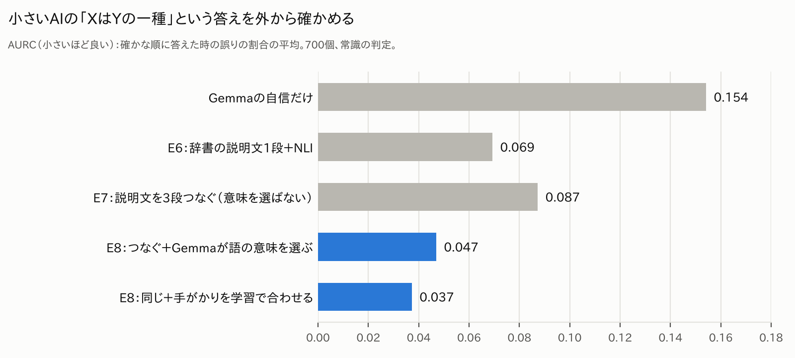
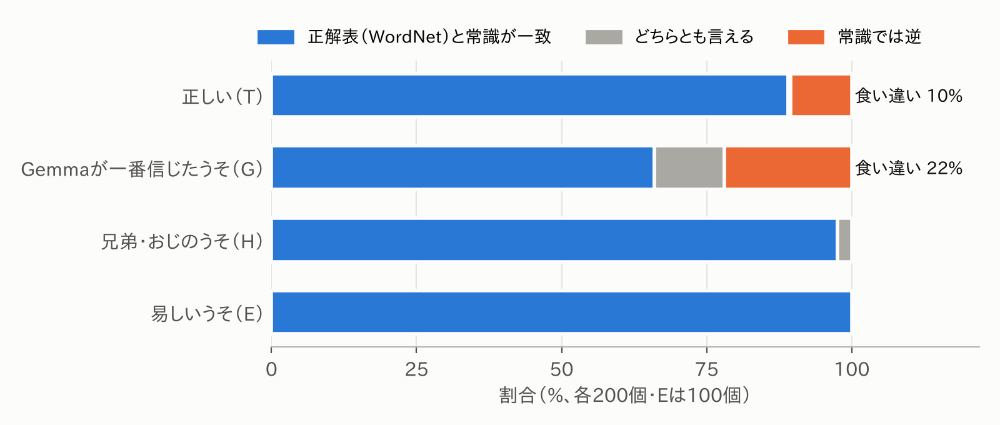
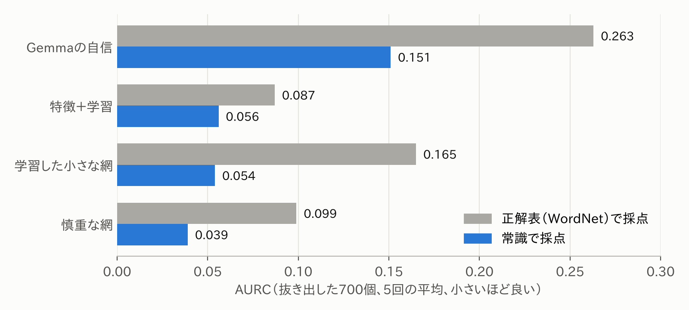
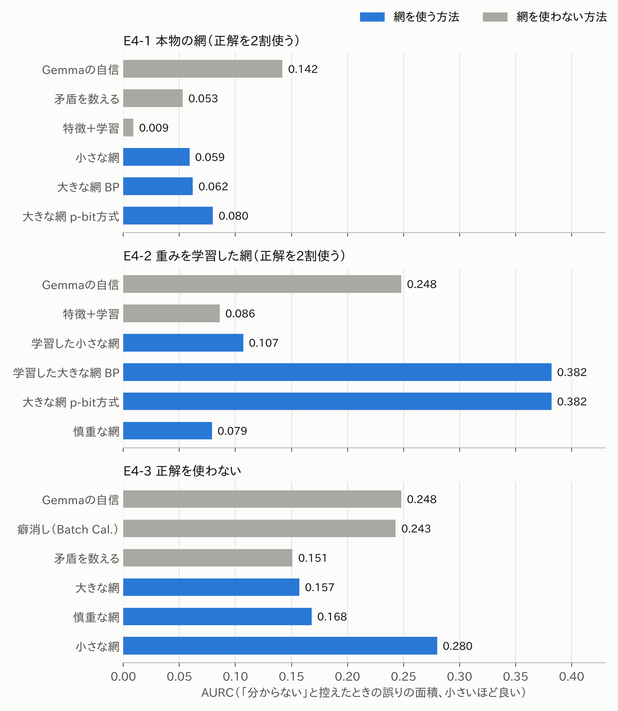

# AKANE Architecture 実験：小さいAIの答えを、外から確かめる

[](https://doi.org/10.5281/zenodo.24045799)

[English](README.md) | 日本語

**これは何か：** 小さな言葉のAI（Gemma-2 2B）を「口」として使い、その答えを、AIの外に置いた部品（ルール、確率伝搬（BP）、資料、辞書の説明文、小さなNLIのAI）で確かめる実験です。どの実験も、結果を見る前に計画を固定し、同着や負けもそのまま載せています。

**ここまでで分かったこと**（小さいAI 1つ・英語・ほぼ1分野。限界は下の「限界」に）：

- **小さいAIは、判定役としては弱いが、手伝いとしては使える。** Gemma-2 2Bは「XはYの一種か」で自信を持って間違えることが多い。その答えを辞書の説明文とNLIで確かめると、誤りの指標（AURC）は0.154から0.069に下がった（E6）。
- **得意な狭い役目だけをさせる。** 説明文をつなぐ（孫娘→人→哺乳類）と、語を違う意味で読む取り違えで崩れる（道の64%、E7）。Gemmaには「この語はどの意味か」を選ぶことだけをさせると、確かめた37個中35個が正しく、取り違えは4%に減った。そのつなぎで確かめると、学習なしでAURC 0.047、学習で合わせると0.037（E8）。
- **決め方に使っていない新しい300個**でも、AIの自信よりはっきり良い（0.039対0.118）。辞書1段だけの確かめ（0.055）より良いとは、300個では言い切れない。
- **網（BP）が効く所と効かない所。** AIが作ったルールも疑うBPは、分類と病気のテストで違反を数えるだけの方法に勝った（E2-6、E2-8）。資料（E3）、輪の多い大きな網（E4）、辞書の鎖（E7・E8）では、より単純な学習の組み合わせに勝てなかった。p-bit方式とBPの正しさは一度も分かれなかった（E4）。
- **訂正（2026-11-11）：比べた学習が全部、直線の学習でした。** E2〜E8の「特徴＋学習」はすべてロジスティック回帰でした。木の学習（勾配ブースティング、`analysis/audit_gb/`）で計算し直すと、3つの言い方が変わります。E2-7（分類はBPの勝ち→同着、地理は組み合わせと同着→BPの負け）、E4-2（WordNetで採点すると慎重な網の負け）、E7（鎖を足すのが一番とは言えない）。E8の結果は残りました。詳しくは下の「点検（2026-11-11）」の所に書きました。
- **少しだけ確かめられる時でも、網は強い学習に勝てなかった（E9）。** 主張の2〜10%を辞書で確かめ、その結果をGemmaのルールに沿って網（BP）で広げると、最初は直線の学習より良く見えました（E9-1）。しかし木の学習を相手にし、候補を選ばない77,326の主張すべてで比べると、網はすべての条件で負けました（E9-3）。網に残る役目は小さく、学習の答えをルールで仕上げるとAURCが5〜20%下がる程度で、先に決めた基準には届きません。



**5分で試す（CPUだけ、GPU不要）。** `data/` に保存済みのモデルの答えとNLIの値から、E8の結果を作り直します。Gemma自体を動かすには `colab/` のノートブックが要ります。

```bash
git clone https://github.com/mst-design2020/akane-e2-experiments.git && cd akane-e2-experiments/analysis/e8
pip install numpy scipy scikit-learn
python e8_analyze.py ../../data/E8_chains_nli.json out.json   # 約5分。AURCの表が出ます（例：学習した鎖の確かめ 0.037）
```

`python check_formulas_e8.py ../../data/E8_chains_nli.json`（約5秒）で、コードが下の式どおりかを確かめられます。まっさらなPython 3.13の環境で確かめ済みです。

すべての実験を1つの表で：[結果の一覧](#結果の一覧)。各実験の計画と結果は `plans/` にあります。

note記事の数字は、すべてこのリポジトリのファイルから出ています。

- 記事1「『数えるだけで足りた』を測り直したら――AIの間違いを、問題どうしのつながりから見つける」（E2-2・E2-3） https://note.com/mst_design2020/n/n28ced8c9549d
- 記事2「ルールまでAIに作らせたら――自分の答えを、自分で作ったルールで確かめられるか」（E2-4〜E2-7） https://note.com/mst_design2020/n/n5d7de09a97f2
- 記事3「外れたルールでも、疑えば使えるか――AIの間違い探しで、ルールの外れを増やしてみた」（E2-8・E2-9） https://note.com/mst_design2020/n/n0cddc2e4f209
- 記事4「先行研究と同じテストで比べてみた――AIの嘘探しで、負けた所と崩れなかった所」（E2-10・E2-11） https://note.com/mst_design2020/n/ne9eea6736480 （Zenn https://zenn.dev/mst_design2020/articles/8b904689df2ddc ）
- 記事5（E2-12、つながりを実際のAIに付けさせる） https://note.com/mst_design2020/n/n1af3e4380f0c （Zenn https://zenn.dev/mst_design2020/articles/bc3e1c916a4baa ）
- 記事6（E3、資料を根拠に「分からない」と言えるか） https://note.com/mst_design2020/n/nf427df9ee49d （Zenn https://zenn.dev/mst_design2020/articles/c1537032d8943c ）
- 記事7（E4、AIの答えから学んだ大きな網） https://note.com/mst_design2020/n/nd323ba54cf92
- 記事8（E4後半・E5、正解表の見直しと、AIが作ったルールの外れの損） https://note.com/mst_design2020/n/n222a0ecf386d

著者：加藤雅也（M.S.T.デザイン代表・大分県佐伯市） https://mst-design.jp/ ・ ORCID https://orcid.org/0009-0001-6803-654X ・ DOI https://doi.org/10.5281/zenodo.24045799

## AKANE Architectureとは（短く）

言葉のAIを「口」として使い、答えを確かめる仕組みをAIの外に置く、という考え方です。AIがまず答え、そのあとで外の仕組みが、答えを大きな記憶やルールに照らして、つじつまが合っているかを確かめます。将来は、この確かめる計算を、p-bit（確率的に0と1を行き来する部品）のような物理の部品に任せることを考えています。
このリポジトリの実験は、その「確かめる仕組み」の、一番小さな形を試したものです。研究全体の説明は https://mst-design.jp/research/ にあります。

## E2：AIが作ったルールで、確率伝搬を使って確かめる

**ひとことで：** 小さなAIに、答えを確かめるためのルールを自分で作らせます（外れも混ざります）。そのルールでAIの答えを確かめるとき、ルール自体が本当かどうかも一緒に疑いながら、確率伝搬で間違いを探します。BTProp（Hou ほか、NAACL 2025）に近い考え方です。違うのは、ルールをAI自身が作ることと、どのルールを信じるかを正解なしで網が決めることです。E2-10〜E2-12で、BTPropが公開した木そのものを使って両方を比べました。元のつながりではBTPropが上か同着でした。つながりをわざと逆にすると（E2-11）ルールも疑う網のほうが崩れにくかったものの、つながりを実際のAI（NLI 3種とGemma）に付けさせると（E2-12）BTPropはほとんど崩れず、ルールも疑う網が上回る所はありませんでした。私たちの方法がBTPropより良いとは言えません。E2はここで閉じます（まとめは `plans/E2_summary.md`）。E3では、資料を網でつなぐと「分からない」と控える判断が良くなるかを試しましたが、AIの自信と同着、NLIの数字を学習で合わせるだけの方法には負けました（下のE3）。E4では、WordNetの分類についてのAIの何千もの答えを、輪の多い1つの大きな網にしました。特徴を学習で組み合わせる単純なやり方には勝てず、BPとp-bit方式の正しさは一度も分かれませんでした（下のE4）。

小さな言葉のAI（Gemma-2 2B）に○×問題をたくさん答えさせ、問題どうしをルールでつないだ網から、どの答えが怪しいかを見つけます。

### E2で何をしているか（短く）

- 問題の例：「パリはフランスの都市である」「フランスはヨーロッパの国である」「パリはヨーロッパにある」（実際は英語）
- ルールの例：「AがBの一種で、BがCの一種なら、AはCの一種」「植物であって、しかも動物でもあるものはない」
- 比べる方法：AIの自信／ルールとの矛盾の数を数える／MaxSAT／確率伝搬（BP）／p-bitの動きをパソコンで真似た方法（揺れ）。E2-7ではさらに、言い換えのぶれ・近所の答えとの一致・それらの組み合わせ。
- 物差し：AIの間違いを見分けるAUROC。問題の2割で調整し、残り8割で測る。分け方5通り×p-bitの乱数2通り＝10回。
- 勝ち負けの決め方（各実験の前に固定）：10回の平均でAUROCの差が0.02以上、かつ10回中8回以上で上回ったら「勝ち」。差が0.02未満なら「同着」。
- E2-10・E2-11だけはやり方が違います：GemmaではなくBTPropが公開したChatGPTの木と自信を使い、FactCheckGPTとWikiBioで嘘の文を見つけます。回答ごとに2割で調整（AUROCで選ぶ）、木の上で厳密に計算（p-bitなし）、5回で「0.02以上かつ5回中4回以上」が勝ち。詳しくは `plans/E2-10_btprop.md`。

各実験の計画（結果を見る前に書いて固定したもの）と結果は `plans/` にあります。同着や負けの結果もすべて載せています。

## 計算のしかた

コードが実際に何を計算しているかを、式で書きます。コードがこの式どおりかは `analysis/check_formulas.py` で確かめられます（この節の最後）。E6〜E8の式は「[E6〜E8の計算のしかた](#e6e8の計算のしかた)」にあります。

**AIから受け取るもの。** 問題 $i$ ごとに「Is the following statement true? Answer Yes or No only.」と聞き、最初の語の「Yes」と「No」のロジットの差を $s_i$ とします。ラベルの組 $k$（例：植物と動物）ごとに「両立しないか」を2つの順番で聞き、Yes−Noのロジットの平均を $z_k$ とします。E2-5からの聞き方は「Is it true that no plant is an animal? Answer Yes or No only.」（聞き方P2）です。「No」が両立しないを意味する聞き方（E2-4、E2-5のP0・P1）では符号を逆にし、いつも $z_k > 0$ が「AIは両立しないと言った」になるようにしています。

**ずれと倍率の調整（調整用の2割だけで決める）。** $\ell_i = (s_i - \beta)\cdot 2/\sigma$。$\sigma$ は調整用の問題での $s$ の標準偏差、$\beta$ は97個の分位点のうち調整用で正解率が一番高くなるしきい値です。AIの答えは $m_i = [\ell_i > 0]$、AIの自信は $c_i = |\mathrm{sigmoid}(\ell_i) - 1/2|$。ルールのほうは $\zeta_k = 2 z_k/\sigma_z$（$\sigma_z$ は全部の組での $z$ の標準偏差）です。

**網。** 問題ごとに $x_i \in \{0,1\}$（1＝正しい）を置きます。ルールも疑う網（E2-6〜E2-9）では、ラベルの組ごとに $u_k \in \{0,1\}$ も置きます。$u_k = 1$ は「この両立しないルールは成り立たない」という意味です。網は次の確率分布です。

$$
P(x,u) \propto \exp\Big( \lambda \sum_i \ell_i x_i \;-\; \lambda r \sum_k \zeta_k u_k \;-\; W \sum_{(a,b,c)\in C} x_a x_b (1-x_c) \;-\; W \sum_k \sum_{(a,b)\in I_k} x_a x_b (1-u_k) \Big)
$$

- $C$：人が書いたつながりのルール「$a$ と $b$ が正しければ $c$ も正しい」（例：「$w$ は $B$ の一種」と「$B$ は $Z$ の一種」なら「$w$ は $Z$ の一種」）。いつも正しいルールです。
- $I_k$：同じことば（または同じ種類）を、組 $k$ の2つのラベルの両方に入れている問題の組。両方が正しいと、$u_k = 1$ でない限り、ルール $k$ を破ります。
- 2つ目の項により、AIが自信を持って「両立しない」と言った組（$\zeta_k$ が大きい）では $u_k = 1$ になりにくく、「両立する」と言った組ではなりやすくなります。つまり、AIのルールの答えは出発点の見込みで、問題への答えのほうからルールがくつがえることもあります。

ルールを全部信じる網（E2-2〜E2-5と、E2-9の「疑わないBP」）には $u$ がなく、両立しないの項は $-W \sum_{(a,b)\in E} x_a x_b$ です。$E$ は正しいとした組の $I_k$ を合わせたもので、E2-2・E2-3とE2-4の人のルールの回では人が書いたもの（わざと外す回はくじで逆にしたもの）、それ以外は $z_k > 0$ の組です。（E2-4の「Bw」だけは、全部の組を入れ、それぞれの $W$ にAIの「両立しない」の確率を掛けています。）

**「この答えは間違い」の合図（大きいほど怪しい）。**
- AIの自信：$-c_i$
- 矛盾の数を数える：$v_i - c_i/10$。$v_i$ は、AIの答え $m$ が破っているルール（つながりのルールと、$z_k>0$ の両立しないルールを全部正しいとしたもの）のうち、問題 $i$ が入っている本数です。$c_i/10$ は同じ本数どうしの順番を決めるだけです。
- 確率伝搬（BP）：$P$ にループのある確率伝搬（sum-product、ダンピング0.5、最大200回、収束の幅 $10^{-6}$）をかけて $q_i \approx P(x_i = 1)$ を出します。合図は $m_i = 1$ なら $1 - q_i$、$m_i = 0$ なら $q_i$ です。
- p-bit方式（コードでは「揺れ」）：同じ $P$ をギブスサンプリング（彩色で同時に更新、10本の鎖、はじめの100回は捨て、そのあと400回の平均）で $q_i$ を出し、BPと同じ形の合図にします。1回の更新で、上の式の指数の変化をsigmoidに通した確率で $x_i = 1$ にするので、p-bitの動きと同じです。ただし、ここのルールは3つの変数を一度につなぐので、ふつう2つずつつなぐp-bitの部品で作るには、配線の工夫が要ります。
- MaxSAT：$P$ で一番確率の高い組み合わせ（重みは整数に丸める：問題ごとに $100\lambda|\ell_i|$、ルールの札ごとに $100\lambda r|\zeta_k|$、ルールごとに $100W$）をRC2で解きます。合図は「MaxSATが $m_i$ を変えたか」$- c_i/10$ です。

**調整。** BP・p-bit方式・MaxSATそれぞれで、$(\lambda, W, r)$ を $\{0.5,1,2\}\times\{1,2,4\}\times\{0.5,1,2\}$ から（$r$ はルールを疑うときだけ）、調整用の問題での正解率で選びます。数えるには調整するものはありません。調整用は、ことば・都市・病気の2割についての問題全部で、AUROCは残りで測ります。

**E2-9。** ルールの答えを $\pm|z_k|$ に置きかえ（符号は正解に合わせる）、そのうち割合 $f$ の組をくじ（seed $10000 + $ 分け方）で選んで符号を逆にします。

**コードが式どおりかの確かめ。** `cd analysis; python check_formulas.py`（1分ほど）は、小さな網を40個くじで作り、上の式の全部の組み合わせを数え上げて正確な確率を出し、実験で使ったコードの結果と比べます。結果：木の形の網ではBPは正確に一致（ずれ0.0000）、ループのある網では最大0.019のずれ（ループのある確率伝搬は近似なので想定どおり）、p-bit方式のずれは最大0.003（サンプリングのばらつき）、MaxSATはいつも一番確率の高い組み合わせを見つけました。

## 結果の一覧

| 実験 | 内容 | 主な結果 | 計画と結果 |
|---|---|---|---|
| E2-2 | 地理テスト（GeoNames、3,586問）、人が書いたルール | BP 0.83 対 数える 0.81：基準ぎりぎりで勝ち | `plans/E2-2_geo.md` |
| E2-3 | ものの分類テスト（WordNet、2,074問）、人が書いたルール | BP 0.88 対 数える 0.85：勝ち | `plans/E2-3_wordnet.md` |
| E2-4 | ルールをAIに作らせる／わざと外したルール | AIのルールは31%正しい → 同着。正しいルールを1割外しても勝ち、2割で同着 | `plans/E2-4_selfrule.md` |
| E2-5 | ルールの聞き方を、テストと別の言葉で選んでから使う | ルールは87%正しい。BP 0.82 対 数える 0.81：同着（AIの自信には勝ち） | `plans/E2-5_wording.md` |
| E2-6 | ルール自体も網の中で疑う | BP 0.84 対 数える 0.81：勝ち（10回中8回） | `plans/E2-6_doubt_rules.md` |
| E2-7 | 地理での繰り返し／ほかの方法との比べ | 地理：BP 0.82 対 数える 0.80：同着。分類：組み合わせを直線の学習で作るとBPがほかの方法すべてに勝ち（0.844対0.803）。木の学習で作ると組み合わせは0.825で差0.019（10回中8回）、同着（2026-11-11に点検、`analysis/audit_gb/`）。地理：直線の学習の組み合わせとは同着（0.817対0.804）。木の学習の組み合わせにはBPの負け（0.851対0.817、10回中8回） | `plans/E2-7_geo_and_baselines.md` |
| E2-8 | 3つ目の分野（病気の分類、Human Disease Ontology、3,304問）。確かめる組もAIに選ばせる | ルールは84%正しい。ルールも疑うBP 0.76 対 数える 0.74：勝ち（10回とも）。AIに選ばせた組は8割が外れで、全部の組を聞くより少し下（基準では同着） | `plans/E2-8_disease.md` |
| E2-9 | 同じ網で、ルールの外れの割合だけを0〜5割と変える（病気・分類） | 外れを増やしても、BPと数えるの差はほぼ同じ（基準では「変わらない」）。ルールを全部信じるBPは、ルールが正しいときは上、外れ3割で逆転。追加の確かめ：人のつながりのルールを抜くと、分類では外れが多いほど差が開いた（+0.03→+0.09） | `plans/E2-9_wrong_rate.md` |
| E2-10 | BTProp（Hou ほか、NAACL 2025）と同じテスト。論文の作者が公開したChatGPTの文の木と自信をそのまま使い、最後の確率の計算だけを入れ替える（FactCheckGPT 631主張、WikiBio 921文） | BTPropが自信より良くなる幅は再現（+0.03／+0.08）。WikiBio：BTProp 0.80 対 ルールも疑うBP 0.77でBTPropの勝ち（5回とも）。FactCheckGPT：0.79 対 0.80で同着 | `plans/E2-10_btprop.md` |
| E2-11 | 同じ木で、NLIのつながりを0〜5割くじで逆にする | BTPropは外れ2〜3割でAIの自信より下に落ちる（5割で0.60〜0.65）。ルールも疑うBPは自信の近くで止まる。FactCheckGPTは外れ2割から、WikiBioは5割で疑うBPの勝ち | `plans/E2-10_btprop.md` |
| E2-12 | 同じ木で、つながりを実際のAI 4つ（NLI小・中・大、Gemma-2 2B）に付けさせる | BTPropはほとんど崩れない（Gemmaでも自信より上）。FactCheckGPTは全部同着、WikiBioは全部BTPropの勝ち（差0.02〜0.05）。本物の外れでは、ルールも疑うBPが上回る所はなかった | `plans/E2-12_real_links.md` |
| E3 | 資料（HoVer、3,952件）：資料を網でつなぐと、AIが「分からない」と控える判断が良くなるか | 網はAIの自信と同着、NLIの特徴＋学習に負け（AURC 0.225・0.207・0.177） | `plans/E3_evidence_abstain.md` |
| E4 | WordNetの分類についてのAIの何千もの答えを、輪の多い1つの大きな網に。BP対p-bit方式 | 大きな網は崩れ、慎重な網は特徴＋学習と同着。BPとp-bit方式の正しさは一度も分かれない | `plans/E4-2_learned_net.md` |
| E5 | AI自身が作ったルールの外れは、どれだけ損か | WordNetの正解では損あり（0.02〜0.04）、常識の正解ではほぼなし。ルールも疑う網＝全部信じる網 | `plans/E5_rule_errors.md` |
| E6 | 辞書の説明文＋NLIで、AIの自信ある間違いを直す（700個） | 自信ある間違いの75%が直る。AURC 0.154→0.069。ただし2段先の正しい答えの40%を壊す | `plans/E6_dictionary.md` |
| E7 | 説明文を3段までつなぐ | 正しい答えを壊すのが減る（40%→29%）が、50本中30本が途中で意味を取り違え。BPは掛け算と同着 | `plans/E7_chain_definitions.md` |
| E8 | 鎖の途中の語の意味をAIが選ぶ・打ち消し・新しい300個 | 取り違え64%→4%。学習なし0.047、学習0.037。網は負け。新しい300個で0.039（自信は0.118） | `plans/E8_sense_choice.md` |
| E9 | 辞書で確かめられるのは主張のごく一部。網で広げると学習より良いか（作り物の確かめ役→本物の辞書） | 確かめが入った物では直線の学習に勝ち（E9-1：2% 0.072対0.032）。木の学習とは同着（E9-2） | `plans/E9-1_real_dictionary.md`・`plans/E9-2_strong_learner.md` |
| E9-3 | 同じ問いを、物1,681×46分類すべて（主張77,326）で。ルールはGemmaの答えだけ | 網は13条件すべてで木の学習に負け（10%：0.0029対0.0018）。木＋網の仕上げは0.0014で、決まりでは同着 | `plans/E9-3_all_categories.md` |

## E3：資料を根拠に「分からない」と言えるか

E2のあと、別の問いを試しました。AIに資料（証拠）を渡したとき、資料を網でつないで計算すると、「分かりません」と控える判断が、ほかの簡単な方法より良くなるか。計画（結果の前に固定、変更は理由ごと記録）：`plans/E3_evidence_abstain.md`、先行研究：`plans/E3_prior_work.md`。

- データ：HoVer の dev（正解の資料つき、ProgramFC の公開版）。1つの主張が2〜4本のWikipedia記事にまたがる。3,952主張（試しに使った48件は除く）、正解は「支える／反する」。
- AI：Gemma-2 2B が答えと自信 P(True) を出す。Gemma-2 9B（4ビット）が主張を部分の主張に分け、名前の書かれていない人や物（「映画Xの監督」＝#1）の候補を資料から出す。DeBERTa-v3-large のNLIが、段落ごとに元の主張と部分の主張を判定する。
- 比べた方法（控える順番の良さで比べる）：①Gemmaの自信、②支える文と矛盾する文を数える（Pandian 2026の形）、③NLIの数字11個＋ロジスティック回帰（SURE-RAGの形、5分割）、④デンプスター・シェーファーで合わせる（EvidentialRAGの形）、⑤決まった論理（ProgramFC・GraphCheckの形）と⑤'部分の主張の一番低い確率、⑥候補・部分の主張・元の主張の網（小さいので確率伝搬と同じ答えを厳密に計算）。

| 方法 | 全部答えた時の正しさ | 9割答える | 7割 | 5割 | AURC（小さいほど良い） |
|---|---|---|---|---|---|
| ①Gemmaの自信 | 67.9% | 69.6 | 73.2 | 76.9 | 0.207 |
| ②数える | 54.5 | 55.7 | 59.5 | 66.4 | 0.353 |
| ③NLIの数字＋学習 | 71.0 | 73.2 | 77.9 | 82.5 | **0.177** |
| ④デンプスター・シェーファー | 67.1 | 68.0 | 70.1 | 73.5 | 0.253 |
| ⑤決まった論理 | 71.0 | 71.1 | 71.3 | 71.2 | 0.287 |
| ⑤'部分の一番低い確率 | 70.6 | 71.4 | 74.1 | 76.2 | 0.246 |
| ⑥網 | 71.1 | 72.4 | 75.3 | 78.0 | 0.225 |

- 先に決めた基準（AURCの差0.02以上、5回中4回以上）で、網は②・④・⑤'に勝ち（5回とも）、①と同着（差0.016、網が上は5回中1回）、③に負け（0回）。記事の本数別のAURC（①／⑥／③）：2本 0.150／0.148／0.144、3本 0.230／0.245／0.182、4本 0.243／0.268／0.205。
- 「支える」主張から正解の段落を1本抜く確かめ（1,976件）：Gemmaの「支える」の答えは75%から41%に変わったのに、自信（|p−0.5|の平均）は変わらなかった（0.445→0.443）。資料を使う方法は自信が下がった（網 0.405→0.349、⑤' 0.346→0.207）。
- まとめ：資料を使うと「資料が足りない」ことに気づきやすくなる。ただ、資料を網でつなぐ方法は、NLIの数字を学習で合わせるだけの方法に勝てなかった。網が効くとは言えません。なお、実際に動かした網には、計画にあった「資料の文どうしの矛盾」の線が入っておらず、輪のない小さな形でした。E3はここで閉じます。

## E4：輪の多い大きな記憶の網と、BP・p-bit方式

E4では、AIのたくさんの答えを輪の多い1つの大きな網にすると、単純なやり方より間違いを見つけられるかを確かめました。あわせて、そこでp-bit方式（揺らして数える。ソフトで再現）とBPに差が出るかも見ました。計画（結果を見る前に固定。あとから足した確認はそう書いてあります）：`plans/E4-0_synthetic.md`・`plans/E4-1_wordnet_net.md`・`plans/E4-2_learned_net.md`、先行研究：`plans/E4_prior_work.md`・`plans/E4-2_prior_work.md`。判定はこれまでと同じで、AURCの差が0.02以上で5回中4回以上同じ向きなら「差あり」、それ以外は同着です。

**E4-0 作り物の網**（主張2,000、1つの主張につながる線2〜6本、外れたルール1〜30%、ルールを正しい強さで信じる／2倍信じすぎる、各5回）。BPとp-bit方式（鎖1本・1万回）は32条件中30で同着、2条件でBPが上。p-bit方式が上の条件はありませんでした。線が多く外れたルールを信じすぎる所では、小さな網でBPの確率が正確な答えからずれました（線6本でずれ0.10、p-bit方式は0.01）が、正しさは同着でした。強いルールを信じすぎると、鎖1本のp-bit方式は谷に閉じこもりました。作り物では網が答えを作った仕組みそのものなので、BPはAIの自信に32条件中29で勝ちました。

**E4-1 WordNetとGemmaの本物の網。** 名詞1,500個×WordNetの分類46個。Gemma-2 2Bに「XはYの一種か」（名詞ごとに正しい分類最大4つ＋関係ない分類3つ）、分類どうしの「YはZの一種か」、「YでありZでもある物はない」を聞きました。ルールは論理の形（受け継ぎ・両立しない・分類どうしの2つ）だけ固定し、分類の知識そのものはGemmaの答えとして網に入れています。主張10,864・ルール51,643・独立な輪 約8万。

| 方法（名詞の主張、評価用8割） | AURC（小さいほど良い） | 全部答えた正しさ | 半分答えた正しさ |
|---|---|---|---|
| ① Gemmaの自信 | 0.142 | 81.9% | 88.3% |
| ② 矛盾を数える | 0.053 | 82.0 | 97.7 |
| ③ 特徴＋学習 | **0.009** | 93.6 | 99.8 |
| ④ 小さな網（1語ずつ、BP） | 0.059 | 81.6 | 96.1 |
| ⑤ 大きな網（BP） | 0.062 | 82.3 | 95.5 |
| ⑥ 大きな網（p-bit方式、鎖4本×1万回） | 0.080 | 82.3 | 93.9 |

大きな網は自信に勝ち（5/5）、小さな網と同着、特徴＋学習に負けました。BPとp-bit方式は同着です（1回だけp-bit方式が谷にはまり、他の4回は差0.001以内）。多くの名詞で使い回す分類どうしの主張は、網の中で悪くなりました（両立しないのAURC 0.009→0.063）。たくさんの名詞から小さな疑いが積み重なるためです。弱点：うその候補が関係ない分類なので、ルールで見分けやすい作りでした。

**E4-2 ルールの強さを学習した網。** NELLで「重みを学習したマルコフ論理ネットワークが1件ずつの学習に勝った」Jiang, Lowd, Dou（ICDM 2012）にならい、ルールの種類ごとの強さと癖の補正をロジスティック回帰で学びました。名詞1,681個×46分類を全部聞いています（80,377問）。うその候補は難しくしました：(G) Gemmaが一番信じたうその分類、(H) 兄弟・おじの分類（TaxoGlimpse, VLDB 2024 と同じ作り）、(E) 関係ない分類。主張11,864・ルール55,136。

| 方法（名詞の主張、評価用8割） | AURC | 全部答えた正しさ | 半分答えた正しさ |
|---|---|---|---|
| ① Gemmaの自信 | 0.248 | 69% | 77% |
| ② 自信＋癖の補正 | 0.251 | 70 | 78 |
| ③ 特徴＋学習 | 0.086 | 77 | 93 |
| ④ 学習した小さな網（BP） | 0.107 | 79 | 90 |
| ⑤ 学習した大きな網（BP） | 0.382 | 46 | 61 |
| ⑤' 慎重な大きな網（分類どうしの主張はGemmaの値に固定） | **0.079** | 79 | 94 |
| ⑥ 学習した大きな網、p-bit方式（温度4つの入れ替え） | 0.382 | 46 | 61 |
| ⑦ 強さ1つを格子で選ぶ | 0.151 | 70 | 86 |

- 学習した大きな網は倒れ、ほとんど全部を「本当」と答えました（うそを見抜けた割合 G 0%・H 3〜11%・E 3〜13%）。②③④に5/5で負けです。結果を見たあとの確認：分類どうしの主張をGemmaの値そのままにしても倒れました（AURC 0.18〜0.21）。使い回す主張が多くの名詞からの疑いで引っ張られる、E4-1と同じ数えすぎです。
- 慎重な網は5回とも③より小さい値でしたが、差は0.007で同着です。ルールの中身もAIの答えであるこの場面では、Jiang 2012 の結果は再現しませんでした。
- BPとp-bit方式は今回も同着（確率の差 平均0.004）。温度の入れ替えは一度も起きず、この大きさの網では温度4つは働きませんでした。
- Gemmaが一番信じたうそ（G）を見抜けた割合は、自信31%・③53%・慎重な網54%。
- **訂正（2026-11-10）：正解表（WordNet）にも問題がありました。** 700個（G 200・H 200・E 100・正しい 200）を、正解を見ずに常識で判定し直しました（`analysis/e4/relabel/`、判定はClaude 1人分）。Gの約3分の1は普通の意味では正しい答えでした（はっきり22%・どちらとも12%。agua→飲み物、velvet→材料、economist→働く人 など。WordNetの意味が狭いため）。H・Eはほぼ本当にうそ。正しいとされた側の約11%は常識では外れでした。常識の正解ではGの正しさは 自信 約60%・③ 約76%・慎重な網 約80%。この700個でのAURCは、慎重な網対③が 0.099対0.087（WordNet）→ 0.039対0.056（常識）。網が5回とも小さいですが、差0.013〜0.027で決まりでは同着のまま。小さな網は0.165→0.054。「Gemmaが一番信じた間違いはほとんど直らない」という読みは言い過ぎでした。

  

  
- **点検（2026-11-11）：強い学習と比べる。** 同じ特徴で、ロジスティック回帰の代わりに木の学習（勾配ブースティング）を使うと、③は0.038になり、慎重な網（0.079）よりずっと小さくなります。WordNetの正解では網の負けです。この良さの多くは、候補の作り方の癖（本当の分類は階層でつながっている、Gは作り方の上で「Gemmaが一番信じたうそ」）とWordNetの狭い意味取りを、木の学習が拾えるためです。常識で判定し直した700個では差は小さく、慎重な網0.039対 木の学習0.049（網が5回とも小さいが、決まりでは同着）。
- 先に書いた予想5つのうち3つが当たり。外れは「学習した大きな網は②に勝つ」「⑤と⑤'は名詞の主張で同着」。

**E4のまとめ。** この範囲では、全部の答えを輪の多い1つの大きな網にしても、特徴を学習で組み合わせる単純なやり方に勝てませんでした。使い回す知識を網の中で動かすと、かえって悪くなりました。使い回す知識は固定し、その場の答えだけを網で決める形が一番良く、直線の特徴＋学習と同着でした（木の学習には、WordNetで採点すると負け、常識で採点すると同着。2026-11-11点検）。BPとp-bit方式の正しさは一度も分かれませんでした。p-bitの良さがあるとすれば速さと電力で、それはシミュレーションでは測れません。

**E4-3 正解をまったく使わない**（`plans/E4-3_no_labels.md`、`analysis/e4/e43.py`）。E4-2と同じ答えと網で、正解は採点だけに使いました。正解なしの方法のAURC（小さいほど良い）：自信0.248、Batch Calibration（Zhou ほか ICLR 2024）0.243、矛盾を数える0.151、網なしのDawid–Skene型EM 0.253、大きな網でEM（BP、W=2）0.157、慎重な網0.168、小さな網0.280。網は自信と癖消しに5回とも勝ち（差約0.09）、矛盾を数えるとは同着でした。網ありでは本当の割合を周辺確率から推すと網の押しを二重に数えて暴走するので、網だけのモデルに合わせる形にしました（正解は使いません）。使い回す「一種」の主張の本当の割合は大きくずれました（0.255、本当は0.026）。E4全体の結論：効いているのは網の計算ではなくルールそのもので、AI自身のルールの外れとWordNetの正解表の外れ（E4-2の訂正）が結果を大きく動かします。



図：`analysis/e4/figs_zenn.py`（日本語）、`analysis/e4/figs_en.py`（英語）。

## E5：AI自身が作ったルールの外れは、どれだけ損になるか

ルールで答えを直す時、そのルールもAIが作ったもので一部外れていると、どれだけ損になるかを測りました。計画（結果を見る前に固定。Geminiでの確かめは結果のあとに足したもの）：`plans/E5_rule_errors.md`、先行研究：`plans/E5_prior_work.md`。AIの「一種」の知識の外れの割合を測る研究（TaxoGlimpse 2024、LLM-Hype 2025）や、正しいと置いたルールで答えを直す研究（BeliefBank、ConCoRD、LoCo-LMs）はありますが、AI自身のルールの外れが答え直しにどれだけ響くかを測ったものは見つかりませんでした。

やり方：新しくAIに聞かず、E4-2の答え・候補・網をそのまま使い（`analysis/e5/e5.py`、CPUで1分以内）、ルール（網の中の分類どうしの「一種」2,044組、「両立しない」968組）だけを入れ替えました。Gemmaの一種のルールは「はい」144組で、WordNetで正しいのは48組（食い違いは全部で102組）。両立しないは「はい」928組、食い違い56組。ルール：なし／WordNet／Gemma／Gemmaの外れを2・5・8割直す／一種の外れだけ直す／両立しないの外れだけ直す／Gemmaの「はい」の強い半分だけ。方法：矛盾を数える、ルールを全部信じる網（分類どうしの主張をルールの はい／いいえ に固定。E4-2の慎重な網と同じ作り）、ルールも疑う網（Gemma自身の確率で固定）、特徴＋学習。採点はWordNet（評価用の名詞の主張すべて）と常識（E4-2で判定し直した700個のうち評価用の名詞）の2通り。

| ルール | 数える | 信じる網 | 疑う網 | 特徴＋学習 | 信じる網（常識） | 特徴＋学習（常識） |
|---|---|---|---|---|---|---|
| なし | 0.248 | 0.251 | 0.251 | 0.194 | 0.154 | 0.107 |
| WordNet | 0.128 | 0.056 | 0.056 | 0.043 | 0.046 | 0.051 |
| Gemma | 0.151 | 0.079 | 0.079 | 0.087 | 0.046 | 0.058 |
| Gemma（一種の外れだけ直す） | 0.130 | 0.060 | 0.060 | 0.044 | 0.043 | 0.051 |
| Gemma（両立しないの外れだけ直す） | 0.155 | 0.076 | 0.078 | 0.089 | 0.048 | 0.066 |
| Gemma（強い半分だけ） | 0.161 | 0.134 | 0.130 | 0.085 | 0.090 | 0.068 |

（名詞の主張のAURC、小さいほど良い、5回の平均。Gemmaの自信だけは WordNet 0.248・常識 0.152）

- WordNetで採点すると、Gemmaのルールの損はWordNetのルールに比べて0.022〜0.023（網・数える）、0.044（特徴＋学習）で、5回とも差あり。損のほぼ全部は一種のルールの外れから来ていて、一種だけ直すとWordNetのルールとほぼ同じになり、両立しないの外れを直しても変わりませんでした。直す割合を増やすと、損はほぼまっすぐ減ります。
- 点検（2026-11-11）：学習を木の学習にすると、学習の損は0.021（0.041対0.020）で、ロジスティック回帰の半分。網は変わりません。
- 常識で採点すると、損はほとんど消えました（0.000〜0.007、差のある回なし）。同じ700個をWordNetで採点すると損は見える（信じる網 0.071対0.108）ので、数が少ないせいだけではありません。Gemmaの「外れた」一種のルールの多くは、WordNetの狭い意味でだけ外れです（野菜→食べ物、車→機械、人→哺乳類など）。
- ルールも疑う網は、全部信じる網と同じでした。Gemmaはルールの答えにほぼいつも強い自信（はい−いいえ が±8前後）を持つので、疑う量がほとんど出ません。強い半分だけ残すと、全部使うより悪くなりました（0.134対0.079、5回とも）。外れより、ルールが抜ける損の方が大きいです。
- E4-2の「弱点」に書いた慎重な網の補正の当て方は、名詞の主張には響いていませんでした（ルールの はい／いいえ に固定しても同じ0.079）。
- 2人目の判定（結果のあとに追加）：同じ802個（700個＋食い違う一種のルール102組、混ぜて番号だけ）をGeminiにも判定してもらいました（`analysis/e5/labels/`）。Claudeの判定との一致は3択で87%、「どちらとも」を正しいに入れると91%。Gemmaが一種と言いWordNetが違うとした96組を、Geminiははっきり正しい32、どちらとも49、違う15としました。Geminiの判定で採点し直しても、Gemmaのルールの損はどの方法も−0.004〜+0.004で差なし（「どちらとも」をどちらに入れても同じ）。判定はどちらもAIで人ではなく、GeminiはGemmaと同じ会社のAIです。
- 先に書いた予想4つのうち当たりは2つ（損の大部分は一種のルール、常識で採点すると差が縮む）。外れは「疑う網は損が小さい」「強い半分だけの方が損が小さい」。

**E5-2 2つ目の分野：病気の分類**（`plans/E5-2_disease.md`、`analysis/e5/e52.py`）。地理はGemmaのルールが99%正しく（E2-7）測れないので、E2-8の病気のデータを使いました。病気の主張3,304、つながりのルール527本（どの条件でも同じ）、分類の組231。Gemmaの「両立しない」ルールは、病気の分類表（DOID）と83.5%一致（言い過ぎ10組・見逃し28組）。ルールの入れ替えと方法はE5と同じ。常識の判定は702個（Gemmaと DOIDが食い違う主張324個すべて、一致する主張300、食い違う組38、一致する組40）を、結果を見る前にClaudeが、そのあとGeminiが付けました。

| ルール | 数える | 信じる網 | 疑う網 | 特徴＋学習 | 信じる網（常識） | 疑う網（常識） |
|---|---|---|---|---|---|---|
| なし | 0.046 | 0.047 | 0.047 | 0.027 | 0.253 | 0.253 |
| DOID | 0.036 | 0.031 | 0.031 | 0.024 | 0.202 | 0.202 |
| Gemma | 0.038 | 0.035 | 0.037 | 0.025 | 0.216 | 0.229 |
| Gemma（見逃しだけ直す） | 0.035 | 0.030 | 0.032 | 0.024 | 0.199 | 0.210 |
| Gemma（言い過ぎだけ直す） | 0.039 | 0.036 | 0.038 | 0.026 | 0.219 | 0.233 |
| Gemma（強い半分だけ） | 0.041 | 0.038 | 0.040 | 0.026 | 0.227 | 0.241 |

（AURC、5回の平均。常識＝抜き出しのClaudeの判定。Gemmaの自信だけは DOIDで0.050）

- DOIDで採点すると、Gemmaのルールの損は0.001〜0.006で差なし。この分野ではルール自体の効き目が小さく（信じる網 ルールなし0.047・DOIDのルール0.031、差なし）、Gemmaの自信だけでもよく当たります。
- 常識で採点しても、数える・信じる網・特徴＋学習は差なし。例外はルールも疑う網で、損0.027（5回とも。Geminiの判定でも0.024、5回とも）。同じ抜き出しをDOIDで採点しても0.023なので、判定のせいではありません。病気のルールにはGemmaの自信が弱く（大きさの中央値約4）、その弱い確率で組を置くと網が悪くなります。
- 損の大部分は見逃しから。言い過ぎを直しても変わりません。見逃し28組をClaudeが見ると、常識でも両立しない7・両立する10・どちらとも11。DOIDの「両立しない」（DOIDの中に両方に入る病気がない）の決め方は、所々狭いです。
- Geminiは「どちらとも」を使わず、組の文78個を全部「違う」としたので、組の判定には使えません。病気の主張ではClaudeと87%一致（「どちらとも」を正しいとした場合）。
- 予想4つのうち当たりは1つ（DOIDで損は小さい）。外れは「言い過ぎの方が効く」「疑う網は少し良い」「常識ではDOIDのルールがGemmaより悪く見える」。

## E6：Gemmaの自信ある間違いを、辞書の説明文で直せるか

E4-2で、Gemmaが信じていて常識で見ても間違いの答え（常識でも違うG）が残りました。物の語の辞書の説明文を足すと、それが何割直り、正しい答えを何割壊すかを測りました。計画（結果を見る前に固定）：`plans/E6_dictionary.md`、先行研究：`plans/E6_prior_work.md`。説明文で「一種か」の判定が良くなること（TaxoLLaMA ACL 2024、Moskvoretskiiほか 2026、LLM-Hype 2025）や、AIは自信があると外の文を聞かないこと（ClashEval NeurIPS 2024、Xieほか ICLR 2024）は知られています。AI自身の自信ある間違いに絞って、直る割合と壊す割合を測ったもの、説明文を聞き方に入れるのと外で判定するのを比べたものは見つかりませんでした。

やり方：E5と同じ見直し済みの700個（ClaudeとGeminiの常識の判定）。そのうち「自信ある間違い」はGemmaが「はい」と言い、常識では違うGの81個。説明文は物の語だけ：S1 WordNet（E4-2の物はWordNetで名詞の意味が1つの語だけなので、正解表の答えを見せるのに近い）、S2 Wiktionaryの英語の名詞の意味ぜんぶ（本命、599語中591語で取れた）、S3 Wiktionaryの1番目の意味だけ。方法：①Gemmaの自信、②説明文を聞き方に入れてGemmaに聞き直す、③NLI（DeBERTa-v3大、E2-12・E3と同じ）で「"X" means: 説明文」⇒主張を判定（一番含む意味）、④Gemmaの答えと意味をつなぐ網（どれかの意味が支えれば正しい。木なのでBPは正確、強さ1つを学習用の分で選ぶ）、⑤特徴＋学習。学習も採点も常識の判定で、物ごとに5分割・5回（`colab/E6_dictionary_gemma.ipynb`、L4 GPU。時間の大部分はWiktionaryをゆっくり取る所、`analysis/e6/`）。

| 方法（書いてなければS2） | 自信ある間違いが直る（81） | 自信 低／中／高 | 正しい答え(T)に「いいえ」 | 常識で正しいGを壊す | AURC Claude | AURC Gemini |
|---|---|---|---|---|---|---|
| ① 自信 | 0% | 0／0／0 | 33% | 4% | 0.154 | 0.149 |
| ② 聞き方に入れる S1 WordNet | 75% | 89／85／52 | 28% | 26% | 0.124 | 0.159 |
| ② 聞き方に入れる | 70% | 93／74／44 | 24% | 26% | 0.124 | 0.145 |
| ③ 外でNLI S1 WordNet | 83% | 93／93／63 | 26% | 40% | 0.060 | 0.080 |
| ③ 外でNLI | 75% | 89／81／56 | 24% | 40% | 0.070 | 0.084 |
| ④ 網 | 20% | 56／4／0 | 31% | 8% | 0.098 | 0.094 |
| ⑤ 特徴＋学習 | 68% | 87／74／43 | 24% | 24% | 0.079 | 0.080 |

- 説明文で、自信ある間違いの約7〜8割が直る。聞き方に入れる対外でNLI（S2）は70%対75%で、決めておいた基準（10ポイント）では同着。どちらも自信の高い間違いほど直りにくい（入れる93%→44%、NLI 89%→56%）ので、Gemmaが文を無視するせいだけではなく、組そのものが難しい（例：「マッチ箱はおもちゃ」「シミュレーターはゲーム」）。
- 説明文は、常識では正しいGの24〜40%も壊す。多くは2段先の主張（「孫娘は哺乳類」）で、説明文は直接の上位（「人」）しか書かない。
- 網対特徴＋学習（S2）：網が5回とも悪い（差0.010〜0.029、0.02以上は2回）ので、決まりでは同着。選ばれた強さが小さく（0.25〜0.5）、網は少ししか直さない。
- 結果を見たあと（参考）：NLIの点だけで並べるとAURCが一番小さい（S2 0.070、S1 0.060）。特徴＋学習より5回とも小さく（差0.005〜0.015）、Gemmaの自信を足すとかえって悪くなる。資料が段落だったE3では外のNLIが負けたが、今回は説明文が主張に直接答えている。
- 点検（2026-11-11）：木の学習にすると、特徴＋学習は0.067（S2）で、NLIの点だけ（0.070）とほぼ同じ。網（0.098）の負けは変わりません。
- 予想5つのうち当たり2つ（説明文は直す、網は学習と同着か負け）、半分当たり1つ（聞き方に入れると自信ある間違いは直りにくい）。外れ：WordNetの説明文が一番直る、NLIは自信に関係なく直る、NLIは珍しい意味の正しい答えを壊す（実際に壊したのは2段先のG）。

## E7：説明文を段々につなぐ（孫娘→人→哺乳類）

E6の説明文は直接の上位しか書かないので、2段先の正しい主張を壊しました。E7は説明文の頭の名詞を3段までたどり、それで直るか、網（BP）でまとめるのが単純な決まりより良いかを見ました。計画（結果を見る前に固定）：`plans/E7_chain_definitions.md`、先行研究：`plans/E7_prior_work.md`。説明文をつないで分類の木を作る研究（MindNet 1998、OntoLearn Reloaded 2013、意味のずれを指摘）、分類の木を網とBPで推す研究（Bansalほか ACL 2014）、証明の鎖で段の点を掛ける研究（Entailer EMNLP 2022）、自動で作った分類ではつなぎの推論が成り立たないことがある研究（Liangほか AAAI 2017）はあります。こうした鎖で小さいAIの自信ある間違いを直し、まとめ方を比べたものは見つかりませんでした。

やり方：E6と同じ700個・判定・NLI。物の語の意味はE6のWiktionaryのもの、その先の語はWiktionaryの英語の全部入りファイル（2026-11-10、2,339語）から。頭の名詞はspaCyと少しの決まり（「one who …」→ person、「a kind of X」→ X など）。各段はNLI（"w" means: 説明文 ⇒ W is a type of 頭の名詞）、着きはNLIか分類の語そのものに着いたか。方法：③1段だけ（E6）、⑥一番強い道の段の掛け算（Entailer型）、⑥b全部の段が0.5を超える道が1本でもあるか、⑦網（点＝「この語はCの一種」、段にそって「ならば」のつながり、輪のあるBP、強さ3つを学習用の分で選ぶ）、⑧E6の特徴＋⑥・⑥b・道の段の数・⑦で学習（`colab/E7_chain_definitions.ipynb`、`analysis/e6/e7_core.py`・`e7_analyze.py`）。

| 方法 | 自信ある間違いが直る（81） | 常識で正しいGを壊す（68） | 正しい答え(T)に「いいえ」（177） | AURC Claude | AURC Gemini |
|---|---|---|---|---|---|
| ③ 1段だけ（E6） | 75% | 40% | 24% | 0.070 | 0.084 |
| ⑥ 一番強い道 | 64% | 29% | 6% | 0.087 | 0.079 |
| ⑥b 道の「または」 | 63% | 29% | 6% | 0.198 | 0.175 |
| ⑦ 網（BP） | 83% | 47% | 28% | 0.083 | 0.097 |
| ⑧ 特徴＋鎖で学習 | 68% | 27% | 23% | 0.048 | 0.054 |
| 参考：E6の特徴＋学習 | 68% | 24% | 24% | 0.079 | 0.080 |

- つなぐと、正しい主張を壊すのが減り（40%→29%、決めておいた基準で差あり）、「〜は生き物」のような本当の答えを多く救う（Tに「いいえ」24%→6%）。ただし自信ある間違いの直りは減る（75%→64%）。
- 網対一番強い道：0.083対0.087で同着。網は段を弱く見る設定（多くの回で β0.25・b−1・ε0.8）を選び、1段だけに近い動きになった。
- 分類に着いた2段以上の道を50本見ると、30本が途中で意味を取り違えていた（一番多いのは person の珍しい意味を通って「体の部分」「器官」に着く道。他に device→「企み」、child→占いのカード）。網は道の強さしか見ず、意味は見ないので、これを見分けられない（抜き出し：`results/E7/E7_drift50_sample.json`、Claudeの判定）。
- 参考として決めておいた比べ：鎖の値を特徴に足す（⑧）と、これまでで一番小さいAURC 0.048（E6の特徴＋学習0.079に5回とも、差0.027〜0.037。Geminiの判定でも0.054対0.080）。鎖を信じてよいかは、網より学習で決める方が良かった（Liangほか 2017と同じ向き）。
- **点検（2026-11-11）：** 両方を木の学習にすると、⑧0.051対E6の特徴0.067。5回とも⑧が小さいが差0.010〜0.018で、決まり（0.02）では同着。「鎖を足すとはっきり一番」は、強い学習が相手だとここでは言えません（E8では残りました）。
- 予想は2つとも当たり（壊すのが減り、直りも少し減る。網は掛け算と同着）。

## E8：鎖の途中の語の意味を選ぶ／新しい問題で確かめる

E7の鎖はよく途中で意味を取り違えました（50本中30本）。E8は鎖の途中の語の意味を1つに選ぶ方法を4通り比べ、網に「両立しない」手がかりを足し、さらに決め方に一度も使っていない新しい300個で確かめました。計画（結果を見る前に固定）：`plans/E8_sense_choice.md`、先行研究：`plans/E8_prior_work.md`。説明文の頭の語の意味選びは昔からの難所（1990年代の辞書の研究で1段約8割、Rigauほか 1998）、まれでない最初の意味は強い（Kovácsほか NLE 2022、SemEval-2016 Task 14）、AIは説明文の一覧から意味を選べる（Meconiほか 2025）、という研究はあります。多段の説明文の鎖で意味の取り違えを測り、小さいAIの答えを確かめるのに使ったものは見つかりませんでした。

やり方：E6/E7の700個に、E4-2の主張から700個に出ない語で作った新しい300個を足した（G/H/E/Tの割合は同じ。正解はClaudeが語と分類だけを見て付けた、`analysis/e8/e8_new_labels.py`）。Wiktionaryの全部入りファイル（2026-11-10）を、「俗語」「古い」などの印を残して読み直した。途中の語の意味の選び方：A 選ばない（最初の4つ全部、E7と同じ）、B まれ・俗語・古いなどの印のない最初の意味、C 1つ前の説明文に一番近い意味（文の近さ）、D Gemma-2 2Bに1つ前の説明文と候補の意味を見せて選ばせる（分類は見せない）。打ち消し：主張の分類と両立しない大きなまとまり（動物・植物・食べ物・人工物など8つ）へのNLIを、網の罰として入れた。方法はE7と同じ（`colab/E8_sense_choice.ipynb`、`analysis/e8/`）。

| 方法（700個） | 自信ある間違いが直る（81） | 常識で正しいGを壊す（68） | 正しい答え(T)に「いいえ」（177） | AURC Claude | AURC Gemini |
|---|---|---|---|---|---|
| ① Gemmaの自信 | 0% | 4% | 33% | 0.154 | 0.149 |
| ③ 1段だけ（E6） | 75% | 40% | 24% | 0.069 | 0.084 |
| ⑥ 一番強い道 A（E7） | 64% | 29% | 6% | 0.087 | 0.078 |
| ⑥ 一番強い道 B / C | 75% / 74% | 35% / 35% | 19% / 15% | 0.053 / 0.055 | 0.062 / 0.063 |
| ⑥ 一番強い道 D（Gemmaが意味を選ぶ） | 75% | 34% | 8% | 0.047 | 0.056 |
| ⑦ 網＋打ち消し D | 83% | 49% | 29% | 0.091 | 0.075 |
| ⑧ 特徴＋鎖で学習 A | 67% | 28% | 23% | 0.050 | 0.057 |
| ⑧ 特徴＋鎖で学習 D | 72% | 27% | 14% | 0.037 | 0.045 |
| 参考：E6の特徴＋学習 | 68% | 24% | 24% | 0.079 | 0.080 |

- 分類に着いた2段以上の道の意味の取り違え（Claudeが、どの選び方か伏せて判定）：A 32/50（64%）、B 2/18、C 5/39、D 2/48（4%）。Gemmaは「XはCの一種か」は苦手だが、「ここではどの意味か」を選ぶのは得意。結果のあとの直接の確かめ（意味選びを無作為に40個、Claudeが候補から正しい意味を先に決め、あとで各方法と照らした）：Gemma 35/37、文の近さ 24/37、印のない最初の意味 24/37、いつも最初の意味 24/37（`results/E8/sense_check.json`）。
- Gemmaが選んだ意味で鎖を作ると、学習なしの一番強い道の掛け算でも、E6の直り（75%）を保ち、正しい答えへの「いいえ」は24%→8%、AURC 0.047。
- 主な比べ1（⑧A対⑧D）：0.050対0.037。5回ともDが良いが差は0.011〜0.013で、決めておいた0.02に届かず、決まりでは同着。
- 主な比べ2（⑥対 網＋打ち消し）：網の方が悪い（0.091対0.047、5/5）。学習用の分で選んだ打ち消しの強さは25回中23回で0。打ち消しは効かなかった。
- 新しい300個（決め方はすべて700個で固定）：AURC ⑧D 0.039、⑥D 0.043、③ 0.055、E6の特徴＋学習 0.055、① 0.118。Gemmaの自信との差ははっきり（0.079、語で取り直した95%の幅 0.043〜0.121）。1段だけのNLIとの差は0.017（−0.007〜0.040）で、300個では言い切れない。新しい300個は700個より易しかったようです。
- 点検（2026-11-11）：学習を木の学習にしても、700個で⑧D対E6の特徴は0.031対0.071（5回とも、差0.033〜0.047）で、E8の良さは残りました。新しい300個では⑧Dが0.023になり、1段だけのNLI（0.055）との差は0.034（95%の幅 0.014〜0.058）。結果を見たあとの参考です。

## E6〜E8の計算のしかた

コードが実際に何を計算しているかを、式で書きます。E8のコードがこの式どおりかは `analysis/e8/check_formulas_e8.py` で確かめられます（この節の最後）。

**記号の一覧。**

| 記号 | 意味 |
|---|---|
| $X$、$C$ | 問いの物の語と分類（「X is a type of C.」） |
| $\ell$ | Gemmaの Yes−No のロジット。$\sigma$ はシグモイド、$\mathrm{logit}(x)=\log\frac{x}{1-x}$ |
| $e(\text{前提} \Rightarrow \text{仮説})$ | NLIが出す「言える（entailment）」の確率 |
| $d_k$、$K$ | $X$ の $k$ 番目の意味の説明文と、意味の数（最大8） |
| $e_k$、$c_k$ | $d_k$ から「X is a type of C.」への entailment と contradiction の確率 |
| $n=(w,j)$ | 鎖の点：語 $w$ の $j$ 番目の意味。説明文 $d_n$、頭の名詞 $g(n)$ |
| $q_n$ | 段の確かさ：$d_n$ から「W is a type of $g(n)$.」への entailment |
| $a_n$ | 着き：$d_n$ から「W is a type of C.」への entailment（$w$ が C そのものなら1） |
| $\mathrm{ch}(n)$、$j^*$ | 点 $n$ の次の点の集まりと、B・C・Dで選んだ意味の番号 |
| $S(n,t)$、$s_1$、$s_6$ | 残り $t$ 段で一番強い道の値、1段だけの値、一番強い道の値 |
| $z_n$、$z_R$ | 網の変数：「この意味の $w$ は C の一種」、「X は C の一種」（0か1） |
| $u_n$、$w_{pc}$ | 点の手がかりの強さ、親 $p$ から子 $c$ へのつながりの重み |
| $\beta$、$b$、$\varepsilon$、$\gamma$ | 網の強さ（着きの倍率、ずれ、つながりの強さ、打ち消しの強さ）。学習用の分で選ぶ |
| $\nu_n$、$G$ | 打ち消し：C と両立しないまとまり $G$ への entailment の最大 |
| $\hat p$、$r_j$、$N$ | 方法が出す「正しい」の確率、確かな順に $j$ 個答えたときの誤り率、問いの数 |

**問いと、外の判定。** 問いは「X is a type of C.」です（X は物の語、C は46分類のどれか）。Gemmaの答えは、E4と同じ聞き方での Yes−No のロジット $\ell$ です。外の判定には NLI（DeBERTa-v3-large-mnli-fever-anli-ling-wanli）を使い、前提の文から仮説の文が言える確率（entailment の確率）を $e(\text{前提} \Rightarrow \text{仮説})$ と書きます。前提はいつも `"w" means: <説明文>`、仮説は `W is a type of <語>.` の形です。

**1段だけ（E6の③）。** 物の語 X の Wiktionary の名詞の意味を $d_1,\dots,d_K$（最大8つ）とすると

$$ s_1 = \max_{k} \; e\big(\text{"X" means: } d_k \;\Rightarrow\; \text{X is a type of C.}\big) $$

説明文が取れなかった語では $s_1 = \sigma(\ell)$ です。E6の②（聞き方に入れる）は、説明文を番号つきで質問の前に並べて聞き直したときの Yes−No のロジット $\ell'$ を使い $\sigma(\ell')$、④（網）は $\sigma\big(\ell + w\cdot \mathrm{logit}(1-\prod_k (1-e_k))\big)$ で、$w \in \{0, 0.25, \dots, 4\}$ を学習用の分で選びます（$e_k$ は上の各意味の値）。

**鎖の点。** 点 $n = (w, j)$ は「語 $w$ の $j$ 番目の意味」で、その説明文を $d_n$、頭の名詞（spaCy の最初の名詞句の主辞と少しの決まり）を $g(n)$ とします。

- 段の確かさ：$\;q_n = e(\text{"w" means: } d_n \Rightarrow \text{W is a type of } g(n).)$
- 着き：$\;a_n = 1$（$w$ が C そのもの）、それ以外は $a_n = e(\text{"w" means: } d_n \Rightarrow \text{W is a type of C.})$
- 次の点 $\mathrm{ch}(n)$：A は $g(n)$ の最初の4つの意味ぜんぶ。B・C・D は $g(n)$ の意味を1つ $j^*$ に決めます（$g(n)$ の意味が1つなら $j^* = 1$）。
  - B：$j^* =$ 「obsolete・archaic・rare・slang などの印がない」最初の意味（全部に印があれば1番目）
  - C：$j^* = \arg\max_j \cos\big(v(d_n),\, v(d_{g(n),j})\big)$（$v$ は all-mpnet-base-v2 の文のベクトル）
  - D：Gemma に `Dictionary definition of "w": d_n … which meaning of the word "g" is used? 1. … 2. … Answer with the number only.` と聞き、答えの最初の語での数字「1」「2」…のロジットを softmax して、一番高い番号。C（分類）は見せません。

**一番強い道（⑥）。** 3段までの道の、段の確かさの掛け算と着きの最大です。

$$ S(n, t) = \begin{cases} a_n & a_n = 1 \text{ または } t = 0 \\ \max\big(a_n,\; q_n \cdot \max_{c \in \mathrm{ch}(n)} S(c, t-1)\big) & \text{それ以外} \end{cases} \qquad s_6 = \max_k S\big((X,k), 3\big) $$

つまり、道 $(X,k)=n_0 \to n_1 \to \dots \to n_t$（$t \le 3$）ごとの $q_{n_0}\cdots q_{n_{t-1}}\, a_{n_t}$ の最大です。⑥b（道の「または」）は、全部の段が $q > 0.5$ で着きが $a > 0.5$ の道が1本でもあれば「はい」とします。

**網（⑦、E8の打ち消し入り）。** 鎖の点ごとに $z_n \in \{0,1\}$（「この意味の $w$ は C の一種」）と、根 $z_R$（「X は C の一種」）を置きます。

$$ P(z) \;\propto\; \exp\Big( b\, z_R + \sum_n u_n z_n \Big) \prod_{(p \to c)} (1 - \varepsilon\, w_{pc})^{[z_p = 0,\; z_c = 1]}, \qquad u_n = \beta\,\mathrm{logit}(a_n) + b - \gamma\, \nu_n $$

- つながり $(p \to c)$ は、根から物の語の各意味（$w = 1$）と、鎖の段（$w = q_p$）です。「子が C の一種なのに親がそうでない」ときだけ確率を弱めます。
- $a_n = 1$ の点は $u_n = 30$（ほぼ固定）にします。
- 打ち消し：$\nu_n = \max_{G} e(\text{"w" means: } d_n \Rightarrow \text{W is a type of } G.)$。$G$ は、C と両立しない大きなまとまり（animal・plant・food・man-made object・material・body part・disease・activity のうち、常識で決めた表で C と重ならないもの）です。$\gamma = 0$ なら E7 と同じ形です。
- 出すのは $P(z_R = 1)$ で、輪のある確率伝搬（同時に更新、ダンピング0.5、40回）で求めます。$(\beta, b, \varepsilon) \in \{0.25,0.5,1\} \times \{-1,0,1,2\} \times \{0.8,0.95,0.99\}$ を学習用の分の対数損失で選び、そのうえで $\gamma \in \{0,1,2,4,8\}$ を選びます。
- E7の網は、点が「語」で意味に分けていません。点の手がかりは意味の中で一番高い着き、同じ2語の間の段は $\prod_k (1 - \varepsilon\,q_k)$ にまとめています（noisy-OR）。

**学習（⑤・⑧）。** ⑤は E6 の特徴（$\ell$、$\max_k e_k$、$\max_k c_k$、$\mathrm{mean}_k e_k$、$\mathrm{mean}_k c_k$、$1-\prod_k(1-e_k)$、$K$、説明文の有無。$c_k$ は矛盾の確率）でのロジスティック回帰。⑧はそれに $s_6$、⑥b、一番強い道の段の数、網の値、$\max_k \nu_{(X,k)}$、一番強い道の最初の頭の名詞の意味の数、鎖があるか、を足したものです。

**物差し。** どの方法も $\hat p = P(\text{正しい})$ を出し、答え $=[\hat p > 0.5]$、確かさ $= \max(\hat p, 1-\hat p)$ です。確かな順に並べて上から $j$ 個答えたときの誤り率を $r_j$ として

$$ \mathrm{AURC} = \frac{1}{N} \sum_{j=1}^{N} r_j $$

（小さいほど良い）。物の語ごとに5つに分け（seed 600〜604）、4つで選び・学習して残り1つで測ります。

**式とコードの対応。**

| 式 | コード |
|---|---|
| NLIの前提・仮説の文 | `analysis/e8/e8_core.py` の `premise`・`hyp`。NLIの値はColabで計算し、`data/E8_chains_nli.json` の `steps`（$q_n$）と `arrive`（$a_n$、$\nu_n$ のもと）に保存 |
| $s_1$ | `analysis/e8/e8_analyze.py` の `x_feats`（1列目）と `run` の `s3`。E6では `analysis/e6/e6_analyze.py` の `nli_feats` と `3_nli_S2` |
| E6の②・④ | `e6_analyze.py` の `run`（`2_in_prompt_*`、`4_net_*`。$w$ の候補は `W_GRID`） |
| $g(n)$ | `e8_core.py` の `genus` |
| $\mathrm{ch}(n)$（A・B） | `e8_core.py` の `chain_nodes`・`first_good`（印の一覧は `BAD_LABELS`） |
| $j^*$（C・D） | `analysis/e8/build_notebook_E8.py` の「3.」のセル（`CHOICE_C`・`CHOICE_D`）。Dの聞き方は `e8_core.py` の `choice_prompt` |
| $a_n$、$\nu_n$、$G$ | `e8_analyze.py` の `Item.__init__`（`self.arr`・`self.neg`）。まとまりは `GW`・`CG`・`COMPAT`・`disjoint_groups` |
| $S(n,t)$、$s_6$、⑥b | `e8_analyze.py` の `Item.maxprod` |
| 網 $P(z)$ と $P(z_R=1)$ | `e8_analyze.py` の `Item.bp`（E7は `analysis/e6/e7_analyze.py` の `Item.bp`） |
| $\beta, b, \varepsilon, \gamma$ の候補と選び方 | `e8_analyze.py` の `GRID`・`GAMMAS` と `run` |
| ⑤・⑧ の特徴 | `e8_analyze.py` の `run`（`X5`）と `feats` |
| AURC | `analysis/e6/e6_analyze.py` の `aurc` |

**既存研究から借りた所と、自分で決めた所。**

| 部分 | 借りた考え（出典） | 自分で決めた所 |
|---|---|---|
| 説明文とNLIで「一種か」を判定 | 説明文があると上位語の判定が良くなる（TaxoLLaMA 2024 ほか）。答えの確かめにNLIを使う（ConCoRD 2022） | 前提・仮説の文の形、意味ごとの値の最大を取ること |
| 説明文の頭の名詞をたどる | Chodorow ほか 1985、MindNet 1998、OntoLearn Reloaded 2013 | spaCyと少しの決まりで頭の名詞を取る実装、3段まで |
| 段の確かさの掛け算（⑥） | 証明の段の点を掛ける（Entailer 2022） | 点を「語＋意味」にすること、道ごとの最大、着き $a_n$ の扱い |
| 意味の選び方 B | まれ・古い等の印のない最初の意味（Kovács ほか 2023） | 印の一覧 `BAD_LABELS` |
| 意味の選び方 C | 近さで意味を選ぶ（McIntosh・Curran 2009、OntoLearn 2013） | 文のベクトル（all-mpnet-base-v2）のcosを使うこと |
| 意味の選び方 D | AIに説明文の候補から意味を選ばせる（Meconi ほか 2025、ConSeC 2021） | 聞き方、分類 C を見せないこと、番号のロジットで選ぶこと |
| 網とBP（⑦） | 分類の木を網とBPで推す（Bansal ほか 2014）、輪のあるBP（Murphy ほか 1999） | 因子の形（親が違うのに子が一種のときだけ弱める）、根の置き方、打ち消しの項 $\gamma\nu_n$ |
| 打ち消し | 両立しないのルールを網に入れる（Jiang ほか 2012） | 8つのまとまりと、両立する組の表（常識で決めた） |
| 鎖の値を学習に足す（⑧） | 道の値を特徴にする（Lao・Cohen 2010 の PRA、Liang ほか 2017） | 特徴の選び方 |
| AURC | risk–coverage（El-Yaniv・Wiener 2010）、AURC（Geifman ほか 2019） | ― |
| 判定の決まり | ― | 差0.02以上を5回中4回、率は10ポイント（実験前に固定） |

**コードが式どおりかの確かめ（E8）。** `cd analysis/e8; python check_formulas_e8.py ../../data/E8_chains_nli.json`（CPUで十数秒）。結果：一番強い道は、道を全部数え上げた式と、4,000組（1,000問×A〜D）で一致（ずれ $10^{-16}$）。網は、点が13個以下の問いで全部の組み合わせを数え上げた確率と比べ、木の形の60問で一致（ずれ $10^{-14}$）、輪のある31問で最大0.015のずれ（輪のある確率伝搬は近似なので想定どおり）。

## E9：少しだけ確かめられる時、網は役に立つか

E8までの網（BP）は、単純なやり方に一度も勝てませんでした。どの実験でも、すべての主張に同じ種類の手がかりがありました。E9では、網が役に立ちそうな場面を確かめます。外の確かめ役（辞書）が確かめられるのは主張のごく一部だけで、網はその結果をルールに沿って広げます（「ビーグルは犬」を確かめる → 「ビーグルは動物」「ビーグルはスポーツではない」も決まる）。近い研究：集団分類と、どれを確かめるかの研究（Sen ほか 2008、Bilgic・Getoor 2008/2010）、Macskassy・Provost（JMLR 2007）、Correct and Smooth（ICLR 2021）。先行研究：`plans/E9_prior_work.md`。計画と結果：`plans/E9_net_role.md`・`plans/E9-1_real_dictionary.md`・`plans/E9-2_strong_learner.md`・`plans/E9-3_all_categories.md`。

やり方：E4-2のGemmaの答えを使います。主張の1%・2%・5%・10%（と20%）を確かめて、確かめ役の答えに固定します。確かめる主張の選び方は3つです：でたらめ／Gemmaが一番迷う所／物ごとに1つずつ網が迷う順（「網で選ぶ」）。比べる方法：(A) Gemmaの自信、(C) 特徴＋直線の学習（同じ物の確かめの結果も特徴にする）、(C++) 同じ特徴で木の学習（E9-2から）、(D) 確かめを固定した網（BP、ルールの重みはE4-2と同じ学び方）、(F++) 木の学習の答えを網で仕上げる（Correct and Smooth型）。AURC（小さいほど良い）。物を調整用2割・評価用8割に分け、5回。

| 段 | 確かめ役と主張 | 主な結果 |
|---|---|---|
| E9 | E6の辞書の当たり方をまねた作り物の確かめ役。E4-2の候補（主張11,864） | 全体では45条件すべて同着。あとから「確かめが入った物の、まだ確かめていない主張」だけを見ると、網の誤りは直線の学習の約半分（2%・網で選ぶ：0.081対0.040、5/5）。この見方は結果を見てから決めたので、E9-1で先に固定した |
| E9-1 | 本物の辞書の確かめ（E8の、Gemmaが意味を選ぶ鎖⑥D。本当→はい88%・うそ→いいえ96%） | 先に固定した採点で、網が直線の学習に勝ち：2% 0.072対0.032（5/5）、5% 0.050対0.029（3/5）、10% 0.074対0.047（5/5）。全体では同着のまま |
| E9-2 | 同じ問題で、学習を強くする | 木の学習：2% 0.030対 網0.032、5% 0.020対0.029、10% 0.025対0.047。決まりでは同着で、**網の勝ちは残らない**。木の学習は確かめなしでも0.038。その多くは、E4-2の候補の作り方の癖を拾ったもの（点検 `analysis/audit_gb/`） |
| E9-3 | 物1,681×46分類すべて（主張77,326、候補を選ばない）。網のルールはGemmaの答えだけ（一種144組・両立しない941組）。WordNetの階層はどこにも入れない | 網は13条件すべてで木の学習に負け。木の学習＋網の仕上げは、木の学習より少し良い（5〜20%）が基準未満。**網の勝ちはない** |

E9-3の詳しいこと（`analysis/e9/e93.py`）：
- 本当の主張は4.9%しかないので、AURCの値は小さく（Gemmaの自信で0.017）、これまでの決まり（差0.02以上）は使えません。回す前に、「相手の値の20%以上の差が、5回中4回以上」を決まりにしました。
- 方法を流す前に、Claudeが600個の主張を、WordNetを見ずに常識で判定しました。内訳は、でたらめに選んだ300個と、Gemmaか辞書が「はい」と言った300個です。結果は、正しい126・どちらとも42・違う432でした。
- 辞書の「はい」は、全部の主張で見ると52%しか当たりません。本当の主張には88%で「はい」と言えますが、うその主張がとても多いためです。
- コードを書く前に、確かめていない主張の学習の特徴から、辞書の点を外しました。入れると、全部を確かめたのと同じになるからです（計画に記録）。

| 確かめ・網で選ぶ | A 自信 | C 直線 | C++ 木 | D 網 | F++ 木＋網 | 全部を辞書で確かめる（参考） |
|---|---|---|---|---|---|---|
| 2% | 0.0147 | 0.0038 | 0.0026 | 0.0044 | 0.0023 | 0.0019 |
| 5% | 0.0160 | 0.0025 | 0.0019 | 0.0038 | 0.0017 | 0.0014 |
| 10% | 0.0157 | 0.0018 | 0.0018 | 0.0029 | 0.0014 | 0.0010 |

（確かめが入った物の、まだ確かめていない主張のAURC。5回の平均）

- 常識の600個で採点しても、同じ向きでした（10%・網で選ぶ：木 0.028、網 0.038、木＋網 0.024、全部辞書 0.027）。
- 確かめなしで本当の分類を見つける割合：木の学習59%（当たりの割合79%）、Gemmaの自信40%、全部を辞書で確かめる68%。
- 予想との照らし合わせ：「網は強い学習と同着」は外れ（実際は負け）。「木＋網は少し良いが基準未満」は当たり。

**E9のまとめ。** E9-1の網の勝ちは、相手が弱かったことと、問題の作り方の癖によるものでした。強い学習を相手にし、候補を選ばない問題にすると、少しの確かめを網で広げても、学習には勝てませんでした。ルールは役に立ちますが、網の中で使うより、学習の特徴として使う方が効きました。網に残る役目は小さく、学習のあとの仕上げ、正解のない場面、ルールの外れへの保険（E2-9・E2-11）です。一番強い手がかりは、辞書の確かめそのもの（E8）でした。

## ファイルの置き場所

- `colab/`：Google Colabで動かすノート（T4 GPU）。Gemmaに質問して答えを保存する。E2-2・E2-3はノートの中で計算と図まで行う。
  - Colabで開く：[E2-2](https://colab.research.google.com/github/mst-design2020/akane-e2-experiments/blob/main/colab/E2-2_geo_gemma.ipynb) / [E2-3](https://colab.research.google.com/github/mst-design2020/akane-e2-experiments/blob/main/colab/E2-3_wordnet_gemma.ipynb) / [E2-4](https://colab.research.google.com/github/mst-design2020/akane-e2-experiments/blob/main/colab/E2-4_selfrule_gemma.ipynb) / [E2-5](https://colab.research.google.com/github/mst-design2020/akane-e2-experiments/blob/main/colab/E2-5_wording_gemma.ipynb) / [E2-7](https://colab.research.google.com/github/mst-design2020/akane-e2-experiments/blob/main/colab/E2-7_geo_baselines_gemma.ipynb) / [E2-8](https://colab.research.google.com/github/mst-design2020/akane-e2-experiments/blob/main/colab/E2-8_disease_gemma.ipynb)
  - 答えは自分のGoogleドライブに保存されます。Gemmaを使える自分のHugging Faceの鍵（Colabの鍵マークに `HF_TOKEN`）が必要です。
- `data/`：Gemmaの答え（保存したもの）。これがあれば、GPUなしで計算をやり直せる。
  - `geo_mouth_gemma-2-2b-it.json`、`wn_mouth_gemma-2-2b-it.json`：○×問題への答え（Yes−Noのlogit）
  - `E2-4_rules_gemma-2-2b-it.json`、`E2-5_rules_gemma-2-2b-it.json`：ルールの質問への答え
  - `E2-7_answers_gemma-2-2b-it.json`：地理のルールの質問と、言い換えの質問への答え
  - `E2-8_answers_gemma-2-2b-it.json`：病気の○×問題・ルールの質問・組選び（AIが書いた番号）への答え
- `analysis/`：E2-4〜E2-9の計算（CPUのみ）と `check_formulas.py`
- `analysis/btprop/`：E2-10〜E2-12。BTPropのコードにはライセンス表示がないので、ここには入れず、`setup_btprop.sh` で決まった版を取ってきて正解ラベルもそろえる
- `analysis/e3/`：E3のコード（試しと本番のColabのセル、ノートを作るコード、`e3_analyze.py`）
- `colab/E3_hover_main.ipynb`：E3の本番（L4 GPUで約4時間、途中から続けられる）。`colab/E3_split_results.ipynb` は結果を小分けにする
- `analysis/e4/`：E4のコード。`e40.py`（作り物の網）、`e41_data.py`・`e42_data.py`（WordNetの問いを作る）、`e41.py`・`e42.py`（網・BP・p-bit方式・比べ）、`probe_*.py`（結果を見たあとの確認）、ノートを作るコード
- `colab/E4-1_isa_gemma.ipynb`・`colab/E4-2_isa_all_gemma.ipynb`：E4-1・E4-2の問いをGemmaに聞く（L4 GPU、E4-2は約30分、途中から続けられる）
- `data/E4-1_answers_gemma-2-2b-it.json`・`data/E4-2_answers_gemma-2-2b-it.json`：E4のGemmaの答え（問いの文とYes−Noのlogit）
- `analysis/e5/`：E5のコード（`e5.py`、E5-2は `e52.py`）と判定（E5は `labels/`、E5-2は `labels_E5-2/`：ClaudeとGeminiの常識の判定、Geminiに渡した依頼文）
- `analysis/e6/`：E6のコード（`e6_colab.py` Colabの中身、`build_notebook_E6.py`、`e6_analyze.py`）と `e6_items.json`（700個、WordNetの説明文と判定つき）
- `colab/E6_dictionary_gemma.ipynb`：E6（Wiktionaryを取り、Gemmaに聞き、NLIで判定。L4 GPU）。`data/E6_answers_gemma-2-2b-it.json`：その出力（Wiktionaryの文はCC BY-SAなので抜いた。ノートが取り直す）
- `colab/E7_chain_definitions.ipynb`：E7（Wiktionaryの全部入りファイルを読み、頭の名詞をたどり、NLIで判定。L4 GPU、約40分）。`data/E7_chains_nli.json`：その出力（頭の名詞とNLIの値。説明文は抜いた）。コードは `analysis/e6/`（`e7_core.py`・`build_notebook_E7.py`・`e7_analyze.py`）
- `colab/E8_sense_choice.ipynb`：E8（全部入りファイルを印つきで読み、文の近さとGemmaで意味を選び、NLIで判定。L4 GPU、約1時間半）。`data/E8_chains_nli.json`：その出力（意味の印・頭の名詞・選んだ意味・鎖・NLIの値。説明文は抜いた）。コードと新しい300個は `analysis/e8/`
- `results/`：計算結果のJSONと図（E3は `results/E3/E3_main_analysis.json`、E4は `results/E4/`、E5は `results/E5/`、E6は `results/E6/`、E7は `results/E7/`、E8は `results/E8/`、E9は `results/E9/`）
- `analysis/e9/`：E9のコード。`e9.py`（作り物の確かめ役でのE9。`real` でE9-1・E9-2の本物の辞書）、`e93.py`（E9-3）、`e9*_analyze.py`（まとめと判定の決まり）、`e91_checker.py`・`e91_from_small.py`（Colabの出力を確かめの点にする）、ノートを作るコード、`labels/E9-3_sample_labeled_claude.json`（Claudeが常識で判定した600個。人の判定ではない）
- `colab/E9-1_dictionary_check.ipynb`：E4-2のすべての主張に、E8の辞書の確かめ（Gemmaが意味を選ぶ）をかける（L4 GPU）。`colab/E9-1b_small_output.ipynb` はその出力を小さくする。`data/E9-1_checker_scores.json`：主張ごとの辞書の「はい／いいえ」
- `plans/`：各実験の計画と結果

## 計算をやり直す

Python 3.10以上。必要なもの：`numpy scipy scikit-learn python-sat nltk wordfreq geonamescache matplotlib`（ものの分類はNLTKのWordNetのデータも使う：`python -m nltk.downloader wordnet`）。
図を作るときは、日本語のフォント（例：Noto Sans JP）のパスを環境変数 `JP_FONT` に入れてください。

`analysis/` に移動してから実行します。結果は `results/` に書き出されます。

```
cd analysis
# E2-4：人のルール（A）、わざと外したルール（1割・2割・3割）、E2-3のルールそのまま
python run_c.py A,F0.1,F0.2,F0.3,E23
# E2-4：Gemmaのルール（B）と、自信を重みにしたもの（Bw）
python run_b.py ../data/E2-4_rules_gemma-2-2b-it.json gemma B,Bw
# E2-5：聞き方ごとのルール
python run_e25.py ../data/E2-5_rules_gemma-2-2b-it.json P2,P1,P12
# E2-6：ルールも疑う網（E2-5で選んだ聞き方P2のルール）
python e26.py ../data/E2-5_rules_gemma-2-2b-it.json P2 P2doubt
# E2-7：ものの分類（E2-6の結果を使い、ほかの方法と比べる）
python e27.py ../data/E2-7_answers_gemma-2-2b-it.json wn reuse:../results/E26_P2doubt.json wn
# E2-7：地理（ルールも疑う網を計算してから比べる。1つの分け方に8分ほど）
BASE=base_geo.py python e27.py ../data/E2-7_answers_gemma-2-2b-it.json geo run geo
# まとめと図
python summ.py ../results/C_A.json
python fig27.py
# E2-8：病気（分け方5通りを並べて回す。1つの分け方に12分ほど）。病気の分類表は自動で取ってくる
bash run28.sh ../data/E2-8_answers_gemma-2-2b-it.json gemma
# E2-9：外れの割合を変える（分け方ごとに回してからまとめる。つながりのルールを抜くときは NOTRANS=1 LEVELS=0,0.3,0.5）
for s in 0 1 2 3 4; do python e29.py dis $s; python e29.py wn $s; done
python merge29.py
# コードが「計算のしかた」の式どおりかを確かめる
python check_formulas.py
```

E2-10・E2-11（BTPropとの比べ、CPUのみで数分。`pyyaml absl-py` と、WikiBioの正解をHugging Faceから取るための `datasets` も使う）：

```
cd analysis/btprop
bash setup_btprop.sh          # BTProp（6e80da8）とFactCheckGPT・WikiBioの正解を取ってくる
cd work/BTProp
python ../../bt_repro.py factcheckgpt                       # 公開どおりのBTProp
python ../../e210.py factcheckgpt ../../E210_factcheckgpt.json
python ../../e210.py wikibio ../../E210_wikibio.json
python ../../e211.py wikibio ../../E211_wikibio.json        # つながりを逆にする
```

E2-12（つながりを実際のAIに付けさせる）：判定はGPUが要るので Colab で `colab/E2-12_links_gemma.ipynb` を実行（T4で約30分、判定と計算まで全部）。判定の結果は `results/E212/E2-12_nli.json` にあるので、計算だけなら `python ../../e212.py factcheckgpt ../../../results/E212/E2-12_nli.json out.json`（`work/BTProp` で）。

WikiBioについて：BTPropは「彼」などを名前に置き換えた文で評価していて、その文は公開されていない。`align_wikibio.py` で、公開の正解と BTPropの文を、順番と文の似かたで突き合わせた（929文中924文）。また、公開のBTPropのコードは、木の無い主張を確率1（本当）にする。FactCheckGPT（48主張）では、そこだけAIの自信を使ったBTPropも出し、それと比べた。

E3：`colab/E3_hover_main.ipynb` を実行（Hugging FaceでGemma-2 2Bと9Bを使える鍵が必要）。`E3_main.json` ができたら `python analysis/e3/e3_analyze.py E3_main.json out.json`（CPUで数秒）。主張ごとの出力にはHoVerの文が入るので、ここには入れていません。

E4：`analysis/e4/` で `python e40.py`（CPUで約20分）。E4-1・E4-2は、`NLTK_DATA=<wordnet> python e41_data.py` と `python e42_data.py` で問いを作り（ノートで使ったファイルと同じものができます）、`python e41.py e41_data.json ../../data/E4-1_answers_gemma-2-2b-it.json out41.json`、`python e42.py e42_data.json ../../data/E4-2_answers_gemma-2-2b-it.json out42.json`（CPUでそれぞれ約70分、ほとんどがp-bit方式。揺らす回数は `E41_SWEEPS`・`E42_SWEEPS`）。


E5：上のとおり `analysis/e4/` で `e42_data.json` を作り、`analysis/e5/` で `python e5.py ../e4/e42_data.json ../../data/E4-2_answers_gemma-2-2b-it.json labels/sample_labeled.json out.json`（CPUで1分以内）。Geminiの判定で採点するときは `labels/sample_gemini.json` か `labels/sample_gemini_strict.json` を使います。E5-2：`python e52.py ../../data/E2-8_answers_gemma-2-2b-it.json labels_E5-2/E5-2_labels_claude.json out.json`（CPUで1分以内。`analysis/data_dis.py` でE2-8の問いを作り直し、病気の分類表を取ってきます）。

E6：`analysis/e6/` で `python e6_analyze.py ../../data/E6_answers_gemma-2-2b-it.json out.json`（CPUで数秒。Geminiの判定は `../e5/labels/` を使います）。E7：`python e7_analyze.py ../../data/E7_chains_nli.json ../../data/E6_answers_gemma-2-2b-it.json out.json`（CPUで約10分、BPの格子のため）。E8：`analysis/e8/` で `python e8_analyze.py ../../data/E8_chains_nli.json out.json`（CPUで約5分）。
E9：上のとおり `analysis/e4/` で `e42_data.json` を作り、`analysis/e9/` で `python e91_from_small.py ../../data/E9-1_checker_scores.json`（`E91_checker.json` ができる）。E9：`python e9.py`、E9-1：`python e9.py real`、E9-2：`E9_STRONG=1 E9_CHECKERS=e8D python e9.py real`、E9-3：`python e93.py`（CPUで5回分約10分）。そのあと `python e9_analyze.py`・`e91_analyze.py`・`e92_analyze.py`・`e93_analyze.py` で判定の決まりをかけます。分け方は `E9_SPLITS`・`E93_SPLITS` で選べます。

## 近い研究と、違うところ

一番近いのはBTProp（Hou ほか、NAACL 2025、https://arxiv.org/abs/2406.06950 ）です。問題どうしのつながりを別のAI（NLI）の判定で作り、確率伝搬でAIの間違いを見つけます。ここでは、両立しないというルールもAI自身に作らせ、そのルールが本当かどうかも網の中で疑わせました（E2-6）。E2-10でBTPropを、論文の作者が公開した木そのもので動かしました。つながりを元のまま使うと、WikiBioでBTPropが上、FactCheckGPTで同着なので、私たちの方法が優れているとは言えません。つながりの一部をわざと反対にすると（E2-11）、つながりを絶対に正しいとするBTPropは大きく崩れ、ルールも疑うBPは崩れませんでした。ただし、つながりを実際のAIに付けさせると（E2-12）、BTPropはほとんど崩れませんでした。本物の判定ミスは、くじで逆にしたミスより害が小さいようです。BTPropの論文で強い比べ相手とされる「AIの自信」（P(True)）は、ここでも比べ相手に入れています。ほかに近い研究：Crum ほか 2024（AIに両立しないかを聞いてルールを作る）、Xu ほか 2026（近所の答えとの一致）、Jiang・Lowd・Dou 2012（自動で集めた知識をルールで掃除）、Maieutic prompting（Jung ほか 2022）、BeliefBank（Kassner ほか 2021）。E2-9の「ルールを疑うと、ルールが正しいときは少し損で、外れが多いときに効く」という形は、Snorkel（Ratner ほか、VLDB 2017、https://arxiv.org/abs/1711.10160 ）の分析（ルールの当たり具合を学ぶ利点は、ルールの当たり外れがばらばらなときに大きい）と同じ傾向です。ここでは、それがAIが自分の答えを確かめる場面でも見えた、という位置づけです。

## 言えないこと（弱点）

- E2〜E8で最初に出した「学習」はすべてロジスティック回帰。木の学習での計算し直し（2026-11-11、`analysis/audit_gb/`）は設定を1つに決めて行い、調整はしていない。
- AIは小さな1種類（Gemma-2 2B）だけで、問題は英語の地理・分類・病気だけ。
- どの組についてルールを聞くかは、E2-7までは人が決めた。E2-8でAIに選ばせたが、番号の位置に引っぱられて8割が外れた。ルールの形は「両立しない」の1つだけ。
- 病気の正解は分類表（Human Disease Ontology）で、表に載っていない＝本当に違う、とは限らない（例：表では新型コロナが呼吸器の病気に入っていない）。
- E2-9の外れは、くじで選んでわざと逆にしたもので、AIが自然に出す外れ（見逃しが多い）とは形が違う。つながりのルールを抜いた確かめは、結果を見たあとで足したもの。
- 同じデータで実験を重ねている（E2-4〜E2-7）。分け方の5通りは同じデータの使い回し。
- E2-7の「言い換えのぶれ」「近所の答えとの一致」は、元の論文の方法を、はい・いいえの1回の答えに合わせて簡単にしたもの。
- E2-10・E2-11の木はChatGPTで作られたもの。私たちの方法はデータの2割で調整し、BTPropは公開の設定（WikiBioの前120人で作った表）のまま。E2-11の外れはくじで逆にしたもので、本物のNLIの間違いとは形が違う（本物の間違いはE2-12）。E2-12の「100組の判定し直し」はClaude（AI）が付けたもので、正解ではない。E2-12のColabはBTPropの最新版（master）を取ってきて動かした。分解のつながりは外していない。E2-10の「調整の幅を広げる」「分解を有向にする」は結果を見たあとで足した確かめ（結論は変わらない）。
- E3：データはHoVer（正解の資料つき）の1つだけ、AIは小さいものだけ。網には資料の文どうしの矛盾の線が入っておらず、輪のない形だった。輪があると変わるかは確かめていない。③は学習を使い（5分割）、網は調整する数がない。1本抜く確かめでは、分け方と候補は抜く前のものを使った（NLIの方法に少し有利）。試しでの分け方の出来の確認はClaude（AI）が行った。
- E4：分野は1つ（WordNetの分類）、AIは小さいもの1つ。正解はWordNetで、WordNetの癖がある（そのため分類を4つ外した）。E4-1のうその候補は易しく、E4-2で難しくした。E4-2のルールの強さの学習は近似（周りをGemmaの答えに固定して学ぶ）。慎重な網は、名詞の主張で学んだ癖の補正を分類どうしの主張にも使ったため、分類どうしの主張は悪かった（名詞の主張の結果には響いていなかったことをE5で確かめた）。温度の入れ替えは温度4つだけで、入れ替えは一度も起きなかった。結果を見たあとに足した確認は参考扱い。
- E8：新しい300個の正解はClaudeだけ（Geminiなし）で、700個より易しかったようです。意味の取り違えの判定はClaude 1人（選び方は伏せた）。Bの印の一覧は「euphemism」が漏れていたが、足しても選ぶ意味は変わらない。打ち消しの大きなまとまりは人の手で決めた。
- E7：E6と同じ700個。頭の名詞は簡単な決まりで取った。全部入りファイルの読み取りで落ちた意味がある（cat の多くの意味など）。意味のずれの判定はClaude 1人で50本。
- E6：700個（自信ある間違い81個）、分野1つ、小さいAI1つ、判定はAI 2つ。説明文は物の語だけで分類の語はなし。Wiktionaryは変わっていくもので、使った意味は2026-11-10に取ったもの。
- E5：E4-2と同じデータ・分野・AI。ルールの外れはWordNetで決めているので、直す向きもWordNet寄り。常識の判定は700個で、AI 2つ（Claude・Gemini）によるもので人ではない。E5-2はE2-8のデータの使い回し。医学の判定はAIによるもので専門家ではない。Geminiの組の判定は一律だったので、組の判定はClaude 1人分。
- p-bitはパソコンの中で真似たもの（ギブスサンプリング）。速さや電力については、この実験からは何も言えない。

## 作り方について

研究の方向・判断・Colabの実行は著者が行いました。実験の設計、コード、計算、文章は、Anthropic社のAIアシスタント「Claude」と一緒に作りました。

## ライセンス

コードはMITライセンスです（`LICENSE`）。`data/` はGemmaの出力で、Gemmaの利用規約に従います。GeoNames・WordNet・Human Disease Ontology・Factcheck-GPT（Apache 2.0）・WikiBioの正解ラベルは、それぞれのライセンスに従います。BTPropのコードと記録は入れていません。HoVerはCC BY-SA 4.0で、その文はここには入れていません。

## 使ったデータとモデル

- GeoNames（`geonamescache` パッケージ経由） https://www.geonames.org/
- WordNet（NLTK経由） https://wordnet.princeton.edu/ 、E4の語の使われやすさは `wordfreq` https://github.com/rspeer/wordfreq
- Human Disease Ontology（2026-10-29版、CC0） https://disease-ontology.org/ 。ファイルはリポジトリに入れず、ノートと計算の中でGitHubのタグ v2026-10-29 から取ってくる。
- BTPropのコードと公開記録（6e80da8） https://github.com/UCSB-NLP-Chang/BTProp
- FactCheckGPTの正解（Factbench.jsonl、Wang ほか 2024） https://github.com/yuxiaw/Factcheck-GPT
- WikiBioの正解（Manakul ほか 2023） https://huggingface.co/datasets/potsawee/wiki_bio_gpt3_hallucination
- HoVer（Jiang ほか、Findings of EMNLP 2020、CC BY-SA 4.0） https://hover-nlp.github.io/ 。正解の資料つきの dev は ProgramFC（Pan ほか、ACL 2023）の公開版 https://github.com/teacherpeterpan/ProgramFC
- Gemma-2 9B（指示調整版） https://huggingface.co/google/gemma-2-9b-it と NLI https://huggingface.co/MoritzLaurer/DeBERTa-v3-large-mnli-fever-anli-ling-wanli （E3）
- Gemma-2 2B（指示調整版） https://huggingface.co/google/gemma-2-2b-it 。`data/` のGemmaの答えは、Gemmaの利用規約に従って使っています。
