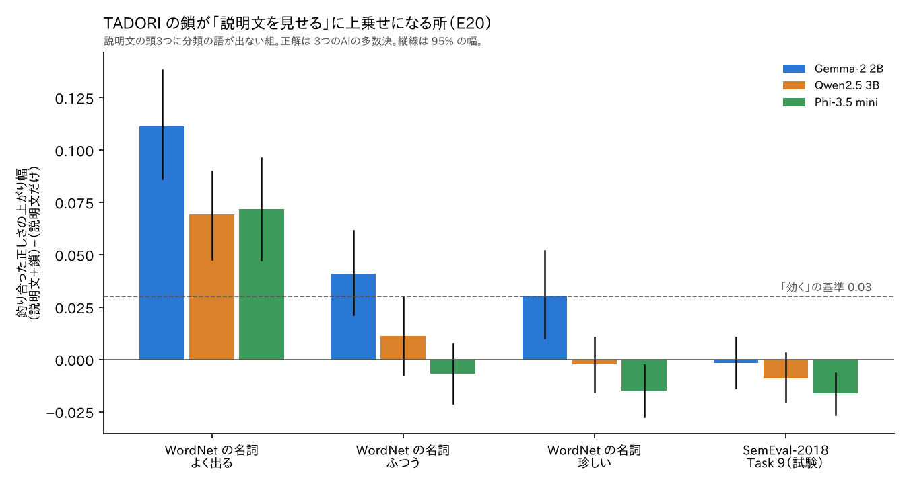

この連載では、小さな言葉のAI（Gemma-2 2B）を「口」として使い、その答えを AI の外に置いた部品で確かめられるかを、1つずつ試してきました。将来はこの「確かめる計算」を p-bit のような物理の部品に任せる、AKANE アーキテクチャという構想の部品の研究です。

前回、E2〜E15 で最後まで残った確かめ方を **TADORI（たどり）** と名付けました。辞書（Wiktionary）の説明文を1段ずつたどり、小さいAIには「途中の語はどの意味か」を選ぶ役目だけをさせ、着いたかの判定は外の NLI に任せる方法です。

ただ、ここまでの TADORI は、小さいAI 1つ（Gemma-2 2B）で、正解もほぼAIが付けた物で確かめていました。今回はそこを広げて確かめます。

1. 正解を**人**が作ったデータでも効くか（E17・E18）
2. 小さいAIがほとんど知らない**珍しい語**で効くか（E19）
3. 辞書の説明文に**答えの語がそのまま書いていない**所で、鎖でたどると良くなるか。**ほかの小さいAI**でも同じか（E20・E20-1）

先に短く、p-bit の揺れで確かめる所を選ぶ試み（E16）がうまくいかなかったことも書きます。最後に、外から見直してもらって足した確かめを書きます。

## これまでの流れ

- E2〜E2-12：AI が作ったルールを確率伝搬（BP）で確かめた。先行研究 BTProp と比べ、元のつながりでは BTProp が上か同着。
https://zenn.dev/mst_design2020/articles/8b904689df2ddc
https://zenn.dev/mst_design2020/articles/bc3e1c916a4baa
- E3〜E5：資料の網・輪の多い大きな網。網は強い学習に勝てず、BP と p-bit 方式の正しさは分かれなかった。
https://zenn.dev/mst_design2020/articles/c1537032d8943c
https://zenn.dev/mst_design2020/articles/545424bd00f46f
- E6〜E8：辞書の説明文で確かめる。途中の語の意味を Gemma に選ばせると、意味の取り違えが72%→10%に減った。
https://zenn.dev/mst_design2020/articles/5d3feab2c2fff8
- E9・E10：網で広げても強い学習に勝てない。部分と全体では答えを書いた文が効いた。
https://zenn.dev/mst_design2020/articles/804eba1639b569
https://zenn.dev/mst_design2020/articles/50e211cbd882af
- E11〜E14：意味選びは3万4千問でも保てた（80.9%）。鎖を深くする・外の文で行き止まりを埋めるは効かなかった。
https://zenn.dev/mst_design2020/articles/8ac3114ae8cf58
- E15：鎖の最後の段を Gemma に判定させると悪くなった。残った形を TADORI と名付けた。
https://zenn.dev/mst_design2020/articles/fc03d9c1a5763b

結論を先に書きます。

- **人の正解に対しては、TADORI は小さいAIより良くならなかった。** 人の点（HyperLex）では順位の合い方が悪くなり（0.832 → 0.795）、人が作った一覧（BLESS）では同着。
- **珍しい語では、辞書を足すと大きく良くなり、大きいAI（Gemma-2 9B）より上になった。** ただし伸びのほとんどは「説明文を見せること」から来ていて、そこに鎖を足す上乗せは同着でした。
- **説明文に分類の語が書いていない組で、よく出る語なら、試した3つの小さいAI全部で、どの正解でも鎖が効いた**（釣り合った正しさで +0.07〜+0.11）。しきい値を別の語で決め直しても残りました。
- **ただし語全体・珍しい語・SemEval-2018 には広がらなかった。** TADORI はどこでも効く方法ではありません。
- 常識での確かめは Claude・ChatGPT・Gemini の3つのAIの判定で、**人の判定ではありません。**

コードと結果は GitHub にあります。
https://github.com/mst-design2020/akane-e2-experiments （README の「E17〜E20」の節と「点検：決めた所と測った所が同じになっていないか」、`plans/E17_*.md`〜`plans/E20-1_*.md`、`analysis/e17/`〜`analysis/e20/`、`data/E19/`・`data/E20/`、`results/E17/`〜`results/E20/`）。Zenodo の全部の版の DOI は 10.5281/zenodo.24045799 です。

## E16：p-bit の揺れで、確かめる所を選べるか（うまくいかなかった記録）

同じことを知らずに試し直さないために、短く残します。

決まりの網（「一種か」の主張どうしのつながり）を p-bit と同じ動き（ギブス）で揺らすと、主張が「矛盾していて揺れる」のか「知らなくて揺れる」のかが読めます。矛盾で揺れる主張から順に TADORI で確かめれば、少ない手間で多く直せるのでは、という案です。

- WordNet の採点では、矛盾の順が木の学習より多く直しました（確かめる数を5%にした時、960 対 792）。
- ところが、2つの順のどちらか一方だけが選んだ1,756主張を、方法を伏せて常識で採点し直すと（Claude）、勝つのは1%の時だけで、2.5%・5%では負けました。WordNet での勝ちは、主に WordNet の狭い正解から来ていました。
- 病気・地理では、どの予算でも他の選び方に負けました。
- 平均の確率から計算しても同じ値が出るので、p-bit でなければできないことでもありません。

ここで「正解表だけで勝ちと言わず、常識で確かめてから言う」を決まりにしました。E17 以降はすべてこの決まりで書いています。

## 比べる3つの答え

小さいAI $m$ に、名詞 $x$ と分類 $y$ について聞きます。どれも次の語の logit（出やすさの値）を読むだけで、文は作らせません。

- **G（説明文なし）**：`Is a "x" a kind of "y"? Answer Yes or No only.` と聞き、$G_m(x,y) = \ell_m(\text{Yes}) - \ell_m(\text{No})$。
- **S（説明文を見せる）**：`Dictionary definitions:` の後に $x$ の Wiktionary の名詞の説明文を最初の3つまで並べてから同じことを聞く。
- **T（TADORI）**：説明文の鎖の点。3段まで、親の語は NLI が選び、途中の語の意味は小さいAI $m$ が選び、着いたかは NLI が決める。

$$T_m(x,y) = \max_{\text{道 } n_0 \to \dots \to n_t} \; q_{n_0} \cdots q_{n_{t-1}} \, a_{n_t}(y), \qquad t \le 3$$

$q_n$ は段ごとの NLI の含意の確率、$a_n(y)$ はその語の説明文から「W is a type of $y$.」が言える確率です。

小さな例で、鎖が何を足すかを書きます。問い「*kitten*（子ねこ）は *mammal*（哺乳類）の一種か」。辞書の *kitten* は「A young cat.」で、mammal という語は書いていません。説明文を見せるだけでは答えは渡りません。TADORI は *cat* に進み（「A small domesticated carnivorous mammal …」）、そこで mammal に着きます。ただし E15 で見た通り、NLI はこの最後の判定で落とすこともあります（cat ⇒ mammal の確率が 0.012 だった例）。鎖はいつも着くわけではありません。

## E17：人の点（HyperLex）

HyperLex（Vulić ほか 2017）には、名詞 2,163組に「X はどのくらい Y の一種か」を人が 0〜6 で付けた平均点があります。物差しは人の点とのスピアマンの順位の合い方 $\rho$ です。

| 方法（2,163組） | $\rho$ |
|---|---|
| 2B（$G_2$） | 0.832 |
| 9B（$G_9$、参考） | 0.852 |
| TADORI（$T$） | 0.782 |
| TADORI、見出しが無い語は 2B（$H$） | 0.795 |

- $H - G_2 = -0.037$（95%の幅 $-0.054$〜$-0.021$）。**悪くなりました。**
- 学習に TADORI の点を足しても同着（+0.014、幅 $-0.007$〜$+0.034$）。
- 結果の後の見方：TADORI は 0/1 に近い点を出します。人が真ん中くらい（約2点）を付けた「部分」「逆向き」「同じ仲間」の組を下げる一方で、本当の一種（4.8〜5.2点）も下げてしまい、段階のある人の点の順位には合いにくいようです。

## E18：間違った「はい」を止められるか（BLESS）

E17 を見ると、2B は部分・逆向き・仲間に「はい」と言っているように見えました。TADORI の**拒否権**（2B が「はい」でも、鎖が着かなければ「いいえ」）で止められるかを、BLESS（Baroni・Lenci 2011、Shwartz ほか 2017 の固定版）で試しました。しきい値は HyperLex で決め、BLESS では決めていません。

| 方法 | 釣り合った正しさ（BLESS） |
|---|---|
| 2B（$G_2$） | 0.902 |
| 逆向きも聞く | 0.903 |
| 2B＋TADORI の拒否権 | 0.910 |
| 9B（$G_9$） | 0.958 |

- 拒否権の上乗せは +0.009（幅 $-0.002$〜$+0.019$）で**同着**です（基準は 0.03）。
- しきい値をきちんと決めると、2B だけでも部分・逆向き・仲間・無関係への「はい」は 0.5〜3% しかありませんでした。E17 で「はい」が多く見えたのは、logit を 0 で切っていたためです。

## E19：珍しい語

Mallen ほか（2023）は、珍しい物ほど外の資料が効くと報告しています。2B がほとんど知らない語で TADORI は効くか、を試しました。

**データ。** WordNet の名詞を、wordfreq の Zipf 値で3段に分けました（**よく出る** ≥ 3.0、**中** 1.5〜3.0、**珍しい** < 1.5）。各段 200語 × 46分類 ＝ 27,600組です。

**決まり。** 主の比べは珍しい段で、2B が「いいえ」でも鎖が着けば「はい」とする

$$\mathrm{TO} = [\,G_2 > \theta\,] \;\vee\; [\,T \ge \tau\,]$$

です。物差しは釣り合った正しさ

$$\mathrm{BA} = \tfrac12\,\Pr(\text{はい}\mid\text{一種}) + \tfrac12\,\Pr(\text{いいえ}\mid\text{一種でない})$$

で、「一種」と「一種でない」を同じ重さで数えます（一種の組が少ないので、全部「いいえ」でも高く出る普通の正しさは使いません）。しきい値は「よく出る」段だけで決めました。差が 0.03 以上で、語ごとに2,000回引き直した95%の幅が0より上なら「効く」としました。

| 方法 | よく出る | 中 | 珍しい |
|---|---|---|---|
| $G_2$ 2B | 0.771 | 0.818 | 0.795 |
| $G_9$ 9B | 0.782 | 0.817 | 0.845 |
| S 説明文を見せる | 0.790 | 0.839 | 0.902 |
| TO 2B または TADORI | 0.867 | 0.892 | 0.921 |

（WordNet の正解。珍しい段は常識の判定でもほぼ同じ値です。）

珍しい段で、比べる方法の答えが分かれた組を、方法を伏せて3つのAIに判定させ、それぞれを正解にして測り直しました。

| 珍しい段 | Claude | ChatGPT | Gemini | 多数決 |
|---|---|---|---|---|
| TO − $G_2$ | +0.114 効く | +0.065 効く | +0.132 効く | +0.103 効く |
| TO − S | +0.011 同着 | −0.001 同着 | +0.038 効く | +0.005 同着 |
| TO − $G_9$ | +0.059 上 | +0.034 上 | +0.062 上 | +0.052 上 |

- **珍しい語では、2B に辞書を足すと大きく良くなり、9B より上になりました**（WordNet と4通りのAIの判定のどれでも）。
- ただし**伸びのほとんどは説明文を見せることから**来ています。S だけで 2B より約 +0.10 で、S に鎖を足す上乗せは同着です。
- 説明文に分類の名前がそのまま書いてある組は一種の組の14〜16%で、それを除いても結果は残りました。
- 一方、分類の語が書いていない一種の組では、よく出る語で鎖が S よりずっと多く「はい」と言えていました（S 0.65 → TO 0.84）。これが E20 のきっかけです。

## E20：分類の語が書いていない所、3つの小さいAI、SemEval

E19 からは「説明文に分類の語が書いていない所で、鎖が効く」と見えました。これは結果を見てからの見方なので、E20 では決まりを先に固定して、新しい語で確かめました。

- **組。** 最初の3つの説明文に $y$ が語として出ない（-s・-es も）一種の組と、一種でない組すべて。
- **語。** E19 と同じ作りで、E19 の語を除いた新しい 600語（27,600組）。
- **小さいAI。** Gemma-2 2B、Qwen2.5-3B、Phi-3.5-mini。途中の語の意味は、それぞれのAIが自分で選びます。
- **人が作った公開の正解。** SemEval-2018 Task 9（Camacho-Collados ほか 2018）の英語 1A のテスト。もとは上位語を順に並べる課題ですが、ここでは「はい・いいえ」の組に作り替えて使いました（「いいえ」は他の語の正解の上位語から）。語を半分に分け、半分でしきい値を決め、残り半分で測りました。

比べるのは「説明文を見せる」と、それに鎖を足した物です。

$$\mathrm{SO} = [\,S > \theta\,] \vee [\,T \ge \tau\,]$$

決まり：AIごとに SO − S が 0.03 以上で幅が0より上なら「効く」。3つのうち2つ以上で効けば「鎖は説明文1段で届かない所に効く」と言う、と流す前に決めました。

**結果**（3つのAIのうち「効く」の数）：

| | 正解表 | Claude | ChatGPT | Gemini | 多数決 |
|---|---|---|---|---|---|
| 語全体 | 1/3 | 1/3 | 1/3 | 2/3 | 1/3 |
| よく出る語 | 3/3 | 3/3 | 3/3 | 3/3 | 3/3 |
| 珍しい語 | 0/3 | 0/3 | 1/3 | 1/3 | 1/3 |
| SemEval | 0/3 | 0/3 | 0/3 | 0/3 | 0/3 |

多数決を正解にした時の SO − S：

| | Gemma-2 2B | Qwen2.5 3B | Phi-3.5 mini |
|---|---|---|---|
| 語全体 | **+0.062** | +0.027 | +0.019 |
| よく出る | **+0.111** | **+0.069** | **+0.072** |
| 中 | **+0.041** | +0.011 | −0.007 |
| 珍しい | **+0.030** | −0.002 | −0.015 |
| SemEval | −0.002 | −0.009 | −0.016 |

太字は決まりを満たした所です。



- **よく出る語では、3つの小さいAI全部、どの正解でも鎖が効きました。**
- **語全体では言えません。** 決まりを満たしたのは Gemma だけでした（Gemini の判定では 2/3）。Qwen・Phi も伸びますが、0.03 に届きません。
- **珍しい語・SemEval では言えません。** Phi は少し悪くなる所もあります。E19 で見えた「珍しい語で効く」は、語を入れ替えると繰り返せませんでした。
- 説明文を見せた SO は、3つの小さいAI全部で、説明文なしの 9B より上でした（語全体で +0.07〜+0.09）。SemEval では同着です。
- 判定の一致：正解表と Claude 0.898・ChatGPT 0.842・Gemini 0.852・多数決 0.894。人ではなくAIの判定です。

## E20-1：学習で合わせても同じ、珍しい語で上乗せが小さい理由

AI は流し直さず、E20 の値だけで2つ確かめました（CPU だけ）。

**学習で合わせる。** 「または」の代わりに、$[S,\ \log(T+10^{-4})]$ の2つの特徴のロジスティック回帰で合わせました。どの正解でも、SO との差は −0.008〜+0.007 で同着です。「または」の簡単な決まりで、学習と同じだけ取れていました。

**数える。** 多数決で「一種」とされた組で、鎖が届いた割合と、説明文だけで当たる割合を数えました。

| 段 | 鎖が届いた | 道がまったく着かない | 説明文だけで当たる（Gemma / Qwen / Phi） |
|---|---|---|---|
| よく出る | 83〜88% | 11〜12% | 12% / 59% / 59% |
| 中 | 84〜86% | 13% | 28% / 76% / 76% |
| 珍しい | 85〜88% | 11% | 52% / 85% / 87% |

- 鎖が届く割合はどの段でも同じです。**珍しい語で鎖が切れているわけではありません。**
- 違うのは、**珍しい語は説明文が具体的で、それだけで当たる**ことです。鎖が足せる所が少ないのです。
- 残る穴の多くは「道がまったく着かない」約11%で、E14 で外の文を足して埋めようとして、雑音で悪くなった行き止まりと同じ所でした。TADORI のこの形で、さらに伸ばせる余地は小さいと見ています。

## 外から見直してもらって足した確かめ

GitHub の README を ChatGPT と Gemini に読ませ、直した方がよい所を聞きました。いちばん大事だった指摘は「しきい値を決めた語で、そのまま結果も測っていないか」です。E19・E20 は、しきい値を「よく出る」段で決め、その同じ段の結果も出していました。主の珍しい段は別の語ですが、よく出る語の数字は甘く出ている恐れがあります。

そこで、よく出る語を半分に分け（くじ5通り）、半分でしきい値を決め、残り半分で測り直しました（各5通りの正解 × 5通りのくじ ＝ 25回）。

| 確かめ | 差の範囲 | 決まりを満たした回数 |
|---|---|---|
| E20 SO − S（Gemma / Qwen / Phi） | +0.08〜+0.12 / +0.03〜+0.09 / +0.04〜+0.09 | 25 / 23 / 25 回 |
| E19 TO − $G_2$ | +0.03〜+0.13 | 24 回 |
| E19 TO − $G_9$ | +0.04〜+0.13 | 25 回 |
| E19 TO − S | +0.03〜+0.12 | 25 回 |

結果は残りました。Qwen は伸びが少し縮みます。

あわせて、E2 からのすべての実験で「設定を決めた所」と「結果を測った所」が同じになっていないかを点検しました。当てはまったのは E19 と E20 の2か所だけで、上の通り測り直しました。ほかは決める所と測る所が分かれているか、何も決めていませんでした。表は README の「点検：決めた所と測った所が同じになっていないか」にあります。

ほかに直した所：

- 初めての方向けの3行の説明と、ここで使う言葉の表を README に足しました。
- 判定の指示文をそのまま載せ、各実験の流した条件（GPU、数の精度、Yes/No の語の取り方など）を書きました。
- 「判定は人ではなくAI」「SemEval は はい・いいえ の組に作り替えた」「3つ目のAIは計画の Llama の許可が出ず Phi に替えた」を、結果の近くに書き直しました。

## 言えないこと

- 正解は WordNet と、3つのAI（Claude・ChatGPT・Gemini）の判定です。人の判定ではありません。AIどうしの一致は 0.83〜0.92 で、判定する組は「比べる方法の答えが分かれた組」だけです。
- 小さいAIは 2B〜4B 級の3つ、英語、問いは「一種か」だけです。
- E17 で人の点に合わなかったのは、0/1 に近い鎖の点を順位で比べたからかもしれません。人の判断そのものに弱いとまでは言えません。
- SemEval は元の課題（上位語を並べる）ではなく、はい・いいえに作り替えた形で測っています。元の課題の成績とは比べられません。

## このあと

TADORI がどこで効き、どこで効かないかは、ここでおおむね見えました。効くのは「説明文に答えがそのまま書いていない、よく出る語」で、珍しい語は説明文を見せるだけでほぼ足ります。次は、ここまでを note にもまとめ、そのあとの方向を考えます。

## 再現

```
cd analysis/e19 && python judge_combine.py && python e19_holdout.py   # E19、3つのAIの判定、別の語での確かめ
cd ../e20 && python judge_combine.py && python e201_analyze.py        # E20 と E20-1
python e20_holdout.py                                                 # E20 の別の語での確かめ
python fig_e20.py                                                     # 図
```

どれも CPU で数秒〜1分です（`numpy scipy scikit-learn matplotlib`）。公開したファイルから流すと、保存した出力とぴったり同じになります。E17・E18 は HyperLex・BLESS の組をここで配らないため、まとめの値だけを載せ、分析のプログラムはノートの出力に対して動くようにしてあります。

## 参考文献

- Vulić・Gerz・Kiela・Hill・Korhonen "HyperLex: A Large-Scale Evaluation of Graded Lexical Entailment", Computational Linguistics 2017. https://arxiv.org/abs/1608.02117
- Baroni・Lenci "How we BLESSed distributional semantic evaluation", GEMS 2011. https://aclanthology.org/W11-2501/
- Shwartz・Santus・Schlechtweg "Hypernyms under Siege: Linguistically-motivated Artillery for Hypernymy Detection", EACL 2017. https://arxiv.org/abs/1612.04460
- Camacho-Collados ほか "SemEval-2018 Task 9: Hypernym Discovery", SemEval 2018. https://aclanthology.org/S18-1115/
- Mallen ほか "When Not to Trust Language Models: Investigating Effectiveness of Parametric and Non-Parametric Memories", ACL 2023. https://arxiv.org/abs/2212.10511
- Yin・Roth "Term Definitions Help Hypernymy Detection", *SEM 2018. https://arxiv.org/abs/1806.04532
- Moskvoretskii ほか "TaxoLLaMA: WordNet-based Model for Solving Multiple Lexical Semantic Tasks", ACL 2024. https://arxiv.org/abs/2403.09207
- Yin・Hay・Roth "Benchmarking Zero-shot Text Classification: Datasets, Evaluation and Entailment Approach", EMNLP 2019. https://arxiv.org/abs/1909.00161
- Wolpert "Stacked Generalization", Neural Networks 1992.
- Ciravegna ほか "Knowledge-driven Active Learning", ECML PKDD 2023.
- Speer "wordfreq". https://github.com/rspeer/wordfreq
- Gemma Team "Gemma 2: Improving Open Language Models at a Practical Size", 2024. https://arxiv.org/abs/2408.00118
- Qwen Team "Qwen2.5 Technical Report", 2024. https://arxiv.org/abs/2412.15115
- Abdin ほか "Phi-3 Technical Report", 2024. https://arxiv.org/abs/2404.14219
- Laurer ほか DeBERTa-v3-large-mnli-fever-anli-ling-wanli. https://huggingface.co/MoritzLaurer/DeBERTa-v3-large-mnli-fever-anli-ling-wanli
